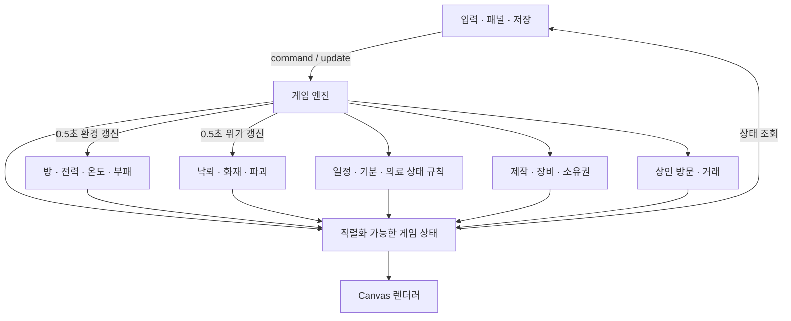

# Frontier Colony 4.0 — 구현 구조

## 모듈 관계



`engine.js`, `colony-systems.js`, `hazards.js`, `colonist-life.js`, `industry.js`, `trade.js`는 DOM, 네트워크, 외부 시계를 사용하지 않는다. 렌더러는 게임 규칙을 변경하지 않는다. 앱만 RAF·사용자 입력·자동 저장을 소유한다.

## 시간과 재현성

- 엔진은 `0.1`초 고정 단계, 환경은 `0.5`초 주기로 갱신한다.
- 앱은 현실 프레임 시간을 제한하고 선택 배속을 적용한다. 숨김 탭에서는 진행하지 않는다.
- 하루는 120 시뮬레이션 초이며 08:00에 시작한다. 80초 경과 시 2일 00:00이다.
- 난수 상태, 고정 단계의 잔여 시간, 예약, 작업 단계, 이동 경로, 음식 신선도, 연구 점수, 방 온도, 배터리 충전량, 환자 운반·침상 예약, 일정·여가, 화력·연료·낙뢰 시각은 저장에 포함된다.
- 상인 이동·재고·방문 시각·제작 재료·장비 슬롯도 저장한다. 방문 계산은 기존 엔진 RNG를 소비하지 않으며, 저장 복원이나 UI 조회가 난수 순서를 바꾸지 않는다.
- 복원 시 임의로 새 지도 생성·시간 진행·난수 소비·파생 상태 갱신을 하지 않아 중간 상태를 정확히 보존한다.

## 공개 엔진 API

```js
import { ColonyGame, BUILDINGS, RESEARCH, JOB_LABELS } from './dist/engine.js';

const game = new ColonyGame({ seed: 314159, difficulty: 'standard' });
game.command('build', { kind: 'bed', x: 25, y: 13 });
game.update(0.1);
const summary = game.getSummary();
const objectives = game.getObjectives();
const equipment = game.getEquipmentStats(game.state.colonists[0]);
const clone = ColonyGame.fromJSON(game.toJSON());
```

| 명령 | 주요 인자 | 의미 |
| --- | --- | --- |
| `designate` | `x,y,kind` | `gather/chop/mine/harvest` 자원 지정 |
| `zone` | `x,y,kind` | `farm/stockpile` 구역 지정 |
| `build` | `x,y,kind` | 연구·자원·접근 조건 검사 후 청사진과 자재 예약 |
| `cancel` | `x,y` | 청사진·구역·지정 취소. 청사진 환불은 1회 |
| `demolish` | `x,y` | 완성 건물 철거, 일부 재료 바닥 반환 |
| `priority` | `id,work,value` | 우선순위 0~4 변경 |
| `prioritize` | `id,x,y` | 주민에게 즉시 수행할 지정 작업·수리·진화 지시 |
| `draft` | `id,value` | 징집·일상 복귀, 예약과 운반 정리 |
| `move` | `id,x,y` | 징집 주민 이동 |
| `moveGroup` | `ids,x,y` | 중복 없는 인접 도착 위치 배정, 부분 성공 보고 |
| `attack` | `id,targetId` | 지정 적 접근·사격 |
| `hold` | `id` | 징집 주민의 경로를 지우고 현재 위치 사수 |
| `medicalBed` | `x,y,value` | 완성 침대의 의료 용도 전환 |
| `rescue` | `id,targetId` | 환자와 침상을 검사하고 구조·운반 작업 배정 |
| `tend` | `id,targetId` | 약품 치료 또는 응급 처치를 우선 배정 |
| `schedule` | `id,hour,mode` | 주민의 한 시간칸 일정 변경 |
| `schedulePreset` | `id,preset` | 균형·야간·자율 하루 일정 적용 |
| `research` | `id` | 연구 선택. 작업으로만 점수 증가 |
| `autoCook` | `value,target?` | 자동 조리와 목표 식사 설정 |
| `bill` | `recipeId,mode,target,paused` | 제작 횟수 또는 보유량 유지. 설정 변경 시 해당 작업 재료를 반환 |
| `equip` | `id,item` | 창고에서 실제 제품을 수령해 장착 |
| `unequip` | `id,slot` | 장비를 해제해 발밑에 내려놓음 |
| `trade` | `traderId,side,type,count` | 현재 상인의 재고·자금·접근을 검증하고 구매·판매 |
| `autoRepair` | `value` | 손상 건물 자동 수리 설정 |
| `raid` | 없음 | 테스트·명시적 도전용 즉시 습격. 기본 UI에는 노출하지 않음 |
| `ignite` | `x,y,strength?` | 시나리오 검증용 점화. 기본 UI에는 노출하지 않음 |

모든 명령은 `{ok,message}`를 반환한다. 잘못된 명령은 가능한 한 변경 전에 거절한다. 그룹 이동은 개별 주민의 가능 여부를 판정하고 적용 인원을 알려 준다.

## 좌표와 작업

타일·바닥 물품·경로 노드는 정수 셀 좌표다. 렌더 중심은 `x+0.5,y+0.5`다. 주민·적·효과의 좌표는 이미 중심을 나타내는 실수이므로 오프셋을 다시 더하지 않는다.

작업은 후보 선정 → 접근 가능성 → 예약 → 이동 → 준비·운반·작업 → 완료 순서로 진행한다. 필요에 따라 `fetch`, `pickup`, `deliver`, `work`, `eat` 단계를 사용한다. 실패·취소·징집·사망은 작업과 예약을 정리한다. 바닥 물품, 운반 중 물품, 창고 재고를 동시에 중복 계상하지 않는다.

완성된 벽은 길을 막고 문은 주민이 통과한다. 경로는 네 방향 BFS이며, 경로가 바뀌면 재계획한다. 비징집 주민은 화재를 피하는 경로를 우선 검색하고, 안전 경로가 없을 때 일반 경로를 검사한다. 기존 경로 앞에 새 불이 생기면 재검사를 제한된 주기로 수행한다. 다른 주민과의 강체 충돌은 모델링하지 않는다.

## 환경 상태

| 데이터 | 내용 |
| --- | --- |
| `state.rooms` | 밀폐된 방의 ID·셀 목록·면적·온도·침대·창고 칸 수 |
| `tile.roomId/roofed/temperature` | 타일의 파생 공간·열 상태 |
| `state.power` | 전체 발전·수요·실제 공급·저장·용량과 개별 연결망 |
| `building.powered/networkId/charge` | 작동·연결 상태, 축전지의 W·s |
| `state.foodBatches` | 창고 식재료·식사 배치의 수량·신선도·입고 좌표 |
| `item.freshness/carry.freshness` | 바닥·운반 중 음식의 잔여 보존 정도 |
| `colonist.ambientTemperature/sheltered/thermalStress` | 주민 위치의 환경 영향 |
| `state.research` | 선택 연구, 점수, 해금 목록 |
| `state.extractionAlarmTriggered` | 최종 구조 습격이 이미 시작됐는지 |
| `tile.fire/fireFuel/burned` | 화력·잔여 연료·탄 흔적 |
| `state.hazards` | 낙뢰·번짐 시계, 화재와 소방 통계 |
| `building.medical` | 의료 침상 용도 |
| `colonist.carryingPawnId/carriedBy/patientBedId` | 환자 운반의 양방향 참조와 침상 예약 |
| `colonist.schedule/recreation/lastScheduleHour` | 24시간 일정·여가·일정 판단 시각 |
| `state.careStats` | 완료한 구조·치료·급식 횟수 |
| `state.industry` | 레시피별 주문과 누적 완성 수 |
| `colonist.equipment` | 무기·조끼·도구 슬롯 |
| `colonist.job.materials` | 진행 중 제작대에 전달된 실제 입력 재료 |
| `state.trade` | 방문 예정·현재 상인·이동 단계·재고·은화·교역 통계 |

전력 연결은 도체의 상하좌우 연결 성분을 찾고 소비기를 3칸 이내 가장 가까운 도체에 붙인다. 소비기는 도체 역할을 하지 않는다. 저장량은 발전과 실제 공급의 차이에 시간 간격을 곱해 변경한다. 남은 배터리로 한 단계 전체 전력을 제공할 수 없는 소비기는 꺼진다.

방 판정은 완성된 벽·문을 경계로 flood fill한다. 바깥 경계·물과 접하거나 120칸을 초과하는 영역은 자동 지붕 대상이 아니다. 방의 형태가 바뀌어도 기존 타일 온도를 이어받아 재봉쇄로 무료 냉각을 얻지 못하게 한다.

## 음식 재고 보존

정상 음식 입출고는 `depositStock`와 `withdrawStock`를 사용한다. 배치 수량 합은 상단의 해당 자원 수량과 일치해야 한다. 오래된 음식부터 소비하고 운반·중단·재입고 중 신선도를 보존한다. 건설 자재는 선예약 방식이며 창고 음식 장부와 별개다.

환경 업데이트는 배치 위치, 바닥 물품 위치, 운반자 현재 위치에 따라 부패를 적용한다. 부패한 운반물이나 예약 물품은 작업을 해제하고 실제 수량에서 제거한다. 시나리오·격리 테스트의 직접 재고 편집은 명시적으로 보정하지만, 저장 가져오기 단계에서는 장부 불일치를 거절한다.

## 의료·화재와 기존 작업의 연결

환자는 자원 운반의 `carry`와 분리된 참조로 운반한다. `patient:<id>` 작업 예약과 진행 중 구조 작업의 `bedId`, 환자의 `patientBedId`를 함께 확인해 이중 구조와 침상 중복을 막는다. 이동 후 환자 좌표를 운반자 좌표에 맞춘다.

`_releaseJob`은 물품과 환자를 올바르게 내려놓는다. `_downPawn`은 쓰러진 주민의 징집·명령·작업을 정리한다. `_onBuildingDestroyed`는 침상과 연결 작업을 정리하며 화재·철거·습격 파괴에서 같은 경로를 사용한다.

환경 계산은 기존 불의 열을 반영한다. 이어 화재 계산이 연료와 강도를 갱신하고 피해·확산·파괴를 처리한다. 건물 파괴 후 방과 전력망을 다시 계산한다. 불타는 칸에는 건설 계획을 놓을 수 없어 청사진 예외 처리로 무료 진화를 만들지 않는다. 화재에 의한 파괴는 철거 자재를 지급하지 않는다.

위기 판단은 주민의 긴급한 생존 욕구, 응급 간호, 구조와 소방, 일정, 일반 작업을 함께 사용한다. 일정 전환·긴급 작업에 의한 중단도 기존 예약과 운반 정리 함수를 거친다. 기분 패널은 `getMoodFactors`가 제공하는 실제 계산 항목을 표시한다.

## 제작·장비·거래 경계

`economy-data.js`는 불변 상수만 제공한다. `industry.js`는 제작 수요·업무 계획·재료 이동·장비 이동·소유량과 저장 검증을 담당하고, 엔진은 기존 작업 선택·이동·예약·중단 경로에서 이를 호출한다. 제작 입력은 명령 시 선결제하지 않고 창고 수령 시 차감한다. 작업대 전달 자재와 운반물을 다른 저장 위치로 세며, 완료·중단 시 각각 한 번만 정리한다.

장비 효과는 슬롯에서 계산하며 원래 기술 수치를 영구 수정하지 않는다. 따라서 반복 장착이나 복원으로 배율이 중첩되지 않는다. 사망 시 장비가 바닥으로 이동하고 슬롯을 비운다.

`trade.js`는 방문자의 이동·체류·퇴장과 원자적 거래를 소유한다. 거래 직전에 현재 방문 ID, 단계, 수량, 은화·재고, 안전한 배송 칸과 실제 접근 가능성을 확인한다. 판매 가능한 수량은 창고 재고만이다. 구매품과 판매 대금은 상인 위치의 바닥 물품으로 생성하고 기존 운반 경로를 사용한다. 음식은 매입하지 않아 신선도 세탁을 차단한다.

기본 은화는 새 게임에만 60개다. 이전 저장에는 0개를 추가한다. 상인은 엔진 RNG를 소비하지 않아 방문 이벤트가 기존 사격·날씨·화재 난수의 순서를 바꾸지 않는다. 상세 규칙은 [제작](docs/crafting_production.md), [장비](docs/equipment_combat.md), [교역](docs/trade_economy.md)에 분리했다.

## 저장과 호환

브라우저 파일 래퍼는 `format:frontier-colony-save`, `version:1`, `savedAt`, `game`을 유지한다. `game.version`은 4이다.

`fromJSON`은 입력을 검증한 뒤 복사한다. v1은 기존 지도·작업·재고를 보존하고 환경·연구·추가 능력 기본값을 채운다. 기존 신호기와 승리는 진행을 승계한다. v2도 지도·기존 작업을 유지하며 새 의료·일정·여가·화재 기본값을 추가한다. v1·v2 주민의 일정은 자율 모드다. v3도 기존 파생 상태·작업·의료·화재 정보를 보존하며 새 제작·장비·교역 기본값만 추가한다. 새 자원은 0, 장비 슬롯은 null, 제작 목표는 0이다. v4는 저장 시점의 제작 재료·장비·방문 상태까지 그대로 복원한다. 저장 파일은 실행 코드로 사용하지 않는다.

## 검증 설계

- `engine.test.mjs`: 실제 작업, 소비·환불·예약·연구·수리·명령·저장 불변조건.
- `systems.test.mjs`: 방의 경계, 전력의 단절과 소진, 열 변화, 부패와 냉장 보존.
- `progression.test.mjs`: UI 기본 시드·표준 난도에서 공개 명령만으로 생존과 구조 성공.
- `care.test.mjs`, `life.test.mjs`, `hazards.test.mjs`: 구조·간호·여가·일정·방향 엄폐·화재의 상태 전이와 보존 조건.
- `migration-v3.test.mjs`: 실제 v1·v2 저장 이관과 잘못된 v3 참조 거절.
- `crisis-scenario.test.mjs`: 공개 명령으로 화재 부상·구조·치료·진화·여가를 연결하는 위기 복구 시나리오.
- `industry.test.mjs`, `equipment.test.mjs`, `trade.test.mjs`: 물리 제작·장착·실제 효과·방문·원자적 거래·물품 보존.
- `migration-v4.test.mjs`: genuine v3 이관, 미래 필드 주입 차단, 제작·장비·상인의 잘못된 참조 거절.
- `economy-scenario.test.mjs`: 기본 맵에서 공개 명령만으로 제작·판매·대금 운반·구매·장착 연결.
- `ui.test.mjs`, `ui-harness.mjs`: 실제 app.js의 패널·버튼·수량 입력·저장·위기 정지 이벤트. 실제 브라우저 시각 검증과 구분한다.
- `tests/fixtures/v1-colony.json`, `v2-colony.json`, `v3-colony.json`: 각 이전 배포에서 생성한 실제 중간 저장. 변경하지 않는다.

격리 테스트는 인과관계를 분리하기 위한 합성 맵을 사용한다. 완주 테스트는 자원·지도·능력치·적·시계를 직접 변경하지 않는다. 두 종류를 함께 사용해 각 시스템의 불변조건과 전체 진행의 도달 가능성을 확인한다.

최종 v4 수용 결과는 88/88 통과이며 상세 조건과 한계는 [검증 보고서](docs/verification_v4.md)에 기록했다.
