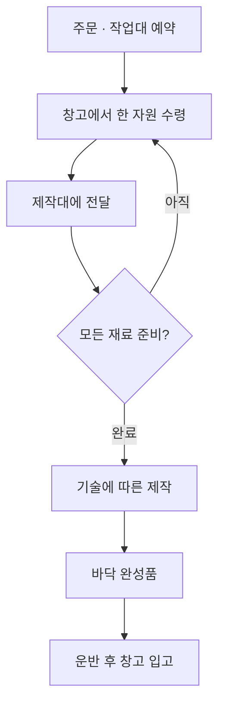

# 제작과 생산 주문

## 목적

채집한 강철·목재를 방어와 생산에 도움이 되는 장비로 바꾸는 선택을 제공한다. 제작대 건설, 담당자의 작업 시간, 재료 운반, 완성품 운반이 모두 필요하다. 제작한 물품을 직접 장착하거나 상인에게 팔 수 있다.

이 문서의 수치와 규칙은 `변방의 기록`의 독자적인 구현 기준이다.

## 시설과 작업자

| 항목 | 규칙 |
| --- | --- |
| 제작대 | 목재 20, 강철 8, 건설 작업량 10, 내구도 120 |
| 연구·전력 | 필요 없음 |
| 동시 작업 | 제작대 한 곳에 한 명. 여러 제작대는 병렬 작업 가능 |
| 업무 | `craft`, UI 이름 제작, 우선순위 0~4 |
| 기본 기술 | 서윤 10, 도현 7, 미나 6 |
| 기본 우선순위 | 세 주민 모두 3 |
| 작업 도구 | 장착한 제작자의 실제 제작 진행량 ×1.25 |

완성된 제작대에 접근할 수 있고, 불이 나지 않았으며, 주문과 재료가 준비되어 있어야 작업을 시작한다. 주민의 생존 욕구·일정·긴급 대응은 기존 작업 규칙을 따른다.

## 제작법

| 제품 | 목재 | 강철 | 기본 작업량 | 개당 산출 |
| --- | ---: | ---: | ---: | ---: |
| 작업 도구 | 4 | 8 | 10 | 1 |
| 방탄 조끼 | 0 | 16 | 15 | 1 |
| 개량 소총 | 8 | 18 | 18 | 1 |

공용 데이터는 `dist/economy-data.js`의 `RECIPES`에 정의한다. UI와 엔진은 같은 정의를 사용한다. 기본 작업량과 실제 경과 시간은 다르며, 기술·장비·이동·중단에 따라 완료 시각이 달라진다.

## 주문 모델

레시피마다 정착지 전체가 공유하는 주문 하나를 둔다.

```js
state.industry = {
  bills: {
    tool:  { mode: 'count', target: 0, paused: false },
    armor: { mode: 'count', target: 0, paused: false },
    rifle: { mode: 'count', target: 0, paused: false }
  },
  crafted: { tool: 0, armor: 0, rifle: 0 }
};

game.command('bill', {
  recipeId: 'tool', mode: 'maintain', target: 3, paused: false
});
```

`count`는 앞으로 완성할 남은 개수다. 한 개를 완성하면 목표를 1 감소한다. 이미 제작에 들어간 작업 수를 먼저 세므로 작업대가 여러 개여도 남은 개수를 초과해 시작하지 않는다.

`maintain`은 창고 수량, 바닥 물품, 일반 운반 중 제품, 주민이 장착한 제품의 합을 목표와 비교한다. 진행 중인 제작 산출 예정량도 시작 여부를 판단할 때 포함한다. 장비를 창고에서 꺼내 장착하거나 바닥에 내려놓았다는 이유만으로 추가 생산하지 않는다. 판매해 소유량이 감소하면 다시 생산할 수 있다.

목표는 0~99 정수다. 0은 추가 제작이 필요 없다는 뜻이다. 일시정지는 주문 값을 남긴 채 작업을 멈춘다. 주문 해제 UI는 목표를 0으로 돌린다. 유효하지 않은 변경은 기존 작업과 물품을 변경하지 않는다. 같은 값을 다시 제출하면 진행 중 작업을 취소하지 않는다.

## 실제 자재 흐름



주문을 클릭할 때 자재를 선결제하지 않는다. 창고에 도착한 주민이 한 종류씩 최대 12개를 수령하며, 그 시점에 재고를 다시 확인한다. 받은 물품은 `colonist.carry`에 들어간다. 제작대까지 운반한 재료는 진행 중 제작 작업의 자재 기록으로 옮겨진다.

모든 재료가 전달되면 제작을 진행한다. 완료 시 투입 자재를 소비하고 작업대 위치에 완성품을 생성한다. 창고의 제품 수량이 즉시 증가하지 않는다. 운반 작업으로 입고해야 장비 지급이나 판매에 쓸 수 있다.

## 중단과 자원 보존

징집, 일정 전환, 긴급 대응, 주문 변경, 제작대 파괴, 주민 사망은 진행 중 작업을 정리한다. 주민이 들고 있는 재료는 현재 위치에 내려놓고, 제작대에 전달한 재료는 제작대 위치에 반환한다. 아직 수령하지 않은 창고 재료는 건드리지 않는다. 제작 진행도는 초기화된다.

반환한 물품은 다시 운반해야 재사용할 수 있다. 취소를 반복해도 물품 수가 늘어나지 않아야 하며, 완성된 제품을 만든 뒤 원재료까지 반환해서는 안 된다.

## 플레이 화면

**제작** 탭 또는 `I` 키로 연다. 제작대 건설, 제작 담당 배치, 레시피별 생산 방식·목표량·일시정지·해제를 제공한다. 재료 비용, 창고·바닥/운반·장착 수량, 작업자의 실제 진행 상태를 함께 표시한다. 제작 담당 배치는 가능한 비징집 주민 중 제작 기술이 높은 주민의 제작 우선순위를 1로 변경한다.

## 범위

제작대별 개별 주문 목록, 제품 품질, 내구도, 미완성품 저장은 구현하지 않는다. 중단한 제작의 시간은 보존하지 않으며 재료는 보존한다. 완성품은 같은 종류끼리 합칠 수 있는 수량형 물품이다.
