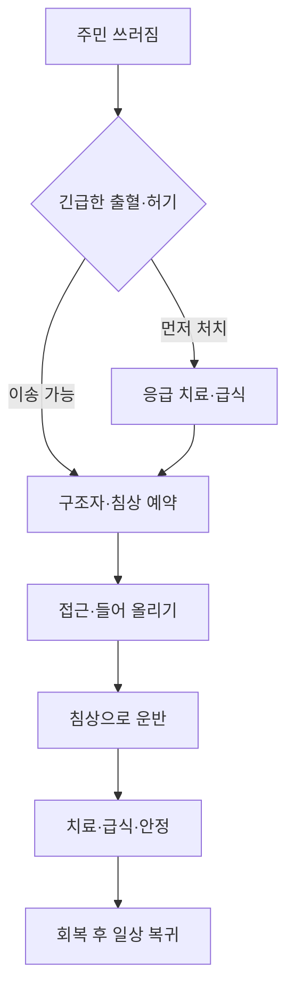

# 의료·구조·환자 급식 — v3 구현 명세

이 문서는 `dist/engine.js`, `dist/colonist-life.js`에 구현한 실제 규칙을 설명한다. 수치와 상태 전이는 이 게임의 플레이를 위해 조정했다.

## 목적

전투·출혈·허기·화재로 행동할 수 없게 된 주민을 동료가 돌보고, 정착지의 일상으로 복귀시키는 순환을 만든다. 구조 버튼은 작업을 배정한다. 위치나 체력을 즉시 변경하지 않는다.



## 상태와 명령

| 항목 | 의미 |
| --- | --- |
| 건강 15 미만 | 쓰러짐. 이동·일상 작업·전투를 수행할 수 없다. |
| `building.medical` | 완성된 침대의 의료 용도 설정. |
| `carryingPawnId` | 이 주민이 운반 중인 환자 ID. 물품 `carry`와 분리한다. |
| `carriedBy` | 이 환자를 운반 중인 주민 ID. 양방향 참조가 일치해야 한다. |
| `patientBedId` | 배정된 환자 침상. 운반 중에도 목적지 예약을 유지한다. |
| `careStats` | 완료한 구조·치료·급식 횟수. |

```js
game.command('medicalBed', {x:21, y:13, value:true});
game.command('rescue', {id:rescuerId, targetId:patientId});
game.command('tend', {id:doctorId, targetId:patientId});
```

수동 지시도 경로, 주민 상태, 대상 예약과 침상 가능 여부를 검사한다. 실패한 지시로 기존 작업을 임의로 취소하지 않는다. 자동 구조는 `rescue`, 자동 치료와 급식은 `doctor` 작업 우선순위를 사용한다.

## 침상과 이송

의료 침상을 우선 사용하며 사용할 수 있는 의료 침상이 없으면 일반 침대도 구조 목적지가 될 수 있다. 건강한 주민의 수면은 일반 침대를 사용한다. 일반 침대를 전부 의료용으로 바꾸면 건강한 주민의 수면 공간이 부족해질 수 있다.

같은 환자에는 한 작업자만 예약된다. 침상에 있는 환자, 진행 중인 구조 목적지, 수면 작업도 확인하여 한 침상에 서로 다른 환자를 동시에 배정하지 않는다.

구조자는 환자에게 걸어가 들어 올린 뒤 침상까지 느리게 이동한다. 운반 중 두 주민의 좌표는 함께 갱신된다. 환자의 허기와 출혈은 이송 중에도 진행된다. 운반자와 환자가 같은 장소에 있으므로 그 장소의 위험에도 노출된다.

다음 중단은 운반 중 환자를 현재 위치 또는 인접한 안전한 위치에 내려놓고, 운반·침상 참조와 예약을 정리한다.

- 구조자의 징집, 다른 강제 작업, 쓰러짐 또는 사망.
- 구조 목적지 침상의 철거·화재·적에 의한 파괴.
- 경로 또는 환자 상태 변경으로 작업을 계속할 수 없는 경우.

취소만으로 환자가 침상으로 이동하거나, 물품이 복제되거나, 환자가 보이지 않는 상태로 남아서는 안 된다.

## 치료와 급식

치료 담당자는 약품이 있으면 창고에서 1개를 가져온다. 약품을 구할 수 없으면 응급 처치를 수행한다. 치료를 마치면 출혈을 멈추고 약품 사용 시 건강 38, 응급 처치 시 건강 19를 회복한다. 최대 건강은 100이다. 약품 사용 치료의 기준 작업량은 5, 응급 처치는 8이며 의학 기술에 따라 실제 시간이 달라진다.

환자가 스스로 식사하기 어려우며 포만감이 낮으면 치료 담당이 식사 또는 식재료 1개를 가져와 급식한다. 식사는 포만감 64, 식재료는 30을 채운다. 식재료·식사를 가져온 시점부터 신선도를 이어받으며, 실제 음식이 있어야 완료할 수 있다. 급식 준비 중 징집하면 들고 있던 음식을 내려놓는다.

환자 침상에서 출혈이 없고 포만감이 0보다 크면 건강이 초당 0.55, 휴식은 초당 2.2 회복된다. 건강 25 이상이 되면 환자 침상 배정을 해제하고 일반 행동을 다시 판단한다. 이후에도 부상이 남아 있으면 치료나 일반 휴식을 이어갈 수 있다.

환자 안정은 출혈을 멈추는 치료, 적절한 음식, 침상이라는 조건을 함께 사용한다. 건강 수치만 잠깐 올리는 지시보다 출혈과 허기를 먼저 해소하는 것이 중요하다.

## 화면과 조작

**의료·소방** 탭에는 주민별 건강·출혈·포만감, 구조·치료 지시, 침상 용도 전환이 있다. 주민 이름 옆 위치 버튼으로 지도에서 찾을 수 있다. 쓰러진 주민을 선택한 상세 화면에서도 구조와 치료를 지시할 수 있다.

선택한 작업 가능 주민을 우선 사용하고, 없으면 가까운 건강한 비징집 주민을 찾는다. 자동 정지가 켜져 있으면 새로 쓰러진 주민을 발견했을 때 멈춘다. 대응을 준비한 뒤 재생해야 실제 작업이 진행된다.

## 저장 불변 조건

- 환자와 구조자의 상호 참조 및 위치가 맞아야 한다.
- 사망한 주민이 환자나 구조자로 연결되어 있으면 안 된다.
- 한 주민이 물품과 환자를 동시에 운반하지 않는다.
- 운반 단계 작업에는 실제 환자와 유효한 침상이 있어야 한다.
- 같은 침상에 서로 다른 환자를 중복 예약하지 않는다.
- 작업 중 저장·복원 시 예약, 운반 상태, 신선도, 진행량과 난수 상태를 유지한다.

v1·v2 저장의 지도·자원·기존 작업을 보존하고 새 의료 필드만 기본값으로 추가한다. 부위별 손상, 수술, 질병·감염, 보철과 포로 치료는 현재 범위에 포함하지 않는다.
