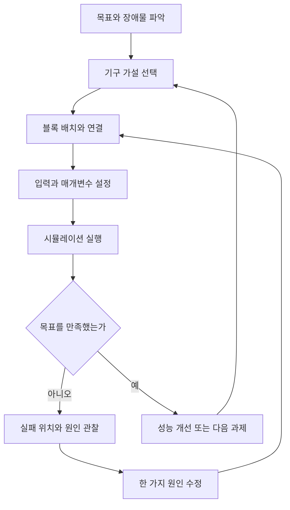

# 01. 게임 구조와 핵심 플레이 루프

> 대상: Steam PC판 Besiege. 조사일: 2026-11-13. 이 문서는 공개 자료를 바탕으로 작성한 역기획이다. 실제 게임 실행·계측 및 비공개 소스 분석은 수행하지 않았다.
> **표기:** `[공식 확인]`은 개발사 발표에 명시된 내용, `[설계 해석]`은 그 기능의 목적·상호작용 분석, `[재구성 제안]`은 유사 게임을 구현할 때 사용할 설계, `[검증 필요]`는 현행 실행판에서 확인할 항목이다.

## 1. 게임을 한 문장으로 정의

**[설계 해석] 플레이어가 연결 가능한 부품으로 기계를 만들고, 물리적 실패를 관찰하며, 제한된 과제를 해결하는 설계 실험 게임이다.** 완성차를 선택하는 전투 게임과 달리, 조종 성능·공격 방식·고장 방식까지 플레이어가 설계한다. 즐거움의 단위는 강한 장비 획득보다 ‘생각한 기구가 실제로 움직이는 순간’에 있다.

[공식 확인] 개발사는 물리 기반 기계 제작, 파괴 가능한 캠페인, 샌드박스, 멀티플레이와 Workshop을 핵심 기능으로 소개한다. [공식 Steam 소개](https://store.steampowered.com/app/346010/Besiege/)

## 2. 설계의 세 가지 축

| 축 | 플레이어가 결정하는 것 | 성공 피드백 | 실패 피드백 |
|---|---|---|---|
| 형상 | 부품 위치·방향·크기 계열·대칭·지지 폭 | 길 통과, 자세 안정, 목표 도달 | 전복, 간섭, 무게중심 불량 |
| 기구 | 연결·회전축·구동·보강·분리 | 원하는 운동과 힘 전달 | 관절 구속, 동력 누수, 연결 파단 |
| 제어 | 키·구동 방향·타이밍·센서 조건 | 단계 동작, 자동화, 반복 성공 | 입력 충돌, 오작동, 과도한 반응 |

**[설계 해석]** 세 축이 독립적이지 않다는 점이 깊이를 만든다. 포신을 길게 하면 사격 방향이 명확해지는 동시에 질량과 모멘트가 바뀐다. 구조 보강은 파손을 줄이지만 가동부를 잘못 잇는 순간 조향을 막을 수 있다. 센서를 달아 자동화하면 조작은 쉬워지지만 조건 설계와 검증의 부담이 생긴다.

## 3. 핵심 루프

이 도식은 **[설계 해석]**이다. 원작 내부 상태 머신을 복원한 것이 아니라, 사용자가 반복하는 의사결정 구조를 정리했다.

### 3.1 초단기 루프: 한 번의 실험

1. 해결하려는 문제를 하나 고른다. 예: ‘출발하자마자 왼쪽으로 돈다.’
2. 원인을 분리한다. 바퀴 회전 방향, 접지 상태, 비대칭 질량, 구조 변형을 각각 후보로 둔다.
3. 한 요소만 수정하고 같은 시작 상태에서 재실행한다.
4. 수정 전후의 궤적과 파손 위치를 비교한다.

### 3.2 중기 루프: 기계의 역할 완성

주행만 되는 플랫폼 → 조향 가능한 플랫폼 → 무기 또는 운반 장치 탑재 → 임무 성공 → 안정성 개선으로 진행한다. 모든 기능을 동시에 붙이면 실패의 원인을 찾기 어렵다. 역기획에서도 기능 조합의 최종 결과와 독립 부품의 동작을 나누어 기술해야 한다.

### 3.3 장기 루프: 재사용과 공유

**[설계 해석]** 한 번 만든 서스펜션·포탑·집게 모듈을 다시 사용하면 새로운 기체의 제작 비용이 감소한다. 공유 기체는 결과물인 동시에 학습 자료가 된다. 다른 사람의 기계를 분해하며 ‘무엇이 연결되어 있고, 어떤 입력으로 작동하는가’를 읽을 수 있어야 한다.

## 4. 건설과 시뮬레이션의 계약

| 단계 | 플레이어 기대 | 역기획 관점의 불변조건 |
|---|---|---|
| 건설 | 블록을 놓으면 원하는 위치에 머문다 | 편집 데이터가 중력·충돌로 변하지 않는다 |
| 실행 준비 | 지금 보이는 설계가 시험된다 | 미확정 입력값을 누락하지 않는다 |
| 실행 | 조작에 따라 기계가 움직인다 | 입력과 반응의 대응 관계가 유지된다 |
| 중단·복귀 | 파괴 전 설계로 돌아와 수정한다 | 실험 중 생긴 파손을 설계의 삭제로 취급하지 않는다 |
| 저장 | 다음에도 같은 설계를 시험한다 | 설계·의존성·설정이 함께 보존된다 |

위 계약은 **[재구성 제안]**이다. 구체적 건설/실행 UX와 예외는 [02 조립 UX](02_assembly_ux.md), 저장 구조는 [16 데이터 설계](16_data_architecture.md)에 정리했다.

## 5. 난도가 만들어지는 방식

### 5.1 부품 수보다 관계 수가 중요하다

바퀴 네 개와 프레임만 있는 기체보다 바퀴 두 개에 여러 관절·스프링·제어 조건을 연결한 기체가 훨씬 어렵다. 실제 제작 난도는 부품 수뿐 아니라 연결 의존성, 가동 자유도, 입력 채널 수, 외부 환경 변화로 결정된다.

### 5.2 실패를 설명할 수 있어야 한다

| 눈에 보이는 현상 | 첫 번째 질문 | 다음에 분리할 변수 |
|---|---|---|
| 출발 즉시 붕괴 | 연결이 없었나, 연결이 끊어졌나? | 접점·초기 관통·초기 구동 |
| 차가 안 움직임 | 바퀴가 회전하는가? | 구동 방향·접지·차체 간섭 |
| 조향이 안 됨 | 관절이 돌 수 있는가? | 보강재 우회 연결·축 방향·하중 |
| 포를 쏘면 넘어짐 | 반동의 작용선이 어디인가? | 지지 폭·포 높이·질량 분포 |
| 비행 중 계속 기울어짐 | 힘의 합이 중심에서 벗어나는가? | 양력·추력·항력·센서 기준축 |
| 물에 뜨지만 뒤집힘 | 부력과 중량의 배치가 적절한가? | 좌우 폭·상부 하중·부력 조절 |

이 분류는 **[설계 해석]**이며 특정 증상의 원인이 항상 하나라는 뜻은 아니다.

## 6. 성과 지표와 보상 구조

[공식 확인] 2025년 기념 업데이트는 완료 시간, 받은 피해, 블록별 점수를 합산한 점수 항목을 소개했다. 따라서 블록 관련 점수를 단순 부품 개수로 해석하면 안 된다. [10주년 공식 공지](https://store.steampowered.com/news/posts/?appgroupname=Besiege&appids=346010&enddate=1743087457&feed=steam_community_announcements)

**[설계 해석]** 이 세 지표는 서로 다른 최적화를 유도한다.

- **시간:** 빠른 이동과 즉시 작동하는 무기에 유리하다.
- **피해:** 안정적 구조, 방호, 위험 회피에 유리하다.
- **블록 점수:** 필요한 기능을 적은 비용으로 구성하는 효율에 유리하다.

최단 시간 기체가 가장 튼튼하거나 저비용일 필요는 없다. 하나의 정답 기체보다 다양한 해법이 남는 이유다. 정확한 산식·실격 조건·현행 점수 갱신 규칙은 [14 캠페인](14_campaign_and_levels.md)과 [17 검증 계획](17_validation_experiments.md)을 함께 본다.

## 7. 범위 관리

| 범위 | 이 문서 묶음에서의 위치 | 혼동 방지 |
|---|---|---|
| 기본 게임 | 건설·기구·육상·비행·무기·자동화 | 모드의 무제한 수치나 임의 스케일을 기본 기능으로 적지 않는다 |
| The Splintered Sea | 수상·수중·선박 | 밀폐 선체 침수 모델을 자동으로 가정하지 않는다 |
| The Broken Beyond | 우주·대기·연료 | 우주 전용 부품과 기본 게임에 반영된 공통 변경을 구분한다 |
| Workshop·모드 | 공유·확장·호환성 | 기체 로드 권한과 개별 부품 편집 권한이 같다고 가정하지 않는다 |

## 8. 역기획에서 가장 중요한 결론

**[설계 해석]** Besiege를 재구성할 때 ‘블록을 붙일 수 있고 물리로 무너진다’만 구현하면 핵심 경험이 완성되지 않는다. 플레이어가 연결을 이해하고, 구동 방향을 확인하며, 실행 결과를 이전 설계와 비교하고, 실패 지점을 수정할 수 있어야 한다. 물리의 복잡성과 실패를 해석하는 UI가 함께 설계되어야 한다.

## 관련 문서

- [00 전체 목차와 읽는 법](00_README.md)
- [02 조립 UX](02_assembly_ux.md)
- [04 연결 규칙](04_connection_rules.md)
- [05 물리 실행 모델](05_physics_runtime.md)
- [18 재구성 우선순위](18_reconstruction_roadmap.md)
