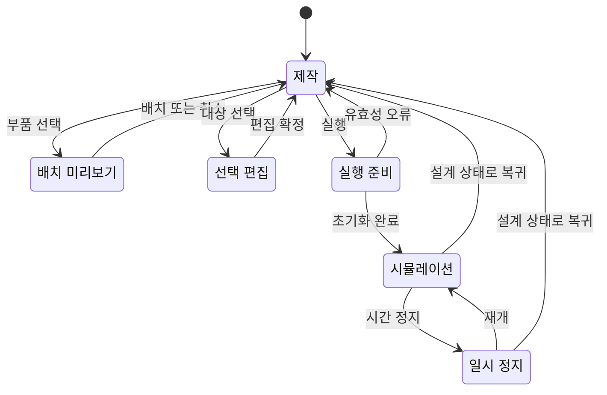

# 02. 조립 UX — 배치에서 시험 운전까지

> 대상: **Besiege Steam PC판**, 자료 조사일 **2026-11-13**. 직접 실행·실측 없이 공식 변경 이력과 공개 설명을 분석한 역기획서다. `[공식 확인]`은 출처가 명시한 기능, `[설계 해석]`은 그 기능이 만드는 경험에 대한 분석, `[재구성 제안]`은 유사 시스템을 구현하기 위한 명세, `[검증 필요]`는 현행 게임에서 재현해야 하는 세부 동작이다. 아래 상태명·데이터명·정량 목표는 원작의 내부 구현을 뜻하지 않는다.

## 1. 시스템이 해결하는 문제

**[설계 해석] 조립 UX의 핵심은 “배치 성공”보다 “예상한 연결과 운동이 만들어졌는지 빠르게 확인하는 것”이다.** 플레이어는 완성된 탈것을 선택하는 대신, 외형·무게 배치·구동축·연결·입력을 조합한다. 따라서 화면에 붙어 보이는 것, 실제로 연결되는 것, 입력했을 때 움직이는 것을 한 단계씩 이해할 수 있어야 한다.

이 관점에서 조립 한 사이클은 다음 세 질문에 답한다.

1. **무엇을 어디에 놓을 것인가?** 부품 탐색, 카메라, 배치 미리보기, 방향 및 스냅이 답한다.
2. **어떻게 작동하도록 만들 것인가?** 회전축, 키 지정, 부품 매개변수, 연결 구성이 답한다.
3. **왜 예상과 다르게 움직였는가?** 짧은 시뮬레이션, 시점 변경, 시각화, 반복 수정이 답한다.

제작 도구가 복잡해도 이 세 질문을 분리하면 학습 부담을 줄일 수 있다. 반대로 처음부터 모든 자유도를 노출하면 연결 오류와 조작 오류를 구분하기 어렵다.

## 2. 공식 자료로 확인되는 UX 기준점

| 근거 시점 | 확인된 기능 | 역기획에서 취급하는 범위 |
| --- | --- | --- |
| V0.6.2, 2018 | 다중 선택, 부분 복사·이동, 사용자 지정 각도, 교차 배치 허용을 포함하는 고급 도구 | 기본 조립에서 정밀 편집으로 확장되는 흐름 |
| V1.25, 2023 | 블록 검색 위치 변경, Brace 클릭 배치 옵션, 표면 노드 가독성 개선 | 긴 부품 목록과 두 지점 배치의 조작 부담 |
| V1.77, 2026 | 여러 블록의 매개변수 동시 편집, 혼합값 표시, 선택지 검색, 부품 찍어오기 | 반복 부품의 일괄 설정과 수정 |

**[공식 확인]** V1.77의 다중 키매퍼는 마지막으로 선택한 블록을 기준으로 항목을 표시하고, 서로 다른 값은 `●●●`로 표현한다. 변경은 같은 설정 항목을 가진 다른 선택 블록에 전달된다. 새 기본 입력으로 `Ctrl + 마우스 가운데 버튼` 부품 찍어오기도 추가됐다. 이는 배치 미리보기와 다른 기능이다. [공식 V1.77 공지](https://steamcommunity.com/games/346010/announcements/detail/509606585808454143), [내용을 확인한 공식 뉴스 피드](https://store.steampowered.com/news/posts/?appgroupname=Besiege&appids=346010&enddate=1778853723&feed=steam_community_announcements)

고급 도구 도입 당시에는 기본 표시를 끄고 사용자가 활성화하게 했다. 이 도입 의도와 기능 범위는 공식 설명에 있지만, **현행 설치본의 초기 설정까지 동일하다고 단정하지 않는다.** [공식 고급 조립 도구 공지](https://store.steampowered.com/news/app/346010/view/5262975441859796919), [동일 공식 기사 본문](https://store.steampowered.com/news/posts/?appids=346010&enddate=1522940994)

V1.25에서 검색·Brace 배치·표면 노드 개선을 확인할 수 있다. 단축키와 화면 위치를 고정된 설계 상수로 삼기보다 해당 행동의 존재를 기준으로 분석한다. [공식 V1.25 변경 이력](https://store.steampowered.com/news/posts/?appids=346010&enddate=1712665825&feed=steam_community_announcements)

## 3. 화면을 기능 영역으로 분해

아래는 **[설계 해석]**이다. 현행 화면을 픽셀 단위로 복제한 와이어프레임이 아니라, 플레이어의 주의와 정보를 분리한 기능 명세다.

| 영역 | 플레이어가 확인할 정보 | 다음 행동 | 혼동하기 쉬운 지점 |
| --- | --- | --- | --- |
| 제작 공간 | 부품 외형, 상대 위치, 배치 방향, 작업 경계 | 배치·선택·이동 | 시각적 접촉을 연결로 오인 |
| 부품 팔레트 | 부품 역할과 이름, 필요한 종류 | 종류 선택·검색·찍어오기 | 비슷한 모양의 구동·수동 부품 혼동 |
| 편집 도구 | 활성 도구, 좌표계, 선택 집합, 피벗 | 다중 선택·변환·대칭 | 드래그가 카메라인지 부품 이동인지 혼동 |
| 매개변수 창 | 입력 키, 방향, 속도·출력 등의 값 | 작동 설정 | 표시값이 한 블록 값인지 혼합값인지 혼동 |
| 실행 제어 | 제작/시뮬레이션 상태, 시간 흐름 | 실행·정지·재시험 | 정지와 제작 복귀를 같은 의미로 오인 |
| 진단 정보 | 부품 응력·저항 등 성능의 단서 | 실패 원인 추적 | 시각화 색을 손상 누적량으로 오인 |
| 저장·불러오기 | 현재 설계와 버전·부분 기체 | 저장·재사용 | 추가 로드와 교체 로드 혼동 |

특히 **선택 대상**, **활성 도구**, **변환 기준축**은 서로 다른 상태다. 동일한 부품을 선택했어도 이동 도구와 매개변수 도구는 전혀 다른 동작을 한다. 재구성할 때 세 상태를 하나의 “현재 블록” 변수에 섞으면 취소·복귀·Undo가 깨지기 쉽다.

## 4. 배치 UX 상세 분석

### 4.1 부품 선택

**[설계 해석]** 부품 팔레트의 역할은 목록 제공뿐 아니라 기능을 학습시키는 것이다. 플레이어는 “앞으로 이동”이라는 의도로 바퀴를 찾지만, 실제로 필요한 것은 구동 바퀴·지지 구조·방향 설정의 조합이다. 따라서 부품 설명에는 최소한 **능동/수동**, **동작 축**, **작동 입력**, **설계에 미치는 영향**이 드러나야 한다.

**[재구성 제안]** 툴팁의 정보 순서는 `역할 한 줄 → 동작 축/작동 방식 → 조절 항목 → 연결상 주의점`으로 둔다. 내부 물리 단위나 솔버 정보보다 “어느 쪽이 고정되고 어느 쪽이 움직이는가”가 먼저다.

### 4.2 미리보기와 배치 확정

**[공식 확인]** V1.26에는 드래그 중 블록 고스트의 투명도 수정 기록이 있다. 따라서 미리보기 표현을 별도로 취급하는 UX의 존재는 확인된다. 이 기록만으로 색상 규칙·히트테스트 우선순위·부착 허용 오차를 복원할 수는 없다. [공식 V1.26 변경 이력](https://store.steampowered.com/news/posts/?appids=346010&enddate=1714155262&feed=steam_community_announcements)

배치를 분석할 때는 다음 판정을 분리한다. **이 순서는 [재구성 제안]이며 원작 코드의 실행 순서가 아니다.**

| 단계 | 입력 | 산출물 | 실패 시 필요한 피드백 |
| --- | --- | --- | --- |
| 표면 찾기 | 화면 위치와 카메라 광선 | 대상 물체·면·법선 | 대상이 없음을 표시 |
| 기준 정하기 | 대상 면, 선택 부품 방향 | 로컬 배치 프레임 | 반대쪽 면에 붙는 이유를 보여줌 |
| 후보 위치 생성 | 스냅 간격·회전 단계 | 미리보기 자세 | 위치 점프와 방향 반전을 분리 |
| 편집상 허용 검사 | 경계·겹침 허용 설정 | 배치 가능 여부 | 경계 위반과 겹침을 구분 |
| 연결 후보 검사 | 연결 포트·근접 형상 | 예상 연결 관계 | 배치 가능해도 미연결일 수 있음을 표시 |
| 확정 | 사용자의 확정 입력 | 편집 데이터와 Undo 명령 | 실패한 후보를 저장하지 않음 |

“겹침을 허용했다”와 “물리 충돌을 제거했다”를 같은 기능으로 설명해서는 안 된다. 전자는 편집 허용 여부이고, 후자는 실행 중 물리 규칙이다. 고급 배치로 가능한 형태가 곧 안정된 기계라는 뜻도 아니다.

### 4.3 방향과 좌표계

**[설계 해석]** 조립에는 최소 세 프레임이 공존한다.

| 프레임 | 유용한 작업 | 대표 오류 |
| --- | --- | --- |
| 화면 기준 | 커서로 면 선택, 가려진 부품 찾기 | 정면에서 겹친 부품을 잘못 선택 |
| 월드 기준 | 지면에 수평, 높이 정렬, 전체 기체 이동 | 회전된 기체에서 “앞”이 달라짐 |
| 부품/선택 기준 | 회전축 정렬, 날개 각도, 포탑 축 수정 | 대칭 반대편에서 회전 부호가 뒤집힘 |

**[검증 필요]** 실제 도구별 Local/Global/Linked/Pivot의 작동 범위, 스냅 기준점, 선택 추가 시 피벗 재계산, 입력 중 도구 전환 시 확정 여부를 확인해야 한다. 명칭만 보고 다른 3D 편집기의 동작을 대입하면 안 된다.

## 5. 선택과 매개변수 편집

### 5.1 선택은 형상 편집과 기능 편집의 공통 기반

**[설계 해석]** 선택 집합을 공유하면 바퀴 네 개의 위치를 바꾼 뒤 동일한 집합의 속도를 수정할 수 있다. 그러나 도구별 대상 적격성은 다르다. 표면 노드, 일반 블록, 레벨 오브젝트, 로프 양끝을 같은 종류의 객체로 처리하면 의도하지 않은 편집이 발생한다.

**[재구성 제안]** 선택 모델은 다음 요소를 별개로 보관한다.

- `SelectionSet`: 전체 선택 ID.
- `ActiveItem`: 마지막으로 활성화한 대상. 속성창 기준이 될 수 있다.
- `SubSelection`: 표면의 코너·에지 등 하위 요소.
- `EditableSubset`: 현재 도구가 실제로 수정 가능한 대상.
- `SymmetryPartners`: 대칭에 의해 함께 선택된 대상.

블록 네 개 중 세 개만 속도 항목을 가진다면 “네 개 선택”과 “세 개 속도 변경”을 구분해야 한다. 이는 일괄 편집의 적용 범위를 이해시키는 핵심이다.

### 5.2 혼합값과 입력 확정

아래는 V1.77의 확인된 혼합값 UX를 바탕으로 정리한 **[재구성 제안]**이다.

| 상황 | 권장 표현 | 적용 의미 |
| --- | --- | --- |
| 모든 선택 항목이 같은 값 | 공통값 | 그대로 두면 변경 없음 |
| 같은 설정이지만 값이 다름 | 혼합 상태 | 새 값을 입력한 항목만 통일 |
| 일부 블록에 없는 설정 | 적용 가능한 수 표시 | 없는 항목을 임의 생성하지 않음 |
| 숫자 입력 중 선택 변경 | 확정·취소 정책 일관화 | 이전 블록의 미완성 텍스트를 다음 블록에 적용하지 않음 |
| 허용 범위 밖의 값 | 범위와 조정 결과 표시 | 불러오기·붙여넣기도 동일 규칙 적용 |
| 키 중복 | 해당 키의 영향 대상 확인 | 중복을 무조건 오류로 보지 않음 |

키 중복은 여러 바퀴를 동시에 구동하는 정상 설계일 수 있다. 반면 조향과 발사처럼 의도하지 않은 동작의 결합은 오류다. 따라서 좋은 진단은 “중복 키 존재”가 아니라 **“이 키로 함께 움직이는 대상”**을 보여주는 방식이다.

## 6. 제작과 실행 전환

다음 상태도는 반복 실험을 위한 **[재구성 제안]**이다. 원작의 실제 상태 클래스나 정확한 UI 상태를 주장하지 않는다.

**[설계 해석]** 제작으로 돌아온다는 것은 실험 전 설계를 다시 편집한다는 뜻이어야 한다. 부러진 부품의 현재 좌표를 설계 좌표로 저장하면 “실패한 실험을 수정”하는 행동이 “잔해를 재조립”하는 행동으로 바뀐다. 따라서 유사 시스템 구현에서는 편집 설계와 실행 인스턴스를 분리하는 편이 명확하다.

**[검증 필요]** 현재 게임에서 제작 복귀 시 각각 복구되는지 확인할 항목은 블록 자세, 소모 탄약·연료, 파손, 로프 길이, 스프링 초기 상태, 토글 입력, 카메라 초점, 레벨 오브젝트다. 싱글플레이 전체 리셋과 멀티플레이 개인 기체 리스폰을 동일하게 취급하면 안 된다.

## 7. Undo·Redo·저장: 서로 다른 복구 층

**[설계 해석]** 조립에서는 실험 실패보다 편집 결과를 잃는 경험이 더 치명적이다. 복구 기능을 구분하면 실패 비용이 낮아진다.

| 복구 층 | 되돌릴 대상 | 유사 시스템에서의 처리 원칙 |
| --- | --- | --- |
| 배치 취소 | 아직 확정하지 않은 고스트 | 작업 이력 생성 없이 폐기 |
| Undo·Redo | 확정된 편집 명령 | 선택·대칭·연결 참조까지 원자적으로 복구 |
| 시뮬레이션 종료 | 실행 중 변형·파손·소모 | 편집 설계를 다시 인스턴스화 |
| 저장 버전 복구 | 과거 기체 설계 | 현재 편집 세션과 구분하여 열기 |

**[재구성 제안]** 대칭으로 바퀴 두 개를 이동했다면 Undo 한 번으로 둘 다 복구해야 한다. 드래그 매 프레임을 개별 명령으로 쌓기보다 시작 자세와 종료 자세를 하나의 명령으로 기록한다. 표면 코너 이동으로 연결된 에지가 함께 바뀌었다면 연쇄 변경도 같은 명령에 들어가야 한다.

저장·자동저장·추가 불러오기 기능의 확인 범위는 [03. 고급 조립](03_advanced_building.md)에 정리했다. Undo만으로 장기 버전 관리까지 해결하려 하지 않는 것이 핵심이다.

## 8. 대표 조립 과제의 UX 단계

다음은 **[설계 해석]**에 따른 학습 과제다. 특정 캠페인의 실제 튜토리얼 순서를 재현한 것이 아니다.

### 과제 A: 주행 차체

1. 대칭적인 기초 차체를 만든다.
2. 구동 부품을 설치하고 축 방향을 확인한다.
3. 같은 전진 입력을 부여한다.
4. 장식과 무기를 붙이기 전에 짧게 실행한다.
5. 한쪽만 역회전하면 입력 부호·부품 방향을 확인한다.
6. 차체가 비틀리면 연결과 구조를 확인한다.

여기서 입력 오류, 연결 오류, 출력 과다를 분리해서 학습시키는 것이 중요하다. 모두 “차가 움직이지 않음”으로 보이지만 해결 방법은 다르다.

### 과제 B: 움직이는 포탑

1. 차체와 회전부를 구분한다.
2. 회전축을 지정하고 주변 부품과 간격을 확보한다.
3. 무기를 달기 전에 회전만 시험한다.
4. 무기를 추가하고 반동 시 회전부가 버티는지 본다.
5. 포신이 주변 구조를 관통하더라도 연결 관계와 충돌 설정을 따로 확인한다.

### 과제 C: 패널 외장

1. 구조와 구동이 작동하는 상태를 저장한다.
2. Build Surface를 추가한다.
3. 패널 생성 직후 실행해 운동이 달라졌는지 확인한다.
4. 질량·공력·의도하지 않은 연결을 순서대로 조사한다.

외형 작업의 시각적 성공이 기능적 성공을 보장하지 않는다는 점을 드러내는 과제다.

## 9. UX 실패 사례와 진단 순서

| 증상 | 먼저 구분할 원인 | 사용자에게 필요한 정보 |
| --- | --- | --- |
| 배치했는데 떨어짐 | 미연결 / 시작하자마자 파손 | 실제 연결 유무와 최초 파손 시점 |
| 좌우가 똑같은데 회전함 | 방향·입력 / 연결 우선순위 / 질량 | 양쪽 매개변수, 축, 연결 대상 |
| 이동 도구로 옮겼더니 작동 안 함 | 경계 연결 손실 / 축 변화 / 겹침 | 이동 전후 연결 차이 |
| 부품을 클릭할 수 없음 | 가림 / 선택 필터 / 하위 노드 | 현재 선택 범위와 도구 상태 |
| 값 수정 후 다른 값으로 돌아감 | 입력 미확정 / 혼합값 / 범위 보정 | 실제 적용 값과 대상 수 |
| 실행하면 갑자기 튀어 오름 | 초기 겹침 / 지면 침투 / 구속 충돌 | 첫 프레임 접촉과 응력 |
| 되돌렸더니 일부만 복구됨 | 대칭·표면 의존성 누락 | 명령 단위와 변경 대상 |
| 불러온 기체를 편집할 수 없음 | DLC 또는 모드 의존 / 편집 대상 제한 | 의존 콘텐츠와 제한 이유 |

마지막 행은 현재 DLC 정책의 영향을 받는다. 이를 일반적인 선택 버그나 저장 손상으로 안내하지 않도록 [15. 멀티플레이·UGC](15_multiplayer_and_ugc.md)의 권한·의존성 구분과 연결한다.

## 10. 검증 시나리오와 UX 측정

아래는 **미실행 검증 계획**이다. 성공 조건은 유사 시스템의 권장 기준이며, 원작이 모두 충족한다고 주장하지 않는다.

| ID | 시험 | 기록할 결과 |
| --- | --- | --- |
| UX-01 | 같은 면에 같은 부품을 연속 배치 | 위치·방향 유지, 누적 오차 |
| UX-02 | 기체 전체 회전 후 동일 작업 | 스냅의 기준 프레임 |
| UX-03 | 서로 다른 값의 바퀴 동시 선택 | 혼합값 표시와 일괄 적용 범위 |
| UX-04 | 숫자 입력 도중 다른 블록 선택 | 확정·취소·전파 동작 |
| UX-05 | 대칭 이동 뒤 Undo·Redo | 양쪽 위치와 매개변수 보존 |
| UX-06 | 제작 중 실행 요청 | 미완성 고스트·표면의 처리 |
| UX-07 | 파손 후 제작 복귀 | 설계·입력·소모 자원 복구 범위 |
| UX-08 | 카메라를 지형에 가까이 배치 | 가림·관통 방지 옵션 영향 |
| UX-09 | 드래그 중 UI 위로 포인터 이동 | 잘못된 배치 확정 방지 |
| UX-10 | 같은 입력으로 조향과 발사 지정 | 키 영향 대상 추적 가능성 |
| UX-11 | DLC 없는 계정으로 기체 열기 | 조작·편집 제한의 정확한 범위 |
| UX-12 | 기본 설정과 기존 저장파일 비교 | 버전별 기본키·기본값 차이 |

**[재구성 제안]** UX 평가지표는 첫 주행 성공까지의 작업 수, 실패 후 원인 확인까지의 시간, 반복 부품 설정에 필요한 입력 수, 배치 취소 대비 Undo 비율, 의도하지 않은 일괄 변경 횟수로 잡는다. 실제 사용성 시험 전에는 목표 초수나 성공률을 성과 수치처럼 기재하지 않는다.

## 관련 문서

- [03. 고급 조립·대칭·표면·재사용](03_advanced_building.md)
- [04. 연결 규칙·충돌·구속](04_connection_rules.md)
- [05. 물리 런타임](05_physics_runtime.md)
- [13. 입력·자동화](13_automation_and_controls.md)
- [17. 검증 실험](17_validation_experiments.md)
- [99. 출처와 근거](99_sources.md)
