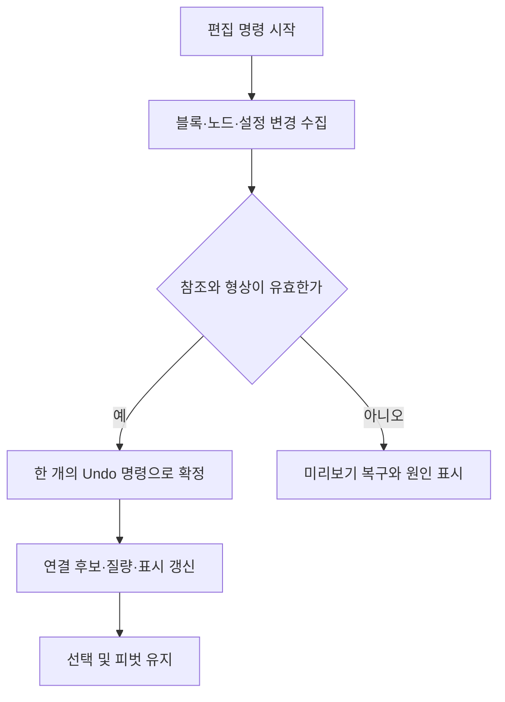

# 03. 고급 조립 — 선택·대칭·표면·기체 재사용

> 대상: **Besiege Steam PC판**, 자료 조사일 **2026-11-13**. `[공식 확인]`은 개발자가 공개한 기능이며 날짜를 함께 해석한다. `[설계 해석]`은 사용자 경험과 설계 의도에 대한 분석, `[재구성 제안]`은 유사 게임의 구현 명세, `[검증 필요]`는 직접 실행으로 확인하지 못한 규칙이다. 특히 **기본 블록 크기 변경, Build Surface 형상 편집, 레벨 오브젝트 스케일**을 서로 다른 기능으로 다룬다.

## 1. 기능의 위치와 범위

**[설계 해석]** 고급 조립은 기본 조립을 더 빠르게 하는 도구이면서, 기본 부착 방식으로 만들기 어려운 구조를 허용하는 도구다. 전자는 반복 비용 감소이고 후자는 설계 공간 확장이다. 두 목표는 연결 안정성·초보자 이해도 측면에서 서로 다른 부담을 만든다.

| 작업 범주 | 필요한 도구 | 게임플레이 효과 |
| --- | --- | --- |
| 반복 줄이기 | 다중 선택, 복제, 대칭, 일괄 매개변수 | 좌우 바퀴·날개·현가장치 수정 비용 감소 |
| 정밀 배치 | 임의 각도, 이동, 피벗·좌표계 | 구동축 정렬, 공간 효율, 날개 각도 조절 |
| 형상 만들기 | Build Surface의 코너·곡면 | 판금 외장·날개·선체 같은 연속적인 형태 |
| 모듈 재사용 | 선택 저장, 추가 로드 | 검증한 구동 모듈을 다른 기체에 이식 |
| 실험 복구 | Undo·Redo, 자동저장, 이전 버전 | 과감한 실험과 빠른 원상 복귀 |

## 2. 기본 기능과 모드 기능의 구분

**[공식 확인: 도입 당시]** 고급 도구는 블록의 선택·복사·이동·임의 각도 회전·교차 배치를 지원하는 것으로 발표됐다. 반면 일반 블록이나 기체 전체를 스케일하는 도구는 기본 제공 대상에서 제외한다고 명시했다. [고급 조립 공식 공지](https://store.steampowered.com/news/app/346010/view/5262975441859796919), [공식 본문](https://store.steampowered.com/news/posts/?appids=346010&enddate=1522940994)

**[검증 필요]** 이 역사적 공지와 현재 패치 기록을 대조했지만, 임의 X/Y/Z 블록 스케일을 현행 기본 UI 기능으로 확정할 근거는 확보하지 못했다. 따라서 본 역기획은 해당 기능을 기본 기능으로 포함하지 않는다. “게임이 스케일이 포함된 저장파일을 읽는다”와 “기본 UI로 그 값을 편집한다”는 별개의 능력이다.

| 기능 | 이 문서의 분류 | 혼동 방지 |
| --- | --- | --- |
| 블록 이동·회전·복제 | 공식 고급 조립 | 크기 자체를 바꾸는 기능과 구분 |
| 대칭 선택·변환·설정·삭제 | 공식 대칭 도구 | 기계적 동작의 대칭까지 자동 보장하지 않음 |
| Build Surface 형상 변경 | 공식 절차적 패널 도구 | 일반 블록의 비균일 스케일과 구분 |
| 레벨 오브젝트 스케일 | 레벨 에디터 계층 | 플레이어 기체 블록의 기능과 구분 |
| 일반 블록 임의 스케일 | 모드/파일 편집 영역으로 취급 | 현행 기본 UI 편입 여부는 추가 확인 |
| 제한 범위 초과 매개변수 | 별도 모드·수정 데이터 영역 | 기본 부품 성능표의 근거로 사용하지 않음 |

이 구분을 생략하면 커뮤니티 기체의 극단적 성능을 기본 시스템의 설계 의도나 정상 밸런스로 오인하게 된다.

## 3. 다중 선택과 변환을 역기획하는 단위

### 3.1 선택 범위

**[설계 해석]** 이동 가능한 집합과 연결된 집합은 다르다. 예를 들어 포탑 전체를 선택한 뒤 옮길 때, 차체와의 연결은 선택 경계 밖에 있다. 내부 상대 자세를 유지해도 외부 연결은 재평가해야 한다. 이때 “복사할 부품”과 “포함할 연결”을 분리해야 한다.

**[재구성 제안]** 선택 객체를 아래 네 종류로 나눈다.

| 종류 | 보존할 정보 | 변환 후 다시 판단할 정보 |
| --- | --- | --- |
| 일반 블록 | 종류, 설정, 방향, 외형 | 외부 접속 후보와 충돌 |
| 두 지점 부품 | 두 앵커의 상대 관계 | 한쪽만 선택했을 때 끝점의 의미 |
| Build Surface | 코너·에지·재질·표면 설정 | 공유 노드, 자기 교차, 접속 |
| 복합 모듈 | 구성 부품과 내부 관계 | 주변 기체와의 입력·연결 충돌 |

### 3.2 피벗

**[설계 해석]** 피벗은 단순한 조작 손잡이가 아니다. 기계적 의미가 있는 축을 중심으로 회전해야 하고, 좌우 대칭의 기준이 될 수도 있다. 포신 각도를 조절할 때 부품 평균 중심을 사용하면 포신 전체가 엉뚱한 원을 그리며 움직일 수 있다.

**[재구성 제안]** `선택 중심`, `활성 블록`, `사용자 지정 피벗`, `개별 블록 기준`을 명시적으로 구분한다. 피벗 선택이 바뀌어도 부품의 실제 자세는 바뀌지 않아야 한다. 피벗 이동 자체와 블록 이동은 별도 명령으로 기록한다.

### 3.3 변환 중 연결 표시

**[재구성 제안]** 이동 미리보기에서 연결을 세 가지로 표현한다.

- 유지 예상: 선택 집합 내부에서 상대 자세가 유지되는 연결.
- 재평가 필요: 선택 경계를 가로지르는 연결.
- 새 후보: 이동 후 다른 부품에 생기는 연결 가능성.

이 표시는 “현재 원작에 있는 기능”을 뜻하지 않는다. 조립 자유도를 높이면서 연결 오류를 학습 가능하게 만드는 개선 명세다.

## 4. 대칭 도구의 행동 규칙

### 4.1 공식 기능과 의미

**[공식 확인]** V1.05는 반대편 대응 블록의 동시 선택, 대칭적인 변환, 같은 매개변수 변경, 대칭 삭제를 추가했다. Build Surface는 그리드의 네 점으로 패널을 만들고 노드를 편집하여 곡면을 만들 수 있으며, 목재·유리 재질과 기존 연결 시스템을 활용한다. [공식 V1.05 공지](https://store.steampowered.com/news/app/346010/view/2198262387487265157), [공식 본문](https://store.steampowered.com/news/posts/?appids=346010&enddate=1652972552&feed=steam_community_announcements)

**[설계 해석]** 대칭에는 적어도 세 층이 있다.

| 층 | 의미 | 자동 일치가 어려운 이유 |
| --- | --- | --- |
| 형상 대칭 | 위치·방향·외형을 반사 | 축의 방향성·좌표계 손잡이성 |
| 설정 대칭 | 수치·키·토글의 대응 | 회전 부호와 조향 목적이 다를 수 있음 |
| 물리 대칭 | 연결·접촉·질량·외력까지 동일 | 연결 대상 우선순위와 초기 접촉 차이 |

따라서 외형이 좌우 대칭인 기체가 직진하지 않는다고 해서 대칭 도구가 실패했다고 단정할 수 없다. [04. 연결 규칙](04_connection_rules.md)의 연결 후보 비교를 함께 해야 한다.

### 4.2 미러링의 수학적 의미

다음은 **[재구성 제안]**이다. 평면의 단위 법선을 `n`, 평면 위 기준점을 `c`라고 하면 점의 대칭 위치는 다음과 같다.

`p_mirror = p - 2 * n * dot(n, p - c)`

그러나 점 위치만 반사하는 것으로 회전 부품의 의미가 완성되지는 않는다. 회전축, 동작 화살표, 시각 메시, 연결 포트의 방향을 함께 변환해야 한다. 회전 입력의 부호를 반전할지는 부품의 기능 기준으로 판단한다. “모든 회전 부품의 키를 반대로 바꾼다”는 일괄 규칙은 조향과 추진에서 다른 결과를 낸다.

### 4.3 예외 처리 명세

| 상황 | 원작 현행 확인 과제 | 재구성 권장 동작 |
| --- | --- | --- |
| 대칭면 위 블록 | 중복 생성 여부 | 자기 자신을 대응점으로 처리 |
| 반대편 대응 블록 없음 | 선택 확장 방식 | 존재하는 대상만 선택하고 상태 표시 |
| 형태는 같지만 설정이 다름 | 대응 판정 조건 | 형상 대응과 설정 일치를 분리 |
| 피벗을 포함한 선택 이동 | 대칭 기준의 이동 여부 | 기준 평면이 고정인지 함께 이동인지 명시 |
| 대칭으로 복사한 두 지점 부품 | 끝점 순서·방향 | 두 앵커와 의미상 시작점 보존 |
| 대칭 삭제 후 Undo | 복원 순서와 접속 영향 | 원래 ID·순서·설정까지 복구 |

원작이 어떤 항목을 보장하는지는 실험해야 한다. 이 표는 요구사항을 누락하지 않도록 만드는 분석 틀이다.

## 5. Build Surface: 외형을 만드는 도구이자 물리 부품

### 5.1 일반 블록과 다른 점

**[설계 해석]** 일반 블록은 이미 정의된 형상에 자세를 주지만, Build Surface는 플레이어 입력으로 형상 자체를 만든다. 따라서 저장할 대상이 Transform 하나로 끝나지 않는다. 코너, 에지, 재질, 연결 대상, 충돌 형상 생성 상태가 함께 존재한다.

**[공식 확인]** V1.75에서 새 Build Surface의 공력 기본값을 꺼짐으로 바꿨다. 과거 자료의 “기본 공력 켜짐”을 현행 새 패널의 기본 동작으로 사용하지 않는다. 기존 저장파일은 저장된 설정을 별도로 확인한다. [공식 V1.75 공지](https://steamcommunity.com/games/346010/announcements/detail/530976484112728513), [공식 본문](https://store.steampowered.com/news/posts/?appgroupname=Besiege&appids=346010&enddate=1772123201&feed=steam_community_announcements)

### 5.2 조작 단계

아래는 **[재구성 제안]**으로 정리한 작업 단계다.

1. 기준 그리드 또는 부착 대상을 정한다.
2. 코너를 순서대로 지정한다.
3. 생성 예정 패널을 미리 본다.
4. 패널을 확정한다.
5. 코너 위치로 외곽을 수정한다.
6. 에지의 곡률을 수정한다.
7. 재질·색·공력 설정을 정한다.
8. 주변 가동부와 연결·충돌이 의도대로인지 실행해서 확인한다.

**[검증 필요]** 삼각형을 만드는 현행 입력 순서, 코너 자동 병합 거리, 연결 해제 명령, 자기 교차 허용 여부, 면의 앞뒤와 텍스처 방향은 공식 공개 설명만으로 완전히 확정하지 못했다. 커뮤니티의 숨겨진 옵션이나 모드 기본값을 기본 게임 UI로 기재하지 않는다.

### 5.3 재질·질량·충돌·공력의 분리

| 개념 | 플레이어가 바꾸려는 것 | 역기획에서 따로 확인할 항목 |
| --- | --- | --- |
| 시각 형상 | 날렵한 외장, 곡면, 이음새 | 렌더 메시 |
| 충돌 형상 | 주변과 부딪히는 부위 | 생성된 콜라이더와 자기 충돌 |
| 연결 형상 | 붙어 있어야 하는 곳 | 코너·에지·주변 부품의 연결 |
| 질량 | 무게중심과 관성 | 재질·면적·두께에 대한 계산 방식 |
| 공력 | 비행·조종·저항 | 설정 활성 상태와 힘 적용 위치 |
| 파손 | 충격·응력에 대한 반응 | 패널 자체와 연결의 파손 구분 |

**[설계 해석]** 표면을 예쁘게 감싼 것만으로 구동계가 제대로 동작하지 않을 수 있다. 외장이 움직이는 축 양쪽에 연결되면 회전을 막고, 한쪽만 연결되면 하중이 한 지점에 집중될 수 있다. 또한 외형이 얇아 보인다고 실제 충돌 두께와 질량까지 작다고 가정할 수 없다.

### 5.4 데이터 모델 예시

```text
SurfaceDesign (재구성 예시)
  stable_id
  corners[]: local_position
  edges[]: curve_parameters
  material_id
  color_settings
  aerodynamic_enabled
  anchor_references[]
  shape_schema_version

SurfaceRuntime (재구성 예시)
  generated_visual_mesh
  generated_collision_shapes
  resolved_connections[]
  mass_properties
  damage_state
```

이는 원작 저장파일 구조가 아니다. 설계 데이터와 생성 결과를 구분하면 형상 알고리즘을 변경해도 버전 호환과 캐시 재생성을 관리하기 쉽다는 설명이다.

## 6. 추가 로드와 모듈 단위 제작

**[공식 확인]** V1.75에는 기존 기체를 지우지 않고 다른 기체나 저장한 선택 부분을 불러오는 기능, 선택 부분 저장, 자동저장이 추가됐다. Starting Block 없는 선택 저장에는 사용 가능한 파일이 되도록 블록을 보충하며, 추가 로드할 때는 그 보충 정보를 처리한다. [공식 V1.75 공지](https://steamcommunity.com/games/346010/announcements/detail/530976484112728513)

**[설계 해석]** 이 기능은 조립을 일회성 완성품 제작에서 모듈 라이브러리 방식으로 바꾼다. “잘 작동한 현가장치”를 다시 만들 필요 없이 다른 차체로 가져올 수 있다. 그러나 공간상 배치만 맞춰도 이식이 완료되는 것은 아니다.

| 이식 요소 | 발생 가능한 충돌 | 재구성 권장 처리 |
| --- | --- | --- |
| 블록 ID | 기존 기체와 중복 | 인스턴스별 ID 재발급과 참조 재연결 |
| 입력 키 | 다른 기능과 동시에 실행 | 키별 영향 대상 비교 |
| 자동화 변수 | 이름은 같지만 의미가 다름 | 모듈별 이름 공간 또는 충돌 경고 |
| 부착 인터페이스 | 외부 포트 위치 불일치 | 연결 기준점 표시 |
| 질량·출력 | 원래 모듈이 운반하던 하중 초과 | 새 전체 기체에서 재시험 |
| DLC·모드 | 일부 부품이 편집 불가 또는 미해결 | 의존성 목록 표시 |
| 버전 | 이전 바퀴·패널 규칙과 다름 | 콘텐츠 버전 보존 및 마이그레이션 |

**[재구성 제안]** 저장 모듈에는 “전진 입력, 조향 입력, 부착 기준면, 시험 하중” 같은 사용자 설명을 함께 기록한다. 물리 성능을 절대적으로 보증하기보다는 어떤 조건에서 검증한 모듈인지 표시한다.

## 7. 정사영·카메라·외형 작업

**[공식 확인]** V1.75는 `Alt`를 누른 채 카메라를 제작 경계의 한 면에 정확히 맞추면 정사영으로 전환하는 카메라 스냅을 추가했다. [공식 V1.75 공지](https://steamcommunity.com/games/346010/announcements/detail/530976484112728513)

**[설계 해석]** 정사영은 투시 왜곡 없이 좌우 간격·축 정렬·윤곽을 확인하기에 유리하다. 그러나 깊이 정보를 줄이기 때문에 같은 화면 좌표에 있는 부품을 혼동할 수 있다. 따라서 정사영에서 정렬하고 투시 시점에서 공간 관계를 재확인하는 작업 흐름이 합리적이다.

도색·스킨은 다음 세 단계로 나눠 분석한다.

1. **기능 확인:** 구동·연결·기본 자세를 검증한다.
2. **형상 정리:** 패널을 추가하고 가동 범위 간섭을 확인한다.
3. **시각 정리:** 색과 스킨의 일관성을 조정한다.

이 순서는 강제 제작 규칙이 아니라 복잡한 실패의 원인을 좁히기 위한 제안이다. 시각 표현이 바뀐 뒤에도 충돌 형상과 기능이 동일한지는 콘텐츠 종류에 따라 확인해야 한다.

## 8. 도구의 데이터 일관성

**[재구성 제안]** 복합 편집은 `명령 시작 → 변경 집합 수집 → 유효성 검사 → 원자적 확정 → 캐시 재생성`으로 다룬다.



표면 코너 한 개를 이동했는데 공유 에지·대칭 패널·연결 후보가 함께 바뀌면 모두 같은 변경 집합에 포함한다. 사용자에게는 한 번의 드래그였기 때문이다. 캐시가 늦게 재생성되더라도 저장되는 설계 데이터는 확정된 상태 하나여야 한다.

## 9. 검증 체크리스트

아래 항목은 **직접 실행하지 않은 검증 과제**다.

| ID | 조건 | 구분해야 하는 결과 |
| --- | --- | --- |
| AB-01 | 선택한 포탑을 평행 이동 | 내부 연결 유지 / 외부 연결 재생성 |
| AB-02 | 선택 집합에 피벗 블록 포함 | 피벗 이동과 기체 이동 분리 |
| AB-03 | 양쪽 바퀴 대칭 복제 | 외형 방향 / 구동 부호 / 연결 대상 |
| AB-04 | 대칭면 위 블록 삭제·Undo | 중복 객체와 ID 재생성 여부 |
| AB-05 | Surface 두 면의 공유 코너 이동 | 공유 노드인지 독립 노드인지 |
| AB-06 | 가동부를 둘러싼 패널 생성 | 시각적 간격 / 실제 연결 / 충돌 |
| AB-07 | 새 Surface와 과거 기체의 Surface | 공력 기본값과 저장값 |
| AB-08 | 저장 모듈을 동일 기체에 두 번 추가 | ID·변수·키 충돌 |
| AB-09 | 자동저장 직전 대량 복제 후 Undo | 복구된 설계와 저장 버전의 일관성 |
| AB-10 | 기본 UI와 스케일 모드 사용 기체 비교 | 편집 가능 범위와 저장 호환 |
| AB-11 | 직교 시점에서 겹친 두 블록 선택 | 깊이 선택 우선순위 |
| AB-12 | 이전 버전 부품을 추가 로드 | 호환 설정의 유지 여부 |

최종적으로 “대칭이 잘된다”는 평가를 하나로 내리지 않는다. **선택 일관성, 변환 일관성, 설정 일관성, 연결 일관성, 반복 복구 일관성**으로 분리해야 개선 지점을 특정할 수 있다.

## 관련 문서

- [02. 조립 UX](02_assembly_ux.md)
- [04. 연결 규칙](04_connection_rules.md)
- [09. 비행](09_flight_and_aerodynamics.md)
- [10. 수상·수중](10_water_and_buoyancy.md)
- [16. 데이터·구현 구조](16_data_architecture.md)
- [99. 출처와 근거](99_sources.md)
