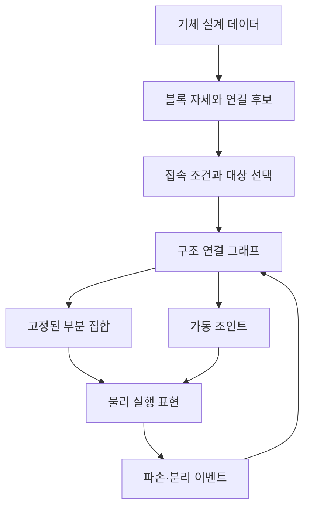

# 04. 연결 규칙 — 부착·충돌·구속·클러스터

> 대상: **Besiege Steam PC판**, 자료 조사일 **2026-11-13**. `[공식 확인]`, `[설계 해석]`, `[재구성 제안]`, `[검증 필요]`를 구분한다. 이 문서의 연결 데이터 구조와 판정 순서는 재구성 모델이다. 게임 실행 파일이나 원본 코드를 조사하지 않았으므로 실제 엔진의 완전한 연결 알고리즘을 복원했다고 주장하지 않는다.

## 1. 가장 먼저 구분해야 하는 네 가지

**[설계 해석]** 조립 게임에서 “붙어 있다”는 표현은 여러 뜻을 가진다. 역기획은 이 뜻을 분리해야 한다.

| 구분 | 의미 | 서로 독립일 수 있는 이유 |
| --- | --- | --- |
| 시각적 접촉 | 메시가 맞닿거나 겹쳐 보임 | 렌더 메시와 실제 충돌·접속 형상이 다를 수 있음 |
| 충돌 접촉 | 실행 중 물리 형상이 접촉해 힘을 주고받음 | 접촉만으로 영구 연결이 생기는 것은 아님 |
| 구조적 연결 | 두 부품의 상대 운동에 제약이 생김 | 고정·회전·슬라이드 등 자유도가 다름 |
| 기능적 연결 | 입력·연료·자동화가 연계됨 | 공간적으로 붙어 있어도 기능 네트워크가 다를 수 있음 |

예를 들어 회전하는 바퀴와 차체는 구조적으로 연결돼 있지만 상대 회전이 가능해야 한다. 패널이 주변 부품과 겹쳐 보여도 연결 후보가 생성되지 않을 수 있다. 또한 같은 키를 쓰는 두 바퀴는 입력상 연결돼 있지만 구조적으로는 멀리 떨어져 있다.

**이 네 종류를 한 개의 `Attached` 플래그로 모델링하면 원작의 조립 특성을 설명하기 어렵다.**

## 2. 확인 가능한 근거와 확정할 수 없는 부분

### 2.1 개발자 변경 이력

**[공식 확인]** V1.26은 2차 연결의 연결 허용 구간, 표면 블록의 연결 대상 일관성, 로그 충돌, 사전 확장 슬라이더와 2차 연결 등을 수정했다. 이는 연결이 단순한 메시 접촉보다 여러 조건과 초기화 절차를 가진다는 근거다. 다만 변경 이력만으로 전체 우선순위나 허용 거리까지 알 수는 없다. [공식 V1.26 변경 이력](https://store.steampowered.com/news/posts/?appids=346010&enddate=1714155262&feed=steam_community_announcements)

**[공식 확인]** V1.65에는 실행 중 연결 응력을 보여주는 Joint Stress Visualizer가 추가됐다. 기존 Cluster 표시도 개선 대상으로 언급된다. 응력 표시와 클러스터 표시가 존재한다는 사실을 확인할 수 있지만, 모든 부품이 어떤 방식으로 합쳐지는지에 대한 공개 명세는 아니다. [공식 V1.65 공지](https://steamcommunity.com/games/346010/announcements/detail/4441207205094492419), [공식 본문](https://store.steampowered.com/news/posts/?appgroupname=Besiege&appids=346010&enddate=1734029661&feed=steam_community_announcements)

### 2.2 관찰 도구 제작자의 1차 기록

**[검증 필요: 도구 제작자 관측]** Colliderscope 제작자는 블록의 시각 외형과 콜라이더·연결점이 다를 수 있음을 설명한다. 또한 연결이 대체로 `X+` 쪽 대상을 우선하고, X 위치가 같으면 먼저 배치된 대상을 택하며, 기계 부품의 연결 트리거 겹침에는 배제 규칙과 Hinge 예외가 있다고 기록했다. 일부 강성 차이는 제작자도 정확한 규칙을 모른다고 명시한다. [Colliderscope 제작자 설명](https://steamcommunity.com/sharedfiles/filedetails/?id=1865492589)

이 자료는 도구 제작자가 직접 기록한 관측이므로 분석 단서로 가치가 있다. 그러나 **Spiderling이 보증한 현행 사양으로 승격하지 않는다.** 특히 월드 축/기체 축 기준, 부품별 예외, 특정 버전의 연결 초기화 순서는 실제 설치본으로 재검증해야 한다.

### 2.3 본 문서에서 확정하지 않는 것

- 모든 연결의 힘·토크 한계 수치.
- 연결 후보가 겹칠 때 항상 적용되는 단일 우선순위.
- 배치 순서가 정확히 어떤 저장 배열·ID에 대응하는지.
- 인접 블록의 충돌 제외가 적용되는 전체 범위.
- 클러스터가 만들어지는 정확한 내부 알고리즘.
- 연결 파손과 블록 파손의 완전한 인과관계.

미확정 내용을 숨기는 대신 [9절 검증 매트릭스](#9-연결-규칙-검증-매트릭스)에서 재현 조건을 제공한다.

## 3. 연결 그래프의 재구성 모델

**[재구성 제안]** 기체를 블록 집합 `V`와 연결 집합 `E`로 표현한다. 렌더링 계층의 부모·자식 관계와 연결 그래프는 분리한다. 한 블록은 여러 이웃과 연결될 수 있고, 폐회로 구조도 만들 수 있기 때문이다.



블록 자체가 없어지는 일과 연결 하나가 끊어지는 일은 다르다. 연결이 끊겨도 블록은 잔해로 남을 수 있다. 반대로 블록이 파괴되면 그 블록에 연결된 여러 간선이 한 번에 사라질 수 있다.

### 3.1 연결의 최소 데이터

```text
ConnectionRecord (재구성 예시)
  id
  block_a, port_a
  block_b, port_b
  local_anchor_a, local_anchor_b
  local_axis_a, local_axis_b
  constraint_kind
  allowed_motion
  drive_settings
  break_policy
  collision_pair_policy
  provenance: placement / endpoint / runtime_grab
```

`provenance`는 같은 두 블록이 붙어 있어도 고정 연결인지, 로프의 끝점인지, 실행 중 Grabber로 잡은 것인지 구분하기 위한 값이다. 원작의 실제 필드명은 아니다.

## 4. 연결 후보를 결정하는 규칙

### 4.1 공간 관계와 호환성

**[재구성 제안]** 연결 후보 탐색은 다음 질문에 답한다.

1. 연결을 요구하는 지점 또는 영역은 어디인가?
2. 그 영역과 겹치거나 근접한 부품은 무엇인가?
3. 대상 부품은 이 연결 방식을 받아들이는가?
4. 한 연결점은 하나만 연결하는가, 여러 개를 연결하는가?
5. 이미 다른 조인트의 가동 영역과 충돌하는가?
6. 복수 후보가 있으면 어떤 대상을 고르는가?
7. 이 결과를 언제 확정하고 언제 다시 계산하는가?

이 질문들은 모두 다른 설정이다. 단일 거리 임계치만으로 모든 블록의 부착을 해결하려 하면 모서리에 놓인 부품, 겹친 구조물, 가동축, 두 지점 부품에서 모순이 생긴다.

### 4.2 연결 우선순위가 주는 설계 효과

**[설계 해석]** 후보가 여러 개면 좌우 대칭 기체도 서로 다른 그래프를 만들 수 있다. 예를 들어 왼쪽 바퀴의 접속 영역에는 차체와 보강재가 동시에 들어가고, 오른쪽은 반사된 배치 때문에 우선 대상이 달라지는 상황이다. 외형은 대칭이지만 한쪽은 더 먼 질량을 지지하게 된다.

따라서 안정적인 제작 레시피는 “대칭 버튼을 썼다”보다 **접속 영역에 의도한 대상이 하나만 들어가도록 구성한다**는 원칙으로 설명하는 편이 낫다. 이는 원작 알고리즘을 새로 단정하는 것이 아니라 후보 모호성을 줄이는 일반적인 조립 전략이다.

### 4.3 초기 연결과 실행 중 연결

| 시점 | 재구성에서 필요한 처리 | 역기획 확인 과제 |
| --- | --- | --- |
| 제작 중 | 예상 접속 후보 표시 | 실제 연결이 이때 저장되는지 |
| 실행 준비 | 물리 표현 생성과 기준 자세 확정 | 연결을 새로 찾는 범위 |
| 초기 정착 | 초기 충돌·구속 오차 해소 | 추가 연결 허용 구간 유무 |
| 일반 실행 | 조인트·Grabber 등 동작 | 접촉이 자동 연결로 바뀌는 부품 |
| 파손 후 | 간선 제거와 질량 그룹 갱신 | 재접속 가능 여부 |
| 제작 복귀 | 설계 상태 복구 | 실행 중 접속이 저장되는지 |

**[검증 필요]** “시뮬레이션 시작 첫 프레임에 모든 연결을 한 번만 만든다”처럼 단순화하지 않는다. 공식 수정 이력에는 2차 연결의 허용 구간이 언급되므로 부품과 버전에 따라 초기 연결 과정의 차이가 있을 수 있다.

## 5. 구속 자유도와 부품 역할

아래 표는 **[재구성 제안]**이다. 실제 Besiege의 모든 부품이 정규 물리 조인트 하나와 일대일 대응한다는 뜻이 아니다. 부품별 세부 동작은 별도 시스템 문서에서 다룬다.

| 구조 역할 | 유지해야 하는 관계 | 허용할 운동 | 잘못 설정했을 때 |
| --- | --- | --- | --- |
| 고정 연결 | 상대 위치·상대 회전 | 원칙적으로 없음 | 차체가 비틀리거나 의도치 않게 유연해짐 |
| 회전 힌지 | 앵커와 회전축 정렬 | 한 축 회전 | 회전축 이탈 또는 옆으로 흔들림 |
| 볼 조인트 | 앵커 위치 | 여러 축 회전 | 비틀림 전달이 안 되거나 과도하게 구속 |
| 유니버설 연결 | 축 전달과 일부 방향 변화 | 특정 축의 굽힘 | 드라이브샤프트가 헛돌거나 잠김 |
| 슬라이더 | 축과 횡방향 위치 | 한 축 병진 | 액추에이터가 옆으로 꺾임 |
| 스프링/로프 | 끝점 사이 관계 | 길이 변화 또는 장력 조건 | 늘어나야 할 구조가 강체처럼 잠김 |
| 실행 중 붙잡기 | 조건부 대상 고정 | 접속 전에는 자유 | 의도하지 않은 물체를 잡거나 놓지 못함 |

**[공식 확인]** Axle은 구부러짐을 허용하면서 자유 비틀림을 막아 회전 동력을 전달하도록 소개됐다. 이를 단순한 Ball Joint와 동일한 것으로 문서화하면 안 된다. [공식 V1.25 소개](https://store.steampowered.com/news/posts/?appids=346010&enddate=1712665825&feed=steam_community_announcements)

**[설계 해석]** 조인트는 움직임을 막는 장치인 동시에 힘을 전달하는 통로다. 허용 자유도를 하나 늘리면 조립 자유도는 좋아지지만 의도한 동력 전달이 사라질 수 있다. 반대로 불필요한 축을 잠그면 구조는 단단해 보이지만 조향·현가가 작동하지 않는다.

## 6. 연결, 충돌, 강체 그룹을 분리하는 이유

### 6.1 충돌 제외

**[설계 해석]** 연결된 두 부품은 접합 부근이 조금 겹칠 수 있다. 이때 접합을 유지하는 힘과 침투를 해소하는 접촉 힘이 싸우면 떨림·폭발적인 분리가 발생할 수 있다. 따라서 조립 시뮬레이션에서는 충돌 쌍 정책을 별도로 관리할 필요가 있다.

**[재구성 제안]** 충돌 제외를 `직접 연결 쌍`, `같은 고정 그룹`, `사용자 지정 예외`처럼 명확히 분류하고, 연결 파손 후 재활성화 여부를 정의한다. 모든 같은 기체 블록의 충돌을 일괄 끄면 자가 충돌로 동작하는 기어·지렛대·접촉 기구를 만들 수 없으므로 설계 목표에 맞춰야 한다.

**[검증 필요]** Besiege에서 어느 연결 유형이 어떤 충돌을 제외하는지, 파손 직후 다시 충돌하는지, Surface·Brace에 예외가 있는지는 부품별로 측정해야 한다.

### 6.2 클러스터

**[설계 해석]** 서로 상대 운동하지 않는 부분을 하나의 실행 그룹으로 다루면 물리 자유도를 줄일 수 있다. 그러나 실제 원작이 모든 고정 부품을 단순 연결 성분으로 합친다고 가정하면 안 된다. 파손·메시·충돌·네트워크 표현이 별도로 작동할 수 있다.

**[재구성 제안]** 구현 시 다음 정보를 분리한다.

- **설계 블록 ID:** 사용자가 선택·수정하는 단위.
- **구조 연결 그래프:** 하중과 파손을 추적하는 관계.
- **실행 강체 그룹:** 물리 적분을 수행하는 단위.
- **시각 파편:** 표현을 위해 생성하는 물체.

이 분리 덕분에 하나의 물리 그룹으로 실행하더라도 개별 블록의 선택·파손·저장 정보를 유지할 수 있다. 연결 파손 시 그룹을 나누는 비용은 물리 런타임 문서에서 별도로 다룬다.

## 7. 하중 경로와 파손의 해석

**[설계 해석]** 긴 포신, 날개, 크레인 암은 무게만이 아니라 접속점에서의 지레팔이 중요하다. 단순한 비교 모형으로 접속점 토크는 `τ = r × F`와 같이 볼 수 있다. 이 식은 일반 역학 관계이며 Besiege의 실제 파손 판정식이 아니다.

| 설계 변화 | 기대되는 효과 | 함께 확인할 부작용 |
| --- | --- | --- |
| 무거운 부품을 접속점 가까이 이동 | 지레팔 감소 | 공간·가동 범위 손실 |
| 보강재로 하중 경로 분산 | 특정 연결의 부담 완화 | 가동 자유도 봉쇄 |
| 출력·가속 완화 | 과도한 동적 하중 감소 | 응답성과 기동성 감소 |
| 넓은 간격으로 지지 | 비틀림 저항 향상 가능 | 연결 후보 중복과 과구속 |
| 외장을 분리된 경로로 지지 | 주구조 파손의 전파 완화 가능 | 부품 수와 충돌 복잡도 증가 |

무조건 많은 연결을 만들면 강해진다고 단정할 수 없다. 폐회로의 작은 위치 오차가 조인트끼리 충돌하게 만들 수 있고, 하중이 일부 연결에 집중되거나 파손 순간 다른 연결에 급격히 이동할 수도 있다.

### 분리 실패를 읽는 순서

1. **처음부터 연결되지 않았는가?** 실행 직후 입력 없이 떨어지는지 본다.
2. **초기 겹침 때문에 깨졌는가?** 시작 순간 큰 속도나 회전이 생기는지 본다.
3. **작동 하중이 커서 깨졌는가?** 무동작 상태는 안정적이고 구동 때만 깨지는지 본다.
4. **충격에 깨졌는가?** 지면·표적 접촉과 파손 시점이 일치하는지 본다.
5. **부품 파괴에 종속되어 끊겼는가?** 연결 자체보다 인접 블록의 손상이 먼저인지 본다.

이는 재현 실험의 진단 순서다. 응력 색상만으로 원인을 확정하지 않는다.

## 8. 저장·복제·대칭이 연결에 주는 영향

**[재구성 제안]** 복제할 때는 내부 연결과 외부 연결을 구분한다. 내부 참조는 복제된 새 ID로 바꾸고, 외부 참조는 새로운 주변 배치에서 다시 해결하도록 한다. 단, 원작의 실제 복제 알고리즘은 별도 검증 대상이다.

| 작업 | 반드시 보존할 의미 | 실패 예 |
| --- | --- | --- |
| 전체 기체 회전 | 상대 자세·기능적 회전축 | 월드 방향에 따라 접속 대상 변경 |
| 일부 모듈 이동 | 내부 연결과 앵커 | 원래 차체를 가리키는 끊어진 참조 |
| 모듈 복제 | 설정과 내부 관계의 새 인스턴스 | 원본과 복제본이 같은 부품 ID 참조 |
| 대칭 복제 | 반사된 접속점·방향 | 외형만 반사되고 동작축은 원본 유지 |
| 저장 후 로드 | 연결 결과 재현 조건 | 배치 순서 정렬로 우선 대상 달라짐 |
| Undo 후 실행 | 되돌린 설계와 참조 | 복구한 블록의 순서·ID 변화 |

**[설계 해석]** 배치 순서가 결과에 영향을 준다면 저장/로드는 단순한 좌표 복구를 넘어선다. 순서를 보존하거나, 생성된 연결을 명시적으로 저장하거나, 후보가 유일해지도록 정규화해야 한다. 어느 방식이 실제 원작에 쓰이는지는 공개 자료로 확정하지 않았다.

## 9. 연결 규칙 검증 매트릭스

아래 시험은 **제안이며 미실행**이다. 모드 사용 실험은 원본 게임만 사용하는 실험과 결과를 구분한다.

| ID | 실험 구성 | 한 번에 바꿀 변수 | 판별할 규칙 |
| --- | --- | --- | --- |
| CN-01 | 연결 후보 한 개와 접속 블록 | 거리·방향 | 기본 부착 영역 |
| CN-02 | 같은 접속 영역에 후보 두 개 | 좌우 위치 | 후보 선택 우선순위 |
| CN-03 | 같은 위치의 두 후보 | 배치 순서 | 순서 의존성 |
| CN-04 | CN-02 전체를 회전 | 월드 방향 | 월드 축/로컬 축 의존 |
| CN-05 | 기계 부품 접속점끼리 겹침 | 부품 종류 | 배제 규칙과 예외 |
| CN-06 | 같은 쌍에 보강 연결 추가 | 연결 수 | 과구속·강성·파손 변화 |
| CN-07 | 연결된 부품을 맞닿게 회전 | 접촉 면 | 직접 연결 쌍 충돌 제외 |
| CN-08 | 연결을 끊은 직후 다시 접촉 | 파손 여부 | 충돌 재활성화 시점 |
| CN-09 | Surface가 여러 부품에 접촉 | 코너·에지 위치 | 접속 대상 선택 |
| CN-10 | 가동부 위에 패널 추가 | 패널 앵커 | 의도치 않은 자유도 봉쇄 |
| CN-11 | 기체 저장·로드·Undo | 생성 순서 | 연결 재현성 |
| CN-12 | 같은 구조를 SP/MP에서 실행 | 실행 환경 | 호스트·클라이언트 표현 차이 |

각 시험에서 **블록 ID, 위치·방향, 배치 순서, 입력, 게임 버전, 모드 목록, 연결 시각화, 최초 파손 시각**을 기록한다. “잘 됨/안 됨”만 남기면 원인을 좁힐 수 없다.

## 10. 역기획 결론

**[설계 해석]** Besiege의 연결은 조립의 숨은 난이도이면서 창의적인 기계가 나오는 기반이다. 외형·접속·구속·충돌을 분리해서 설명하면, 같은 블록으로도 전차의 차체, 비행기의 날개, 크레인의 암, 투석기의 발사축이 서로 다른 거동을 갖는 이유를 이해할 수 있다.

재구성 프로젝트에서 가장 먼저 검증할 것은 부품 수나 외형 다양성이 아니라 **“같은 설계를 다시 실행했을 때 이해 가능한 같은 연결이 만들어지는가”**다. 그 위에 고급 배치와 대칭을 추가해야 편집 자유도가 디버깅 부담으로만 변하지 않는다.

## 관련 문서

- [02. 조립 UX](02_assembly_ux.md)
- [03. 고급 조립](03_advanced_building.md)
- [05. 물리 런타임](05_physics_runtime.md)
- [06. 구조 부품](06_structure_and_materials.md)
- [07. 지상 구동](07_ground_locomotion.md)
- [08. 기계 장치](08_mechanisms_and_constraints.md)
- [12. 파손](12_damage_and_destruction.md)
- [17. 검증 실험](17_validation_experiments.md)
