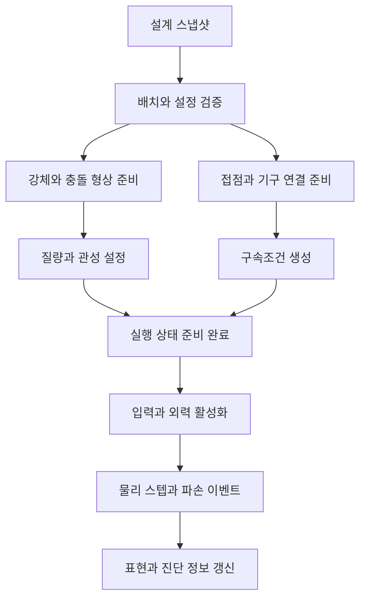

# 05. 물리 실행, 힘 전달, 시간과 안정성

> Steam PC판 공개 자료 기반 역기획 · 조사일 2026-11-13.
> 이 문서의 수식·자료구조·처리 순서는 **유사 동작을 설명하거나 재구현하기 위한 모델**이다. Besiege 내부 솔버·정확한 적분법·계수·현재 물리 스텝 값을 확인한 것으로 읽지 않는다.

## 1. 확인된 사실과 추정의 경계

| 구분 | 확인 또는 정의 | 사용 범위 |
|---|---|---|
| 공식 확인 | 물리 기반 건설과 파괴가 중심 기능 | 게임의 동작 범주 |
| 공식 확인·과거 자료 | 멀티플레이 Global/Local 시뮬레이션과 네트워크 클러스터를 개발사가 설명 | 2017년 공개 아키텍처 |
| 공식 확인 | 부하가 높을 때 시간을 늦추는 Automatic Timescale 도입 | 2025년 공개 기능 |
| 재구성 제안 | 설계 그래프를 강체·구속조건·제어 그래프로 변환 | 구현 검토용 모델 |
| 검증 필요 | 현행 고정 스텝, 반복 횟수, CCD, 충돌 제외, 파단 판정식 | 실행 실험 또는 현행 공식 문서 필요 |

근거: [게임 소개](https://store.steampowered.com/app/346010/Besiege/), [Multiverse 물리 개발 일지](https://store.steampowered.com/news/posts/?appids=346010&enddate=1512760723), [Automatic Timescale 공지](https://store.steampowered.com/news/posts/?appgroupname=Besiege&appids=346010&enddate=1743087457&feed=steam_community_announcements).

## 2. 하나의 기계에 여러 종류의 그래프가 존재한다

**[재구성 제안]** 아래 그래프를 구분하면 ‘붙었는데 안 움직이는 문제’와 ‘보이지만 연결되지 않은 문제’를 설명하기 쉬워진다.

| 그래프 | 노드 | 간선 | 끊어졌을 때 의미 |
|---|---|---|---|
| 설계 그래프 | 배치한 부품 인스턴스 | 사용자가 의도한 부착·끝점 | 편집 관계 변경 |
| 물리 그래프 | 강체 또는 기구 내부의 가동체 | 고정·회전·슬라이드 등 제약 | 분리되거나 운동 범위가 달라짐 |
| 제어 그래프 | 입력·센서·구동기 | 키 또는 논리 신호 | 명령 전달 상실 |
| 자원 그래프 | 연료 저장·사용 부품 | 접속·호스·커플러 | 연료 공급 경로 변경 |
| 복제 그래프 | 네트워크 표현 단위 | 기준 프레임과 상대 변환 | 전송·보간 방식 변경 |

하나의 블록이 반드시 강체 하나일 필요는 없다. 반대로 여러 블록을 전송용으로 묶었다고 해서 솔버에서도 한 강체가 되었다고 결론 내릴 수 없다. **네트워크 클러스터와 물리 강체 병합은 서로 다른 최적화다.**

## 3. 건설 데이터에서 실행 상태로



이 순서는 **[재구성 제안]**이다. 특히 모든 부품과 연결이 준비되기 전에 중력·바람·모터를 먼저 켜면 초기 프레임에서 구조가 무너질 수 있다. 초기 생성 중의 무효한 상태를 정상 시뮬레이션으로 노출하지 않는 것이 목적이다.

### 3.1 초기 조건

실험 기록에는 블록 배치만이 아니라 시작 높이, 기체 자세, 각종 초기 전개량, 키 상태, 타이머 상태, 환경, God Tools 설정을 포함한다. 정지 상태에서 시작하는지, 시작 직후 자동 입력이 발생하는지도 결과를 바꾼다.

### 3.2 중단 후 복구

실행 중 위치를 원위치로 옮기는 것만으로 복구가 끝나지 않는다. 부러진 연결, 손상 상태, 소모 자원, 센서 래치, 분리된 파편, 입력의 눌림 상태까지 초기화해야 한다. 원작의 정확한 복원 구현은 미확인이나, 이러한 상태를 분리하지 않으면 반복 실험의 신뢰성이 사라진다.

## 4. 질량·무게중심·관성

다음은 **일반 강체역학을 사용하는 재구성 모델**이다.

$$M=\sum_i m_i,\qquad \mathbf c=\frac{\sum_i m_i\mathbf x_i}{M}$$

총질량이 같아도 질량이 중심에서 얼마나 멀리 배치되어 있는지에 따라 회전 반응이 달라진다. 병렬축 정리로 설명하면 다음과 같다.

$$\mathbf I=\sum_i\left(\mathbf I_i+m_i\left((\mathbf r_i\cdot\mathbf r_i)\mathbf 1-\mathbf r_i\mathbf r_i^T\right)\right)$$

- 상부 장갑·포탑을 추가하면 전복 경향과 조향 응답을 함께 점검한다.
- 날개 끝에 무거운 물체를 붙이면 롤 가속과 정지에 필요한 토크가 달라진다.
- 연료가 줄면서 질량이 달라지는 부품은 장시간 운용 시 중심 변화도 고려한다.
- 가동부는 각 관절 위치에 따라 전체 질량 분포가 달라질 수 있다.

**[검증 필요]** Besiege의 블록별 질량, 원점, 관성 텐서, 잠긴 자유도, 특수 보정값은 본 문서에서 정량 확정하지 않는다. 장식 외형·스킨의 크기를 물리 질량에 직접 대응시키지도 않는다.

## 5. 힘과 토크를 구분하는 이유

작용점이 중심에서 벗어난 힘은 병진과 회전을 동시에 만든다.

$$\mathbf F_{total}=\sum_i\mathbf F_i,\qquad \boldsymbol\tau=\sum_i(\mathbf x_i-\mathbf c)\times\mathbf F_i+\sum_i\boldsymbol\tau_i$$

| 사례 | 힘의 효과 | 회전 효과 | 구조 설계 질문 |
|---|---|---|---|
| 높은 위치의 포 | 차체 밀림 | 피치 변화 | 반동을 어느 지지점이 받는가? |
| 한쪽만 큰 추력 | 전진 가속 | 요·롤 편향 | 추력 작용선이 중심을 지나는가? |
| 긴 집게 끝의 하중 | 아래로 당김 | 연결부 굽힘 | 팔 길이를 줄이거나 지지점을 늘릴 수 있는가? |
| 좌우 비대칭 부력 | 상승 | 롤 변화 | 중량과 부력 분포를 어떻게 배치할 것인가? |

이 표는 **[설계 해석]**이며 실제 부품이 항상 힘의 보존법칙을 엄밀히 구현한다는 주장이 아니다. 게임화된 추진·안정화 부품은 특수 처리를 가질 수 있으므로 개별 실험이 필요하다.

## 6. 구속조건과 동력

### 6.1 운동을 막는 기능과 움직이는 기능

힌지의 존재는 한 축 회전을 허용한다는 뜻이지, 그 축을 자동으로 돌린다는 뜻은 아니다. 구동기는 허용된 운동에 목표 또는 힘을 제공한다. 관절 제한, 모터, 마찰, 댐핑은 구분해야 한다.

| 요소 | 개념적 역할 | 잘못 해석했을 때 생기는 오류 |
|---|---|---|
| 위치 제한 | 이동 가능한 구간 제한 | 제한을 목표 위치로 오해 |
| 각도 제한 | 회전 범위 제한 | 한계에 닿아도 모터가 힘을 주는 현상 누락 |
| 속도 목표 | 목표 회전·이동 속도 제공 | 무한 토크로 속도를 강제한다고 가정 |
| 위치 목표 | 목표 길이·각도 추종 | 부하 때문에 목표에 못 가는 상황 누락 |
| 최대 구동력 | 구동 능력의 상한 | 작은 모터가 모든 하중을 들어 올린다고 가정 |
| 감쇠 | 상대 운동의 에너지 감소 | 스프링 강성과 동일시 |

### 6.2 일반적인 구동 모델 예시

$$F_{drive}=\operatorname{clamp}\left(k_p(x_{target}-x)-k_d\dot x,-F_{max},F_{max}\right)$$

이 식은 **[재구성 제안]**이며 실제 Piston·Steering의 내부식이 아니다. 속도 모터, 위치 모터, 직접 변환 변경은 같은 입력에서도 전혀 다른 접촉·반력 결과를 만들 수 있다. 부품 문서에서 이를 모르는 경우 `검증 필요`로 남긴다.

## 7. 연결 루프와 과구속

프레임에 바퀴를 달고, 바퀴의 가동측을 다시 Brace로 프레임에 묶으면 구동축이 우회 경로로 고정될 수 있다. 겉보기에는 보강이지만 허용 자유도를 없앤 것이다.

**[재구성 제안]** 설계 분석기는 다음을 구분해 보여 준다.

1. 구조를 연결하는 경로.
2. 실제로 운동이 허용되는 관절 경로.
3. 같은 두 몸체를 중복 구속하는 경로.
4. 실행 시 파단되어야 운동할 수 있는 경로.

닫힌 기구 자체가 잘못된 것은 아니다. 평행 링크·현가장치·엔진 기구는 폐루프를 의도적으로 사용한다. 문제는 자유도와 초기 정렬이 맞지 않는 폐루프, 극단적 질량비, 불필요한 중복 제약이다.

## 8. 접촉과 충돌

| 상황 | 구분해야 할 요소 | 재구성 시 검토 |
|---|---|---|
| 바퀴가 차체와 맞닿음 | 장착 연결과 자기 충돌 | 인접 쌍 충돌 정책 |
| 빠른 탄환이 벽을 통과 | 이동 거리와 충돌 두께 | 연속 충돌 또는 sweep 적용 범위 |
| 시뮬레이션 즉시 튐 | 초기 관통과 분리 보정 | 관통 경고, 시작 위치 수정 |
| 접지한 기체가 떨림 | 접촉·관절·구동의 경쟁 | 솔버 설정, 형상 단순화, 과구속 분석 |
| 파편이 서로 밀어냄 | 파손 후 충돌 필터 변경 | 생성 프레임 유예·충돌 그룹 |

이 항목들은 **[재구성 제안]**이다. Besiege가 모든 고속 물체에 CCD를 쓰거나 쓰지 않는다고 단정하지 않는다. 같은 게임에서도 부품·속도·버전에 따라 다른 경로가 가능하다.

## 9. 파손은 여러 종류의 사건이다

`부품 건강도 소진`, `연결 파단`, `화재로 약화`, `분리 장치 작동`, `충돌로 외형 파편 생성`을 별도 사건으로 분류한다. 연결이 끊어져도 부품은 멀쩡할 수 있고, 부품 외형이 손상되어도 일부 연결이 남을 수 있다.

**[재구성 제안]** 파손 처리에서는 원인·대상·시점·결과를 기록한다.

```text
DamageEvent: 대상 부품, 원인, 크기, 발생 스텝
JointBreakEvent: 연결 ID, 연결 양끝, 원인, 발생 스텝
TopologyChange: 분리된 연결 집합, 갱신된 기구 그룹
EffectEvent: 소리, 먼지, 파편, 화염
```

실제 원작 이벤트 이름이 아니다. 이렇게 나누면 ‘내구도가 약해서’라는 포괄적 설명 대신 어느 연결에 어떤 하중이 몰렸는지 분석할 수 있다. 자세한 분류는 [12 파손](12_damage_and_destruction.md).

## 10. 시간 배율과 실제 시간

[공식 확인] 2025년 Automatic Timescale은 부하에 따라 시뮬레이션 시간을 늦추는 기능으로 소개되었다. 단순히 렌더링 프레임을 높여 주는 기능으로 표현하면 안 된다. [개발사 공지](https://store.steampowered.com/news/posts/?appgroupname=Besiege&appids=346010&enddate=1743087457&feed=steam_community_announcements)

**[재구성 제안]** 계측에서 최소 세 시간을 분리한다.

| 시간 | 의미 | 사용하는 곳 |
|---|---|---|
| 벽시계 시간 | 사용자가 실제로 기다린 시간 | 반응성·사용성·작업 시간 |
| 시뮬레이션 시간 | 물리 세계에서 진행한 시간 | 이동 거리·연료 소비·타이머 |
| 렌더링 프레임 시간 | 화면 한 장의 처리 시간 | 시각적 부드러움 |

슬로모션에서 10초를 기다린 결과와 정상속도에서 10초를 기다린 결과를 직접 비교하면 잘못된 결론에 도달한다. 시험에서는 자동 시간 조절을 고정하거나 사용 여부를 반드시 기록한다.

### 과거의 50 Hz 설명을 읽는 법

[공식 확인·역사 자료] V1.02 공지는 100% 시간 배율에서 **키 에뮬레이션**을 일정한 50fps로 처리한다고 설명했다. 이것만으로 2026년 전체 물리 솔버의 주기까지 50Hz라고 확정할 수 없다. [V1.02 본문](https://store.steampowered.com/news/posts/?appids=346010&enddate=1591733466&feed=steam_community_announcements)

## 11. 성능을 부품 개수 하나로 설명하지 않는다

다음 비용 모델은 **[재구성 제안]**이다.

$$T_{step}\approx T_{bodies}+T_{contacts}+T_{constraints}+T_{fluids}+T_{damage}+T_{logic}$$

정확한 선형식을 뜻하지 않는다. 접촉 수와 제약 루프, 파손으로 인한 그룹 변화, 물·공기 상호작용, 센서 검사 빈도가 함께 변한다. 서로 떨어진 단순 프레임과 서로 충돌하는 사슬은 같은 블록 수라도 비용이 다를 수 있다.

### 진단 우선순위

1. 파손 전후 중 언제 느려지는지 분리한다.
2. 접촉이 거의 없는 정지 시험과 구동 시험을 비교한다.
3. 공기·물·화재·자동화가 켜졌을 때의 증분 비용을 비교한다.
4. 같은 기계를 단독/멀티플레이, 신규/구형 저장본으로 나누어 비교한다.
5. 평균뿐 아니라 최악 구간·로드 시 정지·입력 지연을 본다.

## 12. 재현 실험 계약

실험은 [17 검증 계획](17_validation_experiments.md)의 PHY 계열을 사용한다. 최소한 초기 관통, 자유낙하, 단일 모터 반력, 힌지 잠금, 폐루프 변형, 시간 배율, 파단 전후의 연결 변화를 별도로 확인한다. 본 문서의 예측을 실측 결과로 기록하지 않는다.

## 관련 문서

- [04 연결 규칙](04_connection_rules.md)
- [07 육상 구동](07_ground_locomotion.md)
- [08 기구와 제약](08_mechanisms_and_constraints.md)
- [12 파손과 파괴](12_damage_and_destruction.md)
- [13 자동화](13_automation_and_controls.md)
- [15 멀티플레이](15_multiplayer_and_ugc.md)
- [17 검증 계획](17_validation_experiments.md)
