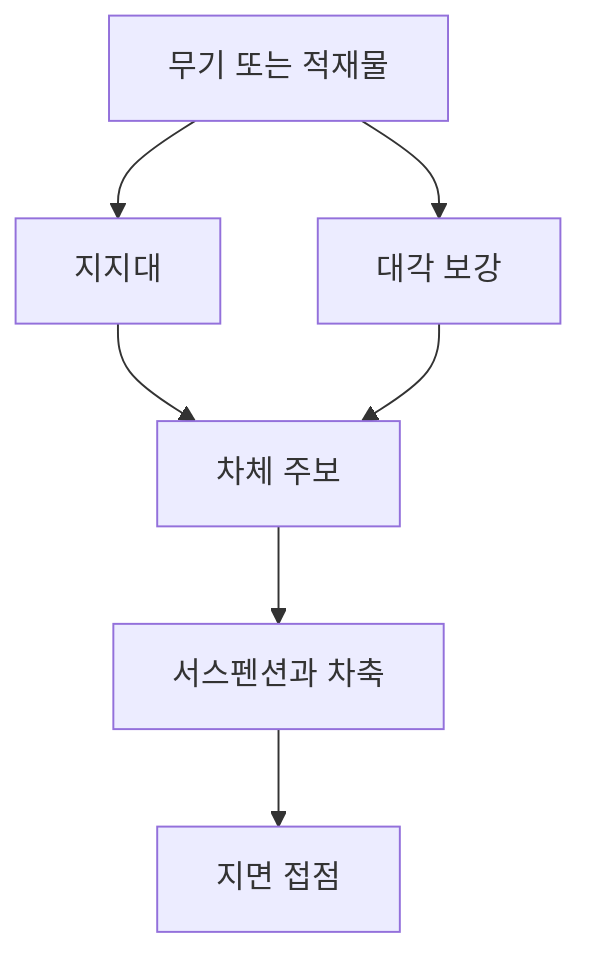

# 06. 구조 블록·재질·질량 배치 역기획

> 조사 기준: 2026-11-13, Steam PC. 본편의 구조 부품을 중심으로 수상·우주 확장과 연결되는 지점을 구분한다. 게임을 실행하거나 내부 코드를 확인한 결과가 아니다. **[공식 확인]**은 개발자 자료에 명시된 내용, **[설계 해석]**은 플레이 구조에 대한 분석, **[재구성 제안]**은 유사 시스템 구현안, **[검증 필요]**는 실행 실험이 필요한 항목이다.

## 1. 시스템의 역할

**[설계 해석]** 구조 부품은 다른 기능 블록을 놓기 위한 빈 공간을 제공하는 데 그치지 않는다. 무기를 지지하고, 구동부의 힘을 전달하며, 질량 중심을 만들고, 손상 이후에도 남아 있을 하중 경로를 결정한다. 같은 바퀴와 대포를 사용해도 차체의 길이·폭·질량 배치·보강 위치가 다르면 전진, 선회, 사격 이후의 자세가 달라질 수 있다.

따라서 구조 설계의 질문은 다음 네 가지로 나눈다.

1. **어디에 붙일 수 있는가:** 배치면, 연결점, 상대 부품, 연결 방향.
2. **어떤 운동을 막는가:** 상대 이동과 회전을 고정할지, 관절을 통해 남겨 둘지.
3. **무엇을 추가하는가:** 질량, 관성, 충돌 면적, 공기·물과 상호작용할 면적.
4. **무엇이 먼저 실패하는가:** 연결 파단, 부품 본체 손상, 접촉 간섭, 화재 전파.

구조 블록을 하나 추가할 때의 비용은 블록 개수만이 아니다. 질량과 접촉 후보가 늘고, 새 연결이 기존 관절을 막을 수 있으며, 무게 중심이 이동한다. 이 상호작용이 조립을 단순 꾸미기와 구별하는 핵심이다.

## 2. 공식 자료로 확인되는 기준점

| 근거 | 확인한 사항 | 이 문서에서의 사용 범위 |
| --- | --- | --- |
| V1.05 Build Surface 소개 | 나무·유리 재질, 사용자 정의 패널, 체력과 파편화, 크기에 따른 손상·응력 반응, 기존 연결 시스템 사용 | 패널을 장식 전용으로 취급하지 않음 |
| V1.5 변경 내역 | 질량 설정 변경 시 질량 중심 갱신, 새로 놓는 길이 조절형 블록의 길이에 맞는 질량 처리 | 저장물의 생성 시점·길이 값을 검증 변수로 둠 |
| V1.75 변경 내역 | Build Surface의 공력 효과 기본값 비활성화 | 패널 형태만 보고 비행 기여를 단정하지 않음 |

출처: [V1.05 공식 공지](https://steamcommunity.com/games/346010/announcements/detail/2198262387487265158), [V1.5 공식 변경 내역](https://store.steampowered.com/news/posts/?appids=346010&enddate=1720798144&feed=steam_community_announcements), [V1.75 공식 변경 내역](https://store.steampowered.com/news/posts/?appgroupname=Besiege&appids=346010&enddate=1772123201&feed=steam_community_announcements). 개별 공지의 본문은 Steam 공식 공지 모음에서 대조했다.

## 3. 구조 부품별 분석 카드

아래 표의 역할은 **[설계 해석]**이다. 연결면 개수, 정확한 질량, 인장·굽힘 한계는 표에서 확정하지 않는다. 특히 겉으로 닿아 있다는 사실과 런타임 연결 생성은 구별해야 한다.

| 부품군 | 조립에서 맡기는 역할 | 물리적으로 확인할 지점 | 대표 실패 형태 |
| --- | --- | --- | --- |
| Starting Block / Source Cube | 설계의 기준점, 저장물 구성의 시작점 | 기준 블록이 실제 질량·충돌·연결에 미치는 영향 | 기준점과 질량 중심을 혼동하여 비대칭 설계 |
| Small Wooden Block | 짧은 연결, 모서리, 작은 간격 조정 | 인접 접촉과 실제 연결의 구별 | 부품 수 증가로 약한 연결이 연속 배치됨 |
| Wooden Block | 차체의 주보, 지지대 | 장축 방향과 하중 방향의 관계 | 긴 캔틸레버 끝의 하중이 뿌리에 집중 |
| Wooden Pole / Log | 긴 지지부, 축 주변의 간격 확보 | 부품별 충돌 형상과 연결면 차이 | 원통 외형을 실제 회전 베어링으로 오인 |
| Brace | 떨어진 구조점 사이의 보강 경로 | 두 끝의 연결 대상, 중앙부 충돌, 상대 회전 구속 | 가동 관절을 가로질러 보강하여 운동을 막음 |
| Ballast | 질량 배분, 카운터웨이트 | 질량 변경과 관성·중심 변화 | 질량 중심을 내리는 대신 전체 하중을 지나치게 증가 |
| Wooden Panel / Half Pipe | 접촉면, 물체 유도면, 외형 구성 | 면 방향, 가장자리, 충돌체와 외형 일치 | 얇은 판 외형 때문에 다른 부품이 통과한다고 착각 |
| Build Surface | 비정형 외피, 날개 후보, 외형과 구조 통합 | 모서리와 주변 블록의 연결, 재질, 공력 설정 | 큰 패널 한 장에 많은 하중과 손상을 집중 |
| Armour 계열 | 취약 부품 앞의 방호면 | 어떤 공격을 차단하는지, 자체 연결의 생존성 | 장갑은 남아 있지만 지지대가 끊어져 방호 기능 상실 |

**[검증 필요]** 위 목록은 역할을 비교하기 위한 핵심 부품군이며 현행 전체 카탈로그의 수량을 보증하지 않는다. `Wooden Block`, `Wooden Pole`, `Wooden Panel`은 별개 부품으로 취급하고, 번역된 UI 이름과 영문 식별명을 함께 수집해야 한다.

### 3.1 Starting Block은 좌표 기준과 물리 중심을 분리해 읽는다

**[설계 해석]** 조립 시작점 주변에 모든 블록이 생성되었다고 해서 그곳이 완성품의 질량 중심인 것은 아니다. 한쪽에 대포, 회전 장치, Ballast가 늘어나면 물리적인 중심은 달라진다. 부품을 원점 기준으로 대칭 배치했더라도 질량·매개변수·연결이 서로 다르면 동역학적으로 대칭이 아니다.

**[재구성 제안]** 설계 좌표계의 원점과 질량 중심 마커를 다른 모양으로 표시한다. 저장·복제용 기준점 변경은 실제 질량 재배치와 분리하여 Undo 명령을 만든다. 플레이어가 기준점을 옮겼다는 이유로 시뮬레이션 결과가 바뀌지 않아야 한다.

### 3.2 짧은 블록의 연속과 긴 블록의 차이

**[설계 해석]** 같은 외형 길이를 만들더라도 짧은 부품의 연결 사슬과 긴 단일 부품은 비교 대상이 다르다. 연결 사슬에는 접합부가 여러 개 있고, 그 접합부가 굽힘을 허용하거나 끊어질 여지가 있다. 반대로 긴 부품 하나는 중간 지지점을 원하는 곳에 만들기 어렵거나 충돌 면적이 커질 수 있다.

이 차이를 평가할 때는 길이만 맞추지 말고 총질량, 끝단 하중, 연결 방식까지 같게 해야 한다. 동일 길이에서 어느 쪽이 더 강하다는 결론은 직접 실험 전에는 확정하지 않는다.

### 3.3 Brace의 핵심은 추가 하중 경로

**[설계 해석]** Brace를 붙였다는 사실보다 두 끝이 실제로 어느 구조에 연결되었는지가 중요하다. 차체와 포탑을 연결한 Brace는 지지대가 될 수도 있지만, 포탑 회전축을 가로질러 의도한 회전을 막을 수도 있다. 구조가 이미 충분히 고정된 부위에 겹쳐 붙이면 시각적인 밀도만 증가하고 취약점은 남을 수 있다.

**[검증 필요]** Brace가 모든 상황에서 완전 용접과 같은 6자유도 구속인지, 끝단의 연결 개수·재질·방향에 따라 어떤 차이를 보이는지, 중앙 막대 전체가 접촉 판정에 참여하는지는 공식 소개만으로 확정하지 않는다. 이를 확인하기 전에는 일반 강체 막대와 동일하다고 구현해서는 안 된다.

## 4. 질량과 관성: 위치가 성능을 바꾸는 이유

아래 식은 **[재구성 제안]**에 사용하는 강체역학 참고식이다. Besiege의 내부 계산식이나 단위를 공개한 것으로 해석하지 않는다.

\[
M=\sum_i m_i,\qquad \mathbf r_{cm}=\frac{\sum_i m_i\mathbf r_i}{M}
\]

같은 추가 질량도 질량 중심에서 멀리 둘수록 회전 관성에 더 크게 기여한다. 개념적으로는 평행축 정리를 사용해 설명할 수 있다.

\[
\mathbf I=\sum_i\left(\mathbf I_i+m_i(\|\mathbf d_i\|^2\mathbf E-\mathbf d_i\mathbf d_i^T)\right)
\]

| 조정 | 기대하는 설계 효과 | 함께 확인할 부작용 |
| --- | --- | --- |
| 무게를 낮게 배치 | 지상 선회 시 전복 경향 감소 | 지상고 감소, 차체 바닥 접촉 |
| 앞뒤 중심에 질량 집중 | 조향 시 회전 관성 감소 | 피치 안정성·무기 배치 공간 감소 |
| 긴 투석기 반대편에 Ballast | 팔의 무게와 균형 조정 | 주축 하중과 회전 관성 증가 |
| 사격축 아래에 질량 추가 | 반동에 따른 기울어짐 감소 후보 | 가속과 등판 성능 저하 |
| 좌우 질량 대칭 | 직진과 자세 제어의 비교 기준 확보 | 좌우 연결 강성·구동 방향까지 같아야 함 |

**[설계 해석]** “무거워서 안정적이다”는 불완전한 설명이다. 같은 질량에서도 높이, 앞뒤 위치, 차폭과 접점 배치가 다르다. 질량이 늘어나면 가속에 필요한 힘과 연결 하중도 늘어난다. 안정성 개선은 반드시 이동·구동·파손과 함께 평가한다.

### 4.1 길이 조절형 부품은 생성 이력을 기록한다

**[공식 확인]** V1.5는 새로 배치한 길이 조절형 블록의 질량 처리를 수정했다고 명시한다. 따라서 오래된 저장물, 새 부품, 길이 편집 후 저장물을 동일 표본으로 합치면 원인을 잘못 찾을 수 있다. [V1.5 변경 내역](https://store.steampowered.com/news/posts/?appids=346010&enddate=1720798144&feed=steam_community_announcements)

**[재구성 제안]** 재현용 로그에는 `game_version`, `save_origin_version`, `freshly_placed`, `length_before`, `length_after`, `mass_readback`을 둔다. 마지막 항목은 실제로 읽을 수 있을 때만 채우고, 추정한 질량은 별도 열로 남긴다.

## 5. 연결 그래프와 하중 경로

**[재구성 제안]** 구조를 블록 목록과 연결 그래프 두 가지로 저장한다. 아래 그림은 게임 내부 그래프를 복원한 결과가 아니라 구조 분석을 위한 표현이다.



분석은 힘을 받는 지점에서 시작해 지면 접점까지 경로를 추적한다. 똑같은 무기를 지지하더라도 긴 지지대 하나만 지나가는 경로와 여러 경로로 분산되는 구조는 실패 양상이 다를 수 있다.

### 5.1 연결 하나를 잃었을 때의 생존성

| 구조 | 하나의 연결 파단 후 예상 분석 | 재설계 방향 |
| --- | --- | --- |
| 일렬 사슬 | 뒤쪽 전체가 분리될 후보 | 별도 지지 경로 또는 모듈 분리 허용 |
| 고리 형태 | 다른 경로가 하중을 전달할 후보 | 남은 경로의 과부하 확인 |
| 가동부를 두 경로로 고정 | 회전 자체가 막힐 후보 | 가동부 쪽 연결에 관절 도입 |
| 장갑 외피에 주요 장치를 연결 | 외피 손상과 기능 상실이 결합 | 핵심 기능은 내부 주보에 연결 |

**[검증 필요]** 실제 연결 파단 순서는 접합 강도, 초기 겹침, 구동 하중, 접촉 조건에 영향을 받는다. 위 표는 결과를 예언하는 규칙이 아니라 실험 설계를 위한 가설이다.

## 6. Build Surface: 외형, 물리, 손상이 만나는 부분

### 6.1 서로 분리해서 기록할 속성

**[재구성 제안]** 사용자 정의 패널은 하나의 “메시” 필드로 관리하기 어렵다.

| 계층 | 필요한 데이터 | 독립적으로 다루는 이유 |
| --- | --- | --- |
| 편집 | 모서리·노드·곡면 조절 값 | 원래 조립 의도를 보존 |
| 렌더링 | 표면 메시, 재질, 색 | 외관 변경과 물리 변경 분리 |
| 충돌 | 충돌 근사 형상 | 시각적인 면과 접촉 판정의 불일치 진단 |
| 연결 | 주변 블록 연결과 앵커 | 모양을 바꿔도 어느 부품에 붙는지 추적 |
| 공력 | 활성 여부, 방향별 응답 | 외형상 날개인 것과 실제 공력 참여 구별 |
| 손상 | 본체 상태, 파편 전환 | 손상 후 기능과 시각 효과의 일관성 |

### 6.2 큰 패널과 작은 패널 여러 개

**[설계 해석]** 큰 패널은 외형을 빠르게 만들지만 손상 범위와 연결 의존성이 집중될 수 있다. 작은 패널 여러 개는 국소 손상과 교체를 분리하기 쉽지만 연결·충돌 후보와 편집 비용이 증가한다. 정확한 성능 관계를 “면적에 비례”라고 가정하지 말고, 동일 면적·동일 질량·동일 지지 조건에서 비교한다.

**[검증 필요]** 패널 크기, 곡률, 두께와 파손 기준의 관계는 공식 정량식이 확인되지 않았다. 모드에서 허용되는 두께·스케일을 기본 UI 기능으로 간주하지 않는다. V1.75의 공력 기본값 변경 또한 기존 저장물의 값까지 자동 변경했다는 의미로 확장하지 않는다.

## 7. 구조 설계용 진단 순서

**[설계 해석]** 무너지는 기계를 보강하기 전에 실패 시점을 분류해야 한다.

1. **입력 전부터 무너짐:** 잘못된 연결, 초기 관통, 과도한 정적 하중 후보.
2. **모터를 켤 때 무너짐:** 반력, 가동부 간섭, 가속 과다 후보.
3. **지면을 떠난 뒤 무너짐:** 한쪽 지지 상실과 관성 하중 후보.
4. **사격 후 무너짐:** 반동 전달 경로, 무기 지지 길이 후보.
5. **불이 번진 뒤 무너짐:** 열·손상과 연결 생존성의 결합 후보.

같은 실패라도 최종 파편 위치만 보면 최초 원인을 놓친다. 첫 연결 파단 시점, 해당 부품의 접촉 여부, 그 직전 입력을 우선 기록한다.

## 8. 구조 실험 목록

아래는 **아직 수행하지 않은 검증 절차**다.

| ID | 최소 조립물 | 바꾸는 조건 | 관찰과 판별 |
| --- | --- | --- | --- |
| ST-01 | 같은 길이의 주보 2종 | 짧은 블록 연속 / 긴 블록 | 동일 끝단 하중에서 처짐·첫 파단 위치 |
| ST-02 | 사각 프레임 | Brace 없음 / 대각 1개 / 대각 2개 | 질량 차이와 보강 효과를 분리 |
| ST-03 | 회전 관절 달린 팔 | 관절을 가로지르는 Brace 유무 | 운동 잠김 또는 연결 파단 발생 여부 |
| ST-04 | 대칭 차체 | Ballast 위치만 변화 | 중심 표시, 기울기, 선회·전복 양상 |
| ST-05 | 같은 외형의 패널 | 나무 / 유리 | 반복 충돌과 단발 큰 충돌을 따로 비교 |
| ST-06 | 동일 패널 형상 | 공력 on/off | 공중 운동 변화와 구조 강성 변화를 혼동하지 않음 |
| ST-07 | 길이 조절형 부품 | 신규 / 구형 저장 / 재저장 | 총질량·중심 변화·재현성 |
| ST-08 | 장갑을 단 차체 | 장갑의 지지점 수 | 장갑 본체보다 지지 연결이 먼저 끊어지는지 |

## 9. 재구성 시 최소 데이터 계약

```text
StructuralPartDefinition
  typeId
  materialProfileId
  massPolicy                   # 고정, 길이 기반 등: 구현안
  collisionProfileId
  attachmentDescriptors[]
  damageProfileId

StructuralPartInstance
  stableInstanceId
  localTransform
  parameterOverrides
  createdWithVersion
  authoredShape                # Build Surface 등

StructuralConnection
  endpointA, endpointB
  localAnchorA, localAnchorB
  constraintProfileId
  runtimeState                 # 연결됨/파단됨 등
```

**[재구성 제안]** 블록 정의, 배치 인스턴스, 런타임 연결을 나누면 스킨 변경과 질량 변경, 연결 파단을 각각 추적할 수 있다. 이 데이터 이름이나 필드가 Besiege의 실제 포맷이라는 뜻은 아니다.

## 10. 관련 문서

- [조립 UX](02_assembly_ux.md)
- [연결 규칙](04_connection_rules.md)
- [지상 이동](07_ground_locomotion.md)
- [기계 장치와 구속](08_mechanisms_and_constraints.md)
- [손상과 파괴](12_damage_and_destruction.md)

**남은 검증:** 부품별 정확한 질량과 단위, Brace의 구속·충돌 범위, 구조 부품의 연결면, 패널 크기별 강도식, 저장 버전별 질량 처리. 확인 전에는 구현 상수로 옮기지 않는다.
