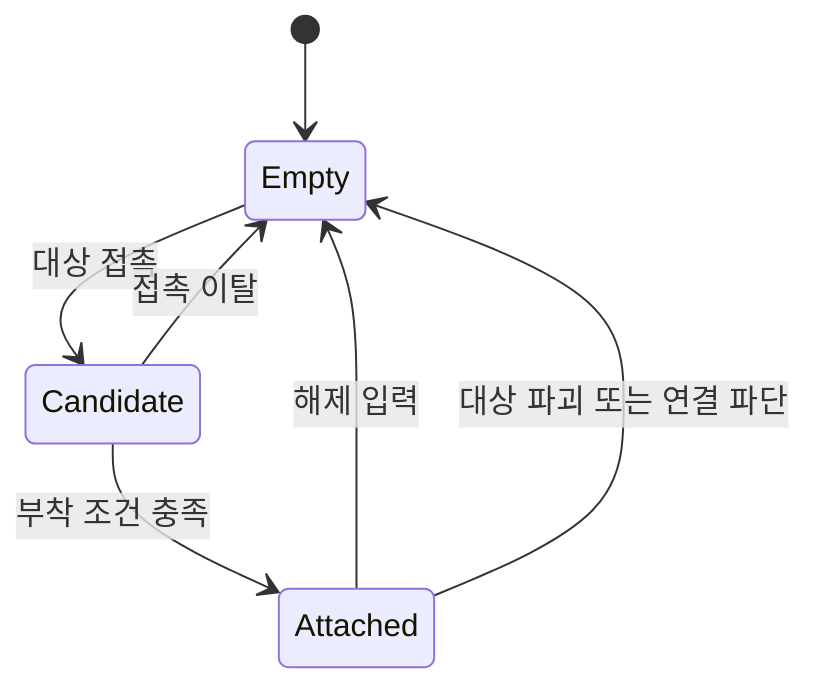
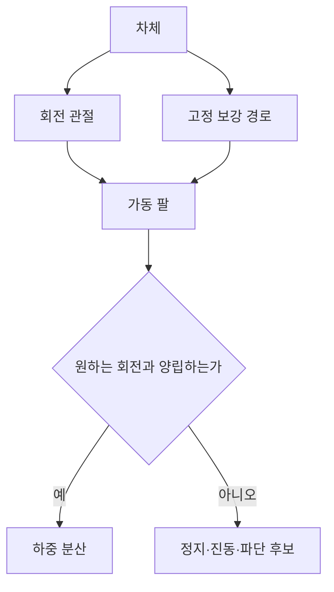

# 08. 관절·구동·스프링·로프·결합 장치 역기획

> 조사 기준: 2026-11-13, Steam PC. **[공식 확인]**은 개발자 공지의 규칙, **[설계 해석]**은 기능을 이해하기 위한 분석, **[재구성 제안]**은 유사 시스템의 구현 모델, **[검증 필요]**는 실행으로 확인해야 할 부분이다. 아래 자유도 표는 실제 엔진 Joint의 종류나 플래그를 열람한 결과가 아니다.

## 1. 이 시스템의 핵심: 형태가 아니라 허용 운동을 조립한다

**[설계 해석]** 기계 장치 블록을 조합하는 행위는 상대 운동을 남기거나 막는 행위다. 무작정 단단하게 고정하면 움직이지 않고, 자유도를 지나치게 많이 남기면 원하는 힘을 전달하지 못한다. 구동부는 운동을 만들고, 관절은 운동의 경로를 제한하며, 구조물은 반력을 받는다.

투석기, 조향장치, 집게, 왕복엔진을 같은 문법으로 분석할 수 있다.

1. 고정할 기준 몸체를 정한다.
2. 움직일 몸체를 분리한다.
3. 두 몸체 사이의 허용 이동·회전축을 정한다.
4. 필요한 축에만 구동 또는 복원력을 둔다.
5. 구동 반력이 돌아가는 경로를 만든다.
6. 접촉 간섭과 파단을 검증한다.

## 2. 부품의 자유도 비교

축 `z`는 설명 편의를 위한 부품의 기준축이다. **아래는 [재구성 제안]의 이상화된 기능 모델**이며, Axle의 2축·자기 축 회전 제한만 공식 설명에 직접 대응한다. 실제 부품 방향과 각도 한계는 게임에서 확인해야 한다.

| 부품 | 자유롭게 남기는 상대 운동 모델 | 구동·복원 | 주요 역할 |
| --- | --- | --- | --- |
| Hinge | 회전 1축 | 외부 힘에 반응 | 팔, 문, 접이식 다리 |
| Swivel Joint | 기준축 회전 1축 | 외부 회전 입력 전달 | 회전체 지지, 축 분리 |
| Ball Joint | 회전 3축 | 수동 | 방향이 바뀌는 연결, 추종 기구 |
| Axle | 굽힘 회전 2축, 축 방향 자유 비틀림 제한 | 수동 전달 | 꺾인 구동축에서 회전 전달 |
| Slider | 이동 1축 | 수동 | 가이드, 직선 운동 경로 |
| Piston | 이동 1축 | 능동 | 밀기·당기기, 왕복 구동 |
| Suspension | 이동 1축 중심 모델 | 스프링·감쇠 | 충격 흡수와 하중 지지 |
| Steering Block / Hinge | 제어되는 회전 1축 중심 모델 | 능동·복귀 설정 검토 | 조향·팔의 위치 조정 |
| Spinning Block | 제어되는 회전축 | 능동·free spin 설정 검토 | 지속 회전 장치 |
| Contractable Spring | 두 끝점 간 거리와 복원 응답 | 수축 입력·탄성 응답 검토 | 발사 에너지, 인장 기구 |
| Rope + Winch | 두 끝점 간 길이 제한 모델 | 길이 조절 | 견인·권상·당김 |
| Brace | 두 끝 사이의 구조 구속 | 수동 | 추가 하중 경로 |
| Grabber | 런타임에 대상과 연결을 생성·해제하는 모델 | 접촉·입력 | 집기·붙잡기 |
| Decoupler | 기존 연결 해제 모델 | 입력 | 분리·투하 |

**[공식 확인]** V1.25는 Axle이 두 회전축을 허용하고 자기 축을 자유롭게 돌지 않게 하여 회전을 전달한다고 설명한다. 같은 업데이트에 Slider의 사전 확장, Grabber의 flexible 옵션이 있다. [V1.25](https://steamcommunity.com/games/346010/announcements/detail/3702564861056742651)

## 3. 수동 관절의 부품별 분석

### 3.1 Hinge와 Swivel Joint

**[설계 해석]** 둘을 모두 “회전하는 연결”로만 소개하면 조립 오류를 설명할 수 없다. 핵심은 부착 방향에 대한 회전축이다. 차체 위에서 팔이 위아래로 움직여야 하는지, 포탑이 차체를 중심으로 돌아야 하는지 먼저 정하고 맞는 축을 고른다.

| 분석 항목 | 확인 방법 |
| --- | --- |
| 회전축 | 짧은 비대칭 막대를 연결해 외부 힘을 가한다 |
| 축방향 이동 | 관절 양쪽에 인장·압축 하중을 준다 |
| 회전 한계 | 한 바퀴 회전 가능한지와 제한각 충돌을 구분한다 |
| 회전 저항 | 입력 없이 같은 초기 속도에서 감속을 비교한다 |
| 부착 간섭 | 연결 뒤쪽과 회전체 사이 접촉 여부를 확인한다 |

**[검증 필요]** 자유 회전이라는 분류가 감쇠 0, 마찰 0, 무한한 연결 강도를 의미하지는 않는다. 부품 내부의 회전 기준축, 기본 제한각, solver 구속 강도는 확인되지 않았다.

### 3.2 Ball Joint

**[설계 해석]** 방향을 자유롭게 바꿔야 하는 부위를 연결하는 후보로 다룬다. 그러나 방향 추종과 회전 동력 전달은 다른 요구다. 출력축을 같은 속도로 돌려야 하는 구동계에 회전 자유도를 전부 남기면 기대한 전달이 성립하지 않을 수 있다.

같은 두 몸체를 Ball Joint 하나로 잇는 구성, Ball Joint와 보조 링크로 잇는 구성, Axle로 잇는 구성을 따로 비교해야 한다. 보조 링크가 생기면 전체 기구의 자유도는 단일 부품의 자유도와 달라진다.

### 3.3 Axle

**[공식 확인]** 공식 설명의 차별점은 Ball Joint와 달리 자기 축의 자유로운 비틀림을 제한한다는 것이다. [V1.25](https://steamcommunity.com/games/346010/announcements/detail/3702564861056742651)

**[설계 해석]** 꺾인 축 사이에서 방향 변화와 회전 전달을 동시에 요구하는 장치에 적합한 기능 모델이다. 다만 실제 유니버설 조인트의 속도 변동을 게임이 그대로 재현하는지, 허용 꺾임각이 얼마인지, 큰 각도에서 토크 손실이 어떤지는 별도 검증이 필요하다.

**실험 설계:** 입력축에 눈에 잘 보이는 표시를 붙이고 출력축에는 작은 편심 질량을 둔다. 축 각도를 단계적으로 바꾸며 입력·출력 회전 비율, 진동, 파단을 기록한다. 직접 힘을 주는 구동 부품이 출력축에도 붙어 있으면 전달 검증이 되지 않으므로 제거한다.

## 4. 회전 구동 부품

### 4.1 Steering 계열과 Spinning Block

**[공식 확인]** V1.26에는 조향 부품 tension과 Spinning Block의 free spin 설정이 기록되어 있다. [V1.26](https://steamcommunity.com/games/346010/announcements/detail/6001676034307566167)

**[설계 해석]** 회전 구동은 다음 세 상태를 구별해야 한다.

| 상태 | 플레이어가 기대할 수 있는 의미 | 확인해야 하는 실제 동작 |
| --- | --- | --- |
| 구동 중 | 원하는 방향으로 회전 | 속도 목표·토크 제한·부하 의존성 |
| 입력 해제 | 중립·정지 또는 회전 유지 | 제동·자유회전·복귀 중 어느 것인지 |
| 외력 작용 | 위치를 버티거나 밀림 | tension·강성·파단과의 관계 |

`free spin`이라는 옵션명만으로 입력 해제 즉시 모터가 완전히 제거된다고 단정하지 않는다. 외부 힘이 없는 공중 시험과 지면 접촉 시험을 나누어 결과를 확인한다.

### 4.2 Powered Cog / Unpowered Cog / Large Unpowered Cog

**[설계 해석]** 톱니 부품은 회전원과 맞물림이라는 두 역할을 가진다. 동력 톱니는 회전을 만들 수 있지만, 옆 톱니로 전달되는 운동은 두 형상의 간격·축 정렬·접촉 조건에도 의존한다.

| 조립 조건 | 분석할 문제 |
| --- | --- |
| 축 간격이 큼 | 톱니가 닿지 않아 전달이 끊기는가 |
| 축 간격이 너무 작음 | 초기 관통과 큰 접촉 반력이 생기는가 |
| 축이 평행하지 않음 | 한쪽만 맞물려 밀려나는가 |
| 출력 부하가 큼 | 입력 모터 감속·치형 건너뜀·연결 파단 중 무엇이 먼저 생기는가 |
| 다른 회전원이 둘 다 활성화 | 기어비가 아닌 모터 충돌을 보고 있지 않은가 |

**[재구성 제안]** 이상적인 기어비 비교에는 `ω₁r₁ ≈ -ω₂r₂`를 참고할 수 있다. 이것은 Besiege의 실제 치형 충돌이나 강제 기어비 구속 구현을 뜻하지 않는다. 내부적으로 접촉만 사용하는지, 보조 구속이 있는지도 확인 대상이다.

### 4.3 Fly Wheel

**[공식 확인]** V1.65는 Fly Wheel의 회전 변화 저항과 관성·power 설정, 클러치 입력을 소개한다. [V1.65](https://steamcommunity.com/games/346010/announcements/detail/4441207205094492419)

**[설계 해석]** 입력의 순간 변화와 출력의 회전 변화 사이를 완충하는 기구로 분석한다. 특히 클러치를 연결한 순간에 입력·출력축의 속도 차이가 크면 구조 하중이 증가할 수 있다. 공식 소개의 “일정한 속도”라는 직관적 표현을 무한 에너지 또는 부하와 무관한 완전 고정 회전으로 해석해서는 안 된다.

**[검증 필요]** 게임의 power가 능동적인 에너지 공급인지, 회전 전달 제한인지, 감쇠와 관련된 매개변수인지 정량식은 공개 자료만으로 확인하지 못했다. 클러치 해제 중의 감속, 출력 부하에 대한 반응, 관성 변화 시 질량 중심과 회전 응답을 분리 실험한다.

## 5. 직선 운동 장치

### 5.1 Slider와 Piston의 구별

**[설계 해석]** Slider는 운동을 직선으로 제한하는 가이드, Piston은 그 방향으로 움직이게 하는 구동 요소라는 기능 모델로 출발한다. 둘을 같은 확장 막대로 취급하면 수동 기구와 구동 기구의 차이가 사라진다.

| 항목 | Slider의 분석 관점 | Piston의 분석 관점 |
| --- | --- | --- |
| 에너지 공급 | 외부 하중·다른 구동원의 역할 | 입력에 따른 자체 구동 |
| 시작 길이 | 조립된 위치가 허용 구간 중 어디인가 | 초기 확장 상태와 입력의 관계 |
| 끝단 | 제한 위치에서 하중 전달 | 구동 계속 시 모터·연결의 반응 |
| 횡방향 하중 | 가이드로서 버티는가 | 축이 아닌 힘이 들어올 때 안정적인가 |
| 멈춤 | 마찰·댐핑·기계적 제한 | 입력 해제·역입력·정지 제어 |

**[공식 확인]** Slider의 사전 확장 기능은 V1.25 변경 내역에 있다. Piston이 있는 저장물을 불러올 때 확장 상태가 접히던 문제는 과거 공식 수정 이력에 등장한다. 이는 시작 상태를 저장 데이터로 검증해야 할 근거다. [V1.25](https://steamcommunity.com/games/346010/announcements/detail/3702564861056742651), [2018년 공식 수정 내역](https://store.steampowered.com/news/posts/?appids=346010&enddate=1525436238&feed=steam_community_announcements)

**[검증 필요]** Piston이 목표 위치 drive인지, 속도 drive인지, 직접 변환 조정인지 확정하지 않는다. 설정 값의 단위, 최대 힘, 양방향 입력 충돌과 끝단 처리도 실험 전에는 고정하지 않는다.

### 5.2 왕복 운동을 회전으로 바꾸는 분석 예

**[재구성 제안]** Piston–링크–크랭크–회전축으로 구성한 기계를 시험한다. 크랭크가 축과 일직선이 되는 사점에서는 동일한 직선 힘이 회전 토크로 거의 바뀌지 않을 수 있다. Fly Wheel이나 위상이 다른 두 구동부를 넣는 실험은 사점 통과를 분석하는 용도로 유용하다.

이 예는 게임에서 실제 만들어 검증한 설계도가 아니다. 구동 입력을 단순 반복했을 때 저절로 안정적인 엔진이 된다고 가정하지 않는다. 관절 축, 기하학적인 간섭, 입력 위상, 초기 위치를 별도 변수로 둔다.

## 6. Contractable Spring과 Rope + Winch

### 6.1 비슷하게 보이는 두 끝점 부품의 차이

**[설계 해석]** 긴 선 모양으로 보이는 부품은 모두 같은 물리 모델을 쓰는 것이 아니다. 분석할 때는 “길이를 제한하는가”, “길이 편차에 따라 힘을 내는가”, “입력으로 기준 길이를 바꾸는가”를 나누어야 한다.

| 항목 | Spring에서 확인할 것 | Rope + Winch에서 확인할 것 |
| --- | --- | --- |
| 입력 전 | 배치 길이가 자연 길이·최대 길이 중 무엇인가 | 설정 길이와 끝점 거리의 관계 |
| 입력 중 | 기준 길이 감소 또는 직접 수축 구동인지 | 감기·풀기와 길이 제한의 변화 |
| 입력 해제 | 원래 길이 복귀·유지·자유 중 무엇인가 | 마지막 길이 유지·미끄러짐 여부 |
| 압축 | 밀어내는 힘도 생기는가 | 줄이 느슨해지는 것과 압축력을 구별 |
| 중간 장애물 | 부품 중앙이 충돌하는가 | 물체를 감아 도르래처럼 작동하는가 |
| 파손 | 끝단 연결과 중앙부의 파단 구별 | 잘림·끝단 분리·대상 파괴의 구별 |

**[검증 필요]** 본 문서는 Spring이 항상 양방향 Hooke 스프링이라고 확정하지 않는다. Rope가 실제 다절점 로프이며 장애물을 감거나 도르래에서 경로를 바꾼다고도 확정하지 않는다. 물리적 길이와 시각적인 선분을 혼동하지 않는 것이 핵심이다.

### 6.2 재구성 시 선택 가능한 모델

**[재구성 제안]** 일반적인 양방향 스프링은 다음과 같이 시작할 수 있다.

\[
F=-k(\ell-\ell_0)-c\dot\ell
\]

장력만 허용하는 줄은 `ℓ > ℓmax`일 때만 당기는 제한으로 만들 수 있다. 감기는 `ℓmax`를 줄이는 동작, 풀기는 이를 늘리는 동작으로 모델링한다. 어느 모델을 택하든 양 끝에 반대 방향의 힘을 적용해야 한쪽 끝을 월드에 고정한 것 같은 오류를 줄일 수 있다. 단, 이것은 재구성 구현의 물리 일관성 원칙이며 게임의 실제 힘 적용 코드를 확인한 진술은 아니다.

### 6.3 투석기 예에서의 설계 선택

**[설계 해석]** 발사 팔을 Spring으로 당길 때는 팔의 회전축과 스프링 연결점 사이 거리, 바닥 쪽 앵커 위치, 초기 팔 각도가 모두 발사 특성을 바꾼다. 스프링 수를 늘리면 에너지뿐 아니라 지지부 하중도 늘어난다. 길이와 위치를 그대로 두고 강도만 높이는 방식은 발사 성능 개선보다 지지부 파손을 먼저 만들 수 있다.

발사체를 놓는 시점도 중요하다. 같은 팔 운동에서 Grabber 또는 Decoupler로 해제하는 각도만 바꾸어 사거리·고도·재현성을 비교한다. 단순히 “스프링의 힘이 세면 멀리 간다”로 결론내리지 않는다.

## 7. Grabber와 Decoupler

### 7.1 Grabber

**[공식 확인]** V1.26은 자동 집기 사용 여부와 관련하여 붙잡기·놓기 입력을 분리하는 변경을 명시한다. [V1.26](https://store.steampowered.com/news/posts/?appids=346010&enddate=1715361118&feed=steam_community_announcements)

**[재구성 제안]** 아래는 런타임 결합을 설명하는 상태 모델이다.

게임에 위 이름의 상태가 존재한다는 뜻은 아니다. 특히 입력 한 번으로 대상을 잡지 못했을 때 재시도되는지, 자동 모드에서 놓은 대상을 즉시 다시 잡는지, flexible 옵션이 어떤 자유도를 남기는지 확인해야 한다.

### 7.2 Decoupler

**[설계 해석]** Decoupler의 주 역할은 결합된 장치를 분리하여 새로운 운동 단위로 만드는 것이다. 분리는 곧 발사와 같은 의미가 아니다. 해제 시 추가 충격량이 있는지, 기존 속도가 어떻게 전달되는지, 다른 Brace나 패널 연결이 남아 있는지를 나눠 살펴야 한다.

| 실패 사례 후보 | 원인 질문 |
| --- | --- |
| 입력했지만 물체가 안 떨어짐 | 다른 연결 경로가 남았는가 |
| 분리 순간 예상보다 튐 | 저장된 구속 에너지·초기 관통·별도 분리력 중 무엇인가 |
| 자동화에서만 동작하지 않음 | 입력 이벤트·키 그룹·버전 차이인가 |
| 분리물 조작이 계속됨 | 제어 입력의 소속이 물리 연결과 독립적인가 |

**[공식 확인]** V1.26에는 Decoupler의 자동화 동작 수정이 기록되어 있다. 이 이력은 부품 자체 입력과 자동화 입력을 별도 테스트할 이유가 된다. [V1.26](https://steamcommunity.com/games/346010/announcements/detail/6001676034307566167)

## 8. 과구속과 반력

**[설계 해석]** 하나의 부품을 두 경로로 고정하면 전체 구조는 단단해질 수 있지만, 한 경로가 회전을 요구하고 다른 경로가 회전을 막는다면 구동부가 자기 구조와 싸우게 된다.

**[재구성 제안]** 빌드 단계에서 “관절이 있는데 움직일 수 없는 폐회로”를 알려주는 검사는 유용하다. 다만 모든 폐회로를 오류로 금지하면 사절 링크나 실제 기계 구조를 만들 수 없다. 금지 대신 연결 경로와 충돌 후보를 보여 주고 시험하게 해야 한다.

## 9. 시험 항목과 판별 기준

아래 절차는 실제 수행 결과가 아니다.

| ID | 대상 | 바꾸는 조건 | 구별하려는 규칙 |
| --- | --- | --- | --- |
| MC-01 | Hinge / Swivel | 설치 방향만 변화 | 로컬 회전축 |
| MC-02 | Ball Joint / Axle | 입력축 꺾임각 | 자유 추종과 회전 전달 |
| MC-03 | Spinning Block | free spin·입력 해제 | 모터 정지와 자유 회전 |
| MC-04 | Cog 2개 | 축 간격·부하 | 접촉 전달과 구동 한계 |
| MC-05 | Fly Wheel | 클러치·관성·부하 | 회전 완충과 에너지 공급 방식 |
| MC-06 | Piston | 외부 하중·속도·확장 상태 | 위치/속도 구동과 힘 제한 |
| MC-07 | Slider | 시작 확장·횡하중 | 수동 이동과 끝단 제한 |
| MC-08 | Spring | 끝점 거리·입력·압축 | 자연 길이·장력/압축 응답 |
| MC-09 | Rope + Winch | 장애물·느슨함·감기 | 중간 충돌·감김·길이 제한 |
| MC-10 | Grabber | 자동·수동·flexible | 부착 타이밍·자유도·재부착 |
| MC-11 | Decoupler | 보조 연결 유무 | 실제 분리 범위와 추가 충격 |

## 10. 관련 문서

- [연결 규칙](04_connection_rules.md)
- [구조·질량](06_structure_and_materials.md)
- [바퀴·조향·현가](07_ground_locomotion.md)
- [자동화](13_automation_and_controls.md)
- [손상과 파괴](12_damage_and_destruction.md)

**남은 검증:** 실제 자유도·각도 제한, 모터의 목표값과 힘 제한, Spring의 압축 응답, Rope의 중간 충돌, Grabber flexible의 구속, Decoupler의 분리 충격. 외형과 일반적인 기계 지식만으로 내부 구현을 단정하지 않는다.
