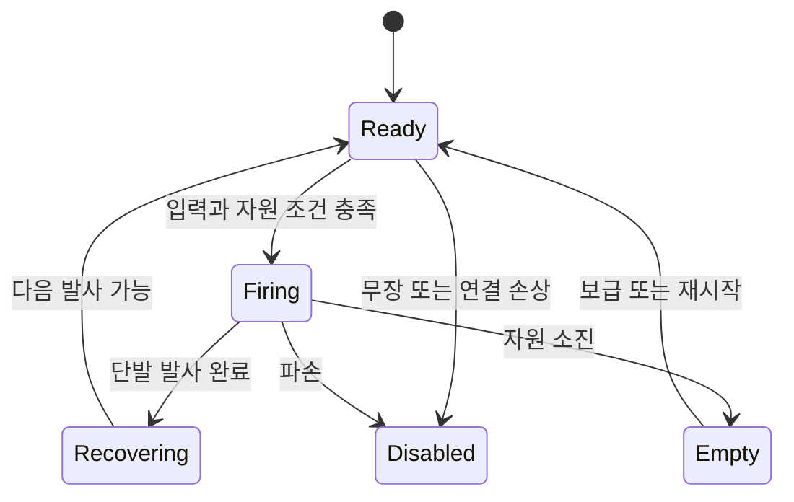

# 11. 무장·발사체·탑재물 시스템 역기획

> 조사 기준: 2026-11-13 / Steam PC. 기본 게임, The Splintered Sea, The Broken Beyond의 무장을 구분한다. 실제 발사·충돌 시험은 실행하지 않았다. 모든 실제 피해량, 반동 계수, 재장전 시간, 관통 횟수는 측정 전까지 미확정이다.
>
> `[공식 확인]` / `[설계 해석]` / `[재구성 제안]` / `[검증 필요]`를 분리한다. 아래의 수식·상태 머신은 분석과 유사 시스템 구현을 위한 제안이다.

## 1. 무장도 조립 기계의 일부다

**[설계 해석]** Besiege의 무장은 “차체에 공격력 숫자를 추가하는 아이템”으로 분석하면 부족하다. 발사 방향, 반동, 중량, 가동 범위, 탄체가 나오는 공간, 폭발물의 보관 위치가 구조 설계에 연결된다. 공격에 성공해도 반동으로 기체가 뒤집히거나 무장이 떨어지면 임무 수행 능력을 잃는다.

따라서 무장 성능을 다음 다섯 축으로 기록한다.

| 축 | 분석 질문 |
| --- | --- |
| 표적 효과 | 충격·절단·화염·폭발·견인 중 무엇을 만드는가 |
| 자기 기체 부담 | 중량·반동·진동·불·폭발 위험이 어떻게 돌아오는가 |
| 제어 | 즉시 입력, 유지 입력, 예약·자동화, 분리 후 입력 중 무엇인가 |
| 소모 | 탄약·시간·연료·부품 자체 중 무엇을 쓰는가 |
| 공간 | 발사구 여유, 회전 범위, 줄 경로, 파편 경로가 필요한가 |

## 2. 현행 문서를 읽을 때 적용할 버전 경계

**[공식 확인]** 2025년 V1.73은 대포의 탄체 크기와 Chainshot 선택을 추가했다. 2026년 V1.77은 Cannon과 Water Cannon의 출력 상한을 3x로 바꾸었다. V1.9에서는 Flamethrower가 연료 시스템을 사용하고 장갑 블록이 화염을 막도록 변경되었다. 따라서 옛 가이드의 2x 상한, 화염 차폐 설명, 유한 작동 시간만으로 현행을 확정하면 안 된다.

출처: [10주년 추가 업데이트 V1.73](https://store.steampowered.com/news/posts/?appgroupname=Besiege&appids=346010&enddate=1770732142&feed=steam_community_announcements), [Better Tools V1.77을 포함한 공식 업데이트 모음](https://store.steampowered.com/oldnews/?appgroupname=Besiege&appids=346010&enddate=1793516400&feed=steam_community_announcements&headlines=0), [V1.9 출시 변경 기록](https://steamcommunity.com/app/346010/announcements/).

**[검증 필요]** 3x는 UI의 상대 강도 표기다. “힘이 3뉴턴”, “피해량이 정확히 세 배”, “속도가 세 배”와 동치로 쓰지 않는다. 탄체 크기 옵션이 질량·충돌체·피해·반동에 각각 어떻게 반영되는지는 독립 측정해야 한다.

## 3. 부품별 기능 계약

### 3.1 원거리 무장

표의 “역기획 계약”은 **[설계 해석]**이다. 공식 자료에서 확인한 기능과, 아직 확정하지 않은 현행 세부를 함께 구분한다.

| 부품 | 범위 | 역기획 계약 | 소모·반작용·예외의 확인 항목 |
| --- | --- | --- | --- |
| Cannon | 기본 | 설치 방향으로 탄체 발사; 탄종·크기·강도를 분리된 설정으로 취급 | 기본 발사 가능 횟수, 무한탄약과 재사용 관계, 반동량, Chainshot 두 탄체/연결 표현 |
| Shrapnel Cannon | 기본 | 넓은 영역을 상대하는 산탄 계열 무장 | 실제 탄체 개수·분산·거리별 피해, 발사 횟수 |
| Crossbow | 기본 | 전방 화살 발사, 연속 사격 계열 | 현행 탄약 수, 발사율, 장전 상태, 고속 이동 중 탄체 초기속도 |
| Harpoon Launcher | 수중 DLC | 줄 달린 작살 발사 후 감기·분리 | 부착 가능한 재질, 최대 줄 길이, 재발사 조건, 줄 절단 |
| Blaster | 우주 DLC | 연료를 사용하는 고열 투사체 공격 | 현행 1회 연료량, 발사 간격, 열·직격 피해, 진공에서 발화 영향 |

**[공식 확인]** Crossbow와 Vacuum은 V0.42에 추가되었으며, 당시 Crossbow는 30발로 소개되었다. 이것은 **출시 당시 값**이며 현행 탄약 수를 대체하지 않는다. V1.26은 Cannon·Crossbow 탄체의 발사 전 속도 동기화와 Crossbow의 연속 충돌 관련 수정을 기록한다. 출처: [V0.42 공식 공지](https://store.steampowered.com/news/posts/?appids=346010&enddate=1491653692), [V1.26 공식 변경 기록](https://store.steampowered.com/news/posts/?appids=346010&enddate=1714155262&feed=steam_community_announcements).

**[공식 확인]** Harpoon의 줄 감기·분리 기능은 수중 기능 소개에 명시된다. Blaster의 연료 사용·직격·발화 가능성은 우주 연료 소개에 명시된다. 출처: [Aquatic Blocks](https://steamcommunity.com/games/346010/announcements/detail/4176601697642985456), [Fuel System & Blocks](https://steamcommunity.com/games/346010/announcements/detail/671745047272620188).

### 3.2 지속 효과·힘을 가하는 부품

| 부품 | 기능 해석 | 입력 상태의 구분 | 검증해야 할 예외 |
| --- | --- | --- | --- |
| Flamethrower | 방향성 화염과 발화; 현행 연료 소비 | 입력 ON/OFF, 연료 있음/없음, 차폐 있음/없음 | 장갑 이외 차폐, 자신의 기체 발화, 수중·진공 반응 |
| Water Cannon | 분사로 목표·기체에 힘을 줄 수 있는 장치 | 분사 상태, 강도, 가열 상태 | 반동/목표 힘 비율, 소화 범위, 증기 전환 |
| Vacuum | 방향성 흡인력 | 활성, 대상이 유효 범위 안/밖 | 차폐, 대상 질량, 자기 기체 영향, 최대 거리 |
| Torch | 지속적인 열·점화원으로 조합 | 점화 유지, 접촉·근접, 매질 | 소진 여부, 화염 전파 조건, 우주에서의 불안정 |

**[공식 확인]** V1.26은 Vacuum의 영향 영역을 원뿔 형태로 다듬었다고 설명한다. 이 정보는 대상 후보 영역의 형태를 뒷받침하지만, 거리별 힘 감쇠·질량 제한·벽 투과 여부까지 확정하지 않는다. 출처: [V1.26 공식 변경 기록](https://store.steampowered.com/news/posts/?appids=346010&enddate=1714155262&feed=steam_community_announcements).

**[공식 확인]** 개발사는 가열된 Water Cannon을 증기 추진으로 활용하는 조합을 언급하며, 우주에서 Torch가 안정적으로 타지 않는 상황도 설명한다. 이 조합을 유한한 연료 시스템과 함께 분석해야 한다. 출처: [Building for Space](https://steamcommunity.com/games/346010/announcements/detail/711152269082493394).

### 3.3 접촉 무장과 탑재물

다음은 **[설계 해석 / 현행 세부 검증 필요]**다. 피해 처리의 명칭과 수치를 원작 내부 클래스처럼 사용하지 않는다.

| 부품 계열 | 주요 효과를 분석하는 방식 | 조립 의존성 | 확인할 조건 |
| --- | --- | --- | --- |
| Metal Spike | 좁은 접촉부로 충돌을 집중 | 방향·돌출 길이·차체 속도 | 상대속도 문턱, 벽·병사 차이 |
| Metal Blade | 날 형태의 접촉 공격 | 베는 방향과 하중 지지 | 날 접촉 판정, 옆면 충돌 |
| Circular Saw | 회전 접촉 공격 | 구동·접근 방향·축 지지 | 실제 구동 방식, 정지 상태 피해 |
| Drill | 회전축을 따라 밀어 넣는 접촉 공격 | 축 반작용·전진력·고정 | 회전수와 피해 관계, 회전 정지 조건 |
| Metal Jaw | 스프링 에너지로 닫히는 공격 | 벌림 공간·목표 유입·지지 | 발동 입력, 재장전, 닫힘 정지와 끼임 |
| Bomb | 기체에 실어 운반하는 폭발 탑재물 | 홀더/그랩/분리 장치 | 충격·열·입력별 기폭 조건 |
| Remote Grenade | 원격 기폭 계열 탑재물 | 분리 후 입력 전달 | 기폭 키, 현행 지연값·범위, 떨어진 뒤 소유권 |
| Explosive Rocket | 자체 이동하는 폭발 탑재물 | 발사 방향·분리·안정성 | 점화, 추진 지속, 폭발 시점 |
| Flaming Ball | 발화 효과를 가진 투척체 | 투석기·놓기·굴리기 | 접촉 발화, 자기 구조물 위험 |
| Boulder | 질량을 이용한 투척·충돌체 | 발사 기구의 저장 에너지 | 충돌 파괴, 부품 재활용 가능성 |

**[공식 확인]** V1.73은 Grenade에 기폭 지연을 추가하고 화염으로도 도화선이 시작된다고 기록했다. 현재 지연 설정 범위와 다른 기폭 조건의 우선순위는 추가 확인 대상이다. 출처: [V1.73 공식 변경 기록](https://store.steampowered.com/news/posts/?appgroupname=Besiege&appids=346010&enddate=1770732142&feed=steam_community_announcements).

**[공식 확인]** V1.25의 Metal Jaw는 감은 스프링으로 강한 물기 동작을 만드는 무장으로 소개되었다. 이것은 개별 부품이 “접촉 즉시 상수 피해”만 주는 것이 아니라 기계적 상태를 지닌다는 근거가 된다. 출처: [V1.25 공식 공지](https://store.steampowered.com/news/posts/?appids=346010&enddate=1705946583&feed=steam_community_announcements).

## 4. 발사체와 발사자의 관계

### 4.1 발사 위치·속도·반동

**[재구성 제안]** 발사체 초기화는 다음 요소를 분리한다.

1. 발사구의 월드 위치와 방향을 얻는다.
2. 그 지점의 기체 이동 속도를 구한다.
3. 무장 설정에서 탄체의 상대 발사 속도를 만든다.
4. 탄체를 생성하고 발사자와 충돌하는 예외를 처리한다.
5. 발사자의 구조물에 반동 사건을 적용한다.
6. 탄약·연료·재사용 상태를 갱신한다.

설명용 식:

$$
\mathbf v_{projectile}=\mathbf v_{muzzle}+v_{relative}\hat{\mathbf d}
$$

$$
\Delta\mathbf p_{recoil}=-k_r\Delta\mathbf p_{projectile}
$$

`Δp_projectile`은 기체에서 상속한 초기 운동량을 제외하고 발사로 추가하는 운동량이다. `k_r`은 게임성 조절을 허용하는 재구성 계수다. 원작이 정확한 운동량 보존, 혹은 위 계수를 사용한다고 주장하지 않는다. 반동을 탄체 생성 함수 안에 숨기지 않고 별도 현상으로 관찰하면 차체가 밀리는 문제와 발사체 속도가 틀리는 문제를 따로 찾을 수 있다.

### 4.2 설치 공간과 자기 충돌

**[설계 해석]** 발사구 앞에 장식 패널이나 구조물이 있으면 발사체 경로와 충돌할 가능성이 있다. 다만 원작이 자신의 부품을 어디까지 무시하는지는 미확인이다. 실험에서는 발사구 앞에 얇은 패널, 다른 무기, 분리된 잔해를 각각 놓아 차폐와 자기 충돌을 구분한다.

대포에 주포탑을 붙이는 경우, 포탑 자체의 회전 연결과 포신의 반동 경로가 겹친다. 조향 출력만 높여 포탑 흔들림을 없애기 전에, 회전 축과 고정 보강이 서로 싸우고 있지는 않은지 확인해야 한다.

## 5. 입력·탄약·연료 상태 머신

다음은 **[재구성 제안]**이다. 원작의 정확한 enum 이름이나 사건 순서를 의미하지 않는다.

| 상태 요소 | 분리해야 하는 이유 |
| --- | --- |
| 입력 유지 | 한 번 누름과 계속 누름을 혼동하지 않도록 함 |
| 다음 발사 가능 시각 | 탄약은 있어도 연사가 제한될 수 있음 |
| 잔여 탄약 | 기본 무장과 무한탄약 모드를 분리 |
| 잔여 연료 | Flamethrower·Blaster 등 연료계 무장을 분리 |
| 부착·발사됨 | 작살·로켓·투하물의 본체와 탄체를 구분 |
| 제어 소유권 | 분리된 폭탄에 누가 입력을 줄 수 있는지 정의 |
| 물리 사용 가능 | 부서졌어도 입력이 살아 있는 경우를 방지 |

**[검증 필요]** Infinite Ammo와 Infinite Fuel을 같은 옵션으로 취급하지 않는다. 분리된 무장의 입력 유지, 키 에뮬레이션, 재시작 시 자원 복구는 각각 별도로 확인한다. God Tool이 켜진 영상을 일반 규칙의 근거로 쓰지 않는다.

## 6. 무장과 기체 균형

### 6.1 동시 발사와 순차 발사

**[설계 해석]** 여러 포를 같은 키로 쏘는 구성은 순간 출력이 크지만 연결부에 하중이 집중될 수 있다. 순차 발사는 구조물의 회복 시간을 확보할 가능성이 있으나 목표가 움직일 때 명중 패턴이 달라진다. 따라서 화력만 비교하지 않고 발사 후 제어 가능 여부를 함께 평가한다.

### 6.2 탄약을 쓴 뒤 기체가 달라지는가

**[검증 필요]** 기존 무장의 탄약 소모가 기체 질량을 줄이는지 일괄 가정하지 않는다. 반면 우주 연료 시스템에서는 연료 소모에 따른 질량 변화가 공식적으로 설명된다. 현행 설계에서 탄약·연료·분리 탑재물은 질량 갱신 규칙이 서로 다를 수 있다.

**[재구성 제안]** 비행체의 좌우 폭탄을 순차 투하하는 시험에서는 `투하 직전 질량중심 → 분리 순간 → 안정 후`를 기록한다. 무게 감소, 연결 해제 충격, 무장 저항 제거를 한 원인으로 뭉뚱그리지 않는다.

### 6.3 전차·배·항공기의 차이

| 기체 | 무장 설계에서 우선 볼 점 | 대표 실패 가설 |
| --- | --- | --- |
| 지상 전투차량 | 접지·포탑 지지·포신 여유 | 반동으로 전복, 포탑 이탈 |
| 선박 | 상부 질량·부력 배치·횡방향 반동 | 발사 후 기울기와 침수 |
| 항공기 | 좌우 대칭·질량중심·저항 | 투하 후 롤, 발사 후 실속 유사 상태 |
| 우주선 | 추진·무장 연료 공유와 방향 독립 | 공격 중 추진 연료 고갈, 궤도 변화 |

## 7. 작살은 피해와 연결을 동시에 만든다

**[설계 해석]** Harpoon을 단순한 총으로만 분류하면 견인 기능을 놓친다. 명중 뒤 두 물체 사이에 새로운 힘 전달 관계가 생기기 때문이다. 분석 단계는 `발사 → 비행 → 접촉 → 부착 성공/실패 → 줄 길이 변화 → 해제/절단`이다.

**[재구성 제안]** 연결 상대가 파괴되었을 때는 다음을 따로 정한다.

- 작살이 파편에 남는지, 원래 목표와 함께 사라지는지.
- 줄을 감을 때 상대가 없으면 공회전하는지.
- 줄이 다른 구조물을 지나갈 수 있는지.
- 여러 작살이 서로 다른 지점을 당길 때 토크가 합산되는지.
- 같은 플레이어와 다른 플레이어의 기체를 구분하는지.

이 동작들은 일반 밧줄 구현을 복사하는 것만으로 완성되지 않는다. 관련 규칙은 [08. 기계 장치](08_mechanisms_and_constraints.md)와 함께 검증한다.

## 8. 손상 처리와 효과 표현의 분리

**[재구성 제안]** 충돌·열·폭발·견인을 하나의 `Damage(float)`로 통합하기보다 의미가 다른 사건으로 유지하는 편이 분석하기 쉽다.

| 사건 | 물리 출력 | 기능 출력 | 시각·음향 출력 |
| --- | --- | --- | --- |
| 탄체 명중 | 충격량 | 부품/연결 손상 | 스파크·파편·명중음 |
| 화염 노출 | 필요하면 별도 힘 | 발화·연료 변화 | 불꽃·연기 |
| 폭발 | 주변 충격 | 다중 부품 파괴 | 폭발·수면 반응 |
| 작살 부착 | 줄 제약 생성 | 견인 상태 | 줄·부착음 |
| 접촉 무장 | 밀기·회전 저항 | 접촉 손상 | 회전/절삭 효과 |

시각 효과가 표시되었다는 사실만으로 실제 피해가 발생했다고 판정하지 않는다. 반대로 눈에 띄는 폭발 없이 관절만 끊어져도 기능적으로는 큰 피해다.

## 9. 검증 실험 명세

**아래는 계획이며 실행 결과가 아니다.**

| ID | 시험 | 통제 및 변경 | 기록값 |
| --- | --- | --- | --- |
| WPN-01 | Cannon 출력 비교 | 탄종·질량 고정, 출력 변경 | 탄속, 반동, 명중 후 손상 |
| WPN-02 | 탄체 크기 비교 | 출력 고정, 크기 변경 | 충돌체, 질량 영향, 사거리 |
| WPN-03 | 이동 중 발사 | 정지/등속/회전 중 | 초기 탄속과 궤적 |
| WPN-04 | 일반/무한탄약 | 같은 무기·입력 | 발사 횟수, 재발사 간격 |
| WPN-05 | 화염 차폐 | 장갑/목재/빈 공간 | 뒤쪽 발화 여부와 시간 |
| WPN-06 | 화염 연료 | 내장만/외부 연료망 | 작동 시간, 공유 자원 고갈 |
| WPN-07 | 작살 부착·해제 | 고정/가벼운/무거운 표적 | 줄 상태, 견인 방향, 재사용 |
| WPN-08 | 접촉 무장 | 정지/회전, 같은 접근속도 | 정지 피해와 회전 피해 분리 |
| WPN-09 | 폭탄 기폭 | 충돌/가열/입력 | 실제 기폭 조건과 지연 |
| WPN-10 | 투하물 제어 | 연결 전/후, 같은 입력 | 분리 후 기폭·점화 유지 |
| WPN-11 | Water Cannon 가열 | 가열원·매질만 변경 | 분사 상태, 반동, 소화/발화 |
| WPN-12 | 무장 손상 | 부분 파손·연결 단절 | 입력 무시·오발·탄체 정리 |

## 10. 연계 문서

- [07. 지상 이동](07_ground_locomotion.md): 발사 중 접지와 차체 안정성.
- [08. 기계 장치](08_mechanisms_and_constraints.md): 포탑·투석기·그랩·줄.
- [09. 비행](09_flight_and_aerodynamics.md): 반동과 투하 이후 자세.
- [10. 수중](10_water_and_buoyancy.md): 작살과 수중 폭발.
- [12. 파손](12_damage_and_destruction.md): 손상 사건의 최종 처리.
- [19. 우주 확장](19_space_expansion.md): 연료망과 Blaster.
