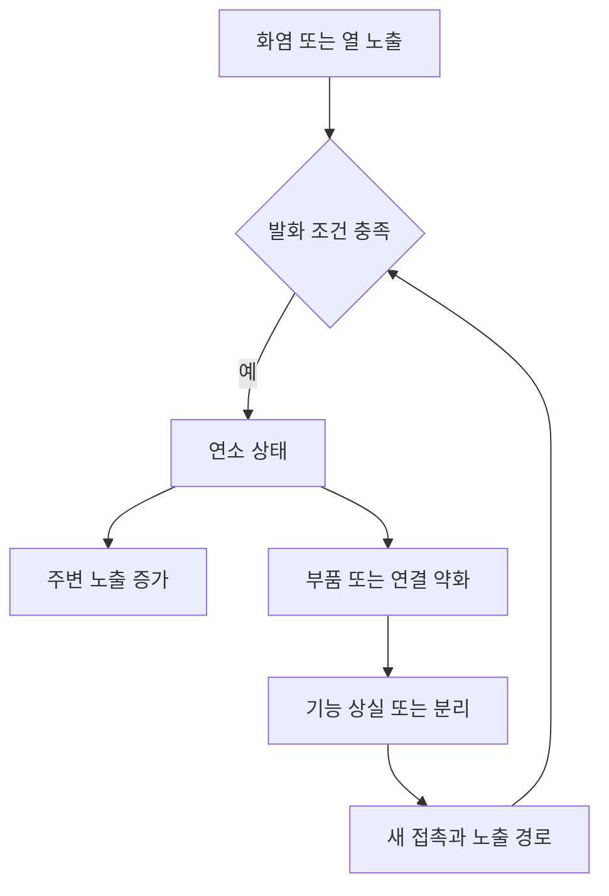

# 12. 충돌·연결 파단·부품 손상·화재·폭발 역기획

> 조사 기준: 2026-11-13, Steam PC. **[공식 확인]**, **[설계 해석]**, **[재구성 제안]**, **[검증 필요]**를 구분한다. 실제 플레이·소스 코드·패킷·부품 데이터 파일을 측정하지 않았으므로 체력·파단력·연소 시간·폭발 반경의 수치표를 만들어 확정하지 않는다.

## 1. 파괴는 하나의 체력 변수로 설명되지 않는다

**[설계 해석]** 화면에서 기계가 부서지는 결과는 최소한 다음 네 층으로 분리해서 읽어야 한다.

| 층 | 변화 | 플레이 결과 |
| --- | --- | --- |
| 연결 | 블록 사이의 결합 상실 | 온전한 부품이 차체에서 떨어짐 |
| 부품 본체 | 손상·파괴·기능 정지 | 구동·방호·제어 기능 상실 |
| 구조 그래프 | 연결된 덩어리가 여러 개로 분할 | 하중·질량 중심·제어 구조 변화 |
| 시각·음향 | 파편, 찌그러짐, 불꽃, 충돌음 | 실패의 원인과 규모를 전달 |

이 분류는 분석을 위한 모델이다. Besiege의 실제 클래스가 네 층으로 나뉜다는 의미는 아니다. 핵심은 **블록이 남아 있는 상태와 기능을 유지하는 상태가 같지 않다**는 점이다. 반대로 작은 장식이나 외피를 잃어도 주행과 임무 수행은 계속될 수 있다.

## 2. 공식 근거와 현재 규칙의 경계

| 출처 | 확인한 사실 | 해석을 제한할 점 |
| --- | --- | --- |
| V1.05 | Build Surface에 누적 손상과 파편화가 있음 | 모든 부품이 같은 체력식을 쓰는 것은 아님 |
| V1.5 | 손상·화재·joint health의 상호작용 수정 | 정확한 감쇠·파단식은 미공개 |
| V1.65 | Joint Stress Visualizer 추가 | 표시를 곧 물리 단위로 읽을 수 없음 |
| V1.73 | Stress 모드에서 충돌·파괴 표시 추가 | 최초 원인과 후속 접촉을 분리해서 읽어야 함 |
| V1.9 | 장갑이 Flamethrower 화염을 막고, 해당 무기는 새 연료 시스템 사용 | 모든 열·폭발·유체 공격의 완전 차단으로 확대 금지 |

출처: [V1.05](https://steamcommunity.com/games/346010/announcements/detail/2198262387487265158), [V1.5](https://store.steampowered.com/news/posts/?appids=346010&enddate=1720798144&feed=steam_community_announcements), [V1.65](https://steamcommunity.com/games/346010/announcements/detail/4441207205094492419), [V1.73](https://steamcommunity.com/games/346010/announcements/detail/530968239863234715), [V1.9](https://steamcommunity.com/app/346010/announcements/). 개별 공지 본문은 공식 Steam 공지 모음에서도 대조했다.

## 3. 충돌 손상의 인과관계

**[설계 해석]** 충돌은 “속도가 높아서 손상”이라는 단일 문장으로 설명하기 어렵다. 상대 물체와의 속도, 질량, 접촉 방향, 접촉 위치, 연결 구조가 결과를 바꿀 수 있다. 회전 중인 팔 끝과 차체 중심의 같은 속도도 기계 내부에 전달되는 하중은 다를 수 있다.

| 관찰할 값 | 목적 | 기록 방법의 예 |
| --- | --- | --- |
| 충돌 전 상대 속도 | 정지 벽·이동 물체 충돌 구별 | 영상과 위치 변화; 가능할 때 계측 |
| 접촉 위치 | 중심 충돌·끝단 충돌 구별 | 차체 기준 좌표 또는 부품 ID |
| 접촉 방향 | 정면·비스듬한 충돌 구별 | 충돌면과 진행 방향 기록 |
| 최초 파단 시각 | 원인과 연쇄 파괴 구별 | 저속 재생·시각화 |
| 최초 파단 연결 | 부품 본체와 연결 손상 구별 | 분리 전후 연결 구조 비교 |
| 남은 기능 | 시각적인 파괴와 임무 실패 구별 | 주행·사격·제어 가능 여부 |

**[재구성 제안]** 다음 값은 손상 입력 후보가 될 수 있다.

\[
E_{relative}=\frac12 m_{effective}v_{relative}^2
\]

그러나 이를 그대로 Besiege의 손상 공식이라고 쓰지 않는다. 게임은 무기별 피해, 충돌 임계, 재질 규칙, 공격 대상 예외를 함께 사용할 수 있다. 검증에서는 충돌 에너지에 비례하는 가설과 속도 임계 가설, 고정 타격 피해 가설을 구분한다.

## 4. 연결 파단과 부품 본체 파괴

### 4.1 연결 파단

**[설계 해석]** 지지대가 떨어졌다고 해서 그 지지대 블록의 체력이 0이 되었다고 판단하면 안 된다. 연결이 먼저 끊어졌을 수 있다. 그 뒤 떨어진 부품이 다른 곳을 때리면 새 충돌과 2차 파괴가 생긴다.

**[재구성 제안]** 연결 상태를 아래처럼 분리해 관리한다.

```text
ConnectionState
  intact
  weakened            # 선택적인 약화 모델
  pending_break       # 이번 physics step 후 처리 후보
  broken

BlockState
  functional
  damaged
  disabled
  fragmented
```

이 상태명과 순서는 제안이다. 실제 게임에 `weakened`나 `pending_break` 상태가 존재한다고 주장하지 않는다.

### 4.2 파단 기준의 재구성 선택

| 후보 모델 | 장점 | 주의점 |
| --- | --- | --- |
| 순간 힘·토크 임계 | 충격에 대한 반응이 명확 | 짧은 수치 잡음에 민감 |
| 누적 손상 | 반복 타격·약화 설명이 쉬움 | 화면상 원인이 불명확해질 수 있음 |
| 임계 초과 지속시간 | 순간 스파이크 억제 | 너무 오래 버티면 물러 보임 |
| 재질별 약화 계수 | 화재·무기 차별화 | 상태 조합과 밸런스 복잡도 증가 |

**[재구성 제안]** 단순 초기 구현이라면 안정적인 파단 이벤트와 원인 표시를 먼저 만들고, 여러 누적 모델은 필요할 때 추가한다. 사용자는 “왜 끊어졌는지”를 이해해야 재설계할 수 있다.

### 4.3 분리된 조각의 계속 동작

**[검증 필요]** 떨어진 구동 블록이 계속 입력을 받는지, 원래 기계의 제어 그룹을 유지하는지, 카메라가 어떤 덩어리를 따라가는지, 분리체가 임무 판정에 포함되는지는 따로 확인한다. 물리 연결과 입력 소속이 항상 일치한다고 가정하면 투하 장치·분리 무기·다단 기계의 규칙을 잘못 설명하게 된다.

## 5. 재질과 방호

### 5.1 재질 표는 실제 면역표와 분리한다

아래는 **[설계 해석]**에 필요한 비교축이다. 확인되지 않은 재질별 수치·면역을 채워 넣지 않는다.

| 비교축 | 질문 | 필요한 시험 |
| --- | --- | --- |
| 충격 내성 | 같은 충격에서 본체와 연결 중 무엇이 먼저 손상되는가 | 같은 지지·질량 조건의 정면 충돌 |
| 열 반응 | 발화, 연소, 연결 약화가 어떤 순서인가 | 같은 거리·노출 시간의 화염 |
| 차폐 | 뒤에 있는 부품을 얼마나 보호하는가 | 방호판의 유무·각도·틈새 비교 |
| 손상 확산 | 접촉·거리·연결 중 무엇이 전파 조건인가 | 붙어 있음/떨어져 있음/접촉만 함 비교 |
| 구조 의존성 | 방호판 자체와 지지 구조 중 취약점은 무엇인가 | 지지점 수·재료 변경 |

### 5.2 장갑이 남아도 방호가 사라질 수 있다

**[설계 해석]** 장갑판을 강한 것으로 가정하더라도 판을 지지하는 연결이 약하면 공격을 받은 뒤 기울거나 떨어져 내부가 노출된다. 단순히 장갑 수를 늘리는 설계는 질량과 지지부 하중도 함께 늘린다. 방향을 가진 공격에 대비할 때는 공격선, 장갑 위치, 뒤의 취약 부품, 지지 경로를 함께 배치해야 한다.

**[공식 확인]** 현행 기록에서 Flamethrower의 장갑 차단은 V1.9 변경이다. 과거 영상을 기준으로 “화염은 항상 장갑을 통과한다”고 쓰면 현재 규칙과 맞지 않을 수 있다. [V1.9 공식 공지](https://steamcommunity.com/app/346010/announcements/)

## 6. 화재 시스템

### 6.1 분석할 사건 순서

**[재구성 제안]** 다음 순서는 화재의 가능한 구현 모델이다.



실제 게임에서 온도 변수를 적분하는지, 접촉 횟수나 시간으로 처리하는지는 확인하지 못했다. 따라서 일반 화학적 연소 시뮬레이션을 그대로 수행한다고 설명하지 않는다.

### 6.2 시각 상태와 기능 상태

**[설계 해석]** 불꽃이 보이는 즉시 기능을 상실하는 경우와, 일정 시간 동작하다 연결이 약해지는 경우는 재설계 방식이 다르다. 후자는 탈출·진화·임무 강행이라는 선택을 만들 수 있다. 불꽃이 꺼졌다는 사실만으로 원래 강도를 회복했다고 판단하지 않는다.

| 사건 | 기록할 내용 |
| --- | --- |
| 최초 발화 | 공격 종류, 거리, 노출 시간, 피격 부품 |
| 주변 전파 | 연결된 부품 / 물리 접촉 / 떨어진 부품 구별 |
| 출력 저하 | 동력·제어·연결 중 어떤 기능이 먼저 바뀜 |
| 부분 분리 | 불붙은 조각이 다른 곳에 닿아 전파하는가 |
| 소화·수중 이동 | 시각 화염, 기능, 손상 상태가 각각 어떻게 바뀜 |

**[검증 필요]** 물에 들어가면 어떤 부품이 어느 시점에 소화되는지, 열원이 꺼진 후 재발화 가능성, 모든 블록의 가연성, 공기·진공에서 연소 차이는 실제 환경과 확장 버전별로 확인해야 한다.

## 7. 폭발 시스템

### 7.1 피해·힘·연출을 나눈다

**[설계 해석]** 폭발에 의해 물체가 멀리 날아간 사실과 손상이 큰 사실은 별개로 관찰해야 한다. 가벼운 조각은 크게 움직여도 이미 떨어진 상태일 수 있고, 무거운 지지대는 거의 움직이지 않아도 연결이 손상될 수 있다.

| 출력 | 분석 대상 |
| --- | --- |
| 피해 | 본체 손상·연결 약화·대상별 반응 |
| 충격량 | 방향·거리·질량에 따른 운동 변화 |
| 발화 | 열 또는 화염 전파 여부 |
| 2차 접촉 | 날아간 조각의 후속 충돌 |
| 연출 | 섬광·파편·연기·음향·카메라 |

**[재구성 제안]** 폭발을 구현한다면 대상 검색, 차폐, 피해, 충격량, 연출을 구분한 이벤트로 만든다. 폭발 1회가 같은 부품에 여러 콜라이더를 통해 중복 피해를 주지 않도록 대상 ID 기준 처리를 검토한다. 이는 Besiege가 사용하는 알고리즘을 확인한 결과가 아니다.

### 7.2 수중 폭발

**[공식 확인]** Splintered Sea의 개발 설명은 큰 수중 폭발이 물체를 밀어내고, 기포가 붕괴할 때 다시 당기는 효과를 소개한다. [Simulating Water 공식 설명](https://store.steampowered.com/news/posts/?appids=346010&enddate=1715361118&feed=steam_community_announcements)

**[설계 해석]** 따라서 육상 폭발의 피해 반경만 물속에 복사해 이해하면 부족하다. 초기 밀어냄, 뒤따르는 당김, 수면 변화와 물체의 부력 응답을 시간 순서로 분석해야 한다. 정확한 압력파·유체 방정식이 적용된다고 단정하지 않는다.

## 8. 부분 파괴가 만드는 플레이 선택

**[설계 해석]** 부분 파괴의 가치가 드러나는 경우는 패배 직전의 장면만이 아니다.

| 남은 상태 | 플레이어가 할 수 있는 판단 |
| --- | --- |
| 바퀴 하나 손실, 추진은 남음 | 저속으로 목표까지 계속 이동 |
| 조향 부품 손상, 좌우 구동은 남음 | 차동 구동으로 방향 보정 시도 |
| 외피 손실, 무기 생존 | 공격을 끝내기 위해 방호를 포기 |
| 지지부 손상, 발사체 준비됨 | 즉시 발사하거나 장치를 버림 |
| 화재가 외곽에서 진행 | 목표 완수 시간과 구조 붕괴 시간을 비교 |

이 표는 가능성 분석이며 특정 기계가 실제로 계속 작동함을 보증하지 않는다. 이런 선택을 살리려면 승패 조건이 모든 부품의 생존만을 요구해서는 안 되며, 임무 목표와 기계 기능을 분리해서 설계해야 한다.

## 9. 실패를 학습으로 바꾸는 피드백

**[공식 확인]** Joint Stress Visualizer와 후속 충돌·파괴 표시가 공식 업데이트에 포함되었다. [V1.65](https://steamcommunity.com/games/346010/announcements/detail/4441207205094492419), [V1.73](https://steamcommunity.com/games/346010/announcements/detail/530968239863234715)

**[설계 해석]** 파괴 장면이 화려해도 최초 원인을 알 수 없으면 플레이어는 무작위로 부품을 늘리게 된다. 응력 표시와 사건 표시의 가치는 “파편이 많다”가 아니라 “어떤 연결이 먼저 위험해졌는가”를 찾는 데 있다.

**[재구성 제안]** 원인 분석 화면은 다음 순서로 보여 준다.

1. 첫 손상 또는 연결 파단 시각.
2. 당시 활성화된 구동·무기 입력.
3. 해당 연결과 양쪽 부품.
4. 직전 충돌 또는 화재 노출.
5. 그 뒤 분리된 구조와 2차 충돌.

이 기록 기능 전체가 현재 게임에 존재하는 것은 아니다. 유사 제품에서 개선할 수 있는 UX 요구사항이다.

## 10. 재구성용 이벤트 계약

```text
DamageEvent
  sourceId, targetId
  category                    # 충돌/무기/화재 등
  position, direction
  simulationTime
  sequenceId

ConnectionBreakEvent
  connectionId
  endpointA, endpointB
  causeEventId
  simulationTime

FragmentEvent
  originalBlockId
  fragmentIds[]
  inheritedVelocityPolicy
  renderEffectProfile
```

**[재구성 제안]** 한 physics step 안에서 연결을 순회하면서 바로 삭제하면 이후 계산과 이벤트 처리 순서가 꼬일 수 있다. 파단 후보 수집과 실제 구조 변경을 분리하는 방식이 유용하다. 이벤트에는 원인 ID를 연결해 연쇄 폭발이나 파편 충돌을 추적한다. 네트워크에서는 시각 효과 재생과 권위 있는 파단 확정을 구분한다.

## 11. 검증 시나리오

| ID | 구성 | 독립 변수 | 판별할 항목 |
| --- | --- | --- | --- |
| DM-01 | 블록 1개를 지지한 팔 | 충돌 방향·속도 | 본체 손상과 연결 파단의 선후 |
| DM-02 | 같은 판재의 지지 1점/다점 | 지지점 | 부품 강도와 연결 강도 분리 |
| DM-03 | 패널 두 재질 | 반복 약타 / 단발 강타 | 누적 손상과 즉시 파괴 |
| DM-04 | 연결된 목재·떨어진 목재 | 접촉·거리·연결 | 화재 전파 조건 |
| DM-05 | 장갑 앞·뒤에 화염원 | 공격 방향·틈새 | V1.9 화염 차단 범위 |
| DM-06 | 동일 폭발물·다른 질량 | 질량만 변화 | 이동량과 손상량 분리 |
| DM-07 | 수면 위·아래 폭발 | 수심 | 밀어냄·당김·수면 반응 |
| DM-08 | 구동 부품을 분리 | 분리 방법 | 입력 소속과 분리체 동작 |
| DM-09 | 같은 기계의 3회 반복 | 초기 조건 고정 | 최초 파단의 재현성 |
| DM-10 | 공격 없는 테스트 | 모터·중력만 변화 | 자가 파손과 외부 공격 손상 구별 |

**측정 주의:** 자동 Timescale, 무적·무한 탄약·무한 연료·화재 확산 비활성화 같은 도구 설정은 결과 해석에 영향을 줄 수 있다. 사용 여부를 적고, 느려진 실제 시간과 게임 내 시뮬레이션 시간을 구별한다. 수행 결과가 없는 항목은 완료 처리하지 않는다.

## 12. 관련 문서

- [구조와 재질](06_structure_and_materials.md)
- [기계 장치](08_mechanisms_and_constraints.md)
- [무기](11_weapons_and_payloads.md)
- [수상 물리](10_water_and_buoyancy.md)
- [캠페인과 목표](14_campaign_and_levels.md)

**남은 검증:** 부품별 가연성·체력·파단력, 열 차폐와 폭발 차폐의 관계, 파편의 충돌·피해 참여, 분리 부품 제어, 누적 손상의 복구 여부, 환경·버전별 예외. 숫자표를 채우려면 먼저 이 실험의 조건을 고정해야 한다.
