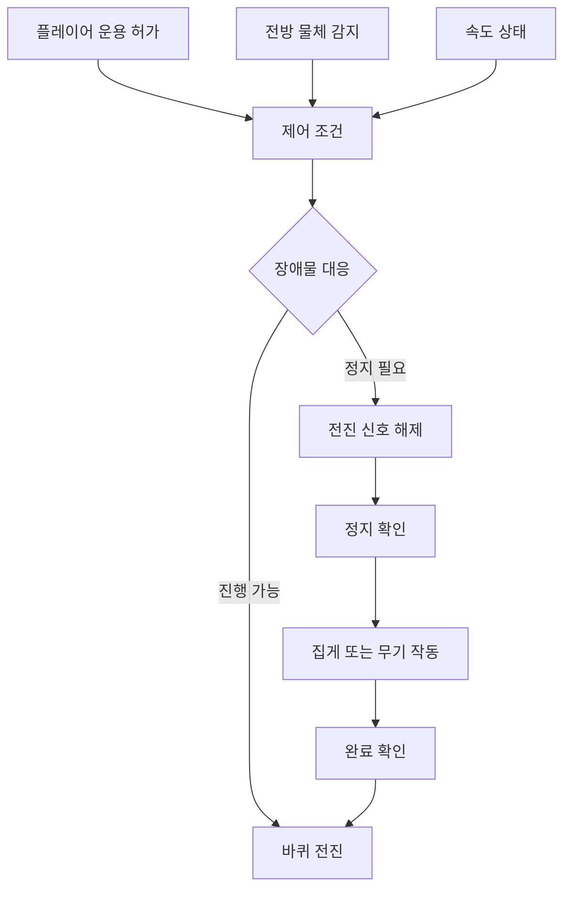

# 13. 입력 매핑, 센서와 자동화

> Steam PC판 · 조사일 2026-11-13. `[공식 확인]`과 `[재구성 제안]`을 분리한다. 아래 예시의 신호 이름·상태 머신·의사 코드는 설명용이며 원작 소스나 저장 형식이 아니다.

## 1. 시스템의 역할

**[설계 해석]** 자동화는 조작을 생략하는 기능만이 아니다. 반복 입력을 정확한 순서로 수행하고, 사용자가 보기 어려운 속도·각도·거리·연료 상태에 대응하여 기계의 운용 범위를 넓힌다. 기구의 문제를 논리로 해결하려 하면 제어가 불안정해지고, 제어의 문제를 보강으로 해결하려 하면 기체만 무거워질 수 있다.

[공식 확인] V1.0은 자동화 부품군을 추가했고, V1.10은 키 대신 변수를 사용하는 기능과 추가 논리 모드를 소개했다. 따라서 ‘모든 자동화는 물리 키를 나눠 쓰는 것’이라는 설명은 현행 기능을 충분히 설명하지 못한다. [V1.0·V1.01 공식 발표](https://store.steampowered.com/news/posts/?appids=346010&enddate=1591733466&feed=steam_community_announcements), [V1.10 공식 발표](https://store.steampowered.com/news/posts/?appids=346010&enddate=1714752154&feed=steam_community_announcements)

## 2. 네 종류의 입력을 구분한다

| 종류 | 의미 | 실수 사례 |
|---|---|---|
| 실제 키 입력 | 플레이어가 누른 입력 | 채팅·숫자 편집 도중 기계가 움직임 |
| 에뮬레이션 입력 | 센서·논리가 생성하는 입력 | 같은 키에 연결한 다른 무기도 동작 |
| 이름 있는 변수 | 자동화 회로의 신호 이름 | 모듈을 합친 뒤 이름 충돌 |
| 부품의 초기 설정 | 시작 자세·기본 작동 상태 | 실행 즉시 예상하지 않은 구동 |

**[재구성 제안]** 입력을 OS 키 이벤트로 직접 주입하지 않고, 기계 내부의 논리 채널로 표현하면 시스템 단축키·다른 플레이어 입력과 분리할 수 있다. Besiege의 내부 구현이 이 방식이라고 확인된 것은 아니다.

## 3. 입력 신호의 시간 의미

| 의미 | 예 | 반드시 확인할 항목 |
|---|---|---|
| 눌림 유지 | 키를 누르는 동안 구동 | 센서가 true인 동안 유지되는가? |
| 상승 에지 | false→true 순간 한 번 | 탄환이 연속 발사되는가, 한 발인가? |
| 하강 에지 | true→false 순간 | 손을 뗄 때 분리·정지하는가? |
| 토글 | 한 번 누를 때 상태 반전 | 자동화 펄스 길이에 영향받는가? |
| 래치 | 설정·해제 신호로 상태 유지 | 두 신호가 동시에 오면 무엇이 우선인가? |

이 표는 **[재구성 제안/검증 필요]**이다. 모든 부품이 모든 모드를 제공한다는 뜻이 아니다. UI에 같은 키가 표시돼도 바퀴와 일회성 무기의 입력 소비 방식은 같다고 가정할 수 없다.

## 4. 부품별 규칙 카드

### 4.1 Sensor

- **역할:** 물체 감지 조건을 제어 신호로 바꾼다.
- **공식 확인:** V1.02에 정적 물체 제외 옵션이, 2025년 추가 업데이트에 감지 영역의 시작 위치를 조정하는 offset이 소개되었다.
- **설계 해석:** 감지 시작점을 앞쪽으로 옮기면 차체 자체나 가까운 구조물이 검출을 방해하는 문제를 줄일 수 있다.
- **검증 필요:** 감지 모양, 자기 기체 제외, 팀 필터, 물체 일부만 겹쳤을 때 판정, 경계의 포함 여부, 빠른 물체 통과.
- **실험:** 고정 벽과 이동 물체를 같은 위치에 번갈아 놓고 정적 제외 옵션을 바꾼다. 감지 영역 시작/끝 바로 앞뒤에서 출력이 바뀌는 위치를 기록한다.

근거: [V1.02](https://store.steampowered.com/news/posts/?appids=346010&enddate=1591733466&feed=steam_community_announcements), [10주년 추가 변경](https://store.steampowered.com/news/posts/?appgroupname=Besiege&appids=346010&enddate=1772123201&feed=steam_community_announcements).

### 4.2 Timer

- **역할:** 일정한 시간 관계를 갖는 출력으로 순차 구동을 구성한다.
- **공식 확인:** V1.0 자동화 부품군에 포함된다.
- **재구성 제안:** `대기 → 지연 → 출력 → 완료`를 기본 상태로 삼아 재시작·중단·반복을 분리한다.
- **검증 필요:** 정확한 UI 옵션, 지연 중 재입력 처리, 출력 지속시간, 재트리거, 반복 설정, 실행 시작 신호와의 관계.
- **실험:** 시작 버튼을 빠르게 두 번 누른 경우와 계속 누른 경우를 비교한다. 자동 시간 배율을 끈 정상속도·슬로모션에서 시뮬레이션 시간 기준 출력 시점을 비교한다.

### 4.3 Logic Gate

- **역할:** 입력의 조합이나 기억된 상태로 출력을 만든다.
- **공식 확인:** V1.10은 Binary Counter, SR Latch, D Latch, Random을 추가했고 V1.26은 Edge Detector를 추가했다.
- **설계 해석:** 조합 논리, 상태 기억, 사건 추출이 같은 부품군에 들어가므로 현재 모드에 맞춰 입력·출력 설명이 바뀌어야 한다.
- **검증 필요:** 정확한 진리표, 입력 우선순위, 카운터 리셋, 랜덤의 갱신 시점·시드, 동시 입력 처리.

근거: [V1.10 개발사 공지](https://store.steampowered.com/news/posts/?appids=346010&enddate=1714752154&feed=steam_community_announcements), [V1.26 개발사 공지](https://store.steampowered.com/news/posts/?appids=346010&enddate=1714155262&feed=steam_community_announcements).

### 4.4 Altimeter

- **역할:** 높이에 관련된 조건을 출력으로 변환하는 계측 부품이다.
- **공식 확인:** V1.0 도입 부품이며 이후 높이 표시 관련 수정이 있었다.
- **검증 필요:** 높이 기준이 월드 원점·지형·시작 위치 중 무엇인지, 우주 환경에서의 기준, 부품 중심/기체 중심 중 어느 위치를 읽는지.
- **설계 해석:** 지형이 높은 지역에서도 같은 출력을 유지해야 하는지부터 결정해야 자동 착륙·고도 유지 설계를 할 수 있다.

### 4.5 Anglometer

- **공식 확인:** 한 축의 각도를 감지해 키를 에뮬레이션하는 부품으로 소개되었다. V1.77에는 초기 자세, 중력 방향, 이동 방향에 대한 기준 모드가 추가되었다.
- **핵심 질문:** 어느 축의 회전인가, 어느 기준 벡터와 비교하는가, 양·음 방향은 어떻게 표현되는가?
- **설계 해석:** ‘처음보다 얼마나 회전했는가’와 ‘현재 중력에 대해 얼마나 기울었는가’는 다른 제어 문제다. 비행기의 수평 유지에 초기 자세 기준을 무조건 쓰면 시작 각도의 오류가 남는다.
- **검증 필요:** 각도 wrap 경계, 속도가 거의 0일 때 velocity 기준, 중력이 거의 0일 때 gravity 기준, 시작 후 기체가 분리된 경우.

근거: [V1.01](https://store.steampowered.com/news/posts/?appids=346010&enddate=1591733466&feed=steam_community_announcements), [V1.77](https://steamcommunity.com/games/346010/announcements/detail/509606585808454143).

### 4.6 Speedometer

- **공식 확인:** 속도 조건으로 키를 에뮬레이션한다. 2025년에는 각속도 측정, 이후 V1.75에는 전체 방향·단일 축·전후 방향 구분이 추가되었다.
- **설계 해석:** 속력의 크기와 진행축의 부호 있는 속도를 구분해야 후진 중에도 전진 제한기가 켜지는 문제를 피한다. 기체 끝의 센서는 회전만으로도 움직일 수 있으므로 측정 기준도 중요하다.
- **검증 필요:** 단위, 월드/로컬 축, 측정 위치, 음수 속도, 범위 비교의 포함 조건.

근거: [2025년 계측 변경](https://store.steampowered.com/news/posts/?appgroupname=Besiege&appids=346010&enddate=1772123201&feed=steam_community_announcements), [V1.75](https://steamcommunity.com/games/346010/announcements/detail/530976484112728513).

### 4.7 Length Detector

- **공식 확인:** 두 지점 사이 길이에 따라 입력을 에뮬레이션하는 부품으로 V1.25에 소개되었다.
- **설계 해석:** 피스톤이 충분히 전개되었는지, 집게가 벌어졌는지 등 기구 상태를 직접 읽는 데 적합하다.
- **검증 필요:** 표시되는 선에 실제 기계적 구속력이 있는지, 끝점 파손 시 동작, 측정과 물리 구속을 혼동하지 않는다.

근거: [V1.25](https://store.steampowered.com/news/posts/?appids=346010&enddate=1705946583&feed=steam_community_announcements).

### 4.8 Fuel Gauge — 우주 확장

- **공식 확인:** 연결된 연료망의 잔량 조건을 신호로 제공하며 V1.91에는 상한·하한 관련 고급 모드가 추가되었다.
- **설계 해석:** 같은 기체 안에서도 연료망이 분리되어 있으면 총연료가 아니라 계측기가 연결된 망의 상태를 봐야 한다.
- **검증 필요:** 비교 범위의 정확한 의미, 연결 끊김 상태, 연료망 합류·분리 순간의 출력, 펌프 제어와의 경합.

근거: [우주 연료 시스템과 V1.91 공지](https://steamcommunity.com/app/346010/announcements/), 상세는 [19 우주 확장](19_space_expansion.md).

## 5. 자동화 연결 예시

다음 도식은 **[재구성 제안]**인 자동 장애물 대응 기체이다. 실제 저장된 Besiege 기체나 검증된 회로를 제공하는 것은 아니다.



### 5.1 제어 신호 해제와 물리 정지는 다르다

바퀴에 전진 신호를 주지 않는다고 즉시 차가 멈춘다고 가정하면 안 된다. 구동 해제, 브레이크, 역구동, 외력에 의한 관성 이동은 별개다. 정지 후 무기를 쓰려면 실제 속도를 확인하거나 충분한 안전 조건을 추가한다.

### 5.2 시간만으로 상태를 가정하지 않는다

피스톤을 1초 구동하면 항상 같은 높이에 도달한다는 가정은 부하·간섭·파손에 취약하다. 길이·각도·센서로 완료 상태를 확인하는 방식과 고정 타이머 방식의 차이를 실험한다. 타이머는 상태를 직접 감지하기 어려운 경우의 근사 수단이다.

## 6. 임계값 진동과 히스테리시스

**[재구성 제안]** 한 임계값 부근에서 센서 출력이 빠르게 켜졌다 꺼지면 구동기가 떨린다. 이를 줄이는 보편적 제어 예시는 다음과 같다.

```text
if output == OFF and value >= upper:
    output = ON
elif output == ON and value <= lower:
    output = OFF
```

`upper > lower` 사이 구간은 직전 상태를 유지한다. 이 예시가 Besiege 모든 센서의 기본 내장 기능이라는 뜻은 아니다. 가능한 게이트·래치 조합으로 구성할 수 있는지, 또는 현행 부품에 해당 설정이 있는지는 실제 UI에서 확인해야 한다.

## 7. 논리 평가 순서와 루프

**[재구성 제안]** 논리 루프의 의미는 반드시 명시해야 한다. A가 B를 만들고 B가 A를 만드는 회로를 같은 틱에서 끝없이 평가하면 문제가 생긴다.

| 모델 | 특성 | 설계상 영향 |
|---|---|---|
| 이전 틱 입력을 읽음 | 유한하고 순서 영향이 적음 | 단계마다 지연 발생 |
| 위상 정렬 평가 | 조합회로 처리에 적합 | 순환 회로는 별도 상태가 필요 |
| 이벤트 즉시 전파 | 반응이 빠름 | 재진입·순환·펄스 중복에 주의 |

원작이 어떤 모델을 현행으로 쓰는지는 단정하지 않는다. V1.02·V1.26의 프레임 의존성 수정 기록은 시간 처리의 중요성을 보여 주지만, 현재 소스 구조를 증명하지 않는다.

## 8. 조립 UX와 자동화의 접점

[공식 확인] V1.77은 다중 선택한 블록의 공통 설정을 함께 편집하고 서로 다른 값은 혼합 상태로 표시하도록 개선했다. [공식 V1.77](https://steamcommunity.com/games/346010/announcements/detail/509606585808454143)

**[설계 해석]** 이 기능의 핵심은 한 번에 많이 바꾸는 것보다 변경 범위를 예측하게 하는 데 있다. 바퀴·피스톤·무기가 섞인 선택에서 이름이 같은 설정만 수정되는지, 비호환 설정을 건너뛰는지 알 수 있어야 한다.

**[재구성 제안]** 입력 매핑 화면은 신호 이름을 선택하면 송신 센서와 수신 구동기를 함께 강조한다. 기체를 합쳐 불러올 때는 같은 변수 이름이 발견되면 의도적 공유인지 모듈별 분리가 필요한지 편집자가 판단할 수 있게 한다.

## 9. 검증 시나리오

| ID | 구성 | 변화시키는 변수 | 판정 |
|---|---|---|---|
| CTL-01 | 키→구동기 | 짧게 누름/길게 누름 | 에지·유지 의미 분리 |
| CTL-02 | Timer→표시 가능한 동작 | 시간 배율 | 게임 시간 기준 비교 |
| CTL-03 | Sensor→구동기 | 고정/이동 물체, offset | 감지 필터·경계 확인 |
| CTL-04 | Anglometer→좌우 구동 | 초기/중력/속도 기준 | 같은 자세에서 출력 비교 |
| CTL-05 | Speedometer | 직진/후진/회전 | 속력과 방향·각속도 구분 |
| CTL-06 | 두 모듈의 동일 변수 | 단독/합쳐 불러오기 | 신호 충돌 여부 |
| CTL-07 | 래치/카운터 | 중단 후 재실행 | 초기 상태 복원 |
| CTL-08 | 센서가 파손된 기체 | 파손 직전 출력 true | 파손 후 잔류 신호 여부 |

모든 항목은 **미실행 시험 계획**이다. 현재 결과를 기록한 표가 아니다.

## 관련 문서

- [02 조립 UX](02_assembly_ux.md)
- [05 물리 실행](05_physics_runtime.md)
- [08 기구와 제약](08_mechanisms_and_constraints.md)
- [16 데이터 설계](16_data_architecture.md)
- [17 검증 실험](17_validation_experiments.md)
