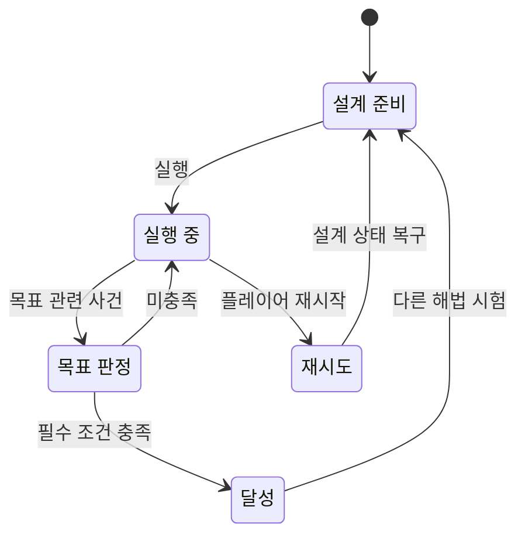
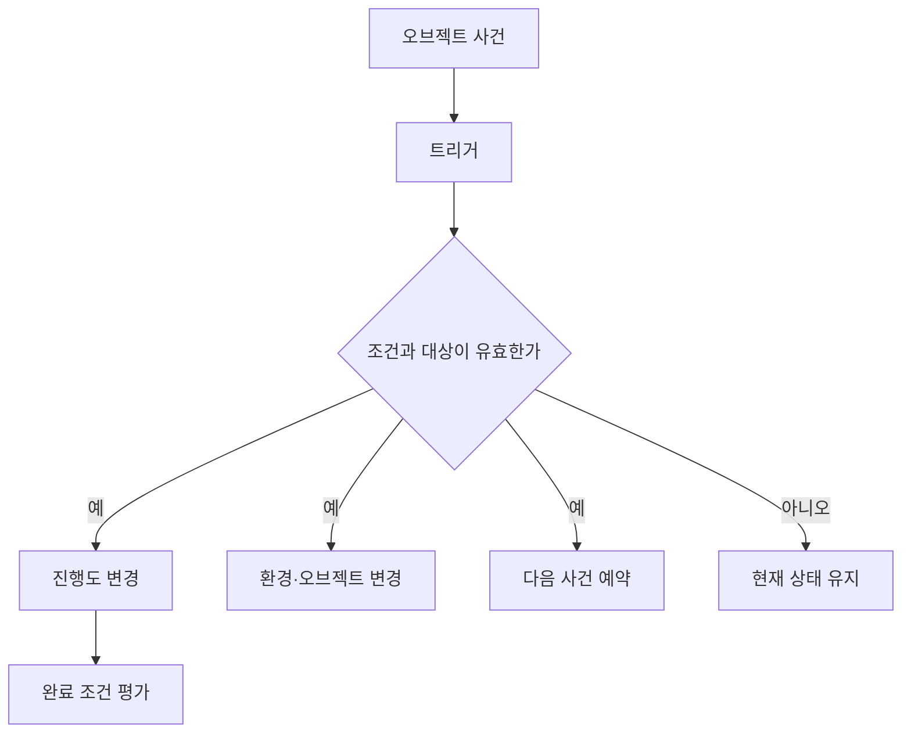

# 14. 캠페인·목표·레벨 에디터

> 대상: **Besiege Steam PC판**, 자료 조사일 **2026-11-13**. `[공식 확인]`은 개발자 공개 자료의 사실, `[설계 해석]`은 플레이 구조에 대한 분석, `[재구성 제안]`은 유사 시스템의 명세, `[검증 필요]`는 현재 설치본에서 확인해야 할 동작이다. 개별 레벨을 직접 플레이하여 전수 검증한 공략집은 아니다.

## 1. 캠페인의 기능

**[공식 확인]** 조사일 Steam 상점은 기본 캠페인을 네 섬에 걸친 파괴 가능한 55개 레벨로 소개하며, 별도 샌드박스와 레벨 에디터를 제공한다. DLC 캠페인·구형 콘솔판의 개수를 섞어서 기본 캠페인 수를 계산하지 않는다. [Besiege Steam 상점](https://store.steampowered.com/app/346010/Besiege/)

**[설계 해석]** 캠페인은 조립한 기계를 시험할 이유를 제공하는 과제 묶음이다. 목표는 단순해도 해결 방법은 열려 있어야 한다. “성벽을 파괴하라”는 목표는 충돌차, 투석기, 포격, 폭발물 운반 등 서로 다른 기계 구조를 허용한다. 이때 게임이 평가하는 것은 외형의 정답보다 목표 상태의 달성이다.

캠페인의 설계 기능은 세 가지로 나눌 수 있다.

- **기초 학습:** 이동, 조향, 안정성, 접촉·파괴를 이해한다.
- **새 제약 도입:** 높이, 지형, 적 공격, 운반 대상, 환경 효과 때문에 설계를 바꾼다.
- **재설계 유도:** 클리어한 기계를 더 빠르게, 적은 손상으로, 효율적인 구성으로 개선한다.

이는 제작 기능을 단계별로 해금하는 경제 모델과는 다른 분석이다. 현행 모든 부품의 해금 조건을 별도로 확인하지 않았으므로 캠페인 진행이 부품 능력치 성장으로 직결된다고 기재하지 않는다.

## 2. 목표 유형을 기계의 요구사항으로 변환

**[공식 확인]** 공식 레벨 에디터 개발 블로그에는 건물 파괴를 진행도로 바꾸는 예시와 기체 손상 조건으로 상대 팀 승리를 결정하는 예시가 있다. Valfross 소개에는 유물·대상 회수, 거대 장벽 파괴, 회전 구조물 과제가 제시됐다. [공식 Multiverse 개발 블로그](https://store.steampowered.com/news/posts/?appgroupname=Besiege&appids=346010&enddate=1512915054), [공식 Valfross 업데이트](https://store.steampowered.com/news/posts/?appids=346010&enddate=1564418637&feed=steam_community_announcements)

아래 유형별 대응은 **[설계 해석]**이다. 실제 레벨 이름별 정답을 지정하는 표가 아니다.

| 목표 유형 | 필요한 기계 성능 | 유도되는 설계 결정 | 흔한 실패의 의미 |
| --- | --- | --- | --- |
| 구조물 파괴 | 충격·사거리·집중 화력 | 발사축, 반동 지지, 접근 경로 | 무기는 충분하지만 차체가 버티지 못함 |
| 적 제거 | 반복 공격·범위·생존 | 무기 배치, 이동성, 방호 | 일부 적이 사각에 남음 |
| 도달·통과 | 조향·지형 추종·크기 | 차폭, 무게중심, 회전 반경 | 부품 성능보다 환경 적합성이 부족 |
| 회수·운반 | 대상 포획·하중 지지 | Grabber, 팔, 적재 공간, 균형 | 집은 뒤 무게중심이 이동 |
| 장치 조작 | 제한된 힘과 정확한 자세 | 피스톤, 힌지, 순차 입력 | 힘이 과해 대상이나 자기 구조가 파손 |
| 복합 과제 | 여러 단계의 성공 | 모듈 분리, 자동화, 입력 체계 | 앞 단계는 성공하지만 다음 기능을 잃음 |
| 기록 경쟁 | 반복 재현성과 효율 | 불필요한 부품 제거, 경로 단축 | 한 번 되는 설계와 안정적인 설계의 차이 |

레벨의 난이도는 적 수만으로 결정되지 않는다. **목표에 접근하기 위한 기동 요구**, **도착 후 필요한 작동**, **작동 중 자기 기체의 안정성**이 동시에 요구될 때 급격히 올라간다.

## 3. 설계 제약의 층

**[설계 해석]** 레벨 제약은 세 종류로 나눠야 한다.

| 층 | 예 | 주는 효과 |
| --- | --- | --- |
| 조립 제약 | 시작 작업 영역, 부품 제한 | 기체를 출발 가능한 형태로 구성 |
| 물리·환경 제약 | 지형, 물, 바람, 적 충돌 | 실행 중 설계 성능 검증 |
| 목표 제약 | 운반 대상 보존, 특정 조건 달성 | 무작정 큰 화력을 쓰는 해법 제한 |

이 세 층을 분리하면 같은 물리 환경에서 목표를 바꿔 재사용하거나, 같은 목표를 다른 환경에서 다시 시험할 수 있다. 예를 들어 “물체를 지정 위치로 운반”은 육상·수상·공중에서 서로 다른 기계를 요구한다.

**[공식 확인]** Multiverse의 공식 설계 설명에는 특정 블록 금지·종류별 개수 제한·전체 블록 수 제한·지정 기체만 허용하는 기능이 있다. 이는 사용자 레벨의 제한이며 기본 캠페인 전체에 항상 같은 제한이 걸린다는 뜻은 아니다. [공식 Multiverse Dev Blog 4](https://store.steampowered.com/news/posts/?appids=346010&enddate=1516890446&feed=steam_community_announcements)

**[검증 필요]** 시작 작업 경계가 블록의 원점·시각 메시·충돌 형상 중 무엇을 기준으로 판정하는지, 가동부를 펼친 뒤의 범위 제한이 있는지, 개인 기체 리스폰과 레벨 전체 초기화가 어떻게 다른지 확인한다.

## 4. 성공과 실패를 판정하는 구조

다음은 **[재구성 제안]**이다. 원작의 실제 상태 클래스나 레벨 파일 필드가 아니다.



### 4.1 작동 불능과 게임 규칙상 실패

**[설계 해석]** 바퀴가 모두 부서져 움직일 수 없는 상태, 목표물을 떨어뜨린 상태, 탄약을 다 쓴 상태는 플레이어에게 실패처럼 느껴진다. 그러나 그것이 항상 자동 실패 화면을 뜻하지는 않는다. 기체의 물리 상태와 레벨의 규칙상 실패 조건은 별개다.

**[재구성 제안]** 자동 실패는 명시적 조건이 있을 때만 발생시키고, 나머지는 즉시 재시도할 수 있게 한다. 모든 기능 파손을 “불가능”으로 자동 판정하려 하면 투사체가 아직 날아가는 중이거나 분리한 작은 기체가 목표를 완수하는 해법을 잘못 막을 수 있다.

### 4.2 진행도와 중복 사건

**[공식 확인]** 개발자 예시는 오브젝트의 `ON DESTROY`에 진행도 증가 이벤트를 연결하는 방식이다. 같은 블로그의 손상 기반 PvP 기준값은 설명용 설정이므로 기본 게임 전체의 승패 기준으로 사용하지 않는다. [공식 레벨 로직 소개](https://store.steampowered.com/news/posts/?appgroupname=Besiege&appids=346010&enddate=1512915054)

**[재구성 제안]** 목표 세 개라면 부동소수점 진행도 세 번 더하기보다 완료 대상 집합으로 상태를 관리하는 편이 명확하다.

```text
completed_targets: set<TargetId>
required_targets: set<TargetId>

on_target_completed(target_id):
    completed_targets.add(target_id)
    completed = required_targets is subset of completed_targets
```

이 예시는 원작 로직을 대체했다는 뜻이 아니다. 파편 여러 개가 동시에 파괴 이벤트를 내거나, 같은 사건이 네트워크로 중복 전달될 때도 목표가 한 번만 인정되는 설계 원칙을 설명한다.

## 5. 리플레이 동기와 성과 지표

**[공식 확인]** 2025년 10주년 업데이트는 완료 시간, 받은 피해, 블록 점수의 세 지표와 전역 리더보드를 추가했다. 블록 점수는 부품별 점수의 합이므로 단순 부품 개수와 다르다. 공식 공지는 Workshop에서 받은 기체로는 점수판 등록이 되지 않는다고 설명한다. 추가 목표·업적도 캠페인 재방문을 유도한다. [공식 10주년 업데이트](https://store.steampowered.com/news/posts/?appgroupname=Besiege&appids=346010&enddate=1748362018&feed=steam_community_announcements)

**[설계 해석]** 세 지표는 서로 다른 최적화 문제를 만든다.

| 지표 | 유도하는 설계 | 다른 지표와의 긴장 |
| --- | --- | --- |
| 시간 | 빠른 이동, 즉각 발사, 짧은 경로 | 강한 출력·충격으로 손상 증가 가능 |
| 피해 | 안정된 구조, 원거리 접근, 방호 | 부품 증가나 느린 진행 가능 |
| 블록 점수 | 역할 통합, 간결한 기계 | 예비 기능·견고함 감소 가능 |

따라서 “최고의 기체”를 단일 합산 점수로 고정하지 않고 목적별로 다른 해법을 인정할 수 있다. 공학적 숙련은 부품을 많이 다는 방향뿐 아니라 필요한 기능을 더 적은 구조로 구현하는 방향에서도 드러난다.

**[검증 필요]** 현재 점수 인정 여부에 대한 God Tool·모드·구버전 기체·추가 로드의 세부 조건, 시간의 실시간/시뮬레이션시간 기준, 피해 점수의 정확한 분모와 자발적 분리 처리 규칙은 현행 UI와 실험으로 확인해야 한다. 공개된 설명 이상을 추정해 리더보드 규칙으로 확정하지 않는다.

## 6. 레벨 에디터의 데이터 계층

**[설계 해석]** 레벨 에디터는 아래 계층을 합친 제작 도구다.

| 계층 | 포함하는 데이터 | 대표 편집 |
| --- | --- | --- |
| 환경 | 배경, 지형 조합, 물·공간 설정 | 분위기와 물리 환경 지정 |
| 물체 | 건축물, 장식, 도로, 장애물 | 위치·크기·속성 변경 |
| 행위자 | 병사·동물·공격 장치 | 배치와 행동 조건 |
| 플레이 영역 | Build Zone, 팀, 시작 위치 | 참가자의 소속·출발 상태 |
| 논리 | 트리거, 이벤트, 변수 | 목표·문·함정·점수 |
| 운영 규칙 | 블록 제한, 기체 제한, 재시작 | 공정성과 성능 범위 |

**[공식 확인]** V1.60은 에디터 오브젝트와 카테고리를 확장했고, 결승선·무중력 영역·오브젝트 사이를 잇는 Joint, 수면 높이와 거칠기 설정을 포함했다. 물 환경에서는 제작 영역 크기도 조정하도록 변경했다. 지형·대형 물체를 카메라가 통과하지 않게 하는 옵션도 추가했다. [공식 V1.60 공지](https://steamcommunity.com/games/346010/announcements/detail/4543660921244335097)

여기서 레벨의 `Joint` 오브젝트와 플레이어 기체의 조립 접속점을 같은 편집 도구로 설명하지 않는다. 둘 다 구조물을 연결하지만 저장 단위와 사용 문맥이 다르다.

## 7. 트리거와 이벤트의 설계 분석

**[설계 해석]** 트리거는 “무슨 일이 일어났는가”, 조건은 “지금 실행해도 되는가”, 이벤트는 “무엇을 바꿀 것인가”다. 이 세 층이 있으면 같은 사건을 진행도·문 개방·적 등장 등 여러 결과에 연결할 수 있다.



위 다이어그램은 **재구성 모델**이다. 원작의 트리거 목록과 내부 스케줄러를 완전히 재현한 것이 아니다.

### 7.1 사건을 처리할 때 정해야 하는 정책

| 정책 | 결정할 질문 | 잘못 설계했을 때 |
| --- | --- | --- |
| 1회성 | 같은 목표가 다시 발생하면 인정하는가 | 진행도 중복 증가 |
| 재진입 | 이벤트 처리 중 같은 이벤트가 발생하면 | 무한 재귀·프레임 폭증 |
| 대상 수명 | 대상이 이미 파괴됐으면 | 사라진 오브젝트 참조 |
| 지연 | 시간 지연은 어느 시간축인가 | 슬로모션에서 순서 불일치 |
| 팀 범위 | 사건을 낸 팀·받는 팀은 누구인가 | 상대 점수를 잘못 증가 |
| 복구 | 레벨 재시작 시 무엇을 초기화하는가 | 이전 시도 상태가 남음 |
| 순서 | 같은 프레임에 둘 다 달성하면 | 승패 비결정성 |

**[공식 확인]** V1.60에는 폭탄이 폭발 이벤트에서 자기 자신을 다시 생성할 때 발생하는 호출 순서 문제의 수정 기록이 있다. 따라서 위 재진입 정책은 추상적인 우려만이 아니라 이 유형의 에디터에서 실제 검증할 가치가 있는 항목이다. [공식 V1.60 변경 이력](https://steamcommunity.com/games/346010/announcements/detail/4543660921244335097)

### 7.2 커스텀 레벨 예시

다음은 **원작 내장 레벨을 복제하지 않은 재구성 예시**다.

**다리 확보 과제**

1. 적 투석기를 무력화하면 다리로 향하는 문이 열린다.
2. 기체 또는 운반 대상을 다리 끝 영역으로 옮긴다.
3. 운반 대상의 생존·위치를 확인한다.
4. 필수 조건을 충족하면 완료한다.

이 과제는 화력, 이동, 운반을 한 기체에 통합하거나 단계별 모듈을 분리하는 선택을 유도한다. 모든 적을 파괴하는 과제로 만들 때보다 넓은 설계 공간을 제공할 수 있다.

**회전 장치 조작 과제**

1. 기계 팔을 제한된 공간에 넣는다.
2. 목표 장치를 정해진 방향으로 움직인다.
3. 목표 물체가 지정 영역에 들어가면 완료한다.

이 과제는 최대 출력보다 부품 방향, 구속 자유도, 미세 조작을 학습시킨다.

## 8. 난이도 곡선과 튜토리얼

**[재구성 제안]** 조립 시뮬레이션의 학습 과제는 새로운 부품 수보다 동시에 이해해야 하는 물리 개념 수로 설계한다.

| 단계 | 새로 배우는 개념 | 이미 알고 있어야 할 것 | 과제 예시 |
| --- | --- | --- | --- |
| 1 | 배치와 실행 | 없음 | 짧은 거리 직진 |
| 2 | 조향과 축 | 기본 주행 | 장애물 옆으로 이동 |
| 3 | 충격·반동 | 구조 연결 | 작은 구조물 파괴 |
| 4 | 하중과 무게중심 | 조향·접속 | 물체 잡고 운반 |
| 5 | 가동 기구 | 회전·병진 | 문·장치 조작 |
| 6 | 비행·부력 | 질량과 힘 | 높이·수면 제약 해결 |
| 7 | 순차 자동화 | 입력과 센서 | 여러 동작의 연속 실행 |
| 8 | 효율 최적화 | 모든 기본 개념 | 기록·부목표 개선 |

같은 레벨이 여러 해법을 허용하더라도 초보자가 무엇을 바꿔야 할지 알 수 있는 피드백이 필요하다. 실패 순간의 위치, 입력 중인 부품, 첫 파손 부위, 목표의 남은 조건을 연결해서 보여주면 학습이 쉬워진다.

**[검증 필요]** 실제 캠페인의 부품 소개 순서, 튜토리얼 표시 조건, 기존 사용자의 튜토리얼 재활성화 방식은 버전과 저장 상태에 영향을 받을 수 있다. 위 표는 캠페인의 공식 순서가 아니다.

## 9. 레벨 데이터 재구성 예시

```text
LevelDefinition (재구성 예시)
  level_id
  content_version
  environment_settings
  objects[]
  actors[]
  build_zones[]
  rules
  required_objectives[]
  optional_objectives[]
  event_graph
  completion_metrics
  dependencies[]

LevelRunState (재구성 예시)
  run_id
  simulation_time
  completed_objective_ids
  emitted_one_shot_events
  team_progress
  tracked_machine_ids
  pending_events
  result_state
```

재구성 시 `LevelDefinition`과 `LevelRunState`를 분리하면 리셋·재시도·저장을 명확하게 다룰 수 있다. 레벨 정의를 덮어쓰지 않고 실행 중 파괴 상태를 폐기할 수 있으며, 참가자가 기체를 리스폰하더라도 레벨 전체 사건 상태는 별도로 유지할 수 있다.

## 10. 검증 항목

아래는 **미실행 계획**이다.

| ID | 시험 | 확인할 사항 |
| --- | --- | --- |
| LV-01 | 목표가 여러 파편으로 파괴됨 | 목표당 완료 사건 1회 인정 여부 |
| LV-02 | 마지막 목표 파괴와 기체 파손 동시 발생 | 성공·실패 우선순위 |
| LV-03 | 발사 후 기체 본체가 소멸 | 날아가는 투사체의 목표 기여 |
| LV-04 | 개인 리스폰과 전체 레벨 리셋 비교 | 목표·적·시간·논리 초기화 범위 |
| LV-05 | 시뮬레이션 속도 변경 | 지연 이벤트·시간 기록 기준 |
| LV-06 | 두 팀이 같은 프레임에 조건 충족 | 무승부·우선순위 처리 |
| LV-07 | 추가 로드와 Workshop 기체 | 현행 기록 등록 자격 |
| LV-08 | 서로 다른 부품 수의 기체 | 부품 개수와 Block Score 구분 |
| LV-09 | 제한 블록 복제·추가 로드 | 제한 검사 시점과 Undo 일관성 |
| LV-10 | 물·무중력 영역 경계 통과 | 환경 중첩과 경계 판정 |
| LV-11 | 이벤트로 자신을 파괴·재생성 | 재진입과 무한 루프 방지 |
| LV-12 | DLC 미소유 참가자의 커스텀 레벨 | 환경·블록·편집 권한의 차이 |

## 관련 문서

- [01. 코어 루프](01_core_loop_and_design.md)
- [02. 조립 UX](02_assembly_ux.md)
- [10. 수상·수중](10_water_and_buoyancy.md)
- [12. 손상·파괴](12_damage_and_destruction.md)
- [13. 입력·자동화](13_automation_and_controls.md)
- [15. 멀티플레이·UGC](15_multiplayer_and_ugc.md)
- [17. 검증 실험](17_validation_experiments.md)
- [99. 출처와 근거](99_sources.md)
