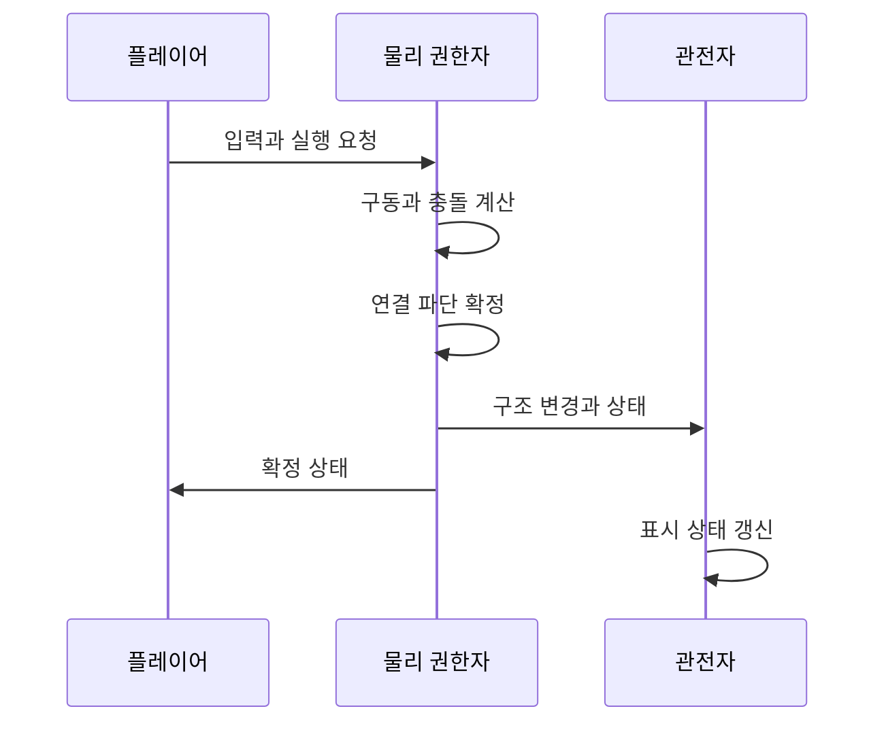

# 15. 멀티플레이, Workshop과 모드

> 조사일 2026-11-13 · Steam PC 범위. 네트워크 관련 공식 기술 설명은 주로 2017년 Multiverse 개발 일지에 근거한다. 현행 패킷·전송 주기·예측·권한 이전 구현을 확인한 문서가 아니다.

## 1. 시스템의 목적

**[설계 해석]** 혼자 설계한 기계를 타인의 기계와 충돌시키는 순간, 물리 재현성뿐 아니라 공정성·편집 권한·로드 대기·환경 상태·의존성 문제가 생긴다. 멀티플레이와 UGC를 완성 단계의 부가기능으로 취급하면 기계 데이터와 시뮬레이션 수명주기를 다시 설계해야 한다.

## 2. 개발사가 공개한 Global과 Local의 차이

[공식 확인·역사 자료] Multiverse 개발 일지는 Global 모드에서 호스트가 공통 물리를 계산하고, Local/Ghost 모드에서는 개인이 로컬에서 기계를 시험하는 구조를 설명했다. 네트워크로 전송할 정보를 줄이기 위해 블록을 클러스터로 묶는 접근도 공개했다. [Multiverse Dev Blog 1, 2017-05-19](https://store.steampowered.com/news/posts/?appids=346010&enddate=1512760723)

| 항목 | Global 시뮬레이션 | Local/Ghost 시뮬레이션 |
|---|---|---|
| 핵심 목적 | 다른 기계와 공통 상호작용 | 개인 제작물 시험 |
| 공개된 물리 계산 위치 | 호스트 | 해당 플레이어 |
| 다른 기계와의 관계 | 같은 상호작용 세계 | 별도의 시험 상태 |
| 레벨 편집 | 공통 실행 상태와 충돌 방지 필요 | 다른 사용자의 편집을 계속 허용하는 목적 |
| 주의 | 호스트 전체 부하가 중요 | 시험 시작 당시 환경과 현재 편집 결과가 다를 수 있음 |

표의 세부 목적 해석은 **[설계 해석]**이다. 2017년 이후의 모든 동작이 그대로 유지된다는 보장은 없으며 현재 실행판에서 검증한다.

## 3. 블록 수와 전송 단위

**[설계 해석]** 정적인 연결로 함께 움직이는 부품은 움직임을 묶어 표현할 여지가 있다. 반대로 관절·분리·파손이 많으면 상대 운동이 증가한다. 기체의 외형이 복잡하다는 사실과 전송할 운동 정보가 많다는 사실은 같지 않다.

### 반드시 구분할 세 개념

| 개념 | 의미 | 함부로 추론하면 안 되는 것 |
|---|---|---|
| 연결 컴포넌트 | 그래프로 연결된 부품 집합 | 모두 한 강체라는 결론 |
| 솔버의 운동 단위 | 실제 강체와 제약 | 전송도 강체마다 독립이라는 결론 |
| 네트워크 클러스터 | 전송을 묶는 표현 단위 | 모든 연결이 영구 고정이라는 결론 |

**[재구성 제안]** 클러스터 ID와 상대 변환을 사용한다면 파단 때 클러스터 분할 사건을 움직임 스냅샷보다 먼저 또는 함께 전달해야 한다. 분할 정보 없이 위치만 전송하면 클라이언트가 파편을 이전 기체의 자식처럼 보간할 수 있다.

## 4. 권한과 이벤트 순서

아래는 **[재구성 제안]**이다.

플레이어·호스트·관전자 세 역할만 표시했다. 구체적인 신뢰성 채널, UDP 여부, 입력 지연 보상, 롤백 여부는 공개 확인하지 않았다.

### 4.1 연속 상태와 불연속 사건

| 데이터 | 예 | 필요한 성질 |
|---|---|---|
| 연속 상태 | 위치·회전·속도 | 지연·누락을 표시 보간으로 완화 가능 |
| 구조 사건 | 파단·분리·집기·연료망 결합 | 대상 ID와 순서의 일관성 필요 |
| 이산 실행 | 발사·폭발·생성·삭제 | 중복 처리 방지 필요 |
| 편집 명령 | 배치·삭제·설정 변경 | 설계 버전과 실행 상태 구분 |

사건의 순서가 잘못되면 파손된 연결이 잠시 되살아나거나, 폭발이 두 번 발생하거나, 이미 삭제한 블록에 입력이 적용될 수 있다. 위 내용은 유사 게임 구현 시 검토할 위험이며 원작에서 현재 발생한다고 주장하는 것이 아니다.

## 5. 공동 제작과 편집 충돌

**[재구성 제안]** 기계 편집, 레벨 편집, 실행 전환에 별도의 소유권·버전 개념을 둔다. 같은 벽을 한 플레이어가 삭제하고 다른 플레이어가 이동할 경우, 명령 순서 또는 잠금 정책이 필요하다.

| 충돌 | 예측 가능한 처리 방향 |
|---|---|
| 삭제된 부품의 설정 변경 | 명령 거부 또는 명시적 무효 처리 |
| 실행 중 설계 변경 | 다음 실행용 설계로 보관하거나 편집 제한 |
| 두 사람이 같은 구조 수정 | 부품·기체 단위 편집 권한 표시 |
| 큰 기체 로드 중 새 접속 | 준비 완료 시점과 참여 가능 시점 분리 |
| 다른 환경 스냅샷으로 시험 | Local 시험의 환경 시점을 표시 |

현재 Besiege의 모든 충돌 해결 정책은 공개 확인하지 않았다.

## 6. Workshop의 역할

[공식 확인] 기본 게임은 기계·레벨·스킨·모드와 Workshop 통합을 제공한다고 소개한다. [공식 게임 소개](https://store.steampowered.com/app/346010/Besiege/)

**[설계 해석]** UGC는 콘텐츠량을 늘리는 동시에 설계 지식의 전달 경로가 된다. 완성된 비행기 하나를 받는 것보다 조향·추진·자동화가 분리되어 이해되는 설계가 재사용 가치가 높다.

### 사용자 흐름

1. 썸네일·이름·설명으로 목적을 파악한다.
2. 기본 게임/DLC/모드 의존성을 확인한다.
3. 로드하고 제어법과 입력 변수를 확인한다.
4. 시험한 뒤 부분 모듈로 재사용하거나 수정한다.
5. 수정한 결과를 자기 버전으로 보관한다.

위 흐름의 세부 화면과 메타데이터 권장은 **[재구성 제안]**이다.

## 7. DLC 소유와 기체 로드 권한

[공식 확인] V1.9는 미소유 DLC의 블록을 포함한 Workshop 기체도 불러올 수 있게 하되, 해당 블록 수정은 DLC 소유가 필요하다고 명시했다. [V1.9 출시 변경 기록](https://steamcommunity.com/app/346010/announcements/)

**[설계 해석]** 따라서 다음 상태를 하나의 ‘지원/미지원’ 플래그로 합치지 않는다.

| 상태 | 질문 |
|---|---|
| 데이터 로드 가능 | 파일 구조와 부품 ID를 해석할 수 있는가? |
| 실행 가능 | 필요한 부품의 런타임 동작을 사용할 수 있는가? |
| 편집 가능 | 해당 부품을 수정할 권한이 있는가? |
| 레벨 접근 가능 | 환경·캠페인에 별도의 요구 조건이 있는가? |
| 재배포 가능 | 창작자 설명·공유 규칙을 준수하는가? |

공지는 블록 로드·편집 정책을 설명한 것이므로 이를 모든 DLC 레벨의 무료 접근으로 확대 해석하지 않는다.

## 8. 모드와 기본 게임의 경계

**[설계 해석]** 임의 스케일·음수 입력·기본 범위를 넘는 매개변수·새 부품이 포함된 기체는 기본 게임 부품의 성능 비교에 사용하지 않는다. 저장 형식에 값이 존재한다는 사실만으로 기본 UI가 그 값을 지원한다는 뜻도 아니다.

| 자료 | 주의할 점 |
|---|---|
| 오래된 튜토리얼 | 과거 모드 기능이 나중에 기본 기능이 되었을 수 있음 |
| 최신 모드 기체 | 기본 한계·파손·충돌 규칙을 바꿨을 수 있음 |
| 스킨 | 외형과 물리 형상의 대응을 별도로 확인 |
| 미설치 모드 부품 | 누락 시 삭제·대체·실행 차단 정책 확인 |
| 멀티플레이 | 호스트와 클라이언트의 버전·설정 일치 필요 여부 확인 |

## 9. 재구성 시 저장·게시 메타데이터

다음은 **[재구성 제안]**이며 원작 Workshop 필드 목록이 아니다.

- 설계 버전, 제작 게임 버전, 요구 DLC·모드.
- 기본 조작과 자동화 변수의 의미.
- 실행 환경: 육상·수상·수중·대기·우주.
- 부품 수, 가동 관절 수 등 사용자가 이해할 수 있는 규모 정보.
- 초기 전개 상태, 권장 시작 위치, 의도한 목표.
- 공유 원본과 수정본을 구분하는 참조 정보.

구체적 내부 프로파일링 수치를 소비자용 다운로드 흐름에 모두 노출할 필요는 없다. 불러올 수 있는지와 어떻게 조작하는지에 필요한 정보가 우선이다.

## 10. 검증 시나리오

| ID | 시험 | 확인할 결과 |
|---|---|---|
| NET-01 | 같은 기체를 Global/Local에서 실행 | 권한·환경·상호작용 차이 |
| NET-02 | 회전부와 프레임을 의도적으로 분리 | 파단과 위치 표시 순서 |
| NET-03 | 무기 발사 직후 실행 중단 | 중복 발사·잔류 폭발 여부 |
| NET-04 | 큰 기체 로드 중 자동화 작동 | 시간·입력 일관성 |
| UGC-01 | 미소유 DLC 포함 기체 로드 | 로드·실행·편집 정책을 각각 기록 |
| UGC-02 | 저장 기체에 모드 의존성 누락 | 복구 가능한 오류 메시지 |
| UGC-03 | 구형 저장본과 같은 신규 기체 | 호환 설정 차이 |

이는 실제 시행 결과가 아닌 검증 계획이다.

## 관련 문서

- [03 고급 조립](03_advanced_building.md)
- [05 물리 실행](05_physics_runtime.md)
- [14 캠페인·레벨](14_campaign_and_levels.md)
- [16 데이터 아키텍처](16_data_architecture.md)
- [17 검증 실험](17_validation_experiments.md)
