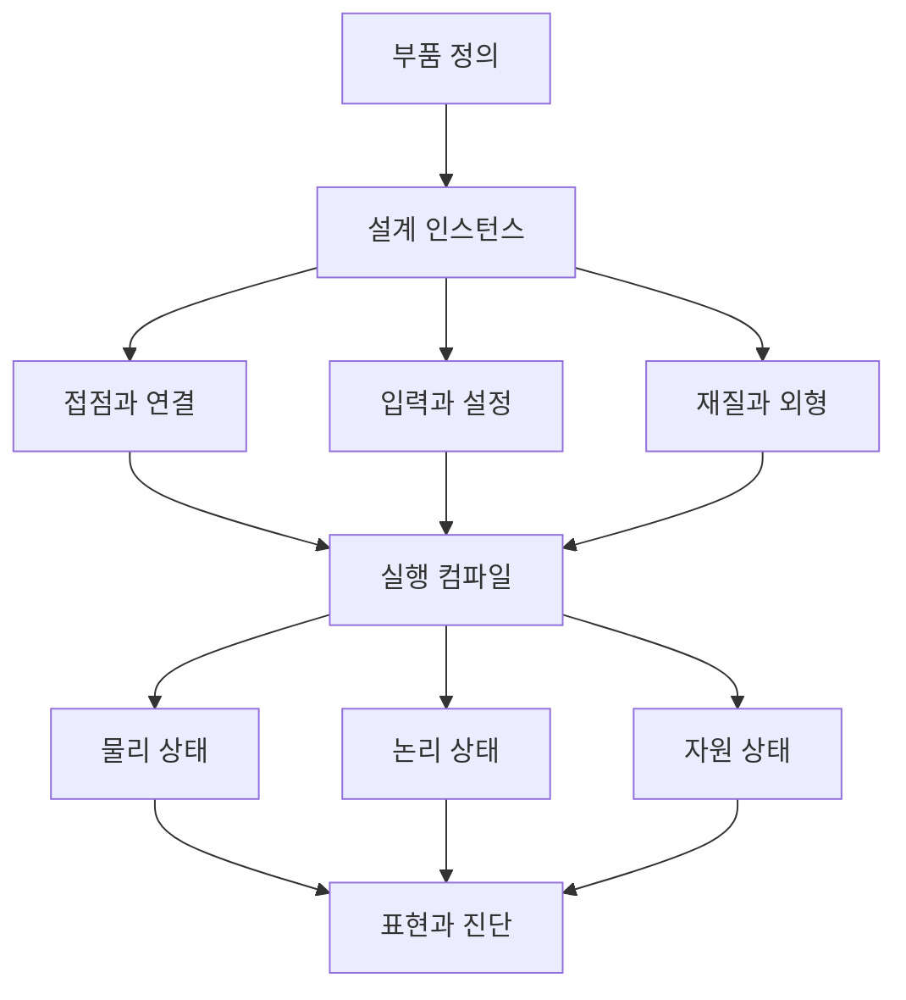

# 16. 설계 데이터와 시스템 아키텍처 재구성

> **문서 전체의 성격: 재구성 제안.** Besiege 원본 코드, 실제 파일 스키마, 클래스명, 네트워크 프로토콜을 복원한 것이 아니다. 앞 문서의 플레이 규칙을 일관되게 구현하기 위한 독립적인 설계안이다.
> Steam PC판의 공개 기능을 분석한 날짜: 2026-11-13.

## 1. 설계 목표

기계 편집, 물리 실행, 저장, 복구, 공유가 하나의 일관된 부품 정의를 사용하도록 만든다. 사용자가 보는 블록과 물리 강체의 관계가 반드시 일대일이라고 가정하지 않는다. 정의 데이터와 인스턴스 설정, 실행 중 상태를 분리한다.

## 2. 데이터 계층



원본 설계는 실행으로 손상시키지 않는다. 실행 결과에서 사용자가 명시적으로 반영한 변경만 편집 데이터로 되돌린다.

## 3. 부품 정의: BlockDefinition

| 필드 | 역할 | 주의 |
|---|---|---|
| `definitionId` | 부품 유형의 안정 ID | 표시 이름·언어와 분리 |
| `definitionVersion` | 동작 변경의 버전 | 구형 저장본 이행 정책 필요 |
| `contentRequirement` | 기본/DLC/모드 요구 | 로드와 편집 권한 분리 |
| `visualDescriptor` | 메시·스킨·피벗 | 충돌 형상과 독립 |
| `collisionDescriptor` | 접촉 형상과 필터 | 부착 탐색용 영역과 독립 |
| `attachmentPorts` | 연결 가능한 면·영역·역할 | 가동측/고정측 분리 가능 |
| `bodyRecipe` | 내부 강체 구성 | 여러 몸체 가능 |
| `jointRecipe` | 내부 제약과 구동 방식 | 사용자 연결과 혼동 방지 |
| `parameterSchema` | 입력 가능한 설정 | 범위·단위·기본값·혼합 편집 규칙 |
| `damageProfile` | 파괴·화재·저항 | 블록과 접합부를 구분 |
| `forceModules` | 공기·물·추진·특수힘 | 환경 조건을 명시 |

### 매개변수 정의 예시

```json
{
  "id": "drive_target",
  "type": "number",
  "displayUnit": "design_unit",
  "limits": "defined_by_component",
  "default": "defined_by_component",
  "bulkEditKey": "drive_target",
  "rebuildRequirement": "runtime_parameter"
}
```

`design_unit`은 물리 단위를 확인하지 못했을 때 단위를 거짓으로 붙이지 않기 위한 설명용 값이다. 실제 원작의 속도 설정을 rad/s나 m/s로 단정하지 않는다. 일반 파일 스키마로 바로 사용할 수 있는 완성 코드도 아니다.

## 4. 설계 인스턴스: BlockInstance

| 항목 | 저장 필요 이유 |
|---|---|
| 고유 인스턴스 ID | 끝점·논리·그룹 참조 안정성 |
| 유형 ID와 버전 | 정의 로드와 호환성 |
| 기체 로컬 변환 | 전체 이동·회전과 개별 편집 구분 |
| 사용자 설정 | 구동력·키·초기 전개 상태 |
| 부착 의도 | 공간 재탐색과 명시 연결의 관계 |
| 외형 설정 | 색·스킨·표면 편집 |
| 제작 메타데이터 | 선택 저장·모듈화·검색 |

런타임 위치·속도·충돌 접촉 캐시·솔버 핸들·현재 눌린 키는 일반 설계 저장과 분리한다. 중간 시뮬레이션 저장을 지원한다면 별도의 실행 체크포인트 형식이 필요하다.

## 5. 연결 데이터

### 5.1 명시적 연결과 실행 시 탐색

두 방식 모두 장단점이 있다.

| 방식 | 이점 | 위험 |
|---|---|---|
| 위치에서 접합 재탐색 | 자연스러운 붙이기와 이동 | 배치 순서·오차·버전 영향 |
| 명시적 연결 저장 | 결과 재현과 수정 추적 | 연결 규칙 변경 때 마이그레이션 필요 |
| 혼합 방식 | 자동 접합과 의도 보존 | 둘이 충돌할 때 우선순위 필요 |

Besiege가 현행으로 정확히 어떤 비율의 방식을 쓰는지 단정하지 않는다. [04 연결 규칙](04_connection_rules.md)의 불확실 항목이 이 설계 선택을 바꾼다.

### 5.2 연결 레코드 예시

```json
{
  "connectionId": "conn_demo_001",
  "a": {"blockId": "frame_a", "port": "side"},
  "b": {"blockId": "steering_a", "port": "base"},
  "connectionRule": "structural_attachment",
  "anchors": "local_coordinates",
  "breakProfile": "profile_reference",
  "source": "user_attachment_intent"
}
```

이는 원작 Block ID 또는 실제 저장 필드가 아니다. 데이터 예제의 이름을 원본 `.bsg` 파일에 적용해서는 안 된다.

## 6. 복사·대칭·부분 저장의 참조 처리

### 6.1 복사

복사한 모든 부품에 새 ID를 부여하고 내부 연결과 센서 끝점 참조를 일괄 재매핑한다. 원본 ID를 유지하면 복제된 스프링이 원래 기체를 잡아당기는 종류의 참조 문제가 생길 수 있다.

### 6.2 대칭

대칭은 위치 반전만으로 끝나지 않는다. 로컬 좌표계의 손잡이성, 구동 부호, 피벗, 좌우 제어 의미가 바뀔 수 있다. 반사 행렬을 quaternion으로 바로 저장할 수 없으므로 ‘형상 반전’과 ‘회전+방향 설정’ 정책을 구분한다.

**재구성 결정표:**

| 속성 | 기본 처리 후보 | 확인할 사항 |
|---|---|---|
| 위치 | 대칭면에 반사 | 대칭면의 원점 |
| 방향 | 부품 유형에 맞는 반사 규칙 | 뒤집을 수 없는 부품 |
| 연결 끝점 | 복제된 짝으로 재매핑 | 선택 밖 대상 |
| 구동 방향 | 부품별 규칙 | 좌우 바퀴 전진의 일관성 |
| 키·변수 | 기본 복사 후 충돌 진단 | 의도한 공통 입력인지 |
| 초기 전개량 | 값 유지 또는 부호 변환 | 축 기준 의미 |

### 6.3 선택 저장

선택 밖에 걸친 Brace·스프링·센서·논리 참조에 대해 명확한 정책이 필요하다. 외부 참조 제거, 선택 확장, 끊어진 연결 표시 중 하나를 사용자에게 설명해야 한다. 자동으로 새 대상에 붙이는 방식은 잘못된 기구를 만들 위험이 있다.

## 7. 명령과 Undo/Redo

편집은 원자적 명령으로 기록한다. 다중 부품 설정 변경은 한 번의 Undo로 되돌아가야 사용자가 변경 단위를 이해하기 쉽다.

```text
EditCommand
  operationId
  expectedDesignRevision
  affectedBlockIds
  beforeState
  afterState
  selectionBefore
  selectionAfter
```

### 예외 처리

- 텍스트 편집을 끝내지 않고 실행하면 확정 또는 취소를 일관되게 처리한다.
- 삭제 뒤 Undo는 부품만이 아니라 참조·설정·연결도 복원한다.
- 대칭 배치는 원본·대칭본을 같은 명령으로 취급한다.
- 표면 편집은 노드·에지·곡률·재질의 변경을 함께 복원한다.
- 자동 저장은 Undo 스택과 역할이 다르다. 세션 내 취소와 장기 복구를 분리한다.

## 8. 실행 컴파일과 원자적 시작

```text
1. 편집 트랜잭션 확정
2. 설계 스냅샷 고정
3. 의존성 및 권한 확인
4. 부품·몸체 생성
5. 연결·제약 구성
6. 입력·센서·연료망 준비
7. 초기 상태 검증
8. 한 경계에서 시뮬레이션 활성화
```

이 순서는 제안이다. 생성 중간에 물리 스텝이 실행되지 않도록 하는 것이 핵심이다. 작업이 오래 걸리면 취소할 수 있어야 하며, 실패한 생성 결과가 원본 설계를 손상시키지 않아야 한다.

## 9. 파손과 토폴로지 변경

연결 파단은 물리 그래프뿐 아니라 제어·자원·표현을 갱신할 수 있다. 다만 물리적으로 분리되었다고 이름 기반 제어 신호도 반드시 끊어진다고 가정해서는 안 된다. 신호의 스코프는 별도의 제품 규칙이다.

| 사건 | 재평가 대상 |
|---|---|
| 접합부 파단 | 운동 그룹·네트워크 표현 |
| 센서 부품 파괴 | 입력 출력 상태·참조 |
| 연료 호스 단절 | 연료망·계측 기준 |
| 집게 부착 | 새로운 연결·충돌 제외 |
| 부품 완전 삭제 | 모든 참조·효과·저장 영향 |

위 표는 재구성 시 고려사항이며 원작 모든 부품의 실제 연동 보장이 아니다.

## 10. 버전과 구형 저장본

부품 정의가 달라졌을 때 파일이 열리는 것만으로 호환성이 확보되지는 않는다. 동일하게 달리고 날고 부서지는지가 중요하다. 신규 기본값과 구형 인스턴스 설정의 차이를 저장해 두면 과거 기체의 동작을 유지하면서 새 기체에 개선된 규칙을 적용할 수 있다.

### 권장 이행 정책

| 변경 | 처리 후보 |
|---|---|
| UI 이름 수정 | 저장 ID 유지 |
| 기본값 수정 | 기존 명시값 유지 |
| 충돌 형상 변경 | 레거시 모드 또는 사용자 선택 |
| 입력 의미 변경 | 변환 경고와 원본 보존 |
| 부품 제거 | 대체 매핑 또는 누락 표시 |
| DLC 요구 변경 | 로드·편집·실행을 각각 평가 |

원작의 실제 예는 [07 육상 구동](07_ground_locomotion.md)의 신규 바퀴와 구형 저장물 구분을 참조한다.

## 11. 단위와 수치 관리

정의 데이터는 표시값과 물리값을 구분한다. UI `1x`가 곧 1N·1m/s·1rad/s라는 뜻은 아니다. 값을 확인하지 못한 상태에서 현실 단위를 부여하면 이후 모든 실험의 비교가 틀어진다.

수치에는 `기준 버전`, `출처`, `측정법`, `단위`, `허용 범위`, `기본값`, `레거시 여부`를 함께 기록한다. 내부값을 모르면 사용자 설정값과 관측 결과만 기록하고 대응식을 나중에 추정한다.

## 12. 진단 데이터

| 진단 | 사용자 질문 | 최소 정보 |
|---|---|---|
| 연결 보기 | 어디가 붙었나? | 접점·양끝·가동측 |
| 힘 보기 | 왜 기울어지나? | 힘 방향·작용점·유형 |
| 관절 보기 | 왜 안 돌아가나? | 허용축·목표·한계 |
| 손상 보기 | 어디가 먼저 부러지나? | 연결/부품 구분·원인 |
| 입력 보기 | 왜 혼자 작동하나? | 신호 송신자·수신자·현재값 |
| 비교 보기 | 수정으로 좋아졌나? | 동일 초기조건의 이전 결과 |

이는 기능 제안이다. 실제 Besiege에 모두 존재한다고 주장하지 않는다. 기존 공식 시각화 기능은 관련 시스템 문서의 `[공식 확인]` 항목을 참고한다.

## 관련 문서

- [04 연결 규칙](04_connection_rules.md)
- [05 물리 실행](05_physics_runtime.md)
- [13 자동화](13_automation_and_controls.md)
- [15 멀티플레이·UGC](15_multiplayer_and_ugc.md)
- [17 검증 실험](17_validation_experiments.md)
- [18 구현 우선순위](18_reconstruction_roadmap.md)
