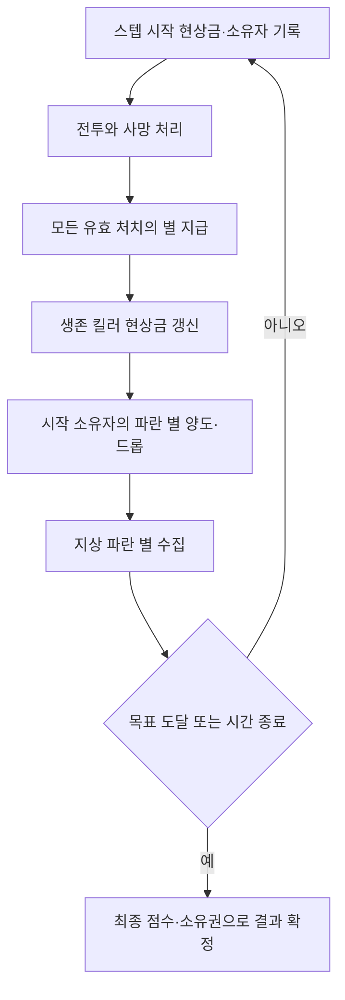

# 바운티 — 실행 코어 명세

> Brawl Lab 4.0 · 모드 ID `bounty` · 3 대 3 · 현상금·파란 별·동시 처치 정책은 이 프로젝트의 명시적인 프로토타입 규칙이며 원작 서버의 상세 판정을 주장하지 않는다.

## 1. 목표와 두 가지 점수

상대를 처치해 **팀 별 20개**를 먼저 모으면 승리한다. 적이 가진 개인 현상금이 높을수록 그 적을 처치했을 때 받는 별도 많다. 상대를 처치한 생존자는 자신의 현상금이 올라 다음 교전에서 더 큰 목표가 된다.

팀의 누적 별과 개인의 현상금은 서로 다른 값이다. 팀 점수는 이미 획득한 성과이므로 아군이 죽어도 차감하지 않는다. 개인 현상금은 해당 캐릭터를 다음에 처치한 상대에게 지급될 값이며, 사망하면 초기값으로 돌아간다.

중앙의 파란 별은 처음 획득할 때만 일반 점수 1점을 준다. 이후에는 추가 점수 없이 **동률 판정권**으로 작동한다. 따라서 일반 점수, 개인 현상금, 파란 별 소유권을 분리해 표시하고 처리한다.

## 2. 기본 수치

| 항목 | 값 |
|---|---:|
| 인원 | 플레이어 포함 3 대 3 |
| 전장 | 1280 × 800 월드 픽셀 |
| 목표 팀 별 | 20개 |
| 경기 제한 시간 | 120초 |
| 개인 초기 현상금 | 2 |
| 유효 처치당 현상금 증가 | +1, 해당 스텝 뒤 살아 있는 킬러 |
| 개인 최대 현상금 | 7 |
| 사망 뒤 개인 현상금 | 2 |
| 부활 시간 | 2.5초 |
| 파란 별 초기 위치·반경 | (640, 400), 12px |
| 파란 별 최초 획득 일반 점수 | 1, 경기 전체에서 한 번 |

맵은 좌우 대칭이며 중앙 파란 별 주변에 진입 공간을 둔다. 엄폐물과 수풀은 접근 경로와 후퇴 위치를 만든다. 녹아웃과 달리 일반 부활이 있으며, 경기 중 지형을 라운드 단위로 복원하지 않는다.

## 3. 공개 상태와 통계

```js
state.mode = 'bounty';
state.timeLimit = 120;
state.score = [0, 0]; // 누적 팀 별, 개인 현상금의 합계가 아님
state.bounty = {
  target: 20,
  blueStar: {
    x: 640, y: 400, r: 12,
    carrierId: null,
    team: null,
    onGround: true,
    firstClaimed: false
  }
};
actor.bountyValue = 2;
actor.starsEarned = 0;
actor.starsLost = 0;
```

`starsEarned`는 본인이 처치로 획득한 별과 파란 별 최초 획득 보너스의 합계다. `starsLost`는 자신의 유효 사망으로 상대 팀에 지급된 별이다. 환경사에는 상대에게 준 별이 없으므로 `starsLost`도 증가하지 않는다.

처치·사망·어시스트와 실제 전투 피해는 기존 통계를 유지한다. 유효 처치의 `killFeed` 항목에는 지급된 별을 나타내는 `stars`를 추가한다. 환경사 등 별 지급이 없는 기록에는 이 필드를 추가하지 않는다.

다른 모드의 `state.bounty`는 `null`이다. 개인 별 관련 필드는 모든 모드에서 기본값으로 존재하지만 바운티에서만 사용한다.

## 4. 같은 스텝의 처치를 일괄 정산하는 이유

한 교전에서 두 선수가 서로를 처치할 수 있다. 먼저 처리된 처치 때문에 한 선수의 현상금이 증가하거나 초기화되고, 그 변경값을 다음 처치가 읽으면 순회 순서가 점수에 영향을 준다.

이를 막기 위해 매 내부 시뮬레이션 스텝이 시작할 때 모든 액터의 현상금과 파란 별 소유자를 기록한다. 해당 스텝의 피해·사망은 먼저 처리하고, 별 정산에는 **피해 처리 전 현상금**만 사용한다.



정산의 단위는 최대 1/60초의 내부 스텝이다. 한 번의 `update` 호출이 여러 내부 스텝으로 나뉘면 각 스텝마다 새 스냅샷을 만든다. 개별 `_kill` 호출에서는 별 점수로 경기 종료를 확정하지 않는다.

### 처치별 처리

| 상황 | 처리 |
|---|---|
| 유효한 적을 처치 | 피해자 스텝 시작 현상금만큼 팀 점수·킬러 `starsEarned` 증가 |
| 유효한 적에게 사망 | 지급된 별만큼 피해자 `starsLost` 증가, 현상금은 2 |
| 환경사·유효 적 킬러 없음 | 팀 별·`starsEarned`·`starsLost` 지급 없음, 현상금은 2 |
| 킬러가 스텝 끝까지 생존 | 스텝 시작 현상금에 유효 처치 수를 더하고 최대 7로 제한 |
| 킬러도 같은 스텝에 사망 | 팀 별과 `starsEarned`는 정상 지급, 개인 현상금은 2 유지 |
| 한 공격이 여러 적 처치 | 각 피해자의 스텝 시작 현상금으로 각각 지급 |

예를 들어 현상금 6인 A와 현상금 3인 B가 같은 스텝에 서로 처치하면 A의 팀은 3점, B의 팀은 6점을 받는다. A와 B의 개인 현상금은 모두 2가 된다. 두 사망을 어떤 순서로 처리했는지 때문에 지급액이 달라지지 않는다.

이미 발사된 탄환으로 탈락한 킬러가 처치를 기록할 수도 있다. 유효한 적 킬러로 인정되면 팀 별과 획득 별은 기록하지만, 죽은 상태의 개인 현상금을 올리지 않는다.

## 5. 파란 별의 최초 획득

파란 별이 바닥에 있을 때, 살아 있고 부활 무적이 없는 캐릭터가 캐릭터 반경과 별 반경의 합 이내로 접근하면 수집할 수 있다. 여러 후보가 겹치면 가까운 캐릭터를 우선하고, 거리가 완전히 같으면 작은 액터 ID를 우선한다.

첫 수집에서는 다음 처리를 함께 수행한다.

1. `carrierId`와 `team`을 수집자로 지정하고 `onGround`를 `false`로 바꾼다.
2. `firstClaimed`를 `true`로 바꾼다.
3. 팀 점수와 수집자의 `starsEarned`에 각각 1을 더한다.

이 보너스는 처치가 아니므로 처치 수나 개인 현상금을 올리지 않는다. 한 번 `firstClaimed`가 설정되면 이후 양도·드롭·재수집·부활로 다시 보너스를 받지 않는다.

## 6. 파란 별 소유자의 사망과 동시 교환

파란 별 소유자가 유효한 적에게 처치되면 별을 그 킬러에게 양도한다. 유효한 적 킬러가 없으면 소유자의 사망 위치에 떨어뜨리고 `carrierId`와 `team`을 `null`로 만든다. 드롭은 `firstClaimed`를 초기화하지 않는다.

핵심 예외는 **스텝 시작 소유자만 기준으로 한 번 양도한다**는 점이다. 한 스텝에서 A가 B에게, B가 C에게 죽더라도 시작 시 A가 파란 별 소유자였다면 A→B까지만 적용한다. 같은 스텝 안에서 B→C로 연쇄 양도하지 않는다.

받은 킬러 B도 같은 스텝에 죽었으면 다음과 같이 처리한다.

- 파란 별은 바닥에 생기지 않고 B의 ID와 팀 소유권을 유지한다.
- B가 죽어 있는 다음 스텝에 사망 처리를 반복하지 않는다.
- B가 부활하면 파란 별 보유도 계속된다.
- 이 소유 팀은 경기 종료 동률 판정에서도 유효하다.

반면 환경사로 떨어진 파란 별은 전투 정산 후 같은 스텝의 지상 수집 대상이 될 수 있다. 살아 있는 유효 수집자가 곁에 있으면 즉시 다시 소유하되, 이미 사용한 최초 획득 보너스는 주지 않는다.

## 7. 승패와 동률 판정

모든 별 지급, 파란 별 양도, 지상 수집을 처리한 뒤 승패를 검사한다. 20점을 넘는 획득량을 잘라 버리지 않으므로 최종 점수가 22점이나 25점이 될 수 있다.

| 조건 | 결과 |
|---|---|
| 한 팀만 20점 이상 | 해당 팀 승리 |
| 같은 스텝에 양 팀 모두 20점 이상, 최종 점수 다름 | 점수가 큰 팀 승리 |
| 같은 스텝에 양 팀 모두 20점 이상, 최종 점수 같음 | 파란 별 소유 팀 승리, 소유 팀 없으면 무승부 |
| 120초에 팀 점수 다름 | 점수가 큰 팀 승리 |
| 120초에 팀 점수 같음 | 파란 별 소유 팀 승리, 소유 팀 없으면 무승부 |

파란 별의 동률 승리는 보유자가 살아 있는지와 별개다. 결과 `reason`에는 일반 별 점수와 파란 별로 동률이 해소되었다는 사실을 설명한다. 종료된 경기에는 이후 탄환·재수집으로 점수나 결과를 추가 변경하지 않는다.

## 8. 봇과 정보 공개

봇은 처음 중앙에 놓인 공개 파란 별을 두고 경쟁한다. 보이는 적 중에서는 높은 현상금의 적을 더 가치 있는 대상으로 고려한다. 개인 현상금이 높거나 파란 별을 보유한 경우, 또는 경기 후반 점수에서 앞서는 경우에는 후퇴 경로를 확보하며 생존을 우선한다. 가까이 진입한 적에게 사격하며 수비할 수 있다.

적이 숨었을 때 파란 별의 내부 좌표를 이용해 추격하지 않는다. 지상 별은 공개 목표지만 보유한 별의 위치는 해당 캐릭터의 가시성을 따른다. 자동 조준도 수풀·사거리·엄폐물 조건을 통과한 적만 대상으로 삼는다.

전장에는 보이는 캐릭터의 현상금과 파란 별 보유 표시를 제공한다. 죽었거나 숨은 보유자의 위치를 지상 별 아이콘이나 미니맵에 표시하지 않는다. 상단에서 공개하는 정보는 팀별 일반 점수와 파란 별의 **소유 팀**이다.

## 9. 검증 경계와 관련 파일

회귀 검증은 스텝 시작 값에 따른 정산, 순서가 반대인 상호 처치, 현상금 상한과 사망 초기화, 환경사 오지급 방지, 최초 보너스와 재수집, 단일 양도, 죽은 킬러의 소유 유지, 양 팀 동시 목표 도달, 시간 종료와 파란 별 동률 판정을 포함한다. 세 영웅의 고정 시드 경기를 끝까지 실행해 결정성과 유한한 상태를 확인한다. 자동화된 엔진·화면 검증을 실제 브라우저 조작 검증과 혼동하지 않는다.

- 구현: [engine.js](../dist/engine.js)
- 모드 회귀: [engine-v4.test.cjs](../tests/engine-v4.test.cjs)
- 전체 API: [CONTRACT.md](../CONTRACT.md)
- 실행 안내: [README.md](../README.md)
- 다른 신규 모드: [녹아웃](KNOCKOUT.md)
