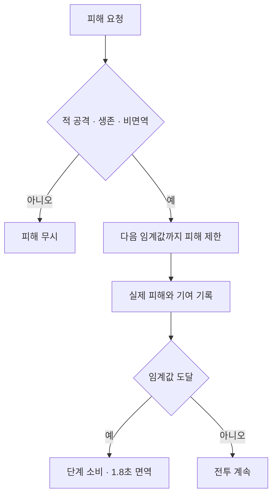

# 하이스트 — 실행 코어 명세

> Brawl Lab 3.0 · 모드 ID `heist` · 이 문서는 프로젝트의 실제 실행 규칙이다. 금고 체력·보호막 시간·초과 피해 정책은 이 프로토타입의 자체 수치다.

## 1. 플레이 목표와 전투 순환

상대 금고를 먼저 파괴하면 승리한다. 플레이어 팀은 왼쪽의 우리 금고를 지키면서 오른쪽 금고로 접근한다. 적 처치는 공격 시간을 만드는 수단이며, 금고에 실제로 준 피해가 목표 진척으로 남는다.

금고 체력은 자동 회복되지 않는다. 체력 75%·50%·25%에 도달할 때마다 짧은 보호막이 한 번씩 발동한다. 공격자는 보호막 동안 재장전하거나 수비수를 견제하고, 보호막이 끝났을 때 다시 금고를 공격할 수 있다. 수비자는 이 시간을 재합류 기회로 활용한다.

## 2. 기본 수치와 공간

| 항목 | 구현 값 |
|---|---:|
| 인원 | 3 대 3 |
| 금고 최대 체력 | 팀별 24,000 |
| 금고 중심 | 우리 (180, 400), 상대 (1100, 400) |
| 금고 충돌 반경 | 42px |
| 보호막 임계 체력 | 18,000 / 12,000 / 6,000 |
| 단계별 보호막 시간 | 1.8초 |
| 경기 제한 시간 | 180초 |
| 일반 부활 | 사망 후 2.5초 |

금고는 캐릭터가 통과할 수 없는 원형 고체다. 길찾기와 근거리 이동은 이 충돌을 고려한다. 처음 생성되는 캐릭터는 금고와 겹치지 않도록 배치한다. 아군의 사격으로 우리 금고를 손상시킬 수 없다.

## 3. 데이터와 통계

```js
state.safes = [
  {
    id: 'safe-0', team: 0, x: 180, y: 400, r: 42,
    hp: 24000, maxHp: 24000,
    shieldTime: 0,       // 보호막의 남은 초
    shieldsTriggered: 0, // 이미 사용한 단계 수: 0~3
    lastHitTime: -10     // 실제 피해가 들어온 시각
  },
  // safe-1: team 1, x 1100
];
state.score = [100, 100]; // 각 팀 자기 금고의 남은 체력 퍼센트
actor.objectiveDamage = 0;
```

`actor.damage`는 적 캐릭터에게 준 전투 피해이고, `objectiveDamage`는 금고에 준 실제 피해다. 금고 공격을 전투 피해에 중복 합산하지 않는다. 금고 피해만으로 처치·어시스트·처치 알림을 생성하지 않는다.

유효한 투사체 공격이 금고에 맞으면 해당 발사 동작의 명중으로 기록한다. 산탄이나 관통탄의 같은 발사에서 여러 번 맞아도 명중 횟수는 한 번이다. 금고 타격은 특수 공격을 **피해량에 따라 추가 충전하지 않는다**. 원래의 자연 충전은 계속 적용된다.

## 4. 피해 수신 규칙

모든 금고 공격은 같은 임계값·면역 경로를 거친다.

| 공격 | 금고에 대한 처리 |
|---|---|
| 핀의 직사탄·관통 특수 공격 | 투사체의 이동 구간과 금고 원형을 검사 |
| 브릭의 산탄 | 각 탄환을 검사하며 발사 통계는 동작 단위로 집계 |
| 브릭의 돌진·착지 충격파 | 접촉·범위 피해를 공통 금고 피해 처리로 전달 |
| 코멧의 일반·특수 폭발 | 유효 폭발 피해를 금고에 적용 |
| 중력장 | 범위와 사선 조건을 만족하면 지속 피해 적용 |
| 아군 공격 | 피해 없음 |
| 보호막 중 공격 | 피해 없음, 기여 피해·피격 시각도 갱신하지 않음 |
| 치유·감속·넉백 | 금고에는 적용하지 않음 |

### 초과 피해 정책

다음 보호막 단계가 남아 있으면 한 번의 큰 공격이 해당 임계값 아래까지 체력을 떨어뜨리지 못한다. 임계값을 넘는 피해는 버리고, 보호막을 발동한다.

예를 들어 금고 체력이 **18,500**일 때 **2,000** 피해를 받아도 체력은 **18,000**까지만 줄어든다. 공격자 기여에는 실제 감소량 **500**만 기록되고, 남은 1,500은 이월하지 않는다. 같은 스텝에 도착한 다음 탄환도 이미 켜진 보호막에 막힌다.

세 단계 보호막을 모두 사용했다면 더 이상 임계값에서 멈추지 않는다. 체력 4,000인 금고에 5,000 피해가 들어오면 실제 피해 4,000으로 파괴된다.



보호막 시간은 시뮬레이션 스텝당 한 번 감소한다. 같은 단계에서 여러 공격을 받아도 보호막이 다시 발동하지 않는다.

## 5. 승패의 확정

금고가 파괴된 즉시 중간 공격 처리에서 경기를 끊지 않는다. 해당 전투 스텝의 양 팀 피해 처리를 마친 다음 두 금고의 상태를 함께 검사한다.

| 상태 | 결과 |
|---|---|
| 상대 금고만 파괴 | 우리 팀 승리 |
| 우리 금고만 파괴 | 상대 팀 승리 |
| 같은 스텝에 양쪽 금고 파괴 | 무승부 |
| 180초 도달, 양쪽 생존 | 실제 남은 체력 비율이 큰 팀 승리 |
| 시간 종료 체력 비율 동률 | 무승부 |

화면에 표시한 퍼센트의 반올림으로 승패를 결정하지 않는다. 종료 후 도착하는 탄환이나 남은 장판이 승패·기여를 다시 바꾸지 않는다.

## 6. 봇과 자동 조준

봇은 공격·수비 역할과 위협 상황을 고려한다. 공격자는 중앙 또는 측면 경로로 금고에 접근하고, 수비자는 금고 근처에 진입한 적을 대응한다. 적이 없거나 교전을 마친 뒤에는 금고 공방 목표로 돌아간다. 보호막 중인 금고에 지속해서 탄약과 특수 공격을 소모하지 않도록 한다.

플레이어의 자동 조준은 먼저 보이는 유효 적을 찾고, 적 후보가 없으면 사거리와 사선 조건을 만족하는 상대 금고를 찾는다. 금고가 면역 중이면 유효 금고 후보에서 제외한다. 자동 조준할 대상이 없어도 일반 공격 입력 자체는 현재 방향으로 발사할 수 있으므로, 보호막 시간을 보며 사격을 멈추는 판단은 플레이어에게 남아 있다.

## 7. 화면과 검증

상단 점수는 우리 금고와 상대 금고의 남은 체력이다. 세부 표시에는 실제 HP 또는 보호막의 남은 시간을 제공한다. 우리 금고가 실제 피해를 받으면 경고한다. 금고에는 팀 색, 체력, 사용한 보호막 단계와 면역 상태를 표시한다.

전황표는 전투 피해와 금고 피해를 분리한다. 공격자가 적 캐릭터 피해는 낮아도 목표 기여가 높았다는 사실을 결과에서 확인할 수 있다. 추적 카메라에서는 고정 목표인 양 금고를 미니맵으로 찾을 수 있다.

핵심 회귀 조건은 아군 피해 차단, 세 번의 임계값 처리, 면역 시간, 초과 피해 통계, 여러 공격 방식, 금고 충돌, 자동 조준, 동시 파괴, 시간 종료 비교다. 봇 시뮬레이션에서는 오류 없는 종료뿐 아니라 실제 금고 피해가 발생하는지도 확인한다.

구현은 `dist/engine.js`, 관련 테스트는 `tests/engine-v3.test.cjs`와 `tests/app.test.cjs`에 있다. 전체 데이터 계약은 [CONTRACT.md](../CONTRACT.md), 실행법은 [README.md](../README.md)를 참조한다.
