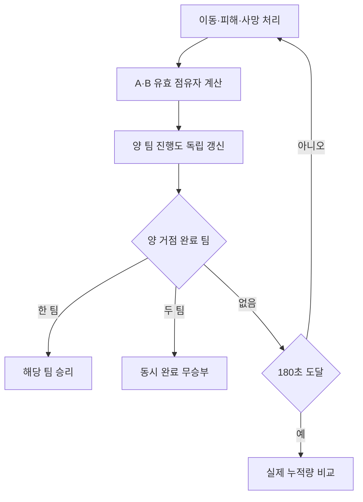

# 핫 존 — 실행 코어 명세

> Brawl Lab 3.0 · 모드 ID `hotzone` · 이 문서는 프로젝트에 구현한 자체 규칙을 설명한다. 원작의 현재 수치와 내부 구현을 단정하는 문서가 아니다.

## 1. 플레이 목표와 선택

두 거점 A·B의 우리 팀 진행도를 각각 100%로 채우면 승리한다. 팀이 누적한 점유는 구역에서 떠나거나 사망해도 줄어들지 않는다. 아직 완료하지 못한 거점에 유효 점유자가 한 명 이상 있는 동안 일정한 속도로 오른다.

**상대가 같은 구역에 들어와도 우리 팀의 진행이 멈추지 않는다.** 두 팀은 같은 구역을 동시에 채울 수 있다. 상대의 진행을 막으려면 공격·넉백·지역 압박으로 상대를 실제로 구역 밖으로 내보내야 한다.

한 팀 세 명이 한 구역 안에 있어도 속도는 한 명일 때와 같다. 따라서 한 명은 점유하고 다른 팀원은 다른 거점을 확보하거나 진입로를 지키는 분업이 가능하다. 한 거점을 완료한 뒤 계속 머무르면 그 팀에 추가 점수가 생기지 않는다.

## 2. 구현 수치

| 항목 | 값 |
|---|---:|
| 경기 인원 | 3 대 3 |
| 전장 | 1280 × 800 월드 픽셀 |
| A 중심 | (640, 245) |
| B 중심 | (640, 555) |
| 두 구역 반경 | 각각 95px |
| 구역당 필요 점유 시간 | 40초 |
| 점유 속도 | 구역별 초당 2.5% |
| 경기 제한 시간 | 180초 |
| 일반 부활 | 사망 후 2.5초 |

구역 진입은 **캐릭터 중심과 구역 중심의 거리 ≤ 구역 반경**으로 판정한다. 캐릭터 몸체의 일부만 원에 걸친 경우는 점유로 세지 않는다. 살아 있고 부활 무적이 끝난 캐릭터만 점유할 수 있다. 가젯의 피해 감소 보호막은 부활 무적과 다른 상태다.

## 3. 데이터 모델

```js
state.captureZones = [
  {
    id: 'zone-A', x: 640, y: 245, r: 95,
    captureSeconds: 40,
    progress: [0, 0],   // 0팀, 1팀의 독립적인 누적 퍼센트
    occupants: [0, 0]   // 이번 스텝의 유효 점유자 수
  },
  // zone-B는 y: 555
];
state.score = [0, 0]; // 각 팀의 두 구역 진행도 평균
actor.captureTime = 0; // 유효하게 기여한 점유 시간(초)
```

`occupants`는 이전 진입 이벤트를 신뢰해 유지하는 목록이 아니다. 현재 위치·생존·무적 상태를 기준으로 매 시뮬레이션 스텝에 다시 계산한다. 순간 이동이나 사망 뒤에 유령 점유가 남는 것을 방지한다.

구역 진행도를 `P[t,z]`, 유효 점유 여부를 `I[t,z]`라 하면 다음과 같이 누적한다.

```text
I[t,z] = 유효 점유자가 한 명 이상이면 1, 아니면 0
P[t,z] = min(100, P[t,z] + (100 / 40) × I[t,z] × dt)
TeamScore[t] = (P[t,A] + P[t,B]) / 2
```

각 액터의 `captureTime`은 해당 액터가 미완료 구역에 유효하게 머문 시간을 뜻한다. 팀원 둘이 함께 점유하면 두 액터 모두 기여 시간을 받지만 팀 점수 속도는 증가하지 않는다. 이 값을 팀 점유 시간으로 합산해서 사용하면 안 된다.

## 4. 판정 순서와 종료

한 전투 스텝에서 이동·피해·사망을 처리한 뒤 현재 점유자를 계산한다. 구역 진행도를 두 팀 모두 갱신한 다음 완료 집합을 검사한다.



한 구역만 100%인 상태로는 승리하지 않는다. 두 팀이 같은 스텝에 두 구역을 모두 완료하면 무승부다. 시간 종료에는 화면에 반올림한 수치가 아닌 내부 진행도 합계를 비교하며, 동률이면 무승부다.

HUD는 완료 전 100%로 보이지 않도록 점유 퍼센트를 내림 표시한다. 전체 팀 점수는 평균이므로 A가 100%, B가 0%이면 상단에는 50%가 표시된다.

## 5. 봇 행동

봇은 자기 팀에서 아직 완료하지 않은 구역을 우선한다. 가까운 구역만 계속 고르는 대신 다른 아군의 위치와 점유 상황을 고려해 분산한다. 유효 구역 안에 들어간 봇은 사격 중에도 점유를 유지하려고 한다. 해당 구역을 완료하면 남은 구역으로 목표를 바꾼다.

낮은 체력에서의 회복 후퇴와 적 탄환 회피는 여전히 적용된다. 따라서 점유 속도 2.5%/초가 경기 전체에 항상 유지되는 것은 아니다. 접근·교전·사망·회복 시간이 실제 완료 시간을 늘린다.

## 6. 화면과 피드백

전장의 A·B 원은 실제 점유 반경과 일치한다. 각 원에는 두 팀의 독립적인 진행 링을 표시한다. 두 팀이 함께 들어온 상태는 동시에 활성화되며, 정지된 '쟁탈 중' 상태로 표현하지 않는다.

상단에는 팀 전체 진행도와 A·B 각각의 진행도를 보여 준다. 전황표의 목표 기여는 `점유 초`로 표시하며 처치나 전투 피해와 구분한다. 추적 카메라의 미니맵에는 두 고정 목표와 아군 위치를 표시한다.

## 7. 중요한 회귀 조건

- 양 팀이 한 구역에 함께 있을 때 두 진행도가 함께 증가한다.
- 같은 팀 인원이 1명에서 3명으로 늘어도 점유 속도가 증가하지 않는다.
- 사망자·부활 무적·구역 밖 캐릭터는 점유에 기여하지 않는다.
- 완료 후 점수와 기여 시간이 계속 증가하지 않는다.
- 한 구역 완료만으로 승리하지 않으며, 두 구역 완료는 한 번만 확정한다.
- 같은 스텝의 양 팀 완료와 시간 종료 동률을 일관되게 처리한다.
- 여러 캐릭터·시드에서 봇이 목표를 실제로 점유하고 경기가 종료된다.

실행 코드는 `dist/engine.js`, 회귀 사례는 `tests/engine-v3.test.cjs`, UI 연결은 `tests/app.test.cjs`에서 확인할 수 있다. 전체 API는 [CONTRACT.md](../CONTRACT.md), 실행법은 [README.md](../README.md)를 참조한다.
