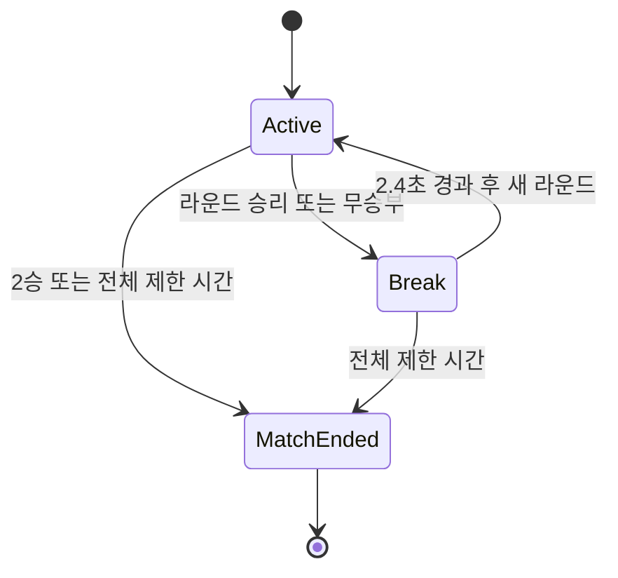

# 녹아웃 — 실행 코어 명세

> Brawl Lab 4.0 · 모드 ID `knockout` · 3 대 3 · 이 문서는 프로젝트에 구현한 자체 규칙이다. 원작의 현재 서버 수치나 내부 구현을 단정하지 않는다.

## 1. 플레이 목표와 경기 단위

상대 팀을 전멸시키면 라운드에서 승리하며, **두 라운드를 먼저 이기는 팀**이 경기에서 승리한다. 한 라운드에서 쓰러진 캐릭터는 그 라운드가 끝날 때까지 부활하지 않는다. 따라서 현재 인원, 회복할 시간, 남은 안전 구역을 함께 판단해야 한다.

플레이어가 쓰러져도 살아 있는 아군이 있으면 경기는 계속된다. 이때 플레이어는 아군을 관전한다. 개인 탈락, 라운드 종료, 전체 경기 종료는 서로 다른 상태이며, 전적과 최종 결과는 전체 경기가 끝날 때만 확정한다.

무승부 라운드는 어느 팀에도 승수를 주지 않는다. 두 팀이 같은 전투 스텝에 전멸하거나 라운드 제한 시간까지 모두 생존하면 다음 라운드를 시작한다. 이 때문에 실제 경기에는 세 라운드보다 많은 라운드가 생길 수 있다. 무한 반복을 막기 위해 별도의 전체 경기 제한 시간이 있다.

## 2. 구현 수치

| 항목 | 값 |
|---|---:|
| 인원 | 플레이어 포함 3 대 3 |
| 전장 | 1280 × 800 월드 픽셀 |
| 경기 승리 조건 | 라운드 2승 |
| 라운드 제한 시간 | 75초 |
| 라운드 사이 휴식 | 2.4초 |
| 전체 경기 제한 시간 | 240초, 휴식 포함 |
| 라운드 도중 부활 | 없음 |
| 새 라운드 부활 보호 | 1.4초 |
| 안전 구역 중심 | (640, 400) |
| 초기 안전 반경 | 770px |
| 독구름 축소 시작 | 현재 라운드 25초 |
| 최종 안전 반경 | 현재 라운드 65초부터 20px |

엄폐물은 좌우 대칭으로 배치하며 최종 안전 구역이 놓이는 중앙은 비워 둔다. 새 라운드에서는 파괴된 목재와 수풀까지 원래 지형으로 복원한다. 초기 캐릭터 위치는 엄폐물과 겹치지 않는다.

## 3. 공개 상태와 시간의 의미

```js
state.mode = 'knockout';
state.timeLimit = 240;
state.score = [0, 0]; // 팀별 라운드 승수
state.round = {
  number: 1,
  phase: 'active', // active | break
  elapsed: 0,
  timeLimit: 75,
  breakRemaining: 0,
  lastWinner: null, // 0 | 1 | null
  lastReason: '',
  history: []
};
state.zone = { x: 640, y: 400, r: 770 };
actor.roundSurvivals = 0;
```

`state.elapsed`는 전체 경기 시간이고, `state.round.elapsed`는 현재 라운드의 전투 시간이다. 휴식 중에는 전체 시간과 가젯 재사용 대기가 계속 흐르지만 라운드 시간은 멈춘다. 독구름은 전체 경기 시간이 아니라 **현재 라운드 시간**을 사용한다.

라운드가 끝나면 `history`에 `{number, winner, reason, duration}`을 한 번 추가한다. `winner: null`은 무승부다. 다음 라운드를 시작해도 이전 결과와 기록은 유지한다. 최종 승리 때도 `phase`는 `break`이며 `breakRemaining`은 0이고, 전체 `status`가 `ended`로 바뀐다.

다른 모드의 `state.round`는 `null`이다. `roundSurvivals`는 모든 액터에 존재하지만 녹아웃에서만 증가한다.

## 4. 한 전투 스텝의 승패 판정

엔진은 이동·공격·투사체·장판과 현재 라운드의 독 피해를 처리한 뒤 팀별 생존자를 센다. 개별 사망 콜백에서 녹아웃 경기나 라운드를 끝내지 않는다.

| 스텝 종료 상태 | 라운드 처리 |
|---|---|
| 상대 팀만 전멸 | 우리 팀 라운드 승리 |
| 우리 팀만 전멸 | 상대 팀 라운드 승리 |
| 양 팀 모두 전멸 | 승수 없는 무승부 |
| 양 팀 생존, 라운드 75초 도달 | 승수 없는 무승부 |
| 양 팀 생존, 75초 미만 | 전투 계속 |

여기서 스텝은 `Game.update` 호출 전체가 아니라 내부의 최대 1/60초 시뮬레이션 단위다. 한 호출이 여러 내부 스텝으로 나뉘면 각 스텝의 전투 결과를 순서대로 판정한다.

라운드 승리 팀의 생존 액터에게만 `roundSurvivals`를 1씩 준다. 이긴 팀에서 먼저 탈락한 액터나 무승부 라운드의 생존자는 해당 기여를 받지 않는다. 경기의 K/D/A, 피해와 사격 통계는 모든 라운드에 걸쳐 누적된다.



전투 스텝에서 라운드 판정을 먼저 완료하고, 경기가 아직 진행 중이면 전체 제한 시간을 확인한다. 240초에는 **라운드 승수만** 비교한다. 승수가 같으면 무승부이며 남은 체력이나 누적 피해로 승자를 만들지 않는다.

## 5. 독구름 규칙

현재 라운드 시간을 `t`라 할 때 안전 반경과 바깥 피해는 다음과 같다.

```text
radius(t) = 770 - clamp((t - 25) / 40, 0, 1) × 750
poisonDps(t) = 300 + 9 × t
stepDamage = poisonDps(t) × dt
```

캐릭터 중심이 안전 원의 반경을 벗어나면 독 피해를 받는다. 독 피해는 부활 보호, 아이언 가드, 돌진 중 피해 감소를 우회한다. 독으로 피해를 받으면 자동 회복의 무피해 대기 시간도 다시 시작한다.

독 피해는 살아 있는 모든 액터에게 적용한 뒤 전멸을 판정한다. 같은 스텝에 양 팀 마지막 생존자가 독으로 쓰러지면 어느 쪽을 먼저 순회했는지와 관계없이 무승부 라운드가 된다. 새 라운드에서는 반경을 770으로 되돌린다.

## 6. 라운드 경계에서 초기화하는 것

라운드 종료 때는 남은 투사체와 장판을 제거하고 이동·돌진을 멈춘다. 휴식 중에는 공격, 회복, 자연 슈퍼 충전이 진행되지 않는다. 새 라운드 시작 시에는 아래 항목을 복원하거나 유지한다.

| 항목 | 새 라운드 처리 |
|---|---|
| 생존·체력·탄약 | 모두 살아 있는 상태, 최대 체력, 탄약 3발 |
| 위치·방향 | 팀 초기 위치와 상대 진영 방향 |
| 부활 보호 | 1.4초, 일반 전투와 같이 공격하면 해제 |
| 벽·수풀 | 초기 맵으로 다시 생성 |
| 투사체·장판·수집물·시각 효과 | 제거 |
| 보호막·감속·돌진·속도·노출 상태 | 초기화 |
| 사격 간격·피해 기여 장부 | 초기화 |
| 마지막 공격·피격 시각 | 현재 전체 경기 시각으로 갱신 |
| 봇 경로·관측 기억·공격 대상 | 초기화 |
| 슈퍼 충전량 | 유지 |
| 가젯 재사용 대기 | 유지, 휴식 중에도 감소 |
| K/D/A·피해·발사·명중·생존 라운드 | 경기 누계 유지 |
| 라운드 승수·이력 | 유지 |

이전 라운드의 피해 기여 장부를 제거하므로, 이전 라운드의 공격이 다음 라운드 처치의 어시스트로 남지 않는다. 마지막 공격·피격 시각을 갱신하므로 이전 라운드의 긴 대기 시간 때문에 새 라운드 시작과 동시에 회복이 발생하는 일도 막는다.

첫 경기 생성과 다음 라운드 시작에는 `roundStart`, 라운드가 끝날 때는 `roundEnd` 이벤트를 보낸다. 이 이벤트는 상태 전환 알림이며 전체 경기의 승리 이벤트와 구분한다.

## 7. 탈락 후 시야와 관전

플레이어가 살아 있을 때는 기존의 플레이어 중심 수풀 시야 규칙을 사용한다. 플레이어가 탈락한 녹아웃에서는 **살아 있는 아군들의 시야 합집합**으로 적의 `hidden`을 계산한다. 시체 위치를 관찰자로 사용하지 않는다.

아군 A에게만 보이는 적과 아군 B에게만 보이는 적은 모두 관전 상태에서 표시 가능한 정보다. 관전 카메라가 어느 아군을 따라가는지는 이 시야 규칙을 바꾸지 않는다. 살아 있는 아군이 없으면 적을 공개하지 않고 라운드 전환을 기다린다.

관전 대상 선택은 앱이 관리한다. 렌더러는 플레이어가 죽은 녹아웃에서만 유효한 생존 아군의 `focusId`를 따르며, 적을 선택해 시야를 넓힐 수 없다. 다음 라운드에 플레이어가 살아나면 플레이어 시점으로 돌아간다. 탈락한 플레이어의 자동 조준 요청도 적 위치를 돌려주지 않는다.

## 8. 봇의 전투 원칙

봇은 현재 라운드 안전 구역을 기준으로 위치를 선택한다. 독구름 밖이나 경계에 가까우면 안쪽 이동을 우선하고, 적이 보일 때는 무기의 유효 거리를 고려한다. 체력이 낮으면 회복을 위해 후퇴하되 축소된 안전 구역 밖으로 복귀하지 않도록 목표를 제한한다.

죽은 봇은 해당 라운드에서 다시 움직이거나 공격하지 않는다. 다음 라운드에는 지난 경로와 적 위치 기억을 비운 상태로 시작한다. 봇과 플레이어는 동일한 벽·몸체 충돌 및 공격 규칙을 사용한다.

## 9. 검증 경계와 관련 파일

회귀 검증은 플레이어 사망 뒤 경기 지속, 라운드 도중 부활 금지, 라운드 승리·휴식·재시작, 초기화와 유지 항목, 동시 탄환·독 전멸, 75초·240초 종료, 생존 아군 시야 합집합을 포함한다. 세 영웅의 고정 시드 경기에서 유한한 상태와 정상 종료를 확인한다. 테스트는 실제 브라우저 관전 조작의 실기 검증과 구분한다.

- 구현: [engine.js](../dist/engine.js)
- 모드 회귀: [engine-v4.test.cjs](../tests/engine-v4.test.cjs)
- 전체 API: [CONTRACT.md](../CONTRACT.md)
- 실행 안내: [README.md](../README.md)
- 다른 신규 모드: [바운티](BOUNTY.md)
