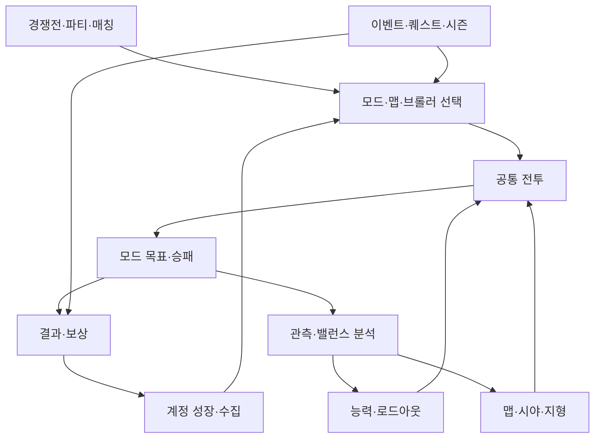
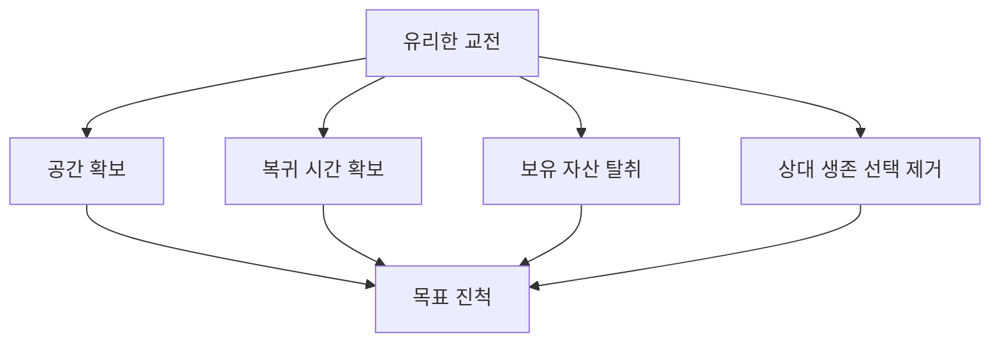

# 브롤스타즈 시스템 관계도와 핵심 설계 해석

> 관계도는 공개 기능을 재분류한 분석 모델이다. 원작 조직·서버·클래스의 구조도가 아니다.

## 1. 전체 구조

같은 공격과 이동을 여러 목표에 적용하면서도, 각 모드는 무엇을 지키고 무엇을 포기할지 다르게 만든다.
따라서 게임의 핵심 자산은 개별 모드 수뿐 아니라 공통 전투가 다른 목표에서 계속 의미 있게 작동하는 관계다.

## 2. 시스템별 책임

| 계층 | 구성 | 핵심 책임 | 연결 문서 |
| --- | --- | --- | --- |
| 조작 | 이동·조준·문맥 전환 | 의도를 명확한 행동으로 변환 | [02](systems/02_controls_camera.md) |
| 전투 | 공격·자원·피해·상태 | 반복 교전과 능력 상호작용 | [03](systems/03_combat_damage.md), [04](systems/04_abilities_loadout.md) |
| 공간 | 맵·은폐·파괴·경로 | 공격과 역할의 가치 변환 | [05](systems/05_maps_terrain_vision.md) |
| 목표 | 점수·생존·운반·시설 | 교전 결과를 승패로 전환 | [모드 비교](02_mode_comparison.md) |
| 세션 | 매치·라운드·런 | 단계와 결과의 범위 관리 | [01](systems/01_core_loop.md), [08](systems/08_data_rules_qa.md) |
| 경쟁 | 드래프트·매칭·등급 | 비슷한 조건의 대결 구성 | [12](systems/12_ranked_draft.md), [13](systems/13_matchmaking_trophies.md) |
| 성장 | 해금·파워·장비·수집 | 새로운 선택지와 장기 목표 | [09](systems/09_roster_progression.md) |
| 경제 | 보상·확률·재화·패스 | 플레이와 성장의 연결 | [10](systems/10_economy_rewards.md), [11](systems/11_quests_passes.md) |
| 관계 | 친구·클럽·협동 | 반복 팀 형성과 공동 목표 | [14](systems/14_social_clubs.md) |
| 운영 | 로테이션·변형·이벤트 | 새 학습과 재방문 동기 | [15](systems/15_liveops_events.md) |
| 전달 | UX·아트·소리 | 규칙과 결과의 이해 | [16](systems/16_ux_onboarding.md), [17](systems/17_art_audio_feedback.md) |
| 기술 | 권위·복구·기록·AI | 결과 일관성과 확장 | [07](systems/07_network_architecture.md), [18](systems/18_ai_pve_patterns.md) |

## 3. 교전 이득은 네 경로로 전환된다 [해석]

브롤스타즈의 모드 차이는 이 경로 중 어떤 것이 강한지로 설명할 수 있다.
젬 그랩은 보유 자산과 후퇴 경로의 가치가 크고, 하이스트는 시설에 공격할 시간이 중요하다.
넉아웃은 사망으로 줄어든 선택지가 라운드 끝까지 남는다.
이 설명은 정량 통계가 아닌 설계 해석이며 상세 근거는 각 모드 문서를 따른다.

## 4. 사망의 비용을 바꾸는 모드 설계 [해석]

| 비용 | 만들어지는 판단 | 대표 분석 문서 |
| --- | --- | --- |
| 잠시 전장에서 이탈 | 복귀 시간과 목표 교환 | [브롤 볼](modes/02_brawl_ball.md), [하이스트](modes/03_heist.md) |
| 상대에게 점수 제공 | 이득 없는 교전 피하기 | [바운티](modes/04_bounty.md), [섬멸전](modes/07_wipeout.md) |
| 보유 자산 유실 | 운반자 보호·회수 | [젬 그랩](modes/01_gem_grab.md) |
| 라운드 참여 종료 | 생존·확정적인 진입 | [넉아웃](modes/06_knockout.md) |
| 팀 전멸 위험 | 마지막 생존자 보호 | [듀오](modes/09_duo_showdown.md), [트리오](modes/10_trio_showdown.md) |
| 런 선택지 소모 | 다음 경기까지 고려한 선택 | [타워](modes/44_topple_the_tower.md) |
| 누적 빌드 상실 | 안전 진출과 추가 성장의 교환 | [Upside](modes/54_upside_showdown.md) |

모드가 다르다는 이유만으로 이동·공격까지 전부 새로 만들 필요는 없다.
사망·점수·목표의 해석을 바꾸는 것만으로 다른 의사결정이 만들어질 수 있다는 것이 재구현 관점의 핵심이다.

## 5. 되돌릴 수 있는 것과 없는 것 [해석]

체력과 탄약처럼 회복 가능한 자원, 금고 피해처럼 누적되는 진척,
라운드 탈락처럼 단계가 끝날 때까지 남는 손실, 런에서 소모한 브롤러처럼 여러 경기에 걸친 손실은 서로 다르다.
피드백 강도와 보상도 자원의 지속 범위에 맞춰야 한다.

- 짧은 실패에는 빠른 재시도와 구체적인 교정 정보.
- 팀 목표 손실에는 공동 경고와 회복 경로.
- 런 종료에는 누적 결과와 다음 선택의 근거.
- 계정 투자에는 정확한 비용과 사용 자격.

## 6. 구현에서 분리해야 할 네 식별자 [제안]

| 식별자 | 다루는 범위 |
| --- | --- |
| AccountId | 영구 소유·재화·진행 |
| MatchId | 한 경기의 권위 결과 |
| RoundId / PhaseId | 같은 경기 안의 반복·교대 |
| RunId | 타워·강화 생존전처럼 여러 경기 묶음 |

이들을 합치면 “라운드를 이겼는데 보상을 두 번 지급”, “이벤트가 끝나며 진행 중 경기 규칙 변경”,
“새 생명의 공격과 죽기 전 공격 혼동” 같은 문제가 생긴다.
모든 게임이 같은 프로그래밍 구조를 써야 한다는 뜻은 아니며, 책임을 구분하기 위한 모델이다.

## 7. 최신성과 안정성을 함께 다루기

자주 바뀌는 것은 브롤러 수치, 보상표, 해금, 시즌, 이벤트 프리셋이다.
상대적으로 안정된 분석 대상은 목표의 성격, 자원의 보존 범위, 선택의 비용, 정보가 주어지는 방식이다.
본문은 변동 수치를 최소화하고, 필요한 수치는 버전과 근거를 붙였다.

공식 자료와 해석의 구분, 전투 미실측 한계는 [범위 문서](00_scope_evidence.md)를 따른다.

