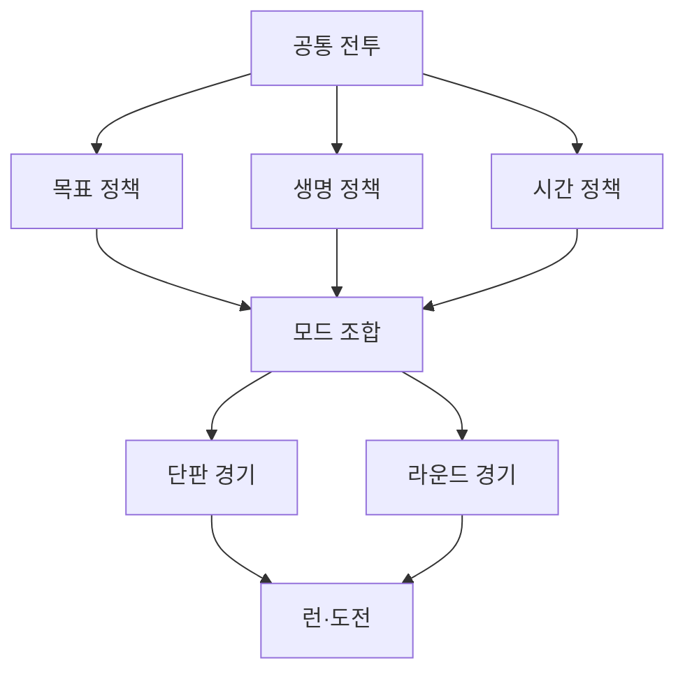

# 재구현을 위한 작업 분해와 검증 순서

> 본 문서는 역기획서의 활용 예시다. 원작 코드를 복제하거나 개발 일정·인력을 추정한 계획이 아니다.
> 실제 구현 코드를 제공하거나 게임을 제작·실행한 것은 아니다.

## 1. 첫 프로토타입의 목적

처음부터 모든 브롤러와 모든 모드를 구현하면 무엇이 재미를 만드는지 분리하기 어렵다.
공통 전투가 서로 다른 목표에서 다른 판단을 만드는지 먼저 검증한다.
아래 순서는 개발비 추정이 아니라 의존성과 학습 효율에 따른 제안이다.

## 2. 단계별 구현 범위

| 단계 | 구현 | 검증할 질문 | 다음 단계 진입 조건 |
| --- | --- | --- | --- |
| A | 이동·조준·탄약·피해·회복 | 한 교전에서 쏠 때와 물러날 때가 구분되는가 | 명중·사망·재장전의 일관성 |
| B | 직선·투척·돌진 등 적은 공격 유형 | 지형과 능력의 가치가 다른가 | 공격별 장점·약점이 관찰됨 |
| C | 젬 그랩형 목표 | 자산 보호와 공간 확보가 연결되는가 | 소유·드롭·종료 규칙 완결 |
| D | 시설 파괴형과 탈락형 | 같은 전투가 다른 선택을 만드는가 | 모드별 승리·동률·복구 |
| E | 공·스포츠형 목표 | 문맥 입력과 목표물 물리가 읽히는가 | 슛·충돌·득점 경계 안정 |
| F | 성장·매칭·결과 | 경기 밖 목표가 반복 동기를 돕는가 | 보상 원자성·중복 방지 |
| G | 인원 확대·이벤트 변형 | 밀도 증가와 규칙 조합을 감당하는가 | 성능·가독성·규칙 호환 |
| H | 런·PvE·운영 | 장기 반복과 새 콘텐츠가 지속되는가 | 버전·진행·만료 처리 |

특정 순서가 항상 최적인 것은 아니다.
제작하려는 게임의 차별점이 공 물리라면 E를 앞당기고, 협동 보스라면 H의 전투 부분을 먼저 검증할 수 있다.

## 3. 시스템 작업 패키지

| 패키지 | 입력 | 산출 명세 | 주된 위험 |
| --- | --- | --- | --- |
| 조작·뷰 | 화면 방향·컨트롤 문맥 | 입력 의도·조준·카메라 | 진영별 변환 오류 |
| 전투 모델 | 브롤러·공격 정의 | 피해·자원·사망 사건 | 중복 타격·상태 중첩 |
| 능력 | 충전·사용 조건 | 실행·취소·쿨다운 | 변신·소유물과 충돌 |
| 맵 | 레이어·스폰·목표 앵커 | 충돌·이동·시야 | 도달 불가 목표 |
| 모드 | 전투 사건 | 점수·단계·최종 결과 | 동시 종료 우선순위 |
| 네트워크 | 입력과 상태 | 권위·예측·복구 | 판정과 표시 불일치 |
| 계정 | 결과·획득 요청 | 성장·소유·정산 | 중복 지급 |
| UI·표현 | 의미 있는 상태 | 화면·소리·피드백 | 읽을 수 없는 복잡성 |
| AI | 허용된 관측 | 이동·공격 요청 | 정보 남용·경로 정지 |
| 운영 | 콘텐츠·기간·버전 | 이벤트 프리셋 | 진행 중 규칙 변경 |

## 4. 공통 규칙에서 파생할 모드

목표 정책은 수집·점령·파괴·골 등,
생명 정책은 즉시 종료·지연 부활·아군 생존 조건 등,
시간 정책은 제한·연장·공간 축소·기록 경쟁 등으로 나눌 수 있다.
아무 정책이나 조합 가능하게 만드는 것보다 검증된 프리셋을 만드는 편이 초기에는 안전하다.

## 5. 먼저 확정할 설계 질문

1. 최종 결과의 권위는 어디에 있는가.
2. 같은 순간의 득점과 사망은 어떤 순서로 결정하는가.
3. 부활·변신·라운드 전환에서 어떤 상태를 보존하는가.
4. 목표물 소유 중 어떤 입력이 바뀌는가.
5. 보상 실패와 경기 실패를 어떻게 구분하는가.
6. 이벤트가 종료될 때 진행 중 경기는 어떻게 처리하는가.
7. 원작 미확인 값은 실기로 복원할 것인가, 새 설계로 선택할 것인가.

일곱 번째를 명확히 해야 원작의 사실과 제작자의 선택이 섞이지 않는다.

## 6. 브롤러를 기능 유형으로 먼저 준비하기 [제안]

도감의 캐릭터 숫자를 채우기보다 상호작용을 검증할 소수 유형을 준비한다.

| 유형 | 검증할 상호작용 |
| --- | --- |
| 직선 원거리 | 사선·엄폐·자동 조준 |
| 산탄 근거리 | 거리별 효율·진입 |
| 투척 | 벽 너머 착탄·위험 영역 |
| 돌진 | 강제 이동·공 소유·벽 |
| 치유·보호 | 체력·보호막·팀 기여 |
| 소환 | AI·소유자 사망·충전 |
| 충전·변신 | 입력 유지·상태 전환 |

이는 실제 브롤러를 이름만 바꿔 복제하는 지침이 아니라 기능 검증용 분해다.

## 7. 모드별 완료 기준

| 항목 | 완료 증거 |
| --- | --- |
| 규칙 | 승리·패배·시간 종료·동률 표 |
| 흐름 | 시작·라운드·연장·종료 상태 |
| 전투 연결 | 사망·피해·강제 이동의 목표 영향 |
| 목표 | 생성·소유·드롭·리셋 불변조건 |
| UI | 상태 변화의 원인과 결과 표시 |
| 복구 | 재접속·중복 입력·결과 재전송 |
| 밸런스 | 목표와 관련된 지표 정의 |
| 근거 | 원작 확인과 제작 선택 구분 |

문서의 QA 표를 그대로 자동 테스트라고 부르지 않는다.
실제로 구현된 정책과 테스트 입력·출력을 연결한 뒤에야 통과 여부를 기록할 수 있다.

## 8. 초기 실험의 관측 항목

[제안] 세션 길이, 목표 참여, 첫 패배 뒤 재시도, 자원 낭비,
조작 거부, 지형에 갇힘, 득점 이해도, 팀 책임 분산을 관측한다.
설문에서 재미있다는 응답과 실제 반복 행동을 함께 본다.
원작의 지표값이 없으므로 목표 수치를 임의로 “브롤스타즈 기준”이라고 제시하지 않는다.

## 9. 콘텐츠와 운영 데이터 분리

전투 수치와 보상표를 같은 파일에서 수정하면 위험이 커진다.
경기 시작 시 전투 규칙 버전을 고정하고, 정산은 그 결과와 보상 정책을 연결한다.
이미 확정된 보상을 수정할 때에는 기존 거래를 덮어쓰기보다 정정 거래를 남긴다.

개발 프로토타입에서는 단순한 저장 방식으로 시작할 수 있다.
규모에 맞지 않는 서비스 분리는 필요 없지만, 책임과 버전은 초기에 구분하는 편이 유리하다.

## 10. 참조 경로

- 구현 계약: [규칙·QA](systems/08_data_rules_qa.md)
- 판정: [전투](systems/03_combat_damage.md)
- 네트워크: [권위·복구](systems/07_network_architecture.md)
- 성장과 보상: [수집](systems/09_roster_progression.md), [경제](systems/10_economy_rewards.md)
- 모드 선택: [비교 매트릭스](02_mode_comparison.md)
- 근거 제한: [범위·자료](00_scope_evidence.md)

