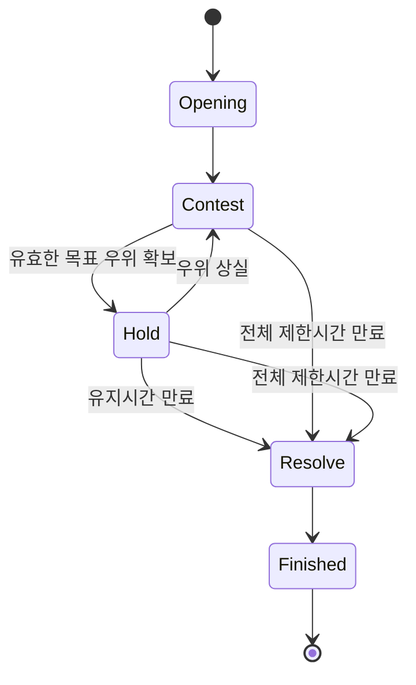

# 젬 그랩 · Gem Grab — 자산 운반형 점유전 역기획

> 조사 기준일: 2026-11-13 · 범위: 기본 3v3 · 상태: 공식 설명으로 존재 확인, 당일 이벤트 슬롯은 확인하지 않음.
> 표기: **[확인]** 공식 공개 규칙, **[해석]** 규칙에서 도출한 설계 분석, **[제안]** 재구현 명세, **[미확인]** 실기 검증이 필요한 세부값.

## 1. 핵심 경험과 범위

**[확인]** 팀이 보석 10개를 모아 유지하는 3v3 모드다. 보석은 중앙과 처치된 상대에게서 얻는다. [S1]

**[해석]** 이 모드의 긴장감은 점수를 팀 계정에 즉시 확정하지 않고 살아 있는 캐릭터에게 맡긴 데서 나온다. 초반에는 중앙으로 이동할 이유가 생기고, 충분한 보석을 확보한 뒤에는 같은 전장에서 후퇴와 호위가 더 중요해진다. 한 판 안에서 공격과 수비의 목적이 자연스럽게 교대한다.

5v5와 4팀 젬 그랩은 광산 수와 목표값이 달라지는 별도 변형이다. 이 문서의 단일 중앙 경합 모델을 그대로 복사하면 측면 광산의 가치와 제3팀 개입을 설명할 수 없다.

## 2. 규칙을 설계 요소로 분해

| 요소 | 분석해야 하는 상태 | 플레이에 주는 의미 |
| --- | --- | --- |
| 팀 보석량 | 팀원별 보유량의 합 | 한 사람이 팀의 승리 조건 대부분을 운반할 수 있음 |
| 중앙 공급 | 생성 예정·지면·소지 상태 | 반복해서 중앙에 노출되는 이유를 만듦 |
| 사망 드롭 | 소유권 해제·획득 가능 위치 | 한 번의 캐리어 처치가 점수 차를 뒤집을 수 있음 |
| 승리 카운트다운 | 시작·중단·재시작·완료 | 목표 확보 이후의 플레이 목적을 생존으로 바꿈 |
| 후방 공간 | 캐리어의 퇴로와 호위 경로 | 적 진영까지 도망만 가는 단순 추격전과 구분 |
| 전체 제한시간 | 최종 보유량 비교 시점 | 무한 교환을 막는 종료 장치 |

**[확인·역사]** 2020년 패치에서 최대 경기시간 3분 30초와 시간종료 시 보유량 비교가 도입되었다. [S2] 이 역사값이 현재 모든 변형에 동일하다고 가정하지 않는다.

**[미확인]** 현행 카운트다운 초수, 광산 생성 간격, 지면 보석 상한, 전체 시간종료와 마지막 픽업의 동시 처리 순서는 공개 자료만으로 확정하지 않았다. 이 값들은 실행 빌드의 데이터로 검증해야 한다.

## 3. 한 판의 의사결정 흐름 [해석]

1. **진입:** 캐리어 후보는 중앙에서 안전하게 회수할 위치를 잡고, 양쪽 라인은 중앙에 대한 교차 사격을 제한한다.
2. **공급 경쟁:** 적을 쓰러뜨리는 목적은 다음 보석까지 회수 가능한 시간과 공간을 얻는 것이다. 처치 수 자체는 승리점수가 아니다.
3. **자산 집중:** 보석이 분산되면 단일 사망의 손실은 줄지만 전원이 위험관리 역할을 부담한다. 집중하면 두 명이 적극적으로 전선을 만들 수 있다.
4. **목표 도달:** 보석 확보보다 현재 리드를 지킬 수 있는 후퇴 경로가 중요해진다. 무조건 맵 끝으로 모이면 광역기와 퇴로 차단에 약해진다.
5. **추격 또는 복구:** 뒤진 팀은 적 전체를 잡기보다 많은 보석을 가진 대상에게 교전 자원을 집중한다. 앞선 팀은 상대가 새 보석으로 따라잡는 경로도 감시한다.
6. **마지막 교전:** 드롭된 보석을 누가 먼저 줍는지에 따라 전선과 역할이 다시 바뀐다. 즉시 재평가할 수 있는 HUD가 필요하다.

## 4. 상태전이 [제안]



`Hold`는 경기 전체의 단일 상태이며 개별 캐리어에게 붙는 버프가 아니다. 캐리어가 바뀌어도 팀 조건이 유지되는지 평가해야 한다. 다만 보석 드롭과 재획득 사이에 조건이 깨졌을 때 카운트다운을 어떻게 처리하는지는 별도 정책이다.

### 판정 모델

- `heldGems[team]`과 지면 보석량을 분리한다. 바닥에 떨어진 보석은 어느 팀의 자산에도 포함하지 않는 모델이 명료하다.
- 보석별 `entityId`와 획득 완료 상태를 두어 두 플레이어가 동시에 접근해도 한 번만 귀속되게 한다.
- 카운트다운 후보를 결정할 때 임계량뿐 아니라 상대와의 우위 조건을 함께 본다.
- 화면의 보석 숫자를 서버 승리 판정에 다시 입력하지 않는다. HUD는 확정 상태의 표현이다.
- 경기 종료 이후 도착한 지연 픽업 이벤트는 보상이나 결과를 재작성하지 않는다.

## 5. 맵·역할·조합 [해석]

### 중앙과 측면의 관계

광산 바로 위에 서는 것만으로 중앙을 통제했다고 볼 수 없다. 중앙에 접근하는 양쪽 사격선이 열려 있으면 캐리어는 회수 순간 노출된다. 측면 압박은 상대 캐리어를 직접 잡지 않아도 회수 비용을 높인다.

중앙에서 아군 후방까지의 안전 경로 수를 중요한 맵 변수로 볼 수 있다. 경로가 하나면 끌어오기·돌진·넉백에 의한 단절이 치명적이고, 너무 많으면 목표 확보 뒤 상호작용이 사라질 수 있다. 파괴 가능한 벽은 경기 후반의 도주 안전성을 변화시키는 별도 시간축이다.

| 역할 | 우선 행동 | 역할 수행의 흔한 실패 |
| --- | --- | --- |
| 캐리어 | 회수 가능한 순간 선택, 퇴로 유지 | 보석을 가진 채 마지막 처치를 쫓음 |
| 라인 담당 | 상대 진입 차단, 중앙을 향한 사격각 확보 | 중앙 숫자만 보고 한곳에 모임 |
| 기습·압박 담당 | 상대 후방을 흔들어 캐리어 행동 제한 | 고립된 다이브로 아군 회수 시간을 잃음 |
| 호위 | 상대 돌진 경로에 대응 자원 유지 | 캐리어 바로 옆에 붙어 광역 공격을 함께 맞음 |

역할은 고정 직업이 아니다. 캐리어가 사망한 뒤 보석을 회수한 라인 담당이 즉시 캐리어 역할을 맡을 수 있어야 한다.

## 6. 역전과 눈덩이 [해석]

보석이 외부에서 계속 공급되므로 초기 우위가 곧 승리로 확정되지 않는다. 그러나 전선·특수 공격 충전·보석량을 동시에 앞서면 보석 회수에 필요한 위험도까지 낮아진다. 따라서 자산의 재분배 가능성과 공간 우위의 지속성을 함께 봐야 한다.

`캐리어 위험도 ≈ 보유 보석의 승리 기여 × 예상 사망확률 × 적의 회수 가능성`이라는 개념 지표를 사용할 수 있다. 이는 원작 수식이 아니라 리플레이를 분류하기 위한 분석 도구다. 보석량이 같아도 드롭 위치가 아군 진영인지 적 진영인지에 따라 손실이 달라진다.

## 7. UI·오디오 요구 [제안]

- 팀 총량과 개별 캐리어의 보유량을 서로 다른 위치에 표시한다.
- 카운트다운 시작·취소는 배경음만이 아니라 색과 숫자로도 전달한다.
- 큰 보석량을 가진 적의 위치를 숨기는 규칙과 표시하는 규칙을 명시적으로 구분한다. 변형 모드의 오프스크린 표시를 기본 모드에 임의 적용하지 않는다.
- 중앙 공급 시각은 전장 이펙트로 알리되 예측 시간의 공개 여부를 별도 결정한다.
- 사망 후 관전 화면은 남은 부활시간과 캐리어 상태를 함께 보여 주어 재합류 목표를 전달한다.

## 8. 데이터·이벤트 명세 [제안]

| 필드 | 형식 | 목적 |
| --- | --- | --- |
| `targetGemCount` | 정수 | 모드별 목표값 |
| `holdDuration` | 시간 | 유지 카운트다운 |
| `hardTimeLimit` | 시간 | 전체 종료 한도 |
| `mineScheduleId` | 데이터 참조 | 광산별 생성 위치·순서 |
| `heldGemsByPlayer` | 플레이어→정수 | 사망 드롭과 역할 가시화 |
| `holdLeaderTeam` | 팀 또는 없음 | 카운트다운 소유권 |
| `holdDeadline` | 권위 시간 | 종료 시각 |
| `tiePolicy` | 정책 ID | 동률 및 동시 사건 처리 |

```text
onResolvedWorldStep(events):
    applyDeathsAndCreateDrops(events)
    resolveUniquePickups(events)
    totals = sumHeldGemsByTeam()
    candidate = chooseEligibleLeader(totals, targetGemCount)
    updateHoldState(candidate, policy)
    if hardDeadlineReached:
        resolveWithTimeoutPolicy(totals)
    else if holdDeadlineReached and leaderStillEligible:
        finishOnce(holdLeaderTeam)
```

사망→픽업→종료의 순서는 재구현을 위한 한 가지 제안이다. 원작 처리 순서를 알아냈다는 의미가 아니다. 동일 시각 임계 사례를 먼저 녹화해 정책을 확정한다.

## 9. QA 시나리오 [제안]

| 상황 | 재구현 기대 결과 또는 확인 포인트 |
| --- | --- |
| 9개 팀이 보석 획득 | 임계량 도달 여부를 한 번 평가 |
| 양팀이 같은 처리 구간에 임계량 도달 | 승리 후보가 중복 생성되지 않음 |
| 캐리어 사망 직후 아군이 전량 회수 | 중간 상태의 카운트다운 처리 정책을 적용 |
| 두 명이 같은 지면 보석 획득 요청 | 소유권은 한 명에게만 부여 |
| 카운트다운 종료와 피격 사망 동시 | 기록된 처리 정책에 따라 재현 가능한 결과 |
| 보석이 벽·물 경계에 드롭 | 정의한 유효 픽업 위치로 보정 |
| 전체 종료 시 총량 동률 | `tiePolicy`로 처리, 임의 승자 없음 |
| 연속 사망·부활 | 이전 캐릭터의 보유량이 복제되지 않음 |
| 리플레이 재생 | 최종 보유량과 결과가 원 경기와 일치 |
| 종료 뒤 늦은 패킷 수신 | 확정 결과와 보상 불변 |

## 10. 계측과 검증 우선순위 [제안]

중앙 첫 확보팀 승률, 캐리어 사망 직후 리드 교체율, 최초 카운트다운 이후 승률, 카운트다운 취소 횟수, 보석을 가진 상태에서의 자발적 적 진영 진입률을 본다. 단순 처치 대비 승률은 호위 기여를 과소평가하므로 보조 지표로만 사용한다.

실기 검증은 카운트다운 임계·양팀 동률·동시 사망·전체 제한시간 순서부터 진행한다. 맵 검증은 캐리어의 가능한 퇴로 수와 교차 사격 노출 시간을 비교한다.

## 11. 출처와 연결

- [S1 · Supercell Game Modes](https://sc-brawlstars.zendesk.com/hc/en-us/articles/49526599632923-Game-Modes): 기본 형식과 목표 구조 확인. 수집일 2026-11-13.
- [S2 · Brawlidays, 2020](https://supercell.com/en/games/brawlstars/blog/release-notes/brawlidays-2/): 전체 제한시간 도입 이력 확인. 과거 공지를 현재 변형의 수치 근거로 확대하지 않음.
- 관련 문서: [핫 존](05_hot_zone.md), [브롤 볼](02_brawl_ball.md), [전체 목차](../README.md).

이 문서의 상태기계·데이터·QA·지표는 공개 규칙을 구현 가능한 형태로 정리한 독립 제안이며 Supercell 내부 설계서가 아니다.
