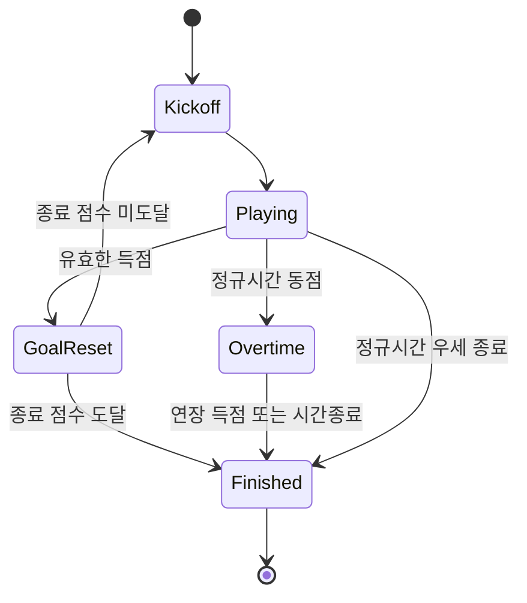

# 브롤 볼 · Brawl Ball — 소유권 전환형 스포츠 전투 역기획

> 조사 기준일: 2026-11-13 · 범위: 기본 3v3 · 상태: 공식 기본 모드 설명 확인, 당일 로테이션은 미확인.
> **[확인]** 공개 규칙 · **[해석]** 설계 분석 · **[제안]** 재구현 명세 · **[미확인]** 현행 실기·데이터 확인 필요.

## 1. 핵심 경험

**[확인]** 먼저 2골을 넣으면 승리한다. 현재 공식 도움말은 연장전에서 파괴 불가 벽도 제거된다고 설명한다. [S1]

**[해석]** 브롤 볼은 전투를 통해 점유 공간을 만들고, 단일 공을 그 공간으로 운반하는 모드다. 다수의 적을 쓰러뜨려도 공이 반대편에 있으면 득점으로 연결되지 않는다. 목표물이 하나이기 때문에 화면 전체에서 지금 중요한 위치가 비교적 명확하다.

기본 3v3과 가로 경기장의 5v5, 충전 슛을 사용하는 Super Ball 계열은 별도 규칙 세트로 관리한다. 이 문서에서 기본 공에 물리 엔진 기반 정밀 강체 시뮬레이션이 사용된다고 가정하지 않는다.

## 2. 공이 전투 규칙을 바꾸는 방식

| 항목 | 설계적 의미 [해석] | 구현 시 분리해야 할 상태 [제안] |
| --- | --- | --- |
| 공 소지 | 목표 이동과 공격 능력 사이에 선택 발생 | `carrierId`와 캐릭터 공격 상태 |
| 패스·슛 | 소유권을 포기하고 위치를 앞당김 | 발사 입력·궤도·다음 픽업 가능 시각 |
| 벽 반사 | 직선 외의 득점 각도 제공 | 충돌면·반사 횟수·속도 감쇠 |
| 몸으로 차단 | 수비가 공의 경로에 직접 참여 | 플레이어 픽업·차단 판정 |
| 골 이후 재개 | 공간 우위를 일부 리셋 | 점수 상태와 라운드 초기화 상태 |
| 연장전 | 정체된 방어 구조를 바꿈 | 맵 전환과 잔여시간 |

**[확인·역사]** 2019년 패치에서 일반 킥에 탄약 소모가 적용되었다. [S2] **[미확인]** 현재 모든 특수 변신·예외 캐릭터에서의 소모 방식과 무탄약 상태 입력 규칙은 별도 검증 대상이다.

### 공 객체의 요구사항 [제안]

공은 `지면`, `운반`, `비행`, `골 판정 대기`, `재개 대기` 중 하나의 상태만 가져야 한다. 렌더링상 공이 캐릭터에 붙었다고 서버 소유권이 확정된 것은 아니다. 같은 입력이 패스와 일반 공격으로 중복 실행되지 않게 입력 의도를 권위 상태에 맞춰 해석한다.

## 3. 경기 흐름 [해석]

1. **첫 교전:** 중앙 공을 즉시 줍는 선택과 적의 탄약을 먼저 소모시키는 선택을 비교한다.
2. **우세 형성:** 적 한 명을 제거하거나 밀어내어 공 운반자의 전진 경로를 만든다.
3. **운반·패스:** 공을 가진 선수에게 공격 기회를 몰아주기보다 공을 먼저 보내고 다른 선수가 전선을 유지하는 선택이 가능하다.
4. **최종 진입:** 골 앞의 수비가 가진 넉백·기절·순간 이동을 고려해 슛과 직접 운반의 위험을 비교한다.
5. **전환:** 공격 실패 후 공이 빠져나오면 뒤에 남은 한 명이 수비 시간을 벌어야 한다.
6. **득점 후 재시작:** 전 경기에서 쌓인 맵 파괴·궁극기 등 무엇이 유지되는지에 따라 다음 킥오프 전략이 달라진다. 해당 유지표는 실기 검증으로 작성한다.

## 4. 경기 상태와 공 상태 [제안]



연장 길이와 정규시간은 설정값이다. 본 문서는 최신 실행 빌드의 초수를 확인하지 않아 임의의 숫자를 명세하지 않는다.

### 득점 판정과 예외

- **[제안]** 경기장상의 골 경계를 권위 좌표로 정의하고 공의 연속 이동 구간과 교차 판정한다. 빠른 슛이 한 프레임에 경계를 건너뛰어도 누락되지 않아야 한다.
- **[제안]** 득점 승인 시 공을 잠그고 단일 `GoalScored`를 발행한다. 여러 충돌 이벤트가 같은 골을 중복 집계하면 안 된다.
- **[미확인]** 자책골 방지, 적을 조종하는 능력과 마지막 터치 귀속, 공 운반 중 특정 이동기 사용 가능 여부는 브롤러별 규칙 검증이 필요하다.
- **[제안]** 골 인정과 시간 만료가 같은 처리 구간이면 `goalAtDeadlinePolicy`를 적용한다. 렌더링에서 먼저 보인 순서로 결정하지 않는다.
- **[제안]** 공이 벽 안에 갇혔을 때 안전 위치 복구와 경기 타이머를 분리한다. 공 복구 대기가 경기의 무한 연장이 되어서는 안 된다.

## 5. 맵의 전술적 변수 [해석]

골 앞 벽은 장거리 사격을 막아 접근전 기회를 주면서 반사 슛의 기준면을 만든다. 벽을 부수는 행동은 현재 교전뿐 아니라 이후 모든 공격의 득점 난도를 바꾼다. 따라서 파괴 능력의 가치는 피해량과 독립적이다.

중앙의 엄폐 밀도, 측면 우회 거리, 골 앞 수비 폭을 함께 본다. 통로가 좁으면 광역 제어가 강해지고, 지나치게 열리면 접근형 캐릭터가 공을 만질 기회가 줄 수 있다. 연장전은 이런 엄폐 의존성의 일부를 제거하여 교전을 빠르게 수렴시키는 장치로 해석할 수 있다.

| 팀 기능 | 필요한 이유 | 과도하게 겹치면 생기는 문제 |
| --- | --- | --- |
| 전선 형성 | 공 운반자 앞에 안전 공간 생성 | 세 명 모두 전진하면 역습에 취약 |
| 공 진행 | 우세를 슛 거리로 전환 | 전원이 공만 추적하면 사격각 상실 |
| 순간 차단 | 상대 마지막 진입 저지 | 대응 기술을 초반 교전에 모두 소비 |
| 벽 변형 | 막힌 득점 경로 개방 | 아군의 은폐·접근 경로까지 제거 |

## 6. 역전 구조와 경기 감정 [해석]

한 골의 가치는 현재 전장 장악 정도와 무관하게 동일하다. 오랫동안 밀려도 한 번의 차단과 긴 패스가 득점으로 연결될 수 있어 점유율과 결과 사이의 긴장감이 생긴다. 반대로 득점 횟수가 적기 때문에 단일 판정 오류의 체감 영향이 크다.

공 없는 구역의 처치는 결과 화면에서 과대평가되기 쉽다. 좋은 수비는 상대를 죽이지 않고 슛 각도를 닫거나 공을 외곽으로 보내는 행동일 수도 있다. 기여 평가에는 득점 외에 위험 구역 탈출·골 앞 차단·득점 전 패스 흐름을 추가하는 편이 타당하다.

## 7. UI·오디오 요구 [제안]

- 캐릭터가 공을 소지할 때 공격 버튼의 의미 변화가 시각적으로 드러나야 한다.
- 슛 조준선은 실제 도달 경로의 확정 약속과 예측 안내를 구분한다. 동적 적 캐릭터가 끼어들 가능성은 별도다.
- 화면 바깥 공 위치를 알려 주되 모든 적의 위치를 함께 노출하지 않는다.
- 득점 연출은 이미 확정된 골에만 재생하고 경기 재개 시점을 일관되게 알려 준다.
- 골선·팀 색·공 위치가 배경 테마에 묻히지 않도록 대비 검사를 한다.
- 연장 시작은 남은 시간 감소와 지형 변화 두 가지 정보를 모두 전달한다.

## 8. 데이터·권위 판정 [제안]

| 필드 | 용도 |
| --- | --- |
| `goalsToWin` | 조기 종료값 |
| `regulationDuration`, `overtimeDuration` | 경기 시간 구성 |
| `ballCarrier`, `ballVelocity` | 운반과 비행 상태 |
| `kickCostPolicy`, `superKickPolicy` | 입력 비용과 강화 킥 |
| `pickupCooldownByPlayer` | 즉시 재획득 악용 방지 여부 |
| `goalVolumes` | 팀별 골 영역 |
| `overtimeTerrainPolicy` | 연장 지형 전환 |
| `restartPersistenceMask` | 득점 후 보존할 상태 목록 |

```text
resolveBallStep():
    intent = interpretInputUsingAuthoritativePossession()
    validateAndApplyKick(intent)
    integrateBallAndResolveContacts()
    goal = testGoalCrossing(previousPosition, currentPosition)
    if goal and matchAcceptsGoal:
        commitGoalOnce(goal)
        if scoreReachedTarget: finishMatch()
        else: enterGoalReset(restartPersistenceMask)
    resolveDeadlineAccordingToPolicy()
```

이는 결정적인 게임 규칙을 위한 추상 모델이다. 원작이 이산 충돌·연속 충돌·강체 중 무엇을 사용하는지는 공개 자료로 확인하지 않았다.

## 9. QA 시나리오 [제안]

| 상황 | 기대 결과 또는 확인 항목 |
| --- | --- |
| 공 비소지 상태에서 슛 입력 | 일반 공격 처리 여부를 입력 정책에 맞춤 |
| 탄약 0에서 공 소지 | 불가능 행동과 가능한 패스 옵션을 정확히 표현 |
| 둘이 동시에 공에 도착 | 한 명만 운반자, 공 객체 중복 없음 |
| 고속 공이 골선을 한 스텝에 통과 | 단일 득점 |
| 슛과 넉백 동시 | 입력 승인·공 분리 순서 재현 |
| 골 순간 서버 시간 만료 | 일관된 마감 정책 |
| 공이 파괴되는 벽 내부에 위치 | 유효 위치 유지 또는 안전 복구 |
| 연장전 진입 | 지정 지형만 전환, 골 영역 유지 |
| 골 뒤 소환물·지속 피해 잔존 | `restartPersistenceMask`에 일치 |
| 골 연출 중 재접속 | 중복 득점 없이 재개 단계 복원 |
| 화면 회전·좌우 진영 전환 | 조준과 골 소유권 일치 |
| 조종·변신 능력과 공 소지 | 캐릭터별 예외표와 대조 |

## 10. 계측·검증 우선순위 [제안]

공 소지 시간보다 **공을 전진시킨 거리**, 슛 시도 대비 득점률, 적 골 앞에서 잃은 소유권, 골 직전 수적 우세, 연장 발생률, 골 뒤 재개 시간, 목표물 관련 판정 이의 건수를 본다. 현재 티어와 무관한 모드 품질을 평가할 수 있다.

우선 검증할 항목은 공 소유권, 골선 교차, 시간 마감, 슛 비용이다. 그다음 모든 이동·변신·조종 능력에 대한 공 상호작용 표를 만든다.

## 11. 출처·버전 주의

- [S1 · Supercell Game Modes](https://sc-brawlstars.zendesk.com/hc/en-us/articles/49526599632923-Game-Modes): 2골 목표와 현재 연장전 설명. 수집일 2026-11-13.
- [S2 · Balance Changes, 2019](https://supercell.com/en/games/brawlstars/blog/release-notes/balancechange0125-2/): 일반 킥 탄약 소모 도입 이력.
- [S3 · Mystery at the Hub, 2023](https://supercell.com/en/games/brawlstars/blog/release-notes/mysteryatthehub-patch-notes/): 당시에는 연장 중 파괴 불가 벽 유지라고 설명. S1과 차이가 있어 과거 설명을 현재 규칙으로 재사용하지 않음.
- 관련 문서: [바스켓 브롤](12_basket_brawl.md), [젬 그랩](01_gem_grab.md), [전체 목차](../README.md).

공개되지 않은 수치·내부 물리·동시 사건 처리는 확정 사실이 아니다. 본문의 구현안과 테스트 기대값은 재구현용 제안이다.
