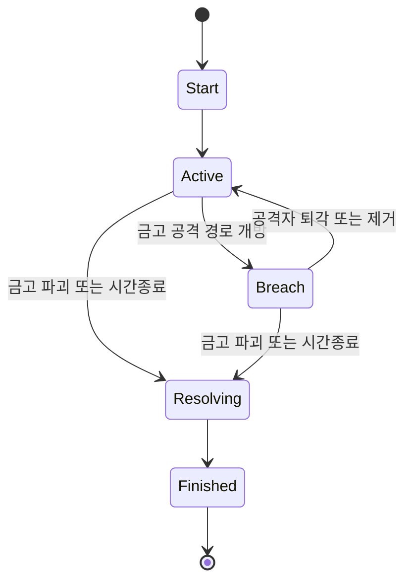

# 하이스트 · Heist — 비가역 목표 피해 경쟁 역기획

> 조사 기준일: 2026-11-13 · 범위: 기본 3v3 · 상태: 공식 모드 설명 확인, 당일 슬롯 미확인.
> **[확인]** 공개 규칙 · **[해석]** 설계 분석 · **[제안]** 구현 명세 · **[미확인]** 현행 실기 확인 필요.

## 1. 핵심 경험

**[확인]** 적 금고를 먼저 파괴하는 팀이 승리하는 3v3 모드다. [S1]

**[확인·2025 개편]** 공식 Katana Kingdom 패치는 금고 체력이 25% 구간을 지날 때 일시 피해면역 보호막을 얻는다고 설명한다. [S2] 이 문서는 보호막 없는 과거 DPS 레이스와 보호막 구간을 가진 개편 모델을 구분한다. 조사에서 이 규칙의 후속 철회 공지는 확인하지 못했으며, 현재 빌드의 지속시간과 경계 피해 처리는 실기 검증 대상이다.

**[해석]** 하이스트의 중심은 적 플레이어를 이기는 일과 금고를 더 빨리 부수는 일이 항상 같지 않다는 데 있다. 금고에 남긴 피해는 이후 교전에서 후퇴하더라도 목표 진척으로 남는다. 방어자는 사망 그 자체보다 사망으로 열린 공격 시간을 계산해야 한다.

이 문서는 경쟁 금고 모드만 다룬다. 로보 럼블의 공동 금고 방어와 시즈의 기지·로봇 주기는 별도 모드다.

## 2. 승리 조건을 전투와 분리 [해석]

| 전장 행동 | 직접 효과 | 목표 관점의 평가 |
| --- | --- | --- |
| 적 처치 | 잠시 전장에서 제거 | 금고에 접근할 시간이 생겼는가 |
| 금고 공격 | 목표 체력 감소 | 귀환·사망 비용보다 가치가 큰가 |
| 적 유인 | 적 이동 경로 변경 | 공격 라인 하나를 비웠는가 |
| 수비 유지 | 금고 피해 차단 | 반대편 공격자가 목표 피해를 낼 시간을 벌었는가 |
| 벽 파괴 | 장기 사격 경로 변경 | 아군 공격과 적 공격 중 누구에게 더 유리한가 |
| 일제 진입 | 높은 순간 목표 피해 | 전멸 뒤 받는 반격을 감당할 수 있는가 |

금고가 손상되는 속도를 개별 브롤러의 표시 공격력만으로 평가하면 재장전·접근 시간·소환물·지속 장판·특수 충전의 영향을 놓친다. 목표에 실제로 딜을 넣는 시간의 비율을 함께 측정해야 한다.

## 3. 원작 확인 범위와 미확정 수치

공식 요약은 기본 파괴 목표를 설명하지만 모든 맵과 이벤트의 금고 체력, 시간제한, 피해 보정 계수까지 제공하지 않는다. 이 문서는 이를 임의 상수로 채우지 않는다.

| 항목 | 취급 |
| --- | --- |
| 금고 체력 | **[미확인]** 맵·모드 설정과 현재 빌드 확인 |
| 시간 종료 시 비교 | **[미확인]** 잔여 체력의 절대값·비율·표시 반올림 관계 실기 확인 |
| 양 금고 동시 파괴 | **[미확인]** 무승부·처리 순서 등 원작 정책 확인 |
| 금고에 대한 최대 체력 비례 공격 | **[미확인]** 브롤러별 예외·상한 확인 |
| 금고 공격의 특수 공격 충전 | **[미확인]** 피해 대상 유형에 따른 차이 확인 |
| 치유·보호막·이동·상태이상 | **[제안]** 금고 전용 수신 가능 효과 표 작성 |

분석에서 말하는 비가역성은 **통상 공격 단계에서 피해 누적이 공격팀의 진척으로 남는 구조**를 가리킨다. 모든 이벤트에 치유 예외가 절대 없다고 주장하는 것은 아니다.

### 단계 보호막이 바꾸는 전투 리듬 [해석]

보호막 구간이 있으면 공격자가 모든 폭딜을 한 번에 쏟는 것이 항상 효율적이지 않다. 다음 체력 구간으로 넘어갈 때 공격을 멈추고 적 수비수를 처리하거나 재장전할 여유가 생긴다. 수비팀은 이 짧은 면역 구간을 재합류 시간으로 사용할 수 있다.

재구현에서는 `현재 체력`, `이미 소비한 보호막 단계`, `면역 종료시각`을 분리한다. 같은 임계값에서 매 피격마다 보호막이 다시 켜지거나, 체력 표시 반올림 때문에 단계를 두 번 통과하면 안 된다. **한 타격이 여러 임계값을 넘을 때 초과 피해를 통과·차단·이월하는지는 공식 문구만으로 확정할 수 없다.**

| 추가 검증 | 이유 |
| --- | --- |
| 임계값을 크게 넘기는 단일 공격 | 폭딜 억제 효과의 실제 범위 |
| 같은 스텝의 다수 투사체 | 첫 피격 이후 면역 적용 시점 |
| 면역 중 지속 피해 | 무효화와 잔여 지속시간의 관계 |
| 면역 종료와 즉시 새 피격 | 보호막의 경계 프레임 |

## 4. 한 판의 운영 단계 [해석]

1. **경로 확인:** 어느 라인이 금고까지 도달할 수 있고 어느 벽을 제거해야 하는지 판단한다.
2. **우세 획득:** 상대를 밀거나 처치하여 공격자가 지나갈 수 있는 틈을 만든다.
3. **전환 선택:** 금고를 칠지, 적을 먼저 제거할지, 체력을 회복하고 다음 진입을 준비할지 선택한다.
4. **레이스 평가:** 양팀 공격자가 상대 금고 앞에 있으면 귀환해 수비할지 끝까지 목표 피해를 넣을지 결정한다.
5. **마감 관리:** 한 번의 진입으로 끝낼 수 있는 체력 구간에서는 교전 승패보다 공격 한 번의 접촉 성공이 더 중요해진다.

경기 초반에 수비 담당이 강한 캐릭터가 후반에도 계속 본진에 남아야 하는 것은 아니다. 금고 잔여 체력과 양팀의 다음 공격 자원에 따라 역할을 바꿔야 한다.

## 5. 상태전이와 피해 처리 [제안]



`Breach`는 분석용 국면이다. 구현에서 별도 전역 상태로 둘 필요는 없다. 핵심 런타임 상태는 경기 활성 여부와 각 금고의 체력이며, 교전 단계는 계측으로 파생할 수 있다.

### 피해 수신 인터페이스

- 금고를 일반 브롤러와 같은 피해 인터페이스로 처리하되 대상 태그로 차이를 표현한다.
- `Brawler`, `Objective`, `Summon`별 피해 보정과 특수 공격 충전 여부를 데이터로 둔다.
- 초과 피해는 통계상의 시도 피해와 실제 체력 감소량을 분리한다.
- 지속 피해·반사·체력 비례 효과는 원 공격의 대상 정책을 검증한 뒤 적용한다.
- 파괴된 금고에 뒤늦게 도달한 투사체는 추가 승리·추가 점수 이벤트를 생성하지 않는다.

## 6. 맵·팀 구성 [해석]

금고와 중앙 사이의 이동 거리가 길면 한 번의 라인 패배가 긴 목표 공격 시간으로 확대된다. 짧으면 수비 복귀가 쉬워 순간 폭딜이 더 중요해질 수 있다. 강가·점프 패드·좁은 다리는 캐릭터별 접근 비용을 비대칭적으로 만든다.

| 기능 | 유효한 이유 | 단독으로 부족한 점 |
| --- | --- | --- |
| 지속 목표 피해 | 열린 공격 시간을 효율적으로 사용 | 접근 전에 제거되면 기여가 없음 |
| 순간 목표 피해 | 짧은 빈틈을 크게 활용 | 빈틈 생성 능력이 약할 수 있음 |
| 수비 제거 | 본진의 적을 빠르게 몰아냄 | 공격 전환이 늦으면 체력 레이스 패배 |
| 라인 압박 | 여러 적의 수비 배치를 강제 | 직접 금고 피해가 낮을 수 있음 |
| 경로 개방 | 아군의 사거리·접근 효율 증가 | 적이 동일 경로를 이용할 수 있음 |

모든 팀원이 최대 금고 DPS를 추구하면 적의 진입을 멈출 수단이 없어질 수 있다. 반대로 수비 기능만 겹치면 앞선 금고 체력 차를 줄이지 못한다. 구성은 금고 접촉 확률과 접촉 후 피해량의 곱으로 평가하는 편이 유용하다.

## 7. 레이스 계산 예시 [해석]

재구현 플레이테스트에서 아군 목표의 남은 체력을 `H_self`, 적 목표를 `H_enemy`, 양측 유효 목표 DPS를 각각 `D_enemy`, `D_self`로 측정했다고 하자.

`피해 가능 구간의 최소 소요시간 ≈ 남은 목표 체력 / 유효 목표 DPS`

단계 보호막이 활성화된 규칙에서는 여기에 남은 면역 구간과 공격 재개 지연을 추가해야 한다. 과거의 `체력/DPS`만으로 최종 파괴시간을 확정하지 않는다.

이 비교는 귀환 판단의 시작점일 뿐이다. 실제로는 탄약 공백, 소환물 생존, 공격자의 체력, 새 적의 도착이 달라진다. 고정된 훈련장 DPS를 전투 중 DPS로 대체하면 공격 레이스의 승자를 과도하게 확신하게 된다.

목표 체력 차는 앞선 팀에 수비 선택권을 준다. 그러나 금고가 낮아지면 한 번의 특수 공격으로 경기가 끝나므로 수비팀의 실수 허용 폭은 줄어든다. 앞선 팀의 이점과 마지막 순간의 역전 가능성이 함께 존재한다.

## 8. UI·오디오 요구 [제안]

- 양쪽 금고 체력을 동시에 표시한다. 작은 차이는 반올림 때문에 동률처럼 보이지 않도록 한다.
- 금고가 공격받는다는 사실은 화면 밖에서도 알 수 있어야 한다.
- 피해 경고 빈도는 피해량·잔여 체력에 따라 조정하되 지속 피해마다 과도하게 반복하지 않는다.
- 결과 화면은 브롤러 피해와 금고 피해를 분리한다. 금고 담당이 적 플레이어 피해가 낮다고 무기여로 보이면 안 된다.
- 맵 미리보기에서 금고 위치와 파괴 가능한 핵심 장애물을 식별할 수 있게 한다.

## 9. 데이터·이벤트 [제안]

| 필드 | 용도 |
| --- | --- |
| `objectiveMaxHpByTeam` | 목표별 최대 체력 |
| `objectiveDamageProfileId` | 피해·치유·상태이상 정책 |
| `shieldThresholds`, `consumedShieldStages` | 단계 보호막의 1회 발동 관리 |
| `shieldDeadline`, `thresholdOverflowPolicy` | 면역 시간과 초과 피해 처리 |
| `matchDuration` | 제한시간 |
| `timeoutComparisonPolicy` | 종료 시 체력 비교 |
| `simultaneousDestructionPolicy` | 동시 파괴 처리 |
| `sourceDamageLedger` | 실피해·기여 기록 |
| `matchResultCommitted` | 결과 중복 방지 |

```text
onCombatStepResolved(damageEvents):
    applyObjectiveDamageAndThresholdShields(damageEvents, overflowPolicy)
    destroyedTeams = teamsWhoseObjectiveHpReachedZero()
    if destroyedTeams is not empty:
        result = resolveDestructionSet(destroyedTeams, policy)
        commitResultOnce(result)
    else if matchDeadlineReached:
        commitResultOnce(compareObjectives(timeoutPolicy))
```

동일 처리 구간의 양쪽 피해를 모아 파괴 집합을 평가하는 것은 재구현 제안이다. 원작 서버가 항상 이렇게 처리한다고 주장하지 않는다.

## 10. QA 시나리오 [제안]

| 상황 | 기대 결과 또는 검증 포인트 |
| --- | --- |
| 양 금고 동시 0 도달 | 정의한 동시 파괴 정책 적용 |
| 0 체력 금고에 지속 피해 | 결과 중복 없음 |
| 보호막 임계구간을 대량 피해로 통과 | 초과 피해 정책 검증 |
| 면역 중 다수 지속 피해 | 체력 불변, 단계 중복 발동 없음 |
| 최대 체력 비례 공격 사용 | 목표 전용 보정·상한 적용 |
| 치유·보호막 기술이 금고에 겹침 | 허용 목록에 따라 일관 처리 |
| 금고 옆 소환물에 범위 공격 | 금고와 소환물 피해 중복·누락 검사 |
| 시간종료 시 표시 체력은 동일 | 내부 정밀값과 표시값의 관계 검증 |
| 경기 종료 직전 투사체 발사 | 타격 발생 시각을 마감 정책과 비교 |
| 금고를 끌어당기는 능력 | 이동 가능 대상 태그 검증 |
| 적 금고 피해 통계 | 실제 체력 감소량과 원시 피해량 분리 |
| 재접속·리플레이 | 목표 체력 및 종료 결과 동일 |

## 11. 계측과 밸런스 질문 [제안]

첫 목표 피해팀 승률, 금고 공격 접촉시간, 브롤러별 목표 피해 비중, 공격자 한 명을 제거하는 데 쓰인 수비 시간, 10% 이하 체력에서의 역전율, 양팀 동시 본진 공격 빈도를 본다. 여기서 10%는 분석용 구간 예시이며 원작 숨은 기준이 아니다.

모드가 특정 장비·브롤러의 폭발적 목표 피해에 종속된다면 목표 대상 보정이 필요한지 검토한다. 다만 금고를 단단하게 만드는 것만으로는 접근 불가능한 조합 문제를 해결하지 못한다. 맵 경로·수비 효율·목표 보정을 함께 분리 실험한다.

## 12. 출처와 연결

- [S1 · Supercell Game Modes](https://sc-brawlstars.zendesk.com/hc/en-us/articles/49526599632923-Game-Modes): 모드 형식과 적 금고 파괴 목표. 수집일 2026-11-13.
- [S2 · Katana Kingdom, 2025](https://supercell.com/en/games/brawlstars/blog/release-notes/updated-june-12-release-notes-the-battle-for-katana-kingdom/): 금고 단계 보호막 도입과 폭딜 억제 의도. 공식 검색 색인 본문을 확인.
- 관련 문서: [젬 그랩](01_gem_grab.md), [핫 존](05_hot_zone.md), [전체 목차](../README.md).

구현 인터페이스, 수식, 로그 필드와 QA 기대값은 독립적인 설계 제안이다. 원작의 현재 금고 수치와 내부 처리 순서는 확인한 범위 밖이다.
