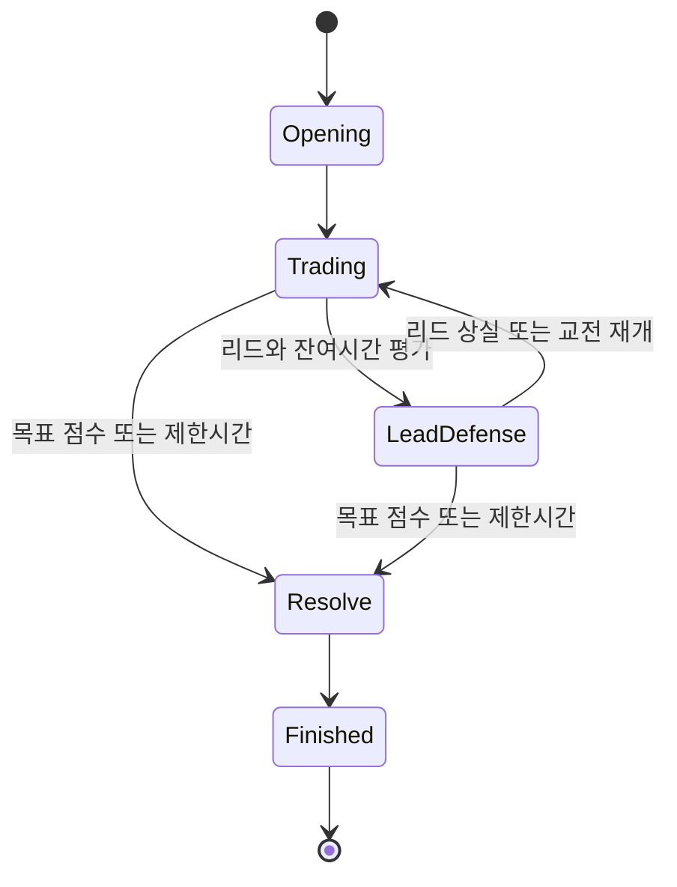

# 바운티 · Bounty — 가변 현상금 팀 데스매치 역기획

> 조사 기준일: 2026-11-13 · 범위: 기본 3v3 · 상태: 공식 설명과 변경 이력 확인, 현재 슬롯 미확인.
> **[확인]** 공식 공개 규칙 · **[해석]** 설계 분석 · **[제안]** 재구현 명세 · **[미확인]** 실기 확인 필요.

## 1. 핵심 경험과 규칙 근거

**[확인]** 먼저 20별을 얻으면 승리한다. 2023년 공식 개편은 120초 종료 시 점수를 비교하고, 동률이면 파란 별로 결정한다고 설명한다. [S1]

**[확인·역사]** 2020년 패치에서 파란 별 소지자를 처치하면 해당 별이 상대팀으로 이전되도록 했다. [S2]

**[해석]** 적을 많이 쓰러뜨린 플레이어가 더 큰 보상 대상이 되면서 개인의 성공과 팀의 위험이 함께 커진다. 일반적인 고정 점수 데스매치와 달리 1 대 1 처치 교환도 대등한 교환이 아닐 수 있다. 킬을 잘하는 선수에게 생존 책임이 추가된다.

이 문서의 120초는 공식 변경 이력에 근거한 기준 규칙이다. 이벤트 변형과 최신 빌드의 시간값을 별도 확인해야 한다. 브롤러별 현상금의 최초값·증가량·최댓값은 이 조사에서 원문으로 확정하지 않았다.

## 2. 상태를 세 층으로 분리

| 층 | 저장할 값 [제안] | 중요한 구분 |
| --- | --- | --- |
| 팀 누적 점수 | `teamStars` | 이미 얻은 승리 진척 |
| 개인 현상금 | `bountyValueByPlayer` | 해당 플레이어 사망 시 상대가 얻을 가치 |
| 동률 결정권 | `blueStarCarrier` 또는 팀 | 일반 점수와 별개로 결과에 영향을 주는 정보 |

개인 현상금이 늘어난다고 팀의 기존 점수를 같은 방식으로 다시 계산하면 안 된다. 누적 점수, 앞으로 지급될 사망 보상, 동률 결정권은 생명주기가 다르다.

파란 별을 일반 드롭 아이템과 동일하게 다루는 구현은 먼저 검토해야 한다. 공개 이력상 핵심은 소지자 처치에 따른 **이전**이며, 사망 지점에서 누구나 다시 줍는 구조와는 다를 수 있다.

## 3. 한 판의 플레이 흐름 [해석]

1. **첫 별 경쟁:** 중앙 접근은 동률 결정권과 초반 위치 우위를 함께 고려하는 선택이다.
2. **안전한 첫 처치:** 좁은 사격선을 만들고 상대의 회복·재장전 틈에 교전을 끝낸다.
3. **현상금 누적:** 같은 선수가 계속 처치할수록 팀의 공격력이 아니라 상대가 노릴 자산이 집중된다.
4. **리드 보호:** 남은 시간과 적의 현상금을 보고 교전을 열 필요가 있는지 결정한다.
5. **역전 시도:** 뒤진 팀은 상대의 가장 가치 있는 목표를 지정하여 위험을 감수할 이유가 생긴다.
6. **마지막 교환:** 점수 차·파란 별·마지막 투사체의 결과가 승패를 바꿀 수 있다.

적이 한 명 남았다고 무리하게 추격하는 것은 수적 우세의 활용처럼 보이지만, 큰 현상금을 가진 아군이 진입하다 죽으면 팀 점수 교환이 불리해질 수 있다.

## 4. 상태전이 [제안]



`LeadDefense`는 전술 국면이며 서버가 강제하는 수비 상태가 아니다. 런타임은 동일한 전투 규칙을 유지하고 점수와 시계만 바뀐다. 전술 변화가 별도 입력 설명 없이 발생하는 점이 설계적 강점이다.

### 처치 트랜잭션 [제안]

1. 사망 직전 피해자의 현상금을 스냅샷한다.
2. 킬 귀속 정책으로 획득 팀과 획득자를 정한다.
3. 팀 누적 점수에 보상을 반영한다.
4. 공격자 현상금의 증가·상한 정책을 적용한다.
5. 피해자가 파란 별 소지자이면 소유권 이전 정책을 실행한다.
6. 사망자의 다음 생명에서 적용할 현상금을 초기화한다.
7. 같은 처리 구간의 모든 처치를 반영한 후 종료 조건을 평가한다.

이 순서는 재구현안이다. 원작 동시 처치 순서와 환경 피해의 귀속 방식은 실기 검증 대상이다.

## 5. 교환 가치 분석 [해석]

플레이테스트에서 아군 현상금이 `A`, 적 현상금이 `B`인 두 플레이어가 맞교환했다고 하자. 단순 점수차 변화는 `B - A`로 볼 수 있다. 실제 전술 가치는 파란 별 이전, 부활 위치, 다른 생존자의 전선 변화까지 포함한다.

이 식은 원작의 별 증가 규칙을 대신하지 않는다. 현상금 자체를 잘못 추정하면 분석도 틀린다. 도구에는 현재 경기 로그에서 얻은 실제 값만 넣어야 한다.

| 상황 | 합리적인 팀 목표 |
| --- | --- |
| 점수 우세, 파란 별도 보유 | 사격선을 좁혀 상대의 강제 진입 비용 증가 |
| 점수 동률, 파란 별 미보유 | 마지막 교전 없이 끝나면 불리하므로 목표 지정 |
| 큰 현상금 한 명에게 집중 | 해당 플레이어의 퇴로·시야를 보조 |
| 상대 큰 현상금이 후방에 숨음 | 다른 적을 잡아 진입 수적 우세를 만들거나 우회 |
| 양팀 모두 목표 점수 직전 | 낮은 가치의 희생도 즉시 패배가 될 수 있어 재계산 |

## 6. 맵·조합·정보 [해석]

바운티는 생존과 사격 기회가 점수 교환을 직접 결정하므로 열린 사격선의 길이와 회복 가능한 엄폐가 중요하다. 다만 특정 지도에서 장거리 캐릭터가 유리하다는 해석을 전체 모드의 고정 메타로 일반화하면 안 된다.

긴 통로는 원거리 견제의 가치를 높이고, 접근 경로가 여러 갈래면 기습과 측면 압박이 안전한 저격 위치를 흔든다. 벽이 사라진 후에는 같은 팀 구성이 다른 위험을 갖는다. 맵 분석에는 시작 상태와 파괴 이후 상태를 모두 사용한다.

지원형 역할의 기여는 치료량만으로 설명되지 않는다. 높은 현상금의 아군이 안전하게 회복할 수 있도록 시야를 유지하고 상대 우회를 미리 확인하는 행동이 팀의 큰 점수 손실을 막는다.

## 7. UI·결과 표현 [제안]

- 개인 머리 위 현상금과 상단 팀 점수의 단위를 혼동하지 않게 한다.
- 파란 별의 현재 소유 상태를 팀 HUD에서 확인할 수 있게 한다.
- 점수가 동률일 때 현재 유리한 팀을 시각적으로 구분하되 점수 자체를 바꾸어 표시하지 않는다.
- 킬 피드는 획득 별 수가 중요한 모드임을 드러낸다.
- 결과 화면은 처치 수뿐 아니라 획득 별과 내준 별을 함께 보여 준다.
- 동률 승리 연출에서는 파란 별이 결과를 결정했다는 이유를 명시한다.

## 8. 데이터·판정 [제안]

| 필드 | 목적 |
| --- | --- |
| `targetStars`, `duration` | 종료 조건 |
| `initialBounty`, `bountyStep`, `bountyCap` | 개인 현상금 정책 |
| `teamStars` | 누적 팀 점수 |
| `blueStarOwner` | 동률 결정권 |
| `killCreditPolicy` | 소환물·환경·동시 공격 귀속 |
| `deadlineResolutionPolicy` | 마지막 사건 처리 |

```text
resolveDefeats(defeats):
    for defeat in orderedOrBatched(defeats, policy):
        value = snapshotBountyBeforeDeath(defeat.victim)
        scorer = resolveKillCredit(defeat)
        addStars(scorer.team, value)
        updateBountiesAndBlueStar(defeat, scorer)
    if thresholdReached:
        resolveThresholdResult(policy)
    else if deadlineReached:
        compareTeamStarsThenBlueStar()
```

`bountyCap` 등 미확인 값을 일반 모드 공통 상수로 하드코딩하지 않는다. 관전·전적·리플레이는 동일한 점수 이벤트를 사용해야 결과 설명이 일치한다.

## 9. QA 시나리오 [제안]

| 상황 | 기대 결과 또는 검증 항목 |
| --- | --- |
| 높은 현상금의 상대 처치 | 사망 직전 값으로 점수 지급 |
| 같은 순간 상호 처치 | 양 사건 처리와 종료 순서 일관 |
| 파란 별 소지자 처치 | 지정 귀속 정책에 따라 한 번 이전 |
| 환경 피해로 소지자 사망 | 미확인 예외를 실기 비교 후 정책 고정 |
| 소환물의 마지막 공격 | 주인 귀속 여부 일치 |
| 목표 점수 초과 획득 | 점수 잘림·추가 보상 중복 없음 |
| 제한시간 동률·파란 별 보유 | 지정 팀 승리 |
| 파란 별 미획득 상태 동률 | 별도 무승부 정책 확인 |
| 죽은 플레이어 재접속 | 이전 생명의 현상금 복원 금지 |
| 결과 확정 뒤 잔존 투사체 | 결과 변경 없음 |

## 10. 지표와 설계 질문 [제안]

개인 현상금 구간별 생존시간, 높은 현상금의 사망이 리드를 바꾼 비율, 1 대 1 교환의 점수차, 파란 별 획득팀 승률, 파란 별로 결정된 경기 비율, 후반 양팀 평균 이동거리를 본다.

경기가 지나치게 수동적이면 단순 제한시간 감소보다 리드팀의 안전 공간과 추격팀의 진입 경로를 먼저 살펴본다. 반대로 큰 현상금 한 번으로 모든 우위가 사라져 무력감이 커지는지 별도 사용자 관찰이 필요하다.

## 11. 출처와 연결

- [S1 · RumbleJungle Patch Notes, 2023](https://supercell.com/en/games/brawlstars/blog/release-notes/rumblejungle-patch-notes/): 목표 점수 도입과 시간종료·동률 규칙.
- [S2 · Brawlidays, 2020](https://supercell.com/en/games/brawlstars/blog/release-notes/brawlidays-2/): 파란 별 이전 이력.
- 관련 문서: [와이프아웃](07_wipeout.md), [녹아웃](06_knockout.md), [전체 목차](../README.md).

모드의 정체성은 공개 규칙에 근거하지만 수식·필드·상태명·QA 결과는 독립적인 재구현 제안이다.
