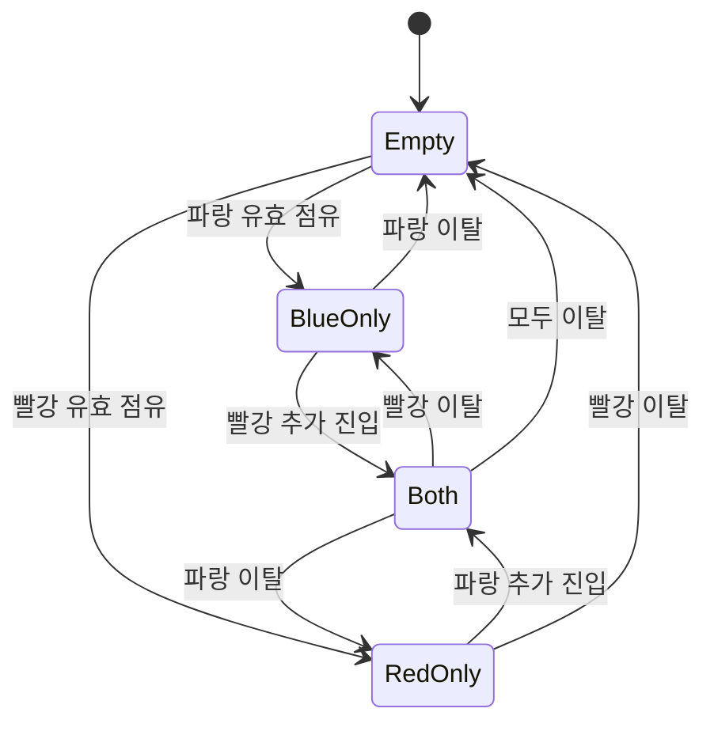

# 핫 존 · Hot Zone — 비감소 점유 누적전 역기획

> 조사 기준일: 2026-11-13 · 범위: 기본 3v3 · 상태: 공식 설명과 재설계 이력 확인, 당일 슬롯 미확인.
> **[확인]** 공개 규칙 · **[해석]** 설계 분석 · **[제안]** 구현 명세 · **[미확인]** 현행 실기 확인 필요.

## 1. 모드의 핵심

**[확인]** 구역을 점유해 먼저 목표를 채우는 모드다. 2020년 재설계 설명은 양팀이 같은 구역에서 서로를 차단하지 않고 동시에 진행할 수 있다고 명시한다. [S1]

**[해석]** 핫 존에서 적이 들어왔다고 점유가 자동 정지한다고 생각하면 행동 목표를 잘못 이해하게 된다. 상대의 진척을 막으려면 실제로 구역에서 밀어내거나 제거해야 한다. 내 몸으로 점유하는 행동과 적의 몸을 밖으로 보내는 행동이 별도 기여다.

맵의 구역 수가 달라지면 한곳에 모이는 싸움과 인원을 나누는 싸움이 달라진다. 다중 구역 지도를 단일 구역의 크기만 늘린 것으로 취급하지 않는다.

## 2. 진행도를 구성하는 상태

| 상태 | 의미 [해석] | 구현 주의 [제안] |
| --- | --- | --- |
| 구역별 팀 진행도 | 해당 구역에 남긴 성과 | 팀 전체 합계와 분리 저장 |
| 유효 점유자 집합 | 지금 진행시킬 수 있는 사람 | 사망·공중·무적 등 자격 정책 필요 |
| 구역 완료 여부 | 그 구역의 추가 점유 필요성 | 완료 후 무한 점수 증가 방지 |
| 총 진행도 | 승리까지의 남은 작업량 | 구역별 가중치와 반올림 명시 |
| 잔여시간 | 불리한 팀의 추가 진입 필요성 | 종료 직전 틱 처리 일관성 |

**[미확인]** 현재 구역별 소요시간, 여러 아군이 들어갔을 때의 점유 속도, 무적·공중·비가시 상태의 자격, 시간종료 동률 처리 세부값은 최신 실행 빌드로 확인해야 한다.

**[제안]** 초기 재구현에서는 한 팀의 구역 내 유효 인원 수가 1명 이상이면 일정 속도로 누적되는 이진 점유 모델을 후보로 둔다. 이를 원작 현행 속도 공식으로 단정하지 않는다.

## 3. 플레이 흐름 [해석]

1. **도착 경쟁:** 첫 진입자는 진행도를 얻지만 집중 공격을 받기 쉽다. 전원이 같은 점에 들어가는 대신 바깥 사격각을 확보할 수 있다.
2. **정착:** 한 명이 점유하고 나머지는 적의 진입로를 제한한다. 점유자의 체력·탄약이 줄면 역할을 교대한다.
3. **동시 점유:** 적이 구역에 진입하면 두 팀의 진척이 함께 오를 수 있다. 남은 목표량이 적은 쪽은 교전 없이 버티는 것이 유리할 수 있다.
4. **탈환:** 상대를 제거하는 동안 한 명은 구역 안에 남아 탈환의 가치를 진척으로 바꾼다.
5. **다중 구역 재배치:** 완료한 구역의 인원을 아직 끝나지 않은 구역으로 이동시킨다. 이동 중 남기는 압박도 따져야 한다.
6. **마감:** 잔여 진척과 남은 시간을 비교해 교환을 감수할지 결정한다.

## 4. 상태전이 [제안]



이 상태기계는 **한 구역의 현재 점유자 구성**만 설명한다. 완료 여부는 팀별로 독립적으로 관리해야 한다. 파랑이 해당 구역을 완료했다고 빨강의 진행도까지 고정하면 안 된다.

### 점유 수식 [제안]

`progress[team, zone] += captureRate(zone) × eligibleOccupancy(team, zone) × dt`

이진 점유 후보에서는 `eligibleOccupancy`가 0 또는 1이다. 인원수에 따른 가속을 실험하려면 해당 함수만 변경할 수 있어야 한다. 구역 가중치를 포함한 총량은 원작 확인값과 제안값을 분리해 표시한다.

## 5. 맵 구조와 역할 [해석]

단일 구역에서는 적을 구역 바깥에 묶어 둘 사격 위치가 중요하다. 원형 안에 세 명이 서는 행위가 항상 최선은 아니다. 여러 인원이 중첩되면 광역 피해에 취약하고 적 진입 경로를 넓게 감시할 수 없다.

다중 구역에서는 양쪽을 완전히 장악하려고 인원을 과분산하면 각지에서 밀릴 수 있다. 반대로 한쪽을 빠르게 끝내고 이동하는 운영은 이동시간 동안 다른 구역의 손해를 감수한다. 지도별 접근 시간과 서로 지원할 수 있는 사격선 길이를 비교해야 한다.

| 팀 기능 | 핵심 기여 |
| --- | --- |
| 점유 유지 | 죽지 않고 구역 안에서 누적 시간 확보 |
| 진입 차단 | 적이 도착하기 전에 체력·탄약을 소비시킴 |
| 강제 이탈 | 넉백·위협 장판·측면 공격으로 적 점유시간 감소 |
| 교대 지원 | 아군 회복 시간 동안 대신 점유 |
| 구역 전환 | 완료 상태를 보고 필요한 곳으로 이동 |

지원형 캐릭터는 점유자의 생존 시간을 늘리면서 간접적으로 목표 진척을 생산한다. 그렇다고 치료량을 곧바로 목표 점수로 변환하면 실제 점유와 무관한 치료가 과대평가될 수 있다.

## 6. 비감소 진척과 역전 [해석]

이미 얻은 진행도가 적의 재진입만으로 사라지지 않는 누적형 모델에서는 짧은 진입도 장기적으로 가치가 있다. 한 번 완전히 밀렸다고 모든 노력이 초기화되지 않는 것이 접근성을 높인다.

반면 상대가 거의 완료한 뒤에는 수비에 성공해도 더 큰 시간을 벌어야 한다. 뒤진 팀은 단순 처치뿐 아니라 **한쪽은 계속 점유하고 다른 쪽은 상대를 구역 밖으로 밀어내 추가 점유 속도를 0으로 만드는 구조**를 만들어야 역전 속도가 충분해진다.

`목표 도달 예상시간 = 남은 구역별 작업량 / 실제 점유 효율`로 비교할 수 있다. 진입·사망·회복 시간을 제외한 유효 점유율을 써야 한다. 이는 분석용 수식이며 원작 내부 계산이 아니다.

## 7. UI·오디오 요구 [제안]

- 구역별 진행도와 팀 총 진행도를 동시에 읽을 수 있어야 한다.
- 양팀이 한 구역을 함께 점유할 때 두 팀의 진행이 어떻게 변하는지 시각적으로 명확히 표현한다.
- 완료한 구역은 남은 구역과 다른 표식을 사용해 불필요한 체류를 줄인다.
- 점유 자격이 없는 상태라면 진입해도 왜 진행되지 않는지 일관된 피드백을 준다.
- 화면에 100%라고 표시하기 전에 실제 종료조건이 충족되었는지 확인한다. 표시 반올림으로 승리했다고 오해하면 안 된다.
- 구역 경계의 장식과 실제 판정 영역의 차이를 최소화한다.

## 8. 데이터·이벤트 설계 [제안]

| 필드 | 목적 |
| --- | --- |
| `zones[]` | 위치·반경·다각형 등 점유 영역 |
| `requiredCaptureTime` | 구역별 필요 누적량 |
| `captureEligibilityPolicy` | 상태별 점유 자격 |
| `captureSpeedPolicy` | 인원 수에 따른 속도 |
| `progressByTeamAndZone` | 독립 진행도 |
| `totalWeightByZone` | 다중 구역 합산 규칙 |
| `timeoutPolicy` | 제한시간 결과 |

```text
for each zone:
    for each team:
        eligible = collectEligibleOccupants(zone, team)
        speed = captureSpeedPolicy(eligible)
        progress[team, zone] = clampToGoal(progress + speed * dt)
for each team:
    complete[team] = allRequiredZonesComplete(team)
resolveCompletionAndDeadline(complete, timeoutPolicy)
```

진입·이탈 이벤트만으로 누적하지 말고 권위 위치·상태와 대조하는 검증 경로를 둔다. 넉백·순간 이동·사망으로 이탈 이벤트가 누락되어 유령 점유자가 남는 문제를 방지한다.

## 9. QA 시나리오 [제안]

| 상황 | 기대 결과 또는 확인 포인트 |
| --- | --- |
| 양팀 한 명씩 동시 점유 | 각 팀의 독립 진척 정책 확인 |
| 같은 팀 인원 1→3명 | 점유속도 정책에 따라 변화 또는 유지 |
| 구역 테두리에 정지 | 위치 오차로 불규칙한 진입·이탈 반복 방지 |
| 점유 중 넉백·점프·텔레포트 | 자격·위치 기준으로 즉시 재평가 |
| 부활 보호막 상태로 진입 | 원작 실기 자격표 확인 |
| 한 구역 완료 후 계속 체류 | 해당 팀 진행도 상한 유지 |
| 여러 구역이 동시에 완료 | 팀 총량과 종료가 한 번만 확정 |
| 같은 처리 구간에 양팀 완료 | 동시 완료 정책 적용 |
| 표시 100% 직전 | 내부 값과 UI 반올림 일치 |
| 종료 직전 점유자 사망 | 정해진 누적·사망·시간 처리 순서 재현 |

## 10. 계측·튜닝 질문 [제안]

전체 교전 시간 중 실제 점유 비율, 죽지 않고 확보한 점유시간, 첫 점유팀 승률, 구역별 완료시간 편차, 완료 구역의 불필요한 체류시간, 넉백으로 줄인 상대 점유시간을 본다.

다중 구역 지도가 한쪽만 먼저 끝내는 운영으로 고정된다면 각 구역의 진입 거리·지원 사격선·이동 비용을 비교한다. 수비팀이 너무 강하면 점유 목표값만 조정하기 전에 재진입 경로와 스폰 압박을 점검한다.

## 11. 출처와 연결

- [S1 · Tara's Bazaar Update, 2020](https://supercell.com/en/games/brawlstars/blog/game-updates/update-taras-bazaar/): 독립적인 동시 점령과 완료 구조를 설명한 공식 재설계 이력. 검색 색인에서 해당 본문을 확인했으며 현재 웹 본문은 로딩 화면으로 반환되는 경우가 있음.
- [Supercell Game Modes](https://sc-brawlstars.zendesk.com/hc/en-us/articles/49526599632923-Game-Modes): 기본 모드의 현재 등재 확인. 수집일 2026-11-13.
- 관련 문서: [젬 그랩](01_gem_grab.md), [하이스트](03_heist.md), [전체 목차](../README.md).

이 문서의 세부 수식·점유 자격표·데이터와 QA 기대값은 원작 내부 구현을 확인한 것이 아닌 재구현 제안이다.
