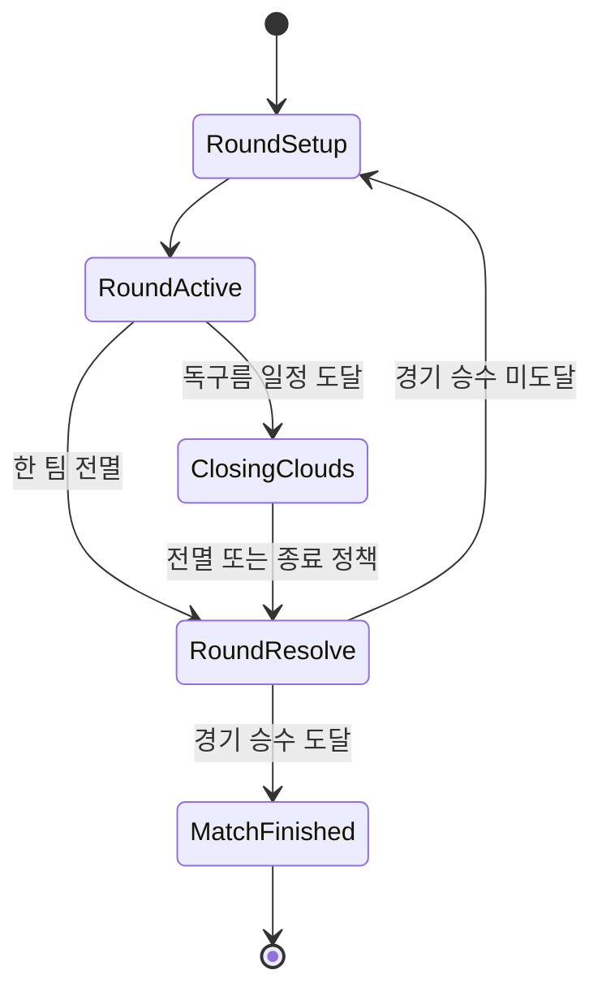

# 녹아웃 · Knockout — 생명 제한 라운드 전투 역기획

> 조사 기준일: 2026-11-13 · 범위: 기본 3v3 · 상태: 공식 기본 모드와 변경 이력 확인.
> **[확인]** 공개 규칙 · **[해석]** 설계 분석 · **[제안]** 재구현 명세 · **[미확인]** 현행 실기 확인 필요.

## 1. 핵심 경험과 확인 규칙

**[확인]** 라운드 중 사망한 선수는 다음 라운드까지 복귀하지 않으며, 3판 중 2판을 이기는 형식이다. [S1]

**[확인·역사]** 2021년 개편은 독구름으로 결말을 유도하고 기존 피해량 기반 동률 판정을 제거했다. [S2]

**[해석]** 한 번의 사망이 다음 교전까지 인원 열세로 남아, 제한 없는 리스폰 모드보다 시도 한 번의 위험이 커진다. 짧은 라운드 종료 후 다시 기회를 주는 구조가 긴 배틀로얄식 대기 부담을 줄인다.

기본 3v3과 5v5 변형을 섞지 않는다. 5v5의 잔존자 강화는 보조 자료 기반 분석이며, 공식 상세와 배율의 미확인 범위는 [5v5 전용 문서](15_knockout_5v5.md)를 따른다. 기본 문서에 강화 배율이나 인원별 보정을 임의로 추가하지 않는다.

## 2. 두 단계 승리 조건

| 단계 | 상태 [제안] | 플레이어가 알아야 할 것 |
| --- | --- | --- |
| 현재 라운드 | 생존자·독구름·교전 자원 | 누구를 제거하면 라운드가 끝나는가 |
| 전체 경기 | 팀별 라운드 승수 | 다음 라운드 패배가 경기 패배인가 |

라운드 승리와 경기 승리 이벤트는 별도다. 첫 라운드 종료를 경기 보상 확정으로 연결하면 두 번째·세 번째 라운드가 잘못 처리된다. 관전·재접속도 현재 라운드 ID를 포함해야 한다.

**[미확인]** 동시 전멸 시 처리, 독구름 일정·피해량, 라운드 사이에 유지되는 특수 공격·하이퍼차지·가젯 상태, 부활 계열 능력과 모드 사망의 우선순위는 실기 검증 대상이다.

## 3. 한 라운드의 흐름 [해석]

1. **정보 교환:** 상대의 위치와 접근 방식을 확인하고 불필요하게 체력을 내주지 않는다.
2. **첫 유리한 타격:** 단순 피해보다 상대를 회복 위치로 밀어내어 교전 각도를 좁히는 가치를 본다.
3. **첫 사망:** 인원 우세팀은 동시에 사격 가능한 각도를 늘리고, 열세팀은 교차 공격을 피할 지형을 찾는다.
4. **독구름 압박:** 안전한 대기 위치가 줄어들어 체력 회복과 시간 끌기의 가치가 달라진다.
5. **최종 교전:** 남은 특수 자원과 공간을 교환해 마지막 상대를 제거한다.
6. **라운드 전환:** 이전 라운드의 상대 습관을 학습하고 진입 경로를 바꿀 수 있다.

## 4. 상태전이 [제안]



현재 라운드가 끝났다는 이유로 모든 월드 객체를 무조건 재생성할 필요는 없다. 그러나 이전 라운드의 투사체·장판·소환물이 다음 라운드에 영향을 주는지는 명시적 보존 정책으로 통제해야 한다.

## 5. 생존과 교환 가치 [해석]

리스폰이 없으면 한 명을 잡고 자신도 죽는 교환은 남은 조합에 따라 가치가 달라진다. 원거리 수비수가 남는지, 좁아진 공간에서 강한 캐릭터가 남는지에 따라 같은 2 대 2가 다른 결과를 만든다.

첫 사망의 영향은 단순 화력 3분의 1 손실보다 클 수 있다. 세 방향 압박이 두 방향으로 줄고, 상대의 회복을 끊거나 우회를 감시할 능력이 사라지기 때문이다. 이를 수적 우세의 눈덩이라고 해석할 수 있다.

열세팀의 역전 수단은 적을 한 줄로 유도하기, 좁은 입구에서 여러 명을 동시에 맞히기, 상대의 공격 타이밍을 분리하기 등이다. 지도에는 이런 제한적 역전 공간과 지나친 무한 대기 공간을 구분하는 설계가 필요하다.

## 6. 맵과 독구름의 결합 [해석]

독구름은 단순 피해 장판이 아니라 남은 시간이 진행될수록 **유효한 지도 자체를 축소하는 규칙**이다. 같은 벽이라도 초반에는 안전한 회복 장소이고 후반에는 탈출을 막는 장애물이 될 수 있다.

| 지도 요소 | 초반 역할 | 후반 위험 |
| --- | --- | --- |
| 긴 측면 우회로 | 적 사격각 흔들기 | 구름에 길이 끊겨 고립 |
| 중앙 엄폐 | 체력 보존·접근 준비 | 양측 공격이 집중 |
| 막힌 주머니 지형 | 은폐·기습 | 밀려날 공간 부족 |
| 파괴 가능한 벽 | 근접 접근 지원 | 이후 라운드 또는 후반에 가치 변화 |
| 점프·이동 경로 | 예상 밖 각도 형성 | 착지점의 안전영역 확인 필요 |

독구름 중심·지도 비대칭·스폰 위치가 결합해 한 진영이 먼저 안전지대를 잃는지 검사해야 한다. 시작 배치의 대칭만으로 종료 국면의 공정성이 보장되지는 않는다.

## 7. 관전과 학습 UX [제안]

- 사망한 선수에게 현재 생존자 수와 다음 라운드 대기 상태를 보여 준다.
- 사망자의 입력이 살아 있는 팀원의 카메라·조준을 변경하지 않도록 관전 채널을 분리한다.
- 라운드 승패 원인을 킬 피드·구름·생존 상태로 설명한다.
- 경기 점수와 라운드 내부 생존 숫자를 다른 시각 계층에 둔다.
- 라운드 사이 준비 시간은 짧아도 다음 시작을 놓치지 않을 시청각 신호를 제공한다.
- 재접속 시 현재 라운드에서 이미 사망했는지 판별해 불법 재진입을 막는다.

## 8. 능력·지속 상태 유지표 [제안]

| 상태 | 결정할 정책 | 이유 |
| --- | --- | --- |
| 체력·탄약 | 라운드 초기화 여부 | 첫 교전의 공정성과 연속성 |
| 특수 공격 충전 | 유지·초기화·별도값 | 라운드 간 자원 전략 |
| 하이퍼차지 | 충전·활성 각각 처리 | 전환 중 버프 잔존 방지 |
| 가젯 | 쿨다운·사용량 처리 | 라운드당 무제한 자원 복제 방지 |
| 변신·소환물 | 복귀·유지·제거 | 캐릭터별 상태 정합성 |
| 지도 파괴 | 유지·복구 | 다음 라운드 지형 계획 |
| 일시 부활 효과 | 라운드 종료와 우선순위 | 전멸 판정의 의미 |

이 표는 원작의 실제 유지값을 주장하는 표가 아니다. 테스트로 채워야 할 체크리스트이며 구현안에서 각 선택을 명시적으로 저장해야 한다.

## 9. 데이터·판정 의사코드 [제안]

| 필드 | 목적 |
| --- | --- |
| `roundId`, `roundWinsByTeam` | 라운드·경기 분리 |
| `aliveRoster` | 승패 판정의 권위 집합 |
| `cloudScheduleId` | 압박 단계 |
| `roundPersistencePolicy` | 라운드 전환 상태 |
| `simultaneousWipePolicy` | 동시 전멸 |
| `pendingRevivePolicy` | 부활 예정 효과 |

```text
resolveRoundStep():
    resolveCombatAndEnvironmentDamage()
    applyAllowedReviveEffectsBeforeOrAfterDeath(policy)
    alive = computeEligibleSurvivors()
    if oneTeamEliminated:
        commitRoundResultOnce(roundId)
    else if bothTeamsEliminated:
        applySimultaneousWipePolicy()
    if roundResultCommitted:
        if winsReachedTarget: finishMatch()
        else: prepareNextRound(roundPersistencePolicy)
```

원작이 피해량으로 동률을 결정한다는 오래된 설명을 이 코드에 넣지 않는다. 공개 개편에서 제거되었다는 근거가 있다.

## 10. QA 시나리오 [제안]

| 상황 | 기대 결과 또는 확인 포인트 |
| --- | --- |
| 첫 사망 | 현재 라운드 일반 리스폰 없음 |
| 마지막 적 사망 | 라운드 결과 한 번 확정 |
| 두 팀 마지막 생존자 동시 사망 | 동시 전멸 정책 적용 |
| 사망 직전 부활 효과 | 부활과 전멸 판정 순서 검증 |
| 라운드 전환 중 지연 투사체 | 다음 라운드 피격 방지 또는 명시 정책 |
| 특수 공격을 보유하고 라운드 승리 | 보존표와 일치 |
| 독구름 속 변신·공중 상태 | 피해·자격 정책 일관 |
| 사망 상태 재접속 | 관전으로 복귀, 추가 생명 없음 |
| 1 대 1 라운드 승수 후 종료 | 세 번째 라운드 결과가 전체 경기 결정 |
| 리플레이·관전 연속 재생 | 라운드 ID 전환과 결과 일치 |

## 11. 계측과 밸런스 질문 [제안]

첫 사망팀 패배율, 1 대 2·1 대 3 역전율, 평균 사망 후 대기시간, 독구름 발생 이전/이후 종료 비중, 라운드 간 경로 변경률, 특정 지형의 말기 생존 우위를 본다.

첫 사망이 사실상 확정 패배라면 인원 보정을 즉시 넣기보다 맵의 엄폐·진입 경로·공간 축소 속도를 먼저 분석한다. 대기시간이 길면 초반 불필요한 안전 교환과 경기 길이의 관계를 살펴본다.

## 12. 출처와 연결

- [S1 · Supercell Game Modes](https://sc-brawlstars.zendesk.com/hc/en-us/articles/49526599632923-Game-Modes): 라운드 생명 제한과 경기 형식. 수집일 2026-11-13.
- [S2 · Jurassic Splash, 2021](https://supercell.com/en/games/brawlstars/blog/release-notes/jurassicsplash-release-and-maintenance-notes/): 독구름 도입과 피해량 동률 판정 제거 이력.
- 관련 문서: [바운티](04_bounty.md), [듀얼](11_duels.md), [솔로 쇼다운](08_solo_showdown.md), [전체 목차](../README.md).

데이터 구조·처리 순서·보존표·지표는 독립 제안이다. 실제 서버 주기나 라운드 내부 구현은 공개 자료로 확인하지 않았다.
