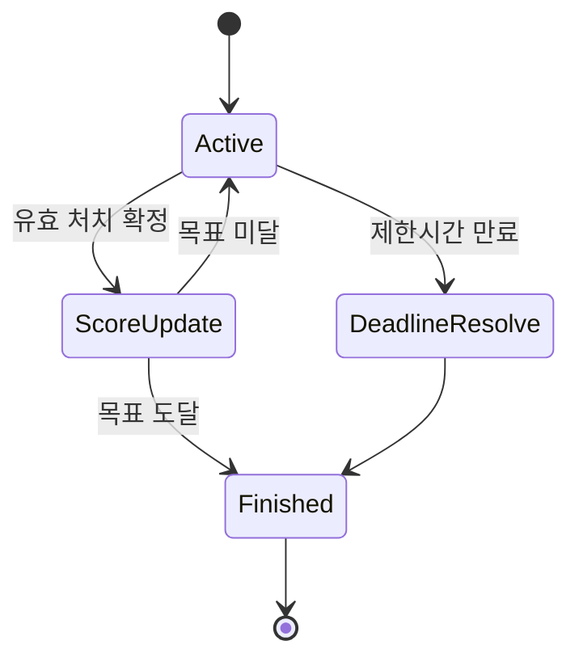

# 와이프아웃 · Wipeout — 고정 처치 점수전 역기획

> 조사 기준일: 2026-11-13 · 범위: 기본 3v3 · 상태: 공식 설명 확인, 당일 슬롯 미확인.
> **[확인]** 공개 규칙 · **[해석]** 설계 분석 · **[제안]** 재구현 명세 · **[미확인]** 실기 확인 필요.

## 1. 핵심 경험과 바운티와의 차이

**[확인]** 기본 모드는 처치로 점수를 얻고 10점에 먼저 도달하는 팀이 이긴다. [S1]

**[해석]** 고정 점수는 무엇을 하면 이기는지 빠르게 이해하게 한다. 한 번의 처치 교환은 가변 현상금이 있는 바운티와 다르게 취급해야 한다. 각 교전의 점수 단위가 일정해, 인원과 체력 우위를 얼마나 안전하게 다음 처치로 바꾸는지가 핵심이다.

5v5와 4팀 와이프아웃은 목표값·팀 수·제3팀 개입이 달라 별도 문서에서 다룬다. 여기에는 왕관 대상·다중 적 팀의 킬 경쟁을 섞지 않는다.

## 2. 시스템 분해

| 요소 | 기능 [해석] | 주의점 [제안] |
| --- | --- | --- |
| 처치 점수 | 전투 성과를 직접 승리 진척으로 환산 | 브롤러 피해량과 점수 분리 |
| 리스폰 순환 | 한 번의 실패 후 재참여 | 부활 보호·재합류 경로 필요 |
| 점수 우세 | 교전 위험을 낮출 선택권 제공 | 무한 도주가 되지 않게 종료시간 관리 |
| 지도 중앙 | 안전한 사격각과 복귀 차단 | 목표물이 없어도 공간 가치 존재 |
| 제한시간 | 교전 회피 경기의 종료 | 동점·동시 임계값 정책 명시 |

**[미확인]** 현재 기본 제한시간, 리스폰 지연, 부활 탄약과 보호막 세부, 환경 자멸의 점수 귀속은 공식 요약만으로 확정하지 않았다. 본문에서 해당 값은 설정 참조로 둔다.

## 3. 한 판의 플레이 흐름 [해석]

1. **첫 교전:** 급하게 처치를 노리기보다 적을 회복하기 어려운 곳으로 밀어낸다.
2. **수적 우세:** 한 명이 빠진 짧은 시간을 이용해 나머지 적의 퇴로를 제한한다.
3. **리스폰 대응:** 적이 복귀하기 전에 교전을 끝내거나 재장전·회복을 완료한다.
4. **리드 유지:** 점수 우세팀은 무리한 다이브 대신 상대의 진입을 받아칠 수 있다.
5. **마지막 점수:** 한 번의 사망으로 패배할 수 있으므로 각 팀의 허용 위험이 급격히 줄어든다.

한 명씩 부활하여 전장에 들어가는 연속 고립은 원래의 작은 열세를 크게 만든다. 팀이 재합류할 때까지 잠시 전선을 포기하는 행동이 장기 점수 효율을 높일 수 있다.

## 4. 상태전이 [제안]



점수 계산을 전투 시스템의 피해 콜백에 직접 누적하면 한 번의 사망이 여러 번 집계될 수 있다. 체력이 0 아래가 된 모든 프레임이 아니라 권위 `DefeatResolved` 이벤트만 점수의 입력으로 사용한다.

## 5. 처치 귀속 규칙 [제안]

| 사례 | 결정할 정책 |
| --- | --- |
| 여러 적이 함께 공격 | 마지막 유효 피해·기여자 기록을 분리 |
| 지속 피해로 사망 | 효과의 원 소유자 귀속 |
| 소환물에 사망 | 소환자와 팀 ID 연결 |
| 넉백 후 환경 피해 | 시간 창과 환경 사망 귀속 정의 |
| 스스로 사망 또는 접속 종료 | 적 점수 제공 여부를 별도 정책화 |
| 경기 종료 이후 사망 연출 | 시각 효과와 점수 집계를 분리 |

어시스트는 기여 기록으로 쓸 수 있지만 단일 처치가 여러 팀 점수로 복제되어서는 안 된다. 상대가 하나인 기본 3v3에서도 제3자의 기여와 최종 킬 귀속은 일관되어야 다중 팀 변형으로 확장할 수 있다.

## 6. 맵과 역할 [해석]

점수가 목표물 위치와 연결되지 않으므로 맵의 중앙 유인은 안전한 사격각과 상대의 복귀 차단에서 나온다. 외곽 공간이 지나치게 안전하면 우세팀이 교전을 피하는 시간이 길어질 수 있다. 반대로 스폰 출구가 좁으면 한 번 밀린 팀이 계속 불리한 재진입을 반복한다.

| 기능 | 실질 기여 | 잘못된 지표 해석 |
| --- | --- | --- |
| 장거리 압박 | 적의 회복·진입 시간 지연 | 피해량이 많아도 처치로 연결되지 않을 수 있음 |
| 마무리 | 약한 적을 제거해 점수 확보 | 마지막 공격만으로 모든 기여를 설명할 수 없음 |
| 보호 | 아군 사망 방지 | 낮은 처치 수를 무기여로 오해 |
| 시야·측면 | 적의 안전한 사격 위치 제거 | 직접 피해로 기록되지 않을 수 있음 |

단일 조합의 화력보다 서로의 사격을 보완할 각도가 중요하다. 세 명이 한 통로에 겹치면 같은 엄폐물에 동시에 막히고 범위 피해를 함께 맞는다.

## 7. 역전과 눈덩이 [해석]

개인 현상금 같은 명시적 역전 보상은 기본 규칙에 없다. 따라서 역전은 적의 무리한 추격, 리스폰 재합류, 특수 공격 자원 우세, 지도 변화로 만들어진다. 앞선 팀이 안전한 플레이만 선택해도 유지 가능한지 맵 단위로 확인해야 한다.

처치 점수의 단순함은 초보자가 실패 이유를 이해하기 쉽게 하지만, 목표 수행으로 기여할 대안이 적다. 초보와 숙련자가 같은 큐에 섞이면 개인 사망이 팀 패배로 바로 연결되는 부담이 커질 수 있다. 이는 브롤러 밸런스와 별도로 매칭 품질·재합류 안내를 평가할 이유다.

## 8. UI·오디오 요구 [제안]

- 목표 점수와 현재 점수를 한눈에 비교한다.
- 마지막 한 점 구간은 특별히 알리되 시야를 덮지 않는다.
- 사망 화면에 리스폰까지 남은 시간과 생존 아군 수를 표시한다.
- 적의 부활 보호 여부는 공격 실패를 이해할 수 있게 시각적으로 명확해야 한다.
- 결과 화면은 처치·사망·보조 기여를 구분하고 팀 총점과 킬 피드 합이 일치하도록 한다.
- 미니맵이 없는 환경이라면 아군 재합류 방향을 기존 화면 정보로 추론할 수 있어야 한다.

## 9. 데이터·판정 [제안]

| 필드 | 목적 |
| --- | --- |
| `targetScore` | 승리 목표 |
| `duration` | 경기 종료 시점 |
| `scoreByTeam` | 권위 점수 |
| `scoredDefeatIds` | 중복 집계 방지 |
| `respawnPolicyId` | 복귀 지연·보호·자원 상태 |
| `killCreditPolicyId` | 처치 귀속 |
| `simultaneousThresholdPolicy` | 양팀 동시 목표 도달 |

```text
onDefeatResolved(defeat):
    if defeat.id already scored: return
    markScored(defeat.id)
    team = resolveEligibleScoringTeam(defeat)
    if team exists: score[team] += configuredKillValue

afterCombatBatch():
    resolveTargetScoreOrDeadlineOnce()
```

모든 처치의 점수가 같더라도 `configuredKillValue`를 명시적으로 둔다. 이벤트 변형을 도입할 때 기본 모드의 가정이 전투 코드에 숨어 있지 않아야 한다.

## 10. QA 시나리오 [제안]

| 상황 | 기대 결과 또는 확인 포인트 |
| --- | --- |
| 단일 적 사망 | 한 번의 점수 지급 |
| 사망 이벤트 중복 수신 | 점수 불변 |
| 양팀 마지막 점수 동시 획득 | 사전에 정한 동시 임계 정책 |
| 지속 피해와 즉시 공격이 겹침 | 한 개의 킬 귀속과 어시스트 기록 |
| 환경 자멸 | 원작 확인 뒤 정책 적용 |
| 보호막 상태의 부활자 공격 | 피해·보호 해제 정책 일치 |
| 점수 확정 직후 연결 끊김 | 점수 소실·추가 사망 방지 |
| 같은 팀 연속 리스폰 | 겹침과 스폰 차단 검사 |
| 제한시간 동점 | 무승부·연장 여부를 실기 확인 |
| 리플레이 결과 | 점수 합계와 원 경기 일치 |

## 11. 계측과 튜닝 [제안]

첫 처치팀 승률, 점수차별 역전율, 사망 후 재합류 시간, 수적 열세에서 시작한 교전 비율, 스폰 근처 사망 비중, 전체 경기 중 교전이 없는 시간, 마지막 점수 구간의 평균 지속시간을 본다.

스폰 근처 반복 사망이 높으면 공격력만 낮추는 대신 출구 수·안전 엄폐·아군 합류 경로를 조정해 본다. 지나친 도주 경기라면 제한시간과 외곽 지형을 분리해서 실험한다.

## 12. 출처와 연결

- [S1 · Supercell Game Modes](https://sc-brawlstars.zendesk.com/hc/en-us/articles/49526599632923-Game-Modes): 기본 3v3의 목표 점수. 수집일 2026-11-13.
- 관련 문서: [바운티](04_bounty.md), [녹아웃](06_knockout.md), [전체 목차](../README.md).

내부 이벤트명·매칭 정책·동시 사건 처리와 제안 지표는 원작 구현에 대한 확인 사실이 아니다.
