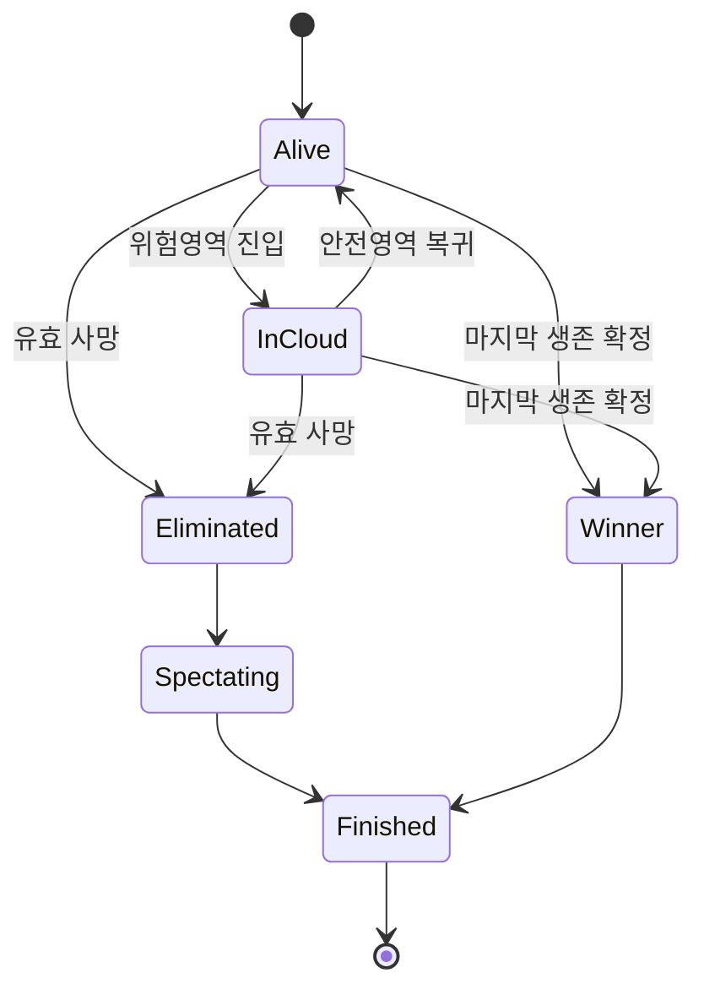

# 솔로 쇼다운 · Solo Showdown — 축소 공간 개인 생존전 역기획

> 조사 기준일: 2026-11-13 · 범위: 일반 개인 쇼다운 · Loaded·Mega·콜라보 변형은 별도 문서.
> **[확인]** 공개 규칙 · **[해석]** 설계 분석 · **[제안]** 재구현 명세 · **[미확인]** 현행 실기 확인 필요.

## 1. 핵심 경험

**[확인]** 개인 또는 팀으로 마지막까지 생존하는 쇼다운 계열이 공식 모드로 안내되어 있다. [S1]

**[해석]** 솔로는 교전에서 이기는 능력과 교전을 피하는 판단이 함께 성과를 만든다. 여러 적이 서로 싸우므로 내가 행동하지 않아도 전황이 변한다. 3v3의 일정한 전선 대신 가까운 적·먼 적·회복 중인 적의 관계를 계속 읽어야 한다.

이 문서는 일반적으로 알려진 10인 개인전을 **분석 예시 정원**으로 사용하되, 현행 이벤트별 실제 참가 인원은 `playerCount` 설정에서 확인하도록 한다. 인원 수를 임의의 모든 쇼다운 변형에 적용하지 않는다.

## 2. 규칙 층과 확인 범위

| 층 | 분석 내용 |
| --- | --- |
| 생존 | 각 플레이어의 탈락 여부와 최종 순위 |
| 성장 | 파워 큐브 등 경기 내 자산이 교전 능력에 주는 영향 |
| 공간 | 독구름으로 줄어드는 이동·회복 가능 영역 |
| 정보 | 부시·엄폐·화면 밖 적의 불확실성 |
| 보상 | 순위와 계정 트로피·이벤트 보상의 연결 |

**[확인·역사]** 쇼다운 독 피해의 적용 시점은 2021년 개편에서 플레이어별 진입 시점을 기준으로 변경되었다. [S2]

**[미확인]** 현행 큐브 한 개의 체력·피해 보정값, 상자 분포·체력, 독구름의 정확한 단계와 피해량, 동시 탈락의 순위 정책은 실기 검증 대상이다. 과거 공지의 적용 시점 설명을 현재 피해 수치로 확대하지 않는다.

## 3. 한 판의 단계 [해석]

1. **초기 주변 평가:** 가까운 상자·안전한 부시·이웃의 사거리와 진입 속도를 본다.
2. **성장 또는 이동:** 상자를 공격하는 탄약과 시간을 소비할 가치가 있는지 판단한다. 상자를 깬 뒤 마지막 픽업을 빼앗길 위험도 있다.
3. **주변 경쟁:** 한 적과 싸우면 다른 적에게 체력·탄약 상태를 노출한다. 교전 후 회복할 공간까지 고려한다.
4. **안전지대 재배치:** 구름이 닿기 전에 중심부 또는 연결된 안전 경로로 이동한다.
5. **소수 생존:** 적의 수가 줄면 제3자 개입 위험은 낮아지지만 남은 상대의 자원이 커질 수 있다.
6. **최종 대결:** 성장 차·지형·남은 능력과 좁은 공간의 적합성이 함께 결과를 결정한다.

처치를 하지 않고 오래 생존하는 선택도 모드 목표에 부합한다. 반대로 과도한 회피가 게임 전체를 정체시키는지는 독구름과 보상 설계로 별도 평가한다.

## 4. 개인 상태전이 [제안]



소환물이나 일시 변신 객체를 별도 참가자로 계산하면 생존자 수가 틀릴 수 있다. 결과의 기준은 참가자 ID이며 캐릭터 엔티티 교체와 분리한다.

## 5. 성장과 제3자 개입 [해석]

파워 큐브는 교전의 승자가 이후 싸움에서도 우세해질 가능성을 만든다. 그러나 강한 플레이어가 체력을 잃고 전투를 끝낸 직후에는 다른 참가자의 공격을 받을 수 있다. 성장에 의한 눈덩이와 다자전의 집중 견제가 동시에 작동한다.

`교전 기대가치 ≈ 획득 자산 + 순위 개선 가능성 - 사망 위험 - 소모 자원 - 제3자 개입 비용`

이 개념식은 최적 전략을 계산하는 원작 공식이 아니다. 리플레이를 분류할 때 단순한 명중률 외에 어떤 위험을 선택했는지 기록하는 틀이다.

| 선택 | 얻는 것 | 위험 |
| --- | --- | --- |
| 중앙 조기 진입 | 많은 접촉 기회·후반 공간 | 여러 방향에서 집중 공격 |
| 외곽 성장 | 초기 안정성 | 구름에 밀릴 때 진입 경로 제한 |
| 상자 경쟁 | 경기 내 능력 향상 | 탄약 소비와 위치 노출 |
| 약한 적 추격 | 탈락 유도·자산 획득 | 제3자에게 측면 노출 |
| 싸움 관찰 | 적의 자원 소모 뒤 진입 | 기회를 놓치거나 공간을 빼앗김 |

## 6. 맵·스폰 공정성 [해석]

각 시작점의 상자 수만 같다고 공정하지 않다. 첫 엄폐까지의 거리, 이웃 두 명의 공격을 동시에 받을 수 있는지, 안전지대로 이동할 경로, 부시 연결 여부를 함께 봐야 한다.

중앙의 파워 큐브를 많이 두면 강한 초기 경합을 만들 수 있지만 중앙 확보자가 그대로 우승하는지 확인해야 한다. 외곽도 성장 가능하지만 결국 충돌하도록 하는 시간 압박이 필요하다.

부시가 넓게 연결된 지도와 열린 지도는 요구 정보가 다르다. 무작위 공격으로 부시를 확인하는 행동은 탄약과 시간을 쓰는 정보 획득이다. 단순 공격 명중률로 평가하면 탐색 행동이 비효율로 오인될 수 있다.

## 7. 비공식 협력과 경쟁 무결성 [해석]

공식 도움말은 솔로에서 회전 동작으로 협력 의사를 표시할 수 있고 배신도 가능하다고 설명한다. [S1] 이를 자동 팀 구성 기능이나 영구 동맹 규칙으로 오해하지 않는다.

설계상 다자전에서는 임시 비공격이 발생할 수 있다. 인접한 모든 적과 동시에 싸우는 선택이 항상 합리적이지 않기 때문이다. 이를 분석할 때 순간적인 상호 회피와 조직적 악용을 같은 이벤트로 분류하지 않는다. 신고·제재 기준은 실제 운영 정책과 별도 문서로 관리한다.

## 8. UI·관전·보상 [제안]

- 남은 참가자 수를 명확히 표시한다.
- 큐브 수는 상대 위험을 읽을 수 있을 정도로 표현한다.
- 구름의 실제 피해 경계와 시각 경계를 일치시킨다.
- 탈락 시 순위를 확정할 수 있는 근거와 관전 선택을 제공한다.
- 원거리 관전 정보가 살아 있는 제3자에게 전달되지 않도록 지연·친구 관전 정책을 검토한다.
- 보상은 권위 순위와 현재 큐 설정으로 계산한다. 과거 트로피 표를 고정하지 않는다.

## 9. 데이터·판정 [제안]

| 필드 | 용도 |
| --- | --- |
| `participantIds`, `aliveParticipants` | 생존 집계 |
| `spawnSeed`, `resourceLayoutId` | 배치 재현 |
| `cubeEffectProfile` | 성장 효과 |
| `cloudSchedule`, `cloudExposureByPlayer` | 구름 진행과 개인 노출 |
| `eliminationBatchId` | 동시 탈락 처리 |
| `placementPolicy` | 최종 순위 |
| `rewardQueueConfig` | 보상 연결 |

```text
afterCombatStep():
    eliminated = resolveNewEliminations()
    assignPlacementsForBatch(eliminated, placementPolicy)
    removeParticipantsFromAliveSet(eliminated)
    if exactlyOneAlive:
        commitWinnerAndPlacementsOnce()
    else if noneAlive:
        resolveFinalSimultaneousElimination(policy)
```

최종 두 명이 같은 스텝에 사망할 수 있으므로 `exactlyOneAlive`만 구현하면 종료되지 않는 결함이 생긴다. 원작 동시 순위 정책은 별도 실기 확인 후 넣는다.

## 10. QA 시나리오 [제안]

| 상황 | 기대 결과 또는 확인 포인트 |
| --- | --- |
| 두 사람이 상자 드롭에 동시 접근 | 큐브 중복 획득 없음 |
| 큐브 효과 중 변신 | 체력·피해 보정이 중복 적용되지 않음 |
| 구름 진입·이탈 반복 | 노출 시간·피해 정책 일관 |
| 마지막 둘 동시 사망 | 결정된 순위 정책으로 종료 |
| 여러 명 한 범위 공격에 탈락 | 순위가 처리 반복 순서에 흔들리지 않음 |
| 소환물만 생존 | 참가자가 살아 있는 것으로 잘못 계산하지 않음 |
| 순간 이동으로 구름 경계 통과 | 위치와 노출 갱신 일치 |
| 탈락 직전 접속 종료 | 큐별 보상·탈락 정책 확인 |
| 초기 상자가 접근 불가능 영역 | 배치 검증 실패로 검출 |
| 리플레이 | 배치·구름·최종 순위 재현 |

## 11. 계측과 검증 [제안]

시작 위치별 순위 분포, 첫 큐브 확보와 최종 순위의 관계, 경기 단계별 사망 원인, 제3자 개입 후 탈락 비율, 독구름 피해 비중, 최종 생존자의 큐브 격차를 본다.

실기 검증은 큐브 효과·드롭·독 노출·동시 탈락 순서로 진행한다. 맵 검증은 시작점별 최단 안전 경로와 초기 이웃 교차 사격을 비교한다.

## 12. 출처와 연결

- [S1 · Supercell Game Modes](https://sc-brawlstars.zendesk.com/hc/en-us/articles/49526599632923-Game-Modes): 생존 목표와 솔로의 비공식 협력 설명. 수집일 2026-11-13.
- [S2 · Jurassic Splash, 2021](https://supercell.com/en/games/brawlstars/blog/release-notes/jurassicsplash-release-and-maintenance-notes/): 독 피해 적용 시점 개편 이력.
- 관련 문서: [듀오 쇼다운](09_duo_showdown.md), [트리오 쇼다운](10_trio_showdown.md), [녹아웃](06_knockout.md), [전체 목차](../README.md).

분석 예시 정원, 이벤트 구조, 수식과 QA 정책은 현재 모든 변형의 실측 명세를 의미하지 않는다.
