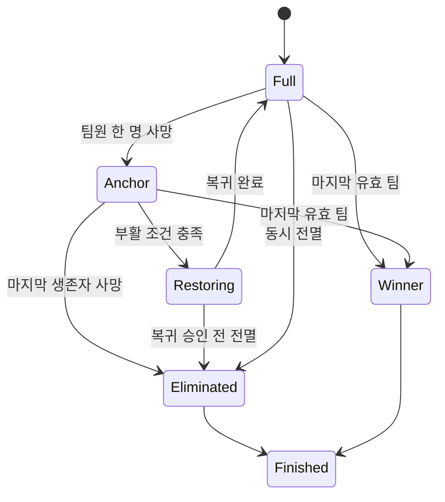

# 듀오 쇼다운 · Duo Showdown — 생존 앵커와 재결합 역기획

> 조사 기준일: 2026-11-13 · 범위: 일반 2인 팀 쇼다운 · Mega Duo 등은 별도 설정.
> **[확인]** 공개 규칙 · **[해석]** 설계 분석 · **[제안]** 구현 명세 · **[미확인]** 현행 실기 확인 필요.

## 1. 핵심 경험과 규칙 근거

**[확인]** 공식 트리오 소개는 듀오와 마찬가지로 아군이 살아 있으면 사망자가 부활한다고 설명한다. [S1]

**[해석]** 듀오는 개인의 생존을 팀의 복구 가능성과 연결한다. 한 명이 쓰러져도 남은 한 명이 살아 있으면 다시 전투력을 회복할 수 있다. 마지막 생존자는 이기는 공격보다 팀이 탈락하지 않을 위치를 선택하게 된다.

일반적인 5팀×2명 상황을 **분석 예시**로 사용한다. 실제 큐 정원·이벤트 변형의 팀 수는 설정에서 확인한다. 팀원 수가 2라는 구조와 전체 참가 팀 수를 코드에서 혼동하지 않는다.

## 2. 팀 생존을 구성하는 상태

| 팀 상태 [제안] | 생존 인원 | 경기에서의 의미 [해석] |
| --- | --- | --- |
| Full | 2명 | 협공·탐색·자산 회수 가능 |
| Anchor | 1명, 복귀 대기자 존재 | 생존이 팀 복구의 전제 |
| Restoring | 복귀가 처리되는 구간 | 보호막·위치·자원 정합성 중요 |
| Eliminated | 0명, 복귀 자격 없음 | 팀 순위 확정 |

팀원이 사망한 순간과 팀이 탈락한 순간은 다르다. 순위는 캐릭터별 사망 순서가 아니라 팀 탈락 순서로 계산해야 한다.

**[미확인]** 부활 초수, 복귀 지점 선정, 보호막 지속·해제 조건, 큐브의 팀 공유 방식과 사망 후 유지량은 최신 실행 빌드 확인이 필요하다. 오래된 듀오 부활 조정 공지를 현재 절대값으로 사용하지 않는다.

## 3. 플레이 흐름 [해석]

1. **초기 역할 분담:** 서로 다른 상자를 처리하면 성장 효율을 높일 수 있지만 적 팀의 집중 공격에 한 명이 고립될 수 있다.
2. **합류 교전:** 두 명의 공격을 겹쳐 적을 빠르게 제거하거나 다른 방향에서 퇴로를 차단한다.
3. **첫 팀원 사망:** 남은 한 명은 공격을 계속할지 부활까지 생존할지 즉시 목표를 바꾼다.
4. **부활 기다리기:** 구름과 적의 위치를 고려해 복귀할 공간을 확보한다. 숨을 곳이 곧 복귀하기 좋은 곳은 아닐 수 있다.
5. **재결합:** 새로 복귀한 팀원의 자원 상태와 보호 상태를 보고 재교전을 결정한다.
6. **마지막 팀 간 전투:** 적의 마지막 생존자를 끝내는 공격과 아군 앵커를 보존하는 수비의 우선순위가 충돌한다.

## 4. 팀 상태전이 [제안]



`Restoring` 경계의 정책이 중요하다. 타이머가 화면에서 0이 된 시각과 권위 캐릭터가 생성된 시각이 달라도 판정은 하나여야 한다. 생존자 사망과 복귀 완료의 동시 사건을 반드시 재현 가능한 순서로 처리한다.

## 5. 솔로와 다른 위험 계산 [해석]

솔로에서는 사망이 개인 경기의 끝이지만 듀오에서는 아군이 복구 가능성을 남길 수 있다. 따라서 공격 담당이 위험을 감수하는 동안 생존력이 좋은 팀원이 한발 물러나 있는 전략이 성립한다.

그러나 아군을 부활용 보험으로만 두면 실제 교전은 반복적으로 1 대 2가 된다. 두 명의 전투력이 겹치는 시간과 마지막 생존자의 안전성을 균형 있게 유지해야 한다. **함께 싸울 때는 가까워야 하고, 함께 죽지 않으려면 분산되어야 한다**는 공간적 긴장이 생긴다.

| 상황 | 합리적인 판단 기준 |
| --- | --- |
| 적 한 명 처치 | 남은 적을 끝내는 데 필요한 시간과 제3팀 위험 |
| 아군 한 명 사망 | 부활까지 버틸 공간과 현재 처치 가능성 |
| 큐브 드롭이 적 사선 안에 있음 | 성장 이득과 팀 전멸 확률 비교 |
| 구름이 가까움 | 복귀 전 안전 지대로 들어갈지 현재 엄폐를 지킬지 |
| 여러 적 팀이 싸우는 중 | 마지막 생존자 제거 기회와 노출 위험 |

## 6. 큐브 공유·부활 자원 [제안]

팀 성장 규칙은 재구현의 중요한 검증 항목이다. 다음을 별도 표로 수집해야 한다.

| 질문 | 필요한 검증 |
| --- | --- |
| 한 명의 큐브 획득이 아군에게도 적용되는가 | 두 HUD와 실제 피해·체력 동시 기록 |
| 사망한 팀원에게 획득 효과가 적용되는가 | 대기 중 획득 후 복귀 상태 비교 |
| 사망 시 몇 개를 드롭하는가 | 사망 직전 보유량별 반복 |
| 부활 시 큐브·특수 자원이 얼마나 남는가 | 복귀 전후 스냅샷 비교 |
| 보호막이 독구름·공격·이동기로 해제되는가 | 조건별 분리 실험 |

문서에서 임의로 공유 정책을 결정한 뒤 원작 규칙으로 표시하지 않는다. 프로토타입에는 `teamCubePolicy`와 `respawnResourcePolicy`를 분리해 구현하면 확인 결과를 반영하기 쉽다.

## 7. 맵·조합·의사소통 [해석]

듀오는 서로 다른 사거리·진입 방식의 두 캐릭터를 조합할 수 있다. 한 명이 적을 밀어내고 다른 한 명이 회수하거나, 한 명이 견제하고 다른 한 명이 근접 위협을 차단하는 식이다. 단일 브롤러의 생존력만으로 팀 안정성을 설명할 수 없다.

부시·벽 뒤의 합류 경로는 중요하지만 지나치게 멀리 분리되면 적 팀 하나가 순차적으로 각개격파할 수 있다. 지도 검증에는 두 사람이 서로를 도울 때의 이동거리와 공격 지원 가능 각도를 포함한다.

간단한 핑도 큰 가치를 갖는다. 부활까지 버티자는 의도, 이동할 안전 위치, 위험한 적의 마지막 생존자를 빠르게 전달해야 한다. 텍스트 채팅만으로 해결하기에는 전투 주기가 짧다.

## 8. UI·관전 요구 [제안]

- 팀원 생존 여부와 부활 카운트다운을 상시 확인 가능하게 한다.
- 사망자는 살아 있는 아군의 체력·위치·위험을 읽을 수 있는 관전 화면을 갖는다.
- 부활 위치·시점이 사망자에게 잘못 예고되지 않도록 권위 데이터를 사용한다.
- 전멸 순간 팀 순위가 확정되었음을 명확히 알린다.
- 같은 팀의 색·윤곽·큐브 표시는 다중 팀 환경에서도 구분되어야 한다.
- 보호막을 공격 기회로 쓸 수 있는지 규칙을 시각적으로 일관되게 표현한다.

## 9. 데이터·판정 [제안]

| 필드 | 목적 |
| --- | --- |
| `teamRoster`, `aliveMembers` | 팀 생존 판정 |
| `respawnDeadlineByPlayer` | 복귀 예약 |
| `respawnAnchorPolicy` | 복귀 위치 선택 |
| `respawnResourcePolicy` | 자산·충전 상태 |
| `teamEliminationId` | 팀 순위 중복 확정 방지 |
| `teamPlacementPolicy` | 동시 전멸 순위 |

```text
resolveTeamStep(team):
    resolveNewDeaths(team)
    updateEligibleRespawnReservations(team)
    resolveRespawnAndLastSurvivorRace(policy)
    if noAliveMembersAndNoValidImmediateReturn(team):
        eliminateTeamOnce(team)
    else:
        keepTeamInPlacementCompetition(team)
```

일반적인 부활 예약이 있다는 이유만으로 이미 전멸한 팀을 계속 살아 있다고 계산하면 무한 대기 결함이 생긴다. 살아 있는 아군이 필요한 예약과 능력 자체의 즉시 복귀를 구분해야 한다.

## 10. QA 시나리오 [제안]

| 상황 | 기대 결과 또는 확인 포인트 |
| --- | --- |
| 한 명 사망·한 명 생존 | 팀 탈락 아님, 부활 조건 평가 |
| 마지막 생존자 사망 | 남은 일반 부활 예약 취소 정책 |
| 타이머 만료와 앵커 사망 동시 | 정의한 순서로 일관 판정 |
| 두 명 동시 사망 | 팀 순위 한 번 확정 |
| 부활 예정 위치가 독구름·벽 안 | 위치 선택·보호 정책 검증 |
| 죽은 팀원 대기 중 큐브 획득 | 공유 정책 일치 |
| 재접속 중 부활 | 중복 캐릭터 생성 없음 |
| 적 팀이 여러 곳에서 동시 전멸 | 순위 처리 정책 재현 |
| 전체 팀 중 한 팀만 유효 | 사망 대기자 존재와 무관하게 승리 조건 검사 |
| 관전 | 제거된 팀이 새 생명으로 오인되지 않음 |

## 11. 계측과 설계 질문 [제안]

팀당 부활 횟수, 앵커 상태 생존시간, 부활 직후 사망률, 팀원 간 평균 거리, 첫 사망 후 팀 탈락률, 큐브 격차별 승률, 전멸을 끝내는 추격 성공률을 본다.

부활이 지나치게 쉬우면 교전의 결말이 지연되고, 너무 어려우면 솔로 두 개가 묶인 것처럼 느껴질 수 있다. 복귀 시간만 바꾸기보다 복귀 위치·구름·지도 엄폐를 함께 분석한다.

## 12. 출처와 연결

- [S1 · SpongeBob SquarePants Patch Notes, 2024](https://supercell.com/en/games/brawlstars/blog/game-updates/patch-notes-spongebob-squarepants/): 듀오와 트리오의 생존 아군 기반 부활 관계.
- 관련 문서: [솔로 쇼다운](08_solo_showdown.md), [트리오 쇼다운](10_trio_showdown.md), [전체 목차](../README.md).

팀 상태기계와 복귀 정책은 재구현용 분석이다. 실제 초수·공유량·우선순위는 테스트 전 확정하지 않는다.
