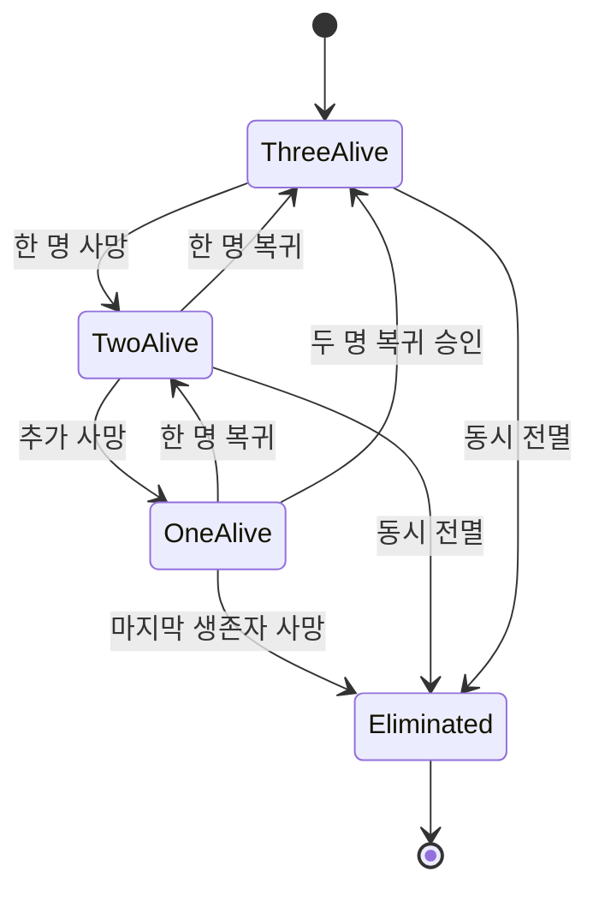

# 트리오 쇼다운 · Trio Showdown — 3인 다중 팀 생존전 역기획

> 조사 기준일: 2026-11-13 · 범위: 팀당 3인의 쇼다운 · 4팀 젬 그랩·와이프아웃과 구분.
> **[확인]** 공개 규칙 · **[해석]** 설계 분석 · **[제안]** 구현 명세 · **[미확인]** 현행 실기 확인 필요.

## 1. 핵심 경험과 확인 범위

**[확인]** 2024년 공식 소개는 팀당 3인, 큐브 성장, 좁아지는 독구름, 아군 생존에 따른 부활을 설명한다. [S1]

**[해석]** 듀오보다 한 명이 늘어나면서 정면 교전·측면 압박·생존 앵커를 동시에 배치할 수 있다. 같은 팀이 세 명이라는 점은 일반 3v3와 같지만, 여러 적 팀과 순위 경쟁을 한다는 점에서 판단이 달라진다.

일반적인 4팀×3명 상황을 **분석 예시**로 사용한다. 실제 큐 정원은 이벤트 설정에서 확인한다. `Trio Gem Grab`, `Trio Wipeout`의 이름만 보고 쇼다운의 부활·구름 규칙을 적용해서는 안 된다.

## 2. 인원 증가로 달라지는 구조

| 항목 | 듀오에서의 판단 | 트리오에서 새로 생기는 판단 [해석] |
| --- | --- | --- |
| 첫 사망 | 한 명이 앵커 역할 | 두 생존자가 싸우거나 함께 후퇴 가능 |
| 자원 탐색 | 두 경로로 분산 | 세 경로 분산과 합류 비용 관리 |
| 교전 전선 | 두 공격각 | 정면·측면·엄호 분업 |
| 팀 전멸 | 두 명 연속 제거 | 세 번째 생존자를 찾아야 결말 확정 |
| 복귀 | 한 사람의 부활 | 두 명의 타이머가 겹칠 수 있음 |
| 의사소통 | 상대적으로 단순 | 누가 후퇴하고 누가 엄호할지 명시 필요 |

인원이 늘면 전멸이 어려워져 경기의 회복 탄력성이 커질 수 있다. 동시에 복귀한 여러 명이 보호 상태로 재진입하면 교전 결과가 크게 바뀔 수 있으므로 부활 보호와 구름의 상호작용이 중요해진다.

## 3. 공개 개편과 검증 경계

**[확인·역사]** 2024년 9월 유지보수는 트리오의 독구름 안에서 보호막을 제거하도록 수정했다. [S1]

이는 부활 보호를 이용한 안전지대 밖 생존이 설계·버그 관리의 핵심 사례임을 보여 준다. 다만 현재 보호막의 모든 해제 행동, 쿨다운, 재발동 방식이 당시와 동일하다고 가정하지 않는다.

**[미확인]** 부활 시간, 여러 명의 복귀 위치 선정, 큐브 공유·사망 후 유지량, 살아 있는 두 명 중 누구를 기준으로 복귀하는지, 동시 전멸 순위 처리 등은 현행 실기 검증 대상이다.

## 4. 플레이 흐름 [해석]

1. **초기 분업:** 성장 담당과 주변 적 감시를 나눈다. 세 명이 한 상자를 때리는 선택은 안전하지만 분산 성장 기회를 줄인다.
2. **첫 팀 충돌:** 두 명이 적의 주의를 끄는 동안 한 명이 측면을 잡을 수 있다. 그러나 다른 팀이 그 측면을 공격할 수 있다.
3. **부분 손실:** 한 명이 죽어도 즉시 완전 후퇴할 필요는 없지만, 두 명이 모두 공격에 몰입하면 부활 기반을 잃을 수 있다.
4. **앵커 단계:** 마지막 생존자는 복귀까지 생존할 경로를 선택한다. 구름 밖에서 버티는 예외를 당연한 해법으로 가정하지 않는다.
5. **재집결:** 복귀자가 같은 지점에 모이면 공격을 재개하기 쉽지만 범위 공격에 취약하다.
6. **팀 수 감소:** 남은 적 팀 수가 줄수록 혼전보다 정규 팀전과 비슷해진다. 마지막 교전에서도 상대의 세 번째 생존자를 확인해야 한다.

## 5. 팀 상태전이 [제안]



위 상태는 생존 인원의 요약이다. 실제 구현은 참가자별 사망·예약·생성 상태를 저장하고 집계한다. 요약 상태만 저장하면 두 복귀자의 서로 다른 타이머를 표현할 수 없다.

## 6. 팀 역할과 지도 [해석]

트리오는 고정된 세 라인보다 상황에 맞는 삼각형 간격이 중요하다. 서로 지원할 수 있을 만큼 가까우면서 한 번의 범위 공격에 모두 맞지 않을 만큼 떨어져야 한다.

| 역할 | 주요 목표 | 실패 패턴 |
| --- | --- | --- |
| 전면 압박 | 적의 시선을 끌고 이동을 제한 | 아군 지원 가능 거리 밖으로 진입 |
| 측면·마무리 | 적의 퇴로·회복 공간 공격 | 제3팀의 사격선에 노출 |
| 생존·지원 | 팀 회복 가능성 유지 | 지나치게 멀리 떨어져 실질 화력 감소 |

세 역할은 브롤러 직업과 일대일 대응하지 않는다. 상대 위치·체력·부활 상태에 따라 같은 플레이어가 역할을 바꾼다.

맵의 좁은 통로는 트리오 전체의 이동을 병목으로 만들 수 있다. 부활자가 합류하는 지점에서 세 명이 겹치는지, 두 적 팀 사이에 끼었을 때 빠져나갈 수 있는 경로가 있는지 검사해야 한다.

## 7. 다중 팀 교전과 역전 [해석]

한 적 팀을 끝내는 동안 다른 팀에 등을 보이는 위험이 있다. 따라서 승리 조건을 위해서는 처치 수보다 **팀 제거 시점**이 중요하다. 한 명을 잡았더라도 남은 상대가 안전하게 부활을 기다리면 목표 진척은 일시적일 수 있다.

큐브 성장은 전투력 눈덩이를 만들지만 큰 팀이 여러 방향에서 공격받을 수 있다. 앞선 팀이 어디에 위치해도 안전하다면 지도·부활·성장 효과의 결합이 지나치게 강한지 살펴본다.

순위를 올리기 위해 다른 팀끼리 싸우는 것을 기다리는 선택도 성립한다. 이를 단순 비참여로 평가하면 모드의 생존 목표와 충돌한다. 활동성 지표는 이동·정보 획득·안전지대 확보까지 포함해야 한다.

## 8. UI·관전·의사소통 [제안]

- 세 팀원의 체력·생존·복귀 시간을 구분해 표시한다.
- `남은 플레이어 수`와 `남은 팀 수`를 혼동하지 않게 한다.
- 마지막 생존자에게 부활 임박을 알리되 전장을 가리지 않는다.
- 두 명이 동시에 부활할 때 서로 다른 참가자 ID와 자원 상태를 유지한다.
- 팀 색상만으로 구분하기 어려운 상황을 고려해 윤곽·이름표를 보조한다.
- 핑은 집중 공격 대상, 후퇴 방향, 재집결 지점을 전달할 수 있어야 한다.

## 9. 데이터·판정 [제안]

| 필드 | 목적 |
| --- | --- |
| `teamSize`, `teamCount` | 편성과 전체 경쟁 규모 분리 |
| `memberStates[]` | 세 참가자의 생명주기 |
| `respawnReservations[]` | 개별 복귀 예약 |
| `spawnAnchorSelectionPolicy` | 복귀 기준 생존자·안전 위치 |
| `cloudProtectionPolicy` | 구름과 보호막 상호작용 |
| `sharedGrowthPolicy` | 팀 성장 효과 |
| `placementByTeam` | 팀 순위 |

```text
for each team after resolved combat:
    cancelInvalidRespawnReservations()
    chooseRespawnAnchorsForDueMembers(policy)
    resolveConcurrentReturnsAndDeaths(policy)
    aliveCount = countActiveEligibleMembers(team)
    if aliveCount == 0 and noAllowedImmediateReturn:
        commitTeamEliminationOnce(team)
resolveRemainingTeamsAndWinner()
```

복귀 위치가 서로 겹치거나 적에게 겹치는 경우의 해결 정책은 캐릭터 충돌 정책과 함께 설계한다. 원작의 위치 탐색 알고리즘은 공개되지 않았다.

## 10. QA 시나리오 [제안]

| 상황 | 기대 결과 또는 확인 포인트 |
| --- | --- |
| 두 명 사망·한 명 생존 | 두 복귀 예약 독립 유지 |
| 두 복귀 시각이 같음 | 중복 생성 없이 두 참가자 복귀 |
| 복귀 순간 앵커 사망 | 정해진 우선순위로 팀 전멸 여부 결정 |
| 구름 안에서 부활 | 보호막·피해 정책 검증 |
| 복귀 기준 아군이 순간 이동 | 유효 위치 기준으로 생성 |
| 첫 복귀자가 두 번째의 앵커가 됨 | 승인 상태와 실제 생존 상태 혼동 없음 |
| 전체 팀 동시 범위 피해 사망 | 순위 한 번 확정 |
| 잘못된 팀 ID로 스폰 | 팀 귀속 검증에서 차단 |
| 대기자 큐브 공유 | 성장 정책과 복귀 스냅샷 일치 |
| 팀 전멸 후 관전 | 경기의 생존 팀 집계에서 제외 |

## 11. 계측과 검증 질문 [제안]

생존 인원 3→2→1→복귀의 전이 빈도, 앵커 상태 시간, 팀당 복귀 횟수, 두 명 동시 복귀 직후 전멸률, 제3팀 공격으로 발생한 전멸, 마지막 적 한 명의 추격시간을 본다.

복귀 반복으로 경기 길이가 늘어지면 독구름과 부활 정책의 결합을 분석한다. 정면전만 강한 조합이 계속 우세하면 우회 경로와 제3팀의 접근성을 살펴본다.

## 12. 출처와 연결

- [S1 · SpongeBob SquarePants Patch Notes, 2024](https://supercell.com/en/games/brawlstars/blog/game-updates/patch-notes-spongebob-squarepants/): 트리오 도입과 독구름 내 보호막 수정 이력.
- 관련 문서: [듀오 쇼다운](09_duo_showdown.md), [솔로 쇼다운](08_solo_showdown.md), [전체 목차](../README.md).

정원 예시·데이터 구조·부활 위치와 동시 사건 정책은 재구현 설계다. 현재 모든 이벤트의 실측 규칙으로 주장하지 않는다.
