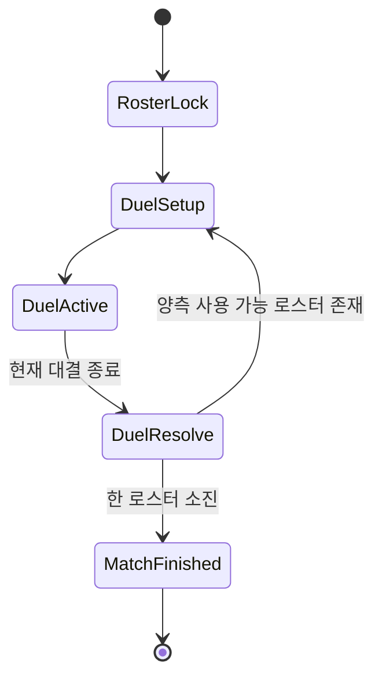

# 듀얼 · Duels — 3인 로스터 연승전 역기획

> 조사 기준일: 2026-11-13 · 범위: 1 대 1, 각자 3명의 브롤러를 준비하는 듀얼.
> **[확인]** 공개 규칙 · **[해석]** 설계 분석 · **[제안]** 구현 명세 · **[미확인]** 현행 실기 확인 필요.

## 1. 핵심 경험

**[확인]** 각자 선택한 3명을 순서대로 사용하며, 승자는 남고 패자의 브롤러가 탈락한다. 상대 로스터를 모두 제거하면 이긴다. [S1]

**[해석]** 듀얼은 팀원의 행동 변수를 없애는 대신 경기 전 로스터의 순서와 상성 설계를 강조한다. 첫 브롤러가 모든 상대를 이길 수도 있고, 특정 상대를 처리하기 위한 두 번째·세 번째 선택이 필요할 수도 있다.

이는 팀 녹아웃의 3전 2선승과 다르다. 한 사람이 여러 생명 슬롯을 가진 연속 대결이며, 양쪽이 한 번씩 승리했다고 곧 세 번째 최종 라운드가 되는 구조가 아니다.

## 2. 로스터와 대결의 두 상태

| 층 | 저장할 상태 [제안] | 핵심 구분 |
| --- | --- | --- |
| 로스터 | 선택한 브롤러 ID·순서·탈락 여부 | 캐릭터 교체 전후의 경기 생명 |
| 현재 대결 | 양쪽 활성 브롤러·체력·위치 | 지금 조작하는 대상 |
| 연속 자원 | 특수 공격·가젯·기타 보존 상태 | 무엇이 다음 대결에 이어지는지 |
| 결과 | 제거된 로스터 수·최종 승자 | 처치 수와 최종 승리 구분 |

**[미확인]** 현행 대결 사이 체력·탄약 초기화, 특수 공격 충전의 브롤러 간 이전, 가젯 사용량·쿨다운, 하이퍼차지 유지, 지형 복구, 동시 사망·무승부 처리 등은 실제 빌드 검증이 필요하다.

이 항목들은 전략에 큰 영향을 준다. 확인하지 않은 자원 이전 규칙을 근거로 특정 선봉 조합을 추천하지 않는다.

## 3. 경기 전 로스터 설계 [해석]

1. **선봉:** 대부분의 상대를 상대로 초기 교전 계획을 실행하기 쉬운 선택을 둔다.
2. **대응 카드:** 선봉이 약한 사거리·지형·진입 방식에 대응할 수 있는 캐릭터를 고려한다.
3. **마지막 카드:** 남은 상대를 끝낼 수 있는 조건을 따져 배치한다. 단순히 가장 강한 브롤러를 마지막에 두는 것이 항상 최선은 아니다.
4. **중복 약점 검사:** 세 명 모두 같은 벽·부시·접근 방식에 취약하면 한 상대에게 전부 막힐 수 있다.
5. **맵 적합성:** 동일 로스터라도 지도마다 순서가 달라질 수 있다.

로스터의 다양성은 클래스 이름의 수가 아니라 실제 대응 가능한 문제의 종류로 평가한다. 서로 다른 클래스여도 같은 사거리와 접근 조건을 가질 수 있다.

## 4. 경기 흐름 [해석]

첫 대결은 상대의 조준 습관·거리 유지·능력 사용 타이밍을 읽는 단계이기도 하다. 한 번 패배하더라도 다음 브롤러가 그 정보를 활용할 수 있다.

승리한 플레이어는 같은 캐릭터로 다음 상성을 상대한다. 따라서 한 대결을 이기는 행동과 전체 로스터를 이기는 행동 사이에 차이가 생길 수 있다. 다만 실제 자원 보존이 확인되기 전에는 이를 구체적인 충전 이득으로 단정하지 않는다.

열세 플레이어는 다음 선택이 이미 정해져 있으므로 경기 중 자유 교체를 전제로 전략을 설명하면 안 된다. 순서 선택의 책임은 경기 전 단계에 있다.

## 5. 상태전이 [제안]



`DuelResolve`에서 패자 인덱스만 전진시키고 승자 인덱스는 유지하는 모델이 핵심이다. 이때 브롤러 객체를 새로 만들지 재활용할지는 구현 선택이지만, 보존 상태는 명시적인 데이터로 옮겨야 한다.

## 6. 상성·지도·정보 [해석]

1 대 1에서는 다른 팀원이 약점을 보완할 수 없다. 짧은 사거리 캐릭터에게 접근 경로가 없거나, 특정 벽 뒤 공격을 방해할 방법이 없으면 교전 자체가 성립하지 않을 수 있다.

따라서 듀얼 지도는 극단적인 상성이 실제 조작으로 극복될 여지를 얼마나 남기는지 평가해야 한다. 완벽히 공정한 모든 상성을 목표로 하기보다, 안전하게 무한 대기할 수 있는 위치와 회피할 수 없는 시작 피해를 제거하는 것이 우선이다.

| 지도 요소 | 설계 질문 |
| --- | --- |
| 시작 거리 | 일방 선공이 발생하는가 |
| 중앙 벽 | 양측에 동등한 접근 선택을 주는가 |
| 부시 연결 | 정보 확인 비용을 감당할 수 있는가 |
| 좁은 다리 | 이동기 없는 브롤러가 강제 불리해지는가 |
| 파괴 가능 지형 | 앞선 대결의 변화가 다음 상성에 남는가 |
| 공간 압박 | 무한 회피를 어떻게 종료시키는가 |

공간 압박의 정확한 타이머·구름 규칙은 이 조사에서 확인하지 않았다. 재구현에서는 교전 종료 장치를 명시해야 한다.

## 7. 자원 보존 검증표 [제안]

| 자원 | 승자 재등장 | 패자 다음 브롤러 | 검증 목적 |
| --- | --- | --- | --- |
| 체력 | 확인 필요 | 확인 필요 | 연승에 누적 손실이 남는가 |
| 탄약 | 확인 필요 | 확인 필요 | 재시작 공격권 |
| 특수 공격 충전 | 확인 필요 | 확인 필요 | 선봉의 자원 전달 가치 |
| 하이퍼차지 | 확인 필요 | 확인 필요 | 다른 능력 체계 간 이전 가능성 |
| 가젯 | 확인 필요 | 확인 필요 | 로스터 전체의 공통 자원 여부 |
| 소환물·변신 | 확인 필요 | 확인 필요 | 캐릭터 객체 교체 안정성 |

검증 결과는 캐릭터별 예외도 기록한다. 변신으로 엔티티가 바뀌는 브롤러와 일반 브롤러의 결과를 같은 구현 경로라고 가정하지 않는다.

## 8. UI·매칭·보상 [제안]

- 경기 전 세 브롤러의 순서를 명확히 보여 주고 잠금 시점을 알린다.
- 경기 중 현재 브롤러와 남은 로스터를 구분해 보여 준다.
- 승자 유지·패자 교체를 라운드 연출에서 명료하게 표현한다.
- 같은 플레이어의 여러 브롤러에 보상이 어떻게 배분되는지는 큐별 데이터로 둔다.
- 로스터별 트로피가 크게 다른 경우 매칭 기준은 별도 설계·검증한다. 단순 평균이라고 단정하지 않는다.
- 결과 화면은 각 대결의 상대·승패·주요 피해를 연결해 순서 선택을 학습하게 한다.

## 9. 데이터·판정 [제안]

| 필드 | 용도 |
| --- | --- |
| `roster[side][slot]` | 선택과 순서 |
| `activeIndex[side]` | 현재 캐릭터 |
| `eliminatedSlots` | 소진 상태 |
| `duelId` | 대결별 결과 중복 방지 |
| `carryoverPolicyId` | 자원 보존 |
| `simultaneousDefeatPolicy` | 동시 패배 |
| `rewardDistributionPolicy` | 브롤러별 보상 |

```text
resolveDuel(result):
    assert result.duelId not committed
    if result.hasSingleLoser:
        eliminateSlot(loser, activeIndex[loser])
        activeIndex[loser] = nextEligibleSlot(loser)
    else:
        applySimultaneousDefeatPolicy(result)
    if anyRosterExhausted:
        commitMatchResult()
    else:
        transferAllowedState(carryoverPolicy)
        createNextDuel()
```

단일 플레이어의 로스터 슬롯과 캐릭터 엔티티 ID를 분리하면 변신·재접속·리플레이에서도 대결 결과를 안정적으로 추적할 수 있다.

## 10. QA 시나리오 [제안]

| 상황 | 기대 결과 또는 확인 포인트 |
| --- | --- |
| 선봉이 승리 | 승자 슬롯 유지, 상대 슬롯만 교체 |
| 선봉이 세 명 모두 처치 | 단일 브롤러로 경기 종료 가능 |
| 두 번째 슬롯에서 패배 | 세 번째 정상 진입 |
| 양측 동시 사망 | 동시 패배 정책대로 슬롯 처리 |
| 다음 대결 전 재접속 | 로스터·현재 인덱스 정확히 복원 |
| 전환 중 남은 투사체 | 새 대결 피해 오염 방지 |
| 특수 자원 보유 후 교체 | 보존표와 일치 |
| 변신 도중 대결 종료 | 원 브롤러 ID·로스터 유지 |
| 잘못된 중복 로스터 선택 | 해당 큐의 선택 정책대로 차단 또는 허용 |
| 종료 보상 | 브롤러별 배분의 총합과 경기 보상 일치 |

## 11. 계측과 밸런스 질문 [제안]

선봉 완승 비율, 슬롯별 실제 출전률, 상성 쌍별 승률, 첫 대결 패배 후 역전율, 세 번째 슬롯 미출전 비율, 로스터의 공통 약점 분포를 본다.

특정 선봉이 모든 경기를 결정하면 능력 수치·맵·자원 보존 중 어느 요소가 연승을 강화하는지 분리한다. 순서를 선택하는 전략이 존재하는지 보려면 브롤러별 총승률뿐 아니라 배치 위치별 성과를 비교해야 한다.

## 12. 출처와 연결

- [S1 · Supercell Game Modes](https://sc-brawlstars.zendesk.com/hc/en-us/articles/49526599632923-Game-Modes): 3인 로스터와 승자 유지·패자 탈락 구조. 수집일 2026-11-13.
- 관련 문서: [녹아웃](06_knockout.md), [솔로 쇼다운](08_solo_showdown.md), [전체 목차](../README.md).

자원 보존·매칭·보상 배분의 세부값은 공개 요약으로 확인되지 않았다. 데이터와 QA는 그 공백을 명시적으로 채우기 위한 재구현 제안이다.
