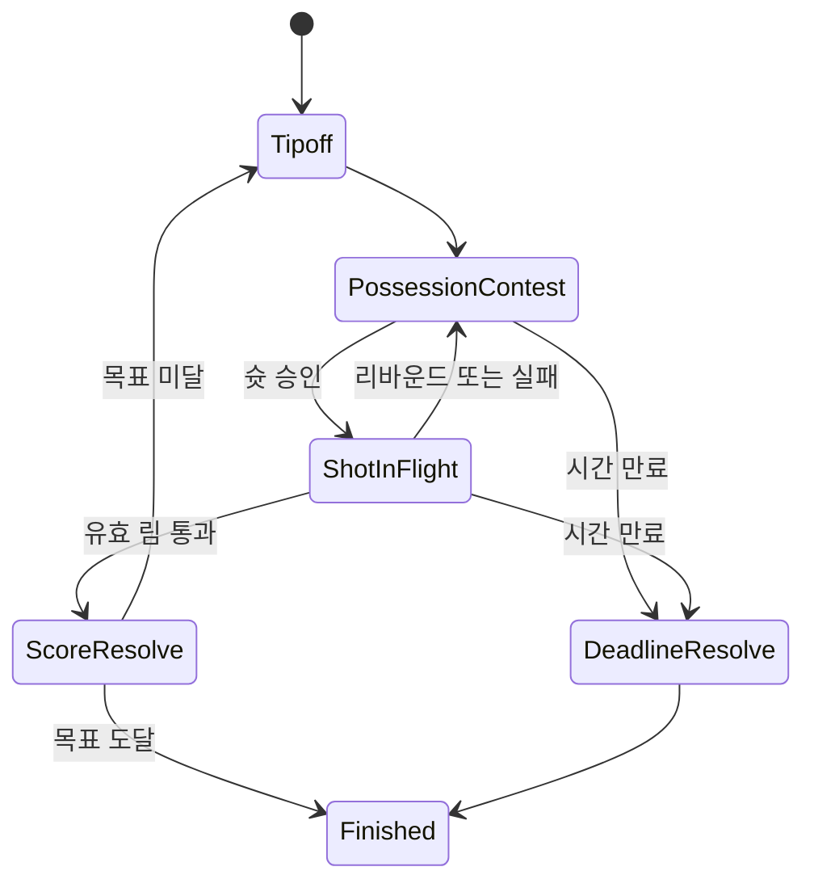

# 바스켓 브롤 · Basket Brawl — 위치 가치가 다른 슛 경쟁 역기획

> 조사 기준일: 2026-11-13 · 범위: 기본 3v3 농구 모드 · 상태: 공식 설명 확인, 당일 로테이션 미확인.
> **[확인]** 공개 규칙 · **[해석]** 설계 분석 · **[제안]** 재구현 명세 · **[미확인]** 실기 확인 필요.

## 1. 핵심 경험과 확인 규칙

**[확인]** 선 밖 슛은 3점, 안쪽은 2점이며, 5점 도달 또는 시간종료로 경기가 끝난다. [S1]

**[해석]** 득점 위치가 점수 가치를 바꾸므로 공을 골대 가까이 옮기는 행동만이 최적 선택은 아니다. 멀리서 성공률이 낮더라도 더 큰 점수로 경기 단계를 줄일 수 있다. 전투로 공간을 만든 후 어디에서 슛할지 선택하게 한다.

브롤 볼의 골선 통과와 농구의 림 통과는 다른 판정이다. 바스켓 모드의 슛을 축구 공의 평면 이동에 골대 외형만 바꾸어 구현하면 높이·림 진입 방향·튕김의 의미를 잃는다.

## 2. 점수 조합이 만드는 의사결정 [해석]

| 현재 점수 예시 | 선택의 의미 |
| --- | --- |
| 0점 | 3점 성공 후 2점으로 끝내는 경로와 2점 반복 경로 비교 |
| 2점 | 다음 3점이 즉시 목표 도달로 이어질 수 있음 |
| 3점 | 무리한 장거리보다 안전한 2점의 가치가 커질 수 있음 |
| 상대가 마지막 득점만 남음 | 슛 방해와 공 소유권 회수의 우선순위 증가 |

이 표는 공식 점수 규칙에서 도출한 산술 예시다. 실제 슛 성공률이나 특정 브롤러의 득점 확률을 가정한 통계가 아니다.

## 3. 상태와 확인 범위

| 객체 | 필요한 상태 [제안] |
| --- | --- |
| 공 | 지면·운반·슛 비행·림 접촉·리바운드·재개 |
| 슈터 | 마지막 소유자·발사 위치·팀·입력 승인시각 |
| 득점 영역 | 팀·림 위치·득점 통과 방향 |
| 경기 | 팀 점수·정규시간·연장·종료 |

**[미확인]** 현재 골대의 이동 궤적·속도, 슛 탄도와 반사 계수, 공 소지 중 공격 비용, 정규·연장 시간, 경계선 위 슛의 분류, 종료 버저 이후 비행 중 공의 처리 등은 현행 실기 검증이 필요하다.

골대가 이동하는 형식에서는 발사 순간이 아니라 공 도착 순간의 위치를 예측해야 한다. 이는 **움직이는 골대 변형을 분석하는 경우**의 요구이며, 현재 모든 맵의 이동 데이터가 동일하다고 주장하지 않는다.

## 4. 한 판의 흐름 [해석]

1. **공 확보:** 중앙 교전에서 공을 줍는 시점과 적의 공격을 먼저 소모시키는 시점을 비교한다.
2. **슛 공간 확보:** 공 소지자를 지키면서 특정 슛 위치를 비운다.
3. **거리 선택:** 2점과 3점의 위험·가치를 현재 점수와 연결해 판단한다.
4. **발사:** 목표의 현재 위치와 미래 위치, 방해 능력, 공의 체공시간을 고려한다.
5. **리바운드·전환:** 실패한 슛 뒤 공이 어디로 돌아오는지가 다음 공격권을 결정한다.
6. **재개:** 득점 후 전장 리셋 범위에 맞춰 다음 점수 계획을 세운다.

슛 실패를 단순 조준 실패로만 분석하면 안 된다. 좋은 슛 위치를 만들기 위한 전투, 점수 상황에 맞는 거리 선택, 실패 뒤 회수 위치까지 하나의 공격 과정이다.

## 5. 상태전이 [제안]



시간 종료 때 공이 비행 중인 경우는 독립된 정책이 필요하다. 실제 경기 규칙을 확인하기 전 농구 종목의 버저비터 규칙을 자동으로 적용하지 않는다.

## 6. 슛과 득점 판정 [제안]

- 발사 시각의 권위 위치를 저장해 점수 종류를 정한다. 발사 후 밀려났다고 2점·3점이 바뀌지 않게 한다.
- 림 판정은 필요한 통과 방향과 높이 조건을 정의한다. 아래에서 공이 닿았다는 이유만으로 득점하면 안 된다.
- 공의 연속 궤적과 움직이는 림의 상대 운동을 계산한다. 시각적 교차와 판정의 불일치를 최소화한다.
- 득점 승인 뒤 림 안에서 반복 충돌해도 점수는 한 번만 반영한다.
- 리바운드 후 다른 플레이어가 다시 터치하면 `shotId`, 마지막 발사 위치, 점수 자격의 갱신 정책을 적용한다.

이 절의 기하·상태 모델은 재구현 제안이다. 원작이 일반 강체 물리, 전용 탄도, 애니메이션 경로 중 무엇을 쓰는지는 확인하지 않았다.

## 7. 맵과 팀 기능 [해석]

작은 경기장은 교전과 공 전환을 빠르게 만들지만 부활 위치·골대·중앙 사이의 거리가 너무 짧으면 반복 득점이나 스폰 압박을 만들 수 있다. 공간을 넓히면 수비가 도착하기 전에 자유 슛이 가능한지 확인해야 한다.

| 기능 | 가치 |
| --- | --- |
| 슈터 | 확보한 공간을 실제 점수로 전환 |
| 스크린·보호 | 적의 접근·방해 타이밍 차단 |
| 리바운드 | 실패 후 소유권 유지 |
| 전환 수비 | 공이 반대편으로 넘어간 즉시 득점 위협 제거 |
| 지형 조작 | 특정 슛 각도와 접근 경로 변경 |

이 역할들은 동시에 수행될 수 있다. 공 없는 두 선수가 모두 적 처치만 쫓으면 슛 실패 뒤 회수 경로가 비고, 전투 우위를 얻었어도 소유권을 잃는다.

## 8. UI·조준 가독성 [제안]

- 2점·3점 영역의 경계를 배경과 구별한다.
- 예상 궤적을 보여 준다면 시뮬레이션과 동일한 입력값을 사용한다.
- 움직이는 골대의 위치를 장식·부시·능력 이펙트가 가리지 않게 한다.
- 공 높이·착지 위치가 평면 탑다운 화면에서 구분되도록 그림자와 궤적을 활용한다.
- 점수 연출에는 이번 슛이 몇 점이었는지 표시한다.
- 남은 점수와 시간은 슛 선택에 필요한 정보이므로 전투 중에도 읽혀야 한다.

## 9. 데이터·판정 [제안]

| 필드 | 목적 |
| --- | --- |
| `targetScore`, `duration` | 경기 종료 |
| `scoringRegions` | 2점·3점 영역 |
| `hoopMotionProfile` | 골대 이동이 있는 경우의 궤적 |
| `shotTrajectoryProfile` | 발사·체공·반사 |
| `shotOrigin`, `shotTeam`, `shotId` | 점수 귀속 |
| `rimCrossingPolicy` | 유효 득점 기하 |
| `deadlineInFlightPolicy` | 마감 시 비행 공 |

```text
onShotAccepted(player, input):
    shot.id = allocateId()
    shot.origin = authoritativePlayerPosition()
    shot.value = classifyShotRegion(shot.origin)
    launchUsingConfiguredTrajectory(input)

onValidHoopCrossing(shot):
    if shot.alreadyScored: return
    if deadlinePolicyAllows(shot):
        addScore(shot.team, shot.value)
        lockBallAndResolveMatchOrRestart()
```

이 의사코드는 위치 기반 점수와 득점 중복 방지를 강조한다. 실제 원작의 공 재접촉·골대 반사 정책은 테스트로 채운다.

## 10. QA 시나리오 [제안]

| 상황 | 기대 결과 또는 확인 포인트 |
| --- | --- |
| 경계선 앞·위·뒤에서 슛 | 명시한 영역 분류와 일치 |
| 슛 직후 넉백 | 발사 위치 기준 점수 유지 여부 확인 |
| 림 아래에서 공 접촉 | 유효 통과 방향 조건 검증 |
| 공이 림 안에서 여러 번 튕김 | 중복 점수 없음 |
| 골대 이동 중 고속 슛 | 상대 운동 판정 누락 없음 |
| 리바운드 후 다른 선수 슛 | 새 발사·점수 자격 정확히 갱신 |
| 버저 직전 발사·직후 도착 | 원작 확인한 마감 정책 적용 |
| 목표값을 넘기는 득점 | 경기 종료 한 번 확정 |
| 골대를 가리는 지형 생성 | 가시성·충돌 예외 검증 |
| 골 뒤 재접속 | 점수·공·재개 상태 일치 |

## 11. 계측·튜닝 질문 [제안]

2점·3점 선택 비율, 거리별 성공률, 슛 실패 후 회수율, 공 소유권 전환에서 득점까지 걸린 시간, 전투 승리 후 무득점 비율, 골대 이동 위상별 성공률을 본다.

3점이 항상 유리하거나 항상 무의미하다면 점수 비율만 보지 말고 슛 정확도·수비 접근시간·리바운드 불이익을 분리 분석한다. 조준 가독성 문제를 캐릭터 밸런스 문제로 오인하지 않는 것이 중요하다.

## 12. 출처와 연결

- [S1 · Supercell Game Modes](https://sc-brawlstars.zendesk.com/hc/en-us/articles/49526599632923-Game-Modes): 위치별 점수와 목표값. 수집일 2026-11-13.
- 관련 문서: [브롤 볼](02_brawl_ball.md), [전체 목차](../README.md).

탄도·골대 이동·마감·림 판정의 세부 구현은 독립 제안이다. 현재 실행 빌드의 물리 수치로 읽어서는 안 된다.
