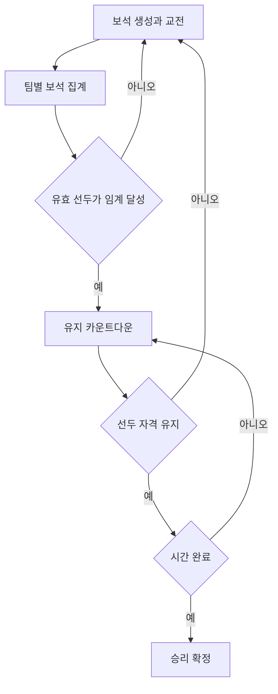

# 13. 젬 그랩 5v5 심층 역기획

> 기준일: 2026-11-13. 상태: 공식 모드 안내에 수록된 5v5 변형. 현재 실시간 슬롯 개방 여부는 미확인. **[공식]**과 **[해석]** 및 재구현 **[제안]**을 구분한다.

## 1. 경험의 핵심

[해석] 한 광산을 중심으로 한 3v3의 압력을 두 광산 사이의 병력 배분과 합류 판단으로 확장한다. 전선 하나를 이기는 능력뿐 아니라 어느 전선에서 얻은 이익을 다른 전선으로 옮길지 판단하는 능력이 중요하다. 인원이 늘었다는 사실보다 목표의 공급 위치가 둘로 나뉜 점이 핵심이다.

## 2. 확인된 규칙과 범위

[공식] 팀당 5명이며, 맵에 보석 광산이 두 개 있다. 팀이 보석 20개를 확보하고 유지하는 승리 구조다.[S1]

| 항목 | 확인·구현 기준 |
|---|---|
| 팀 구조 | 2팀×5명 [공식] |
| 목표 공급 | 보석 광산 2개 [공식] |
| 승리 임계 | 20개 확보·유지 [공식] |
| 카운트다운 길이 | 최신 5v5 실기 확인 필요 |
| 생성 주기·총 보석 제한 | 광산별 설정값; 수치 미확인 |
| 리스폰·보석 드롭 | 기본 모드와의 차이를 실기 대조 |
| 시간 종료·동률 | 5v5 전용 예외 확인 필요 |

## 3. 경기 단계 [해석]

1. **개막 분산:** 두 광산의 지형과 상대의 인원 배치를 확인한다.
2. **부분 우세:** 한 광산을 안정적으로 가져오거나 상대 운반자의 이동을 제한한다.
3. **합류 선택:** 반대쪽을 도울지, 추가 보석을 받을지, 적 후방을 차단할지 결정한다.
4. **임계 접근:** 팀 합계뿐 아니라 누구에게 보석이 집중되었는지 확인한다.
5. **유지·추격:** 선두 팀은 운반자 보호, 뒤진 팀은 가치 높은 운반자에게 접근한다.

3v3보다 화면 밖에서 보석 수가 급변할 수 있어, 개인 전투 승리와 팀의 실제 우세가 어긋나기 쉽다.

## 4. 상태 모델 [제안]

`유효 선두`의 정확한 동률 정책은 검증 후 채운다. 표시 숫자가 같다는 이유로 카운트다운이 계속되는지 취소되는지를 임의로 확정하지 않는다.

## 5. 라인·역할·보석 분산 [해석]

| 역할 | 주요 판단 | 실패 위험 |
|---|---|---|
| 광산 압박 | 상대를 픽업 위치에서 밀어냄 | 자기 라인 승리에만 집중 |
| 보석 운반 | 낮은 위험으로 공급을 받아 보존 | 공격에 합류하다 큰 가치 손실 |
| 연결 역할 | 양 광산 사이 수적 우세 생성 | 이동 중 양쪽 모두 비게 됨 |
| 침투 역할 | 상대 운반자의 후퇴 경로 차단 | 보석이 적은 대상을 쫓음 |
| 보호 역할 | 운반자 접근 위협을 제거 | 안전한 후퇴 공간을 스스로 막음 |

한 명에게 집중하면 보호 대상이 단순해지지만 한 번의 사망으로 크게 뒤집힌다. 여러 명에게 나누면 단일 사망 위험은 줄지만 팀 전체의 자유로운 공격 인원이 줄어든다. 이것은 절대 정답이 있는 배분이 아니라 상대의 돌진·당기기·광역 능력과 맵의 후퇴 공간에 따라 달라진다.

## 6. 맵 설계 [제안]

두 광산이 너무 멀면 각각 독립된 소규모 전투가 되어 5인 팀의 의미가 약해진다. 너무 가까우면 하나의 큰 광산처럼 작동한다. 광산 간 이동시간과 안전한 연결 경로가 설계의 핵심 변수다.

광산 사이를 빠르게 이동하는 경로에는 시야 노출이나 좁은 입구 같은 비용을 줄 수 있다. 한쪽 광산을 포기한 팀도 상대 운반자의 귀환 경로를 압박할 수 있어야 우세가 완전히 고정되지 않는다.

## 7. UI·판정 계약 [제안]

팀 합계와 각 운반자의 보석 수를 동시에 읽을 수 있어야 한다. 광산 두 개의 위치, 주요 운반자의 화면 밖 방향, 카운트다운 주체를 명확히 표시한다. 총합만 보여주면 위험한 운반자가 어디 있는지 팀원이 알기 어렵다.

| 데이터 | 목적 |
|---|---|
| MineState[2] | 생성 주기·대기 보석·다음 생성 시각 |
| CarrierGemCount[player] | 개인 소지량 |
| TeamGemCount[team] | 검증된 개인 소지량의 합 |
| CountdownState | 주체·시작 시각·취소 이유 |
| PickupTransaction | 픽업 중복·경합 방지 |

## 8. 예외와 원작 확인 필요 항목

동시에 양 팀이 임계치를 넘는 경우, 마지막 순간 운반자 두 명이 함께 죽는 경우, 보석이 벽·물·맵 외부에 떨어지는 경우를 별도 검증한다. 보석은 피해 판정 순서에 따라 잠깐 소유자가 없을 수 있으므로, 종료 판정은 정해진 이벤트 경계에서 수행하는 편이 일관적이다.[제안]

공개되지 않은 동시 이벤트 순서를 원작의 실제 판정으로 적지 않는다. 기본 젬 그랩의 관찰 결과도 5v5에서 다시 확인한다.

## 9. QA [제안]

| ID | 시나리오 | 기대 결과 |
|---|---|---|
| G501 | 두 광산이 같은 시각 생성 | 각 광산의 보석이 별도 ID로 생성 |
| G502 | 팀 합계 19→20 | 검증된 승리 자격이면 카운트다운 시작 |
| G503 | 운반자 사망으로 임계 미달 | 설정된 규칙에 따라 유지 상태 해제 |
| G504 | 양 팀 합계 동률 | 정해진 동률 정책을 양 화면에 동일 표시 |
| G505 | 같은 보석 동시 픽업 | 한 명에게만 소유권 부여 |
| G506 | 한 화면 밖 광산에서 급변 | 팀 합계·경고 즉시 갱신 |
| G507 | 재접속한 운반자 | 소지 보석과 카운트다운 복원 |
| G508 | 종료 직전 드롭·픽업 | 단일 확정 순서로 승자 일치 |

## 10. 밸런스·KPI [제안]

광산별 점유 시간, 광산 간 합류 빈도, 보석 집중도, 임계 달성 후 역전률, 선두 운반자의 후퇴 거리, 화면 밖 사망으로 끝난 경기 비율을 본다. 첫 광산 우세가 승리로 거의 직결된다면 연결 경로나 보석 공급의 분산 효과가 부족할 수 있다.

## 출처

- [S1: 공식 Game Modes](https://sc-brawlstars.zendesk.com/hc/en-us/articles/49526599632923-Game-Modes) — 인원·광산 수·20개 승리 구조.

관련 문서: [기본 젬 그랩](01_gem_grab.md), [4팀 젬 그랩](17_gem_grab_four_teams.md), [전체 목차](../README.md).
