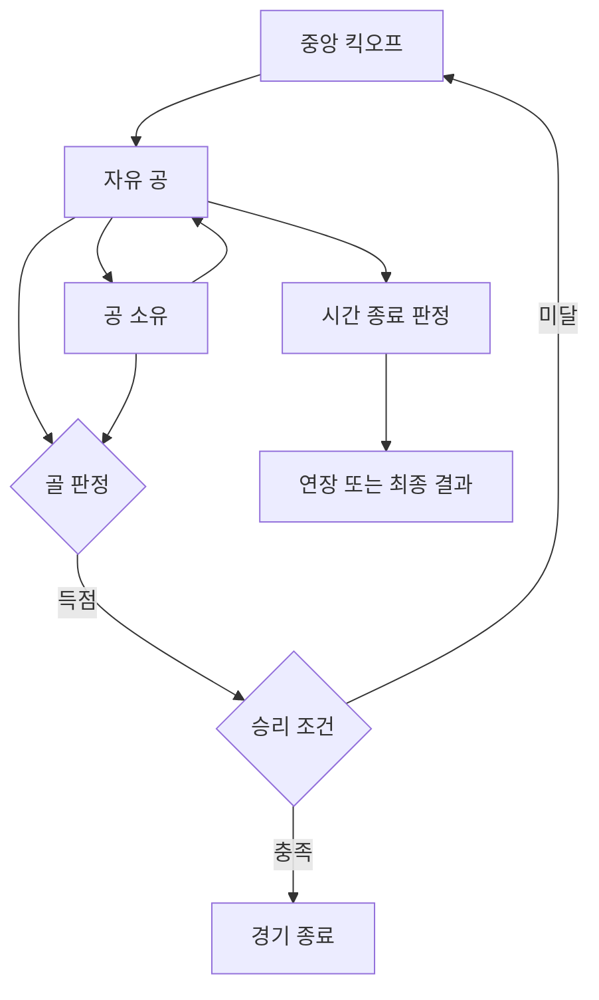

# 14. 브롤 볼 5v5 심층 역기획

> 기준일: 2026-11-13. 상태: 공식 안내에 수록된 대규모 변형. 오늘의 슬롯 여부는 미확인. **[공식]** 외 규칙 상속과 구현은 **[제안]**, 전술적 효과는 **[해석]**이다.

## 1. 핵심 경험

[해석] 공 하나를 두고 10명이 싸우면서, 패스 경로와 공격·수비의 역할 교대가 더 중요해진다. 단순히 3v3 인원을 늘리면 밀집 전투가 심해지므로 가로로 넓은 경기장과 골문 폭 변화가 공간 분산을 담당한다.

## 2. 확인된 차이

[공식] 5v5 브롤 볼은 가로 방향 경기장이며 골문이 더 넓다.[S1] 따라서 기본 모드에서 사용한 카메라·공격 방향·골 판정 표현을 그대로 복제하기 어렵다.

| 항목 | 분석 기준 |
|---|---|
| 팀 구조 | 2팀×5명 |
| 목표 | 상대 골문으로 공을 보내 득점 |
| 경기장 | 가로 방향, 더 넓은 골문 [공식] |
| 득점 목표·시간 | 기본 모드와 상속되는지 최신 실기 대조 |
| 공 보유 시 공격·슈퍼 | 기본 모드의 운반·킥 규칙 대조 |
| 골 후 배치 | 5v5 스폰·정렬 규칙 별도 확인 |
| 연장 지형 처리 | 기본 모드와 전용 맵 예외 확인 |

## 3. 경기 흐름 [해석]

개막에는 공을 잡는 사람보다 공을 잡을 공간을 만드는 사람이 중요하다. 중앙에 5명이 겹치면 광역 공격과 관통 공격에 손실이 커진다. 측면에서 패스 받을 위치를 만들고, 수비 인원을 빼내어 골문 각도를 확보하는 것이 핵심이다.

공격이 실패했을 때 복귀할 사람이 없으면 공의 이동속도에 비해 수비 전환이 늦어진다. 그래서 전방 압박 인원, 중간 연결 인원, 후방 안전 인원을 고정 직업이 아닌 상황별 책임으로 나누는 것이 유용하다.

## 4. 상태 모델 [제안]

소유 공과 자유 공의 충돌·득점 판정은 분리한다. 공을 들고 이동할 때와 킥으로 날아갈 때 같은 골문 경계를 어떻게 통과하는지 규칙으로 정의한다.

## 5. 공간과 패스의 분석 [해석]

| 선택 | 이익 | 비용 |
|---|---|---|
| 중앙 직접 돌파 | 가장 짧은 득점 거리 | 집중 사격과 넉백에 취약 |
| 측면 전개 | 수비 방향을 벌림 | 긴 이동·패스 차단 위험 |
| 후방 패스 | 압박 해제와 재정비 | 상대가 전선을 올릴 시간 |
| 빈 공간으로 킥 | 자신이 들고 있는 제약 해제 | 아군이 받지 못하면 소유권 상실 |
| 골문 앞 밀집 | 연속 슈팅 기회 | 광역 제어와 역습 위험 |

인원이 많아도 공은 하나다. 모든 유저가 공 운반에만 몰리면 공격력이 늘지 않고 서로의 이동 경로만 막는다. 화면에서 패스 받을 아군의 위치와 수비 뒤 공간을 쉽게 읽게 해야 한다.

## 6. 맵 설계 변수 [제안]

골문이 넓어지면 한 명이 몸으로 막을 수 있는 비율이 줄어든다. 대신 골 앞 엄폐, 진입 각도, 중앙에서 골문까지의 거리가 수비의 시간을 제공한다. 맵을 가로로 바꾸는 것만으로 충분하지 않다.

전방 돌진 브롤러가 계속 공을 밀어 넣는 상황을 평가하려면 평균 득점 시간뿐 아니라 ‘최초 교전 승리 뒤 수비가 다시 자리를 잡을 기회’를 측정한다. 이동 경로가 지나치게 짧으면 리스폰이 있어도 실질적 대응이 없다.

## 7. 좌표·카메라·팀 시점 [제안]

서버의 경기장 좌표와 로컬 카메라 표현을 분리한다. 플레이어별 시점에서 공격 방향을 보기 쉽게 바꾸더라도 골문 판정·공 속도·장애물·네비게이션은 서버 좌표를 기준으로 유지한다.

공의 화면상 이동 방향으로 ‘아군 골’ 여부를 판정하지 않는다. `Goal.teamOwner`와 공의 월드 위치로 판정한다. 화면 변환은 입력 방향을 월드 방향으로 환산하는 층에서만 처리한다.

이 구조는 재구현 제안이며 원작 엔진의 실제 방식은 공개되지 않았다.

## 8. 데이터와 UI [제안]

| 데이터 | 역할 |
|---|---|
| BallState | 위치·속도·소유자·픽업 잠금 |
| GoalVolume[2] | 골문 경계와 소유 팀 |
| KickEvent | 차감 자원·방향·속도·시작 시각 |
| ScoreState | 득점과 승리 임계 |
| PhaseState | 킥오프·플레이·골 연출·연장 |

HUD는 공 위치, 골문 방향, 팀 득점, 남은 시간, 공 소유 여부를 우선한다. 넓은 화면에서도 공과 주요 수비자의 위치가 장식 효과에 가려지지 않게 한다.

## 9. QA [제안]

| ID | 시나리오 | 기대 결과 |
|---|---|---|
| B501 | 서로 다른 팀 시점 | 같은 골문이 동일한 팀 소유로 판정 |
| B502 | 골문 가장자리 고속 킥 | 연속 충돌 또는 규정된 골 경계로 누락 방지 |
| B503 | 공 보유자 사망·넉백 | 소유권 해제와 공 위치가 한 번만 갱신 |
| B504 | 공 픽업과 킥 동시 요청 | 유효 소유자가 낸 입력만 적용 |
| B505 | 득점 후 10명 배치 | 중첩·충돌 없이 지정 스폰으로 이동 |
| B506 | 0:00에 공이 벽에 끼임 | 설정된 시간 종료 정책으로 해결 |
| B507 | 연장 지형 제거 | 충돌·시각·골문 경계가 일치 |
| B508 | 재접속 중 득점 | 최신 점수와 단계로 복구 |

## 10. KPI와 검증 과제 [제안]

패스 연결 수, 소유 교체 빈도, 측면 진입 비율, 수비 복귀 성공률, 첫 교전 승리와 득점의 상관, 역할별 볼 접촉 편중을 본다. 특정 두 명만 계속 공을 다룬다면 남은 세 명에게 유효한 공간·보호 역할이 제공되는지 검토한다.

원작 복제 전에는 득점 목표·경기시간·연장·공을 든 상태의 능력 제한을 같은 버전에서 녹화해 확인한다.

## 출처

- [S1: 공식 Game Modes](https://sc-brawlstars.zendesk.com/hc/en-us/articles/49526599632923-Game-Modes) — 5v5 경기 방향·골문 폭.

관련 문서: [기본 브롤 볼](02_brawl_ball.md), [UI](../systems/16_ux_onboarding.md), [전체 목차](../README.md).
