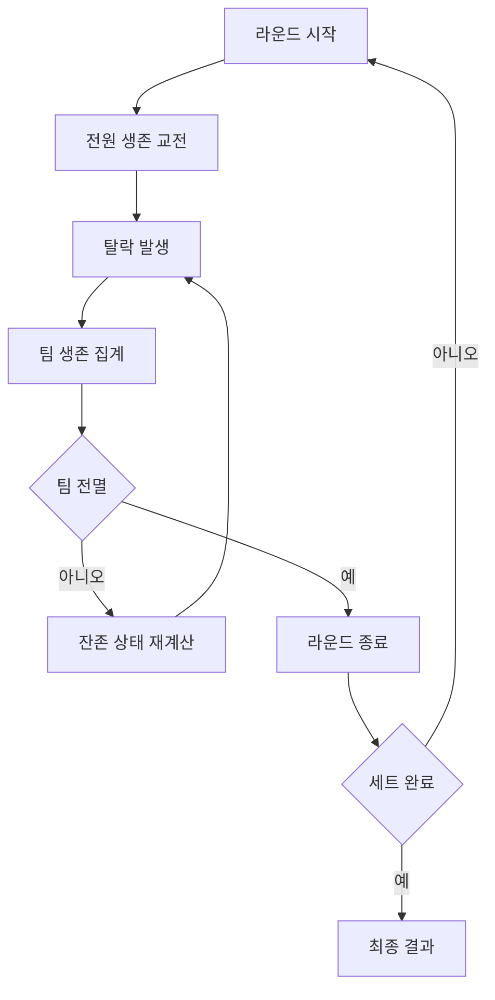

# 15. 녹아웃 5v5 심층 역기획

> 기준일: 2026-11-13. 공식 패치에서 운영 이력이 확인되는 변형이다. 현재 실시간 슬롯은 미확인. 공개 근거가 약한 강화 수치·체력 재계산을 확정하지 않고 검증 가설로 분리한다.

## 1. 모드 정체성과 근거 수준

[공식] 공식 패치들은 Knockout 5v5의 로테이션과 전용 맵을 기록한다.[S1][S2] 기본 녹아웃은 라운드 중 탈락자가 다음 라운드까지 대기하며, 독구름이 대치를 압박하는 구조다.[S3]

[미확인] 5v5의 특징으로 알려진 **아군 탈락에 따른 잔존자 강화**는 이번에 확보한 공식 텍스트만으로 증폭률·적용 대상·부활 상호작용을 확정하지 못했다. 아래 해당 부분은 이 메커니즘을 검증할 조건부 분석이다. 실제 클라이언트에서 확인하기 전 원작 규칙의 완성 사양으로 사용할 수 없다.

## 2. 기본 흐름 [해석]

팀당 인원이 늘어나면 첫 탈락이 전체 팀의 전투력에서 차지하는 비중은 작아지지만, 측면과 사격선의 수가 많아진다. 3v3보다 한 번의 진입이 여러 각도에서 공격받을 수 있으므로 넓은 공간의 분담이 중요하다.

라운드 탈락형에서는 처치 뒤 추격할지, 탄약을 재정비할지, 안전한 독구름 방향을 선점할지 선택한다. 무리한 추가 처치는 이미 얻은 인원 우세를 반납할 수 있다.

## 3. 규칙 데이터 표 [제안]

| 항목 | 구현·검증 기준 |
|---|---|
| teamSize | 5 |
| roundRespawnPolicy | 기본 녹아웃과 전용 예외 확인 |
| roundsToWin | 기본 3판 2선승 상속 여부 실기 대조 |
| poisonSchedule | 전용 맵과 단계별 안전 구역 |
| survivorScaling | 사용 여부·계수·대상은 미확인 |
| revivePolicy | 능력 부활과 생존자 집계의 관계 |
| simultaneousWipePolicy | 동시 전멸 처리 |
| roundCarryover | 슈퍼·탄약·능력 상태의 유지 범위 |

## 4. 상태 전이 [제안]

잔존 상태 재계산은 강화가 있으면 포함하고, 없으면 생존·시야·관전 정보만 갱신한다. 확인되지 않은 규칙을 엔진 핵심 코드에 강제하지 않는다.

## 5. 잔존자 강화가 있을 때의 설계 효과 [조건부 해석]

일반적인 탈락전은 인원 우세가 곧 사격선·탄약량·시야의 우세다. 생존자가 강해지는 보정이 있으면 적을 쓰러뜨릴수록 남은 적 하나의 위협이 증가할 수 있다. 이때 처치 수만 보고 즉시 돌진하는 행동이 위험해진다.

| 팀 상태 | 일반 탈락전의 기대 | 잔존 강화 시 검토할 변화 |
|---|---|---|
| 전원 생존 | 다양한 각도로 압박 | 초기 능력은 상대적으로 낮을 수 있음 |
| 일부 탈락 | 전선 축소 | 남은 개체의 피해·생존 보정 가능 |
| 마지막 한 명 | 포위당하면 불리 | 큰 단일 위협으로 역전 가능 |
| 부활 발생 | 인원 이익 회복 | 강화 재계산이 급변할 수 있음 |

강화가 과하면 일부러 팀원이 빨리 탈락하는 행동이 최적이 될 수 있다. 이를 평가하려면 정상적인 5인 협동의 기대 승률과 의도적 1인 집중 전략을 비교해야 한다. 원작이 그런 전략을 권장한다는 뜻은 아니다.

## 6. 강화 공식 검증 실험 [제안]

1. 같은 레벨·능력의 브롤러로 기준 체력과 한 발 피해를 기록한다.
2. 아군 탈락 수를 하나씩 늘리며 최대 체력·현재 체력·피해·이동·재장전 변화를 비교한다.
3. 동시에 여러 아군이 탈락했을 때 단계를 건너뛰는지 확인한다.
4. 부활·변신·소환수·백분율 피해·회복에서 같은 보정이 적용되는지 확인한다.
5. 다음 라운드 시작에 모든 보정이 초기화되는지 확인한다.

계수만 알아도 충분하지 않다. 최대 체력 증가 시 현재 체력을 비율로 올리는지, 고정량을 더하는지에 따라 마지막 생존자의 실제 생존력이 크게 달라진다.

## 7. 맵·역할·독구름 [해석]

넓은 맵은 인원 분산을 허용하지만, 마지막 생존자가 적을 찾지 못해 지루해질 수 있다. 독구름은 경기 종료를 보장하고 사격선의 수를 줄이는 역할을 한다. 안전 구역 중심이 특정 엄폐에 과도하게 유리하면 초반 교전보다 마지막 위치 선점이 지배적이 된다.

장거리 압박·투척·돌진·지원의 가치는 생존 인원이 줄 때 바뀐다. 초반에는 많은 아군을 지원하는 능력이 효율적이고, 후반에는 혼자 살아남아 공격을 피할 수 있는 능력이 중요해질 수 있다.

## 8. UI와 데이터 [제안]

생존 인원, 라운드 점수, 다음 독구름 단계, 강화가 있다면 현재 단계와 변화를 명확히 보여준다. 죽은 아군의 관전 화면은 남은 플레이어의 판단을 읽을 수 있게 하되 과도한 핑으로 방해하지 않게 한다.

`AliveRoster`, `PendingRevives`, `RoundPhase`, `PoisonPhase`, `SurvivorModifierVersion`, `RoundResult`를 별도로 관리한다. 부활 예약을 가진 탈락자를 전멸 판정에서 언제 제외할지 명시한다.

## 9. QA [제안]

| ID | 시나리오 | 기대 결과 |
|---|---|---|
| K501 | 두 아군 동시 탈락 | 잔존 상태를 한 이벤트 경계에서 계산 |
| K502 | 마지막 생존자와 부활 예약 | 설정된 전멸 정책 일관 적용 |
| K503 | 강화 상태에서 변신 | 체력·피해 보정 중복 없음 |
| K504 | 다음 라운드 시작 | 이전 라운드 탈락·강화 초기화 |
| K505 | 동시 전멸 | 정해진 무승부·재라운드 정책 적용 |
| K506 | 독구름과 마지막 공격 동시 | 단일 판정 순서로 결과 일치 |
| K507 | 소환수만 생존 | 브롤러 생존으로 잘못 집계하지 않음 |
| K508 | 재접속한 탈락자 | 현재 라운드에 불법 복귀하지 않음 |

## 10. KPI와 한계 [제안]

첫 탈락 팀의 라운드 승률, 1대다 역전률, 의도적 조기 탈락 비율, 독구름까지 지속되는 경기 비율, 생존 인원별 평균 교전 시간을 측정한다. 강화 구조가 있다면 ‘역전 가능성’과 ‘팀원을 희생시키는 유인’을 별도로 평가한다.

이 문서의 가장 중요한 미해결 항목은 잔존 강화의 원작 상세다. 검증 전에는 계수를 비워 둔 프로토타입으로 취급한다.

## 출처

- [S1: 2025년 9월 패치](https://supercell.com/brawlstars/en/blog/release-notes/release-notes-september-2025/) — 5v5 녹아웃 운영 기록.
- [S2: 2026년 8월 패치](https://supercell.com/brawlstars/en/blog/release-notes/release-notes-august-2026/) — 전용 맵의 수정 기록.
- [S3: 공식 Game Modes](https://sc-brawlstars.zendesk.com/hc/en-us/articles/49526599632923-Game-Modes) — 기본 녹아웃 구조. 5v5 강화 상세의 근거로 사용하지 않음.

관련 문서: [기본 녹아웃](06_knockout.md), [5v5 섬멸전](16_wipeout_5v5.md), [전체 목차](../README.md).
