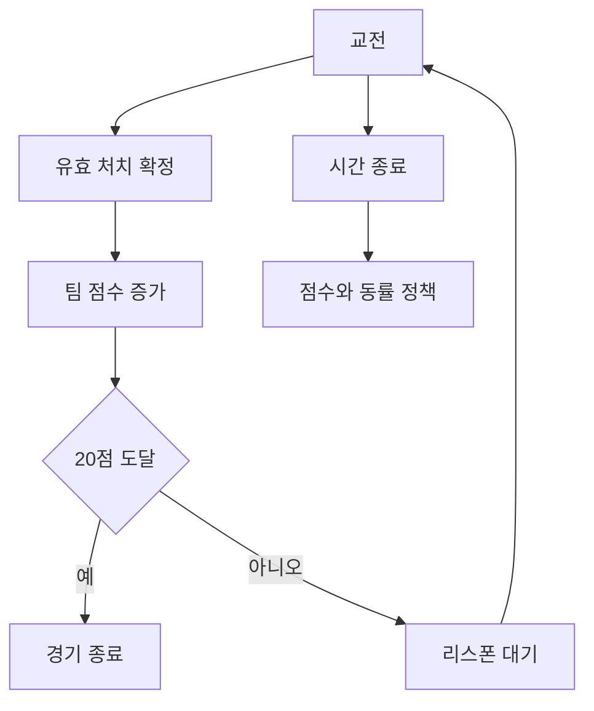

# 16. 섬멸전(Wipeout) 5v5 심층 역기획

> 기준일: 2026-11-13. 공식 안내에 수록된 5v5 처치 점수 모드. 실시간 슬롯과 최신 맵별 시간 규칙은 미확인. **[공식]** 외 전술은 **[해석]**, 데이터·QA는 **[제안]**이다.

## 1. 모드의 핵심

[공식] 5v5 Wipeout은 상대 처치로 점수를 얻으며 20점에 먼저 도달한 팀이 이긴다.[S1]

[해석] 목표물이 별도로 없으므로 위험을 감수할 이유는 상대를 처치하거나 자신이 지는 상황을 바꾸는 데서 생긴다. 인원이 늘면 한 명의 실수를 여러 적이 동시에 처벌할 수 있어 ‘교전을 시작할 타이밍’과 ‘아군 손실을 막는 위치’가 중요하다.

## 2. 규칙 표

| 항목 | 규칙·검증 범위 |
|---|---|
| 인원 | 2팀×5명 |
| 점수 획득 | 상대 브롤러 처치 |
| 조기 승리 | 20점 [공식] |
| 기본 진행 | 리스폰을 전제로 한 처치 누적 구조 |
| 시간 제한·동률 | 최신 5v5 실기에서 확인 |
| 환경 피해 귀속 | 마지막 공격·팀 점수 정책 확인 |
| 동시 20점 | 원작 우선순위 미확인 |

## 3. 플레이 단계 [해석]

개막에는 다섯 명이 상대의 사거리와 제어 능력을 확인한다. 첫 처치 이후에는 추격보다 아군 체력과 재장전 상태를 확인하는 편이 장기 점수 교환에 유리할 수 있다.

중반에는 양팀의 리스폰이 어긋난다. 죽은 아군이 돌아오기 전에 남은 인원이 다시 들어가면 차례로 쓰러지는 흐름이 생긴다. 숫자상 다섯 명인 게임이라도 실제 전선에서는 반복적으로 2대5가 될 수 있다.

종반에는 점수차가 전략을 바꾼다. 앞선 팀은 낮은 위험의 교환을 원하고, 뒤진 팀은 제한된 시간 안에 더 큰 교전을 열어야 한다. 동일한 자리에서 기다리는 행동도 점수 상황에 따라 의미가 다르다.

## 4. 상태 모델 [제안]

피해 이벤트가 아니라 최종 탈락 이벤트에서 점수를 지급한다. 같은 대상에게 여러 투사체가 도달해도 점수는 한 번만 발생해야 한다.

## 5. 역할과 점수 교환 [해석]

| 역할 | 팀에 주는 가치 | 주의할 행동 |
|---|---|---|
| 견제 | 적 체력·탄약을 줄여 진입 창 생성 | 처치 없는 피해만 계속 쌓기 |
| 진입 | 약해진 대상을 마무리 | 아군과 거리가 먼 단독 진입 |
| 지원 | 손실 방지·전선 유지 | 이미 불리한 전투를 무한 연장 |
| 측면 | 사격선을 벌려 집중 화력 유도 | 본대가 싸우는데 우회만 지속 |
| 후퇴 보호 | 아군의 안전한 회복 지원 | 점수 앞서는데 불필요한 추격 |

한 명이 3명을 처치하고 4번 죽으면 개인 킬 수는 높지만 점수차에는 불리하다. 단순 처치 수보다 ‘내 행동이 양팀 점수차를 얼마나 바꾸었는가’를 보아야 한다. 다만 모든 유저에게 생존만 강조하면 교전이 사라지므로 위험을 연 사람의 기여도 함께 평가한다.

## 6. 맵과 스폰 설계 [제안]

다섯 명이 부활해 나올 수 있는 충분한 출구가 필요하다. 단일 출구에 상대가 광역 공격을 유지할 수 있으면 연속 점수와 재장전·슈퍼 충전이 결합해 스폰 봉쇄가 된다.

안전한 복귀 경로를 주되 상대 후방에 공짜로 나타나게 하지는 않는다. 전선까지의 이동시간, 엄폐물 분포, 중앙을 우회하는 경로가 팀 재집결 시간을 결정한다.

## 7. UI와 데이터 [제안]

상단 점수는 목표 20점까지의 거리를 읽기 쉽게 보여준다. 아군 부활 상태와 남은 인원은 지금 싸워도 되는지 판단하는 데 중요하다. 대미지 숫자보다 점수 변화와 아군 탈락 경고가 묻히지 않게 한다.

| 데이터 | 용도 |
|---|---|
| TeamScore | 두 팀 누적 점수 |
| EliminationId | 중복 점수 방지 |
| KillerAttribution | 플레이어·소환수·환경 피해 귀속 |
| RespawnQueue | 부활 시각·스폰 후보 |
| EndReason | 임계 도달·시간·중단 |

## 8. 판정 예외 [제안]

자폭·독·소환수·소유자 사망 뒤 남은 투사체가 처치를 만들 때 점수 주체를 분명히 해야 한다. 라운드 종료형 녹아웃과 달리 탈락은 다음 교전으로 이어지는 상태이므로, 부활 예약과 점수 확정을 서로 독립적으로 처리한다.

동일 시뮬레이션 단계에서 양팀이 20점에 도달하면 어느 순서로 이벤트를 적용할지 명시한다. 원작의 동시 처치 판정은 실기 확인 항목으로 남긴다.

## 9. QA [제안]

| ID | 시나리오 | 기대 결과 |
|---|---|---|
| W501 | 19점에서 유효 처치 | 20점 확정 뒤 경기 종료 |
| W502 | 대상에게 다중 치명 피해 | 한 처치만 점수화 |
| W503 | 소환수의 처치 | 주인·팀 귀속 정책으로 집계 |
| W504 | 양팀 동시 임계 도달 | 사전 정의한 동시 판정 적용 |
| W505 | 부활 위치에 장애물 생성 | 유효 스폰 대안 선택 |
| W506 | 종료 후 날아온 투사체 | 결과 확정 뒤 점수 추가 없음 |
| W507 | 연결 끊김과 부활 | 플레이어 상태 중복 생성 없음 |
| W508 | 시간 종료 동점 | 설정된 동률 처리 일관 적용 |

## 10. KPI [제안]

평균 처치 간격, 첫 5점 선취 팀 승률, 사망 직후 재사망률, 양팀 인원 불균형 시간, 스폰 근처 피해 비율, 점수차별 교전 빈도를 측정한다. 경기시간이 짧아졌다는 이유만으로 개선이라 판단하지 않고, 한쪽이 아무 대응 없이 연속으로 죽은 비율을 확인한다.

## 출처

- [S1: 공식 Game Modes](https://sc-brawlstars.zendesk.com/hc/en-us/articles/49526599632923-Game-Modes) — 5v5의 20점 목표.

관련 문서: [기본 섬멸전](07_wipeout.md), [4팀 섬멸전](18_wipeout_four_teams.md), [전체 목차](../README.md).
