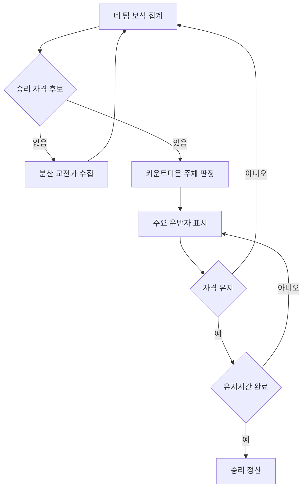

# 17. 4팀 젬 그랩(Trio Gem Grab) 심층 역기획

> 기준일: 2026-11-13. 2025년 10월 공식 도입 자료와 공식 모드 안내를 기준으로 한다. **3인 쇼다운과 다른 모드**다. 현재 슬롯은 미확인. **[공식]**, **[해석]**, **[제안]**을 분리한다.

## 1. 모드 정체성

[공식] 3명씩 네 팀이 보석을 경쟁한다. 시작 시 보석이 맵에 흩어져 있으며, 광산 수는 맵마다 다르다. 승리 카운트다운에서는 선두 팀의 최다 보석 운반자에게 적들이 볼 수 있는 화면 밖 표시가 붙는다.[S1] 지원 문서는 최대 다섯 광산과 맵별 목표 보석 수를 설명한다.[S2]

[해석] 두 팀 게임에서는 적의 손해가 대체로 아군의 이익이다. 네 팀에서는 두 팀이 오래 싸우는 동안 나머지 팀이 보석을 모을 수 있다. 이 구조가 교전 회피·세 번째 팀의 개입·선두 추격이라는 별도 전략을 만든다.

## 2. 규칙 표

| 항목 | 규칙·범위 |
|---|---|
| 팀 구조 | 4팀×3명, 총 12명 |
| 목표 | 맵에 설정된 보석 임계 확보와 유지 |
| 초기 보석 | 시작 시 맵에 분산 [공식] |
| 광산 수 | 맵별 가변; 최대 5개 안내 [공식] |
| 임계 보석 수 | 맵별 다름; 10·20으로 고정하지 않음 |
| 추격 정보 | 카운트다운 중 주요 운반자 화면 밖 표시 |
| 동률·동시 카운트다운 | 세부 실기 확인 필요 |
| 리스폰·드롭 예외 | 4팀 전용 규칙과 기본 모드 상속 대조 |

## 3. 경기 단계 [해석]

1. **초기 획득:** 흩어진 보석과 가까운 광산을 확보한다.
2. **접경 형성:** 어느 팀과 주로 맞닿을지 결정된다.
3. **기회 선택:** 전면 교전, 빈 광산 획득, 교전 중인 두 팀에 개입 중 선택한다.
4. **선두 공개:** 카운트다운이 시작되면 여러 팀의 관심이 선두 운반자에게 쏠린다.
5. **도주·협공:** 선두는 추격 경로를 갈라놓고, 다른 팀은 누가 보석을 회수할지 경쟁한다.

추격 팀끼리는 공통 목표를 잠깐 공유하지만 같은 팀이 아니다. 선두를 쓰러뜨린 뒤에는 바로 다음 승리를 두고 다시 경쟁한다.

## 4. 다팀 상태 모델 [제안]

후보가 둘 이상인 경우의 우선순위는 검증 전 비워 둔다. `winnerCandidate`를 단일 변수로 먼저 저장한 뒤 다른 팀을 무시하는 구현은 다팀 경합 오류를 만들기 쉽다.

## 5. 교전 가치의 변화 [해석]

| 선택 | 얻을 수 있는 것 | 기회비용 |
|---|---|---|
| 가까운 팀과 장기 교전 | 지역 통제·상대 보석 | 제3팀의 무혈 수집 허용 |
| 빈 광산 확보 | 낮은 위험의 수입 | 선두 운반자 추격 시간 상실 |
| 두 팀 교전에 개입 | 약해진 적과 드롭 회수 | 양쪽에게 동시에 공격받음 |
| 선두 추격 | 카운트다운 차단 | 다른 추격 팀이 보석을 가로챔 |
| 조용한 후퇴 | 소지 보석 보존 | 주요 운반자 위치 표시로 은신 한계 |

따라서 순간 처치 효율보다 ‘내가 싸우는 동안 누가 승리에 가까워지는가’를 읽는 능력이 중요하다. 다팀 게임의 지도 정보는 주변 적만 보여주면 부족하다.

## 6. 역전 구조 [해석]

보석을 가진 선두는 승리까지의 시간을 얻지만, 동시에 추격 대상이 된다. 주요 운반자 표시가 은신만으로 시간을 끝내는 전략을 제한한다. 이는 직접적인 스탯 보정 없이 선두의 정보 비용을 높이는 역전 장치로 해석할 수 있다.

하지만 선두를 잡은 보상이 마지막에 도착한 팀에게만 돌아가면 추격 기여자는 손해를 느낄 수 있다. 원작의 드롭 귀속을 임의로 바꾸지 말고, 실제 픽업 경합과 동선을 관찰해 어느 정도의 개입 이익이 생기는지 측정한다.

## 7. 맵과 스폰 [제안]

네 팀의 시작 위치는 첫 광산 접근 거리뿐 아니라 다른 두 팀 사이에 끼일 가능성까지 고려해야 한다. 거리 대칭만으로 공정성을 보장할 수 없다. 중앙 광산이 추가되면 여러 팀이 동시에 모이는 교차점이 되므로 탈출 경로가 필요하다.

광산 수가 바뀔 때 목표 보석 수를 함께 조정하는 구조는 공급량 변화에 맞춰 경기 시간을 맞추는 수단이다. `광산 수→목표 수`의 실제 표는 공개 자료로 확정되지 않아 별도 설정으로 둔다.

## 8. UI·데이터 [제안]

| 데이터 | 목적 |
|---|---|
| TeamId 4종 | 적대·색상·점수의 일관된 식별 |
| TeamScore[4] | 모든 팀의 보석 합계 |
| MineDefinitions[] | 맵별 광산과 공급 |
| WinThresholdByMap | 맵별 목표 수 |
| TrackedCarrier | 카운트다운 팀 주요 운반자 |
| CountdownCandidates[] | 동시 자격 후보 추적 |

HUD는 4팀의 점수를 읽기 쉽게 보여주고, 현재 추격 대상과 자기 팀을 명확히 구분한다. 적 A와 적 B를 같은 붉은색으로만 표시하면 누가 선두인지 알기 어렵다.

## 9. QA [제안]

| ID | 시나리오 | 기대 결과 |
|---|---|---|
| G401 | 광산 수가 다른 맵 | 해당 맵의 임계값 로딩 |
| G402 | 초기 보석 동시 픽업 | 각 보석이 한 명에게만 지급 |
| G403 | 두 팀 동시 임계 달성 | 검증된 후보·동률 정책 적용 |
| G404 | 선두 팀 최다 운반자 변경 | 화면 밖 표시 대상 재계산 |
| G405 | 선두 운반자 사망 | 점수·표시·카운트다운 일관 갱신 |
| G406 | 제3팀이 드롭 회수 | 실제 획득 팀 합계에만 반영 |
| G407 | 팀 색상과 로컬 시점 변경 | 관계·목표 표시가 뒤섞이지 않음 |
| G408 | 재접속 | 4팀 점수와 광산·운반자 상태 복원 |

## 10. KPI·실기 검증 [제안]

팀별 접경 횟수, 제3팀 개입 뒤 점수 변화, 선두 표시 후 생존시간, 최초 임계 팀의 승률, 광산별 가치, 시작 위치별 승률을 측정한다. 팀 간 암묵적 협력과 단순한 공통 목표 추격을 데이터만으로 단정하지 않는다.

최종 구현 전에는 목표 보석 수의 맵별 표, 동시 선두·동률, 리스폰 보호, 드롭 만료, 카운트다운 재시작 방식이 필요하다.

## 출처

- [S1: 2025년 10월 패치](https://supercell.com/brawlstars/en/blog/game-updates/release-notes-october-2025/) — 4팀 구조·초기 보석·운반자 표시.
- [S2: 공식 Game Modes](https://sc-brawlstars.zendesk.com/hc/en-us/articles/49526599632923-Game-Modes) — 광산 수와 맵별 목표.

관련 문서: [기본 젬 그랩](01_gem_grab.md), [5v5 젬 그랩](13_gem_grab_5v5.md), [3인 쇼다운](10_trio_showdown.md), [전체 목차](../README.md).
