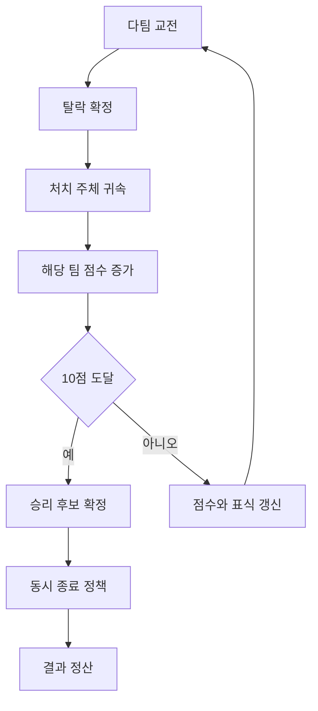

# 18. 4팀 섬멸전(Trio Wipeout) 심층 역기획

> 기준일: 2026-11-13. 2025년 10월 도입 자료와 공식 지원 문서를 대조했다. 4팀×3명으로, Trio Showdown과 다르다. 현재 운영 슬롯은 미확인.

## 1. 핵심 규칙과 자료 충돌

[공식] 네 팀이 처치 점수를 경쟁하며, 먼저 10점에 도달한 팀이 승리한다.[S1][S2]

[미확인] 왕관 표시 대상은 자료가 다르다. 도입 패치는 ‘선두 팀 구성원’, 지원 문서는 ‘각 팀 최다 처치자’를 설명한다. 이 문서는 어느 쪽이 현재 클라이언트와 일치하는지 확정하지 않는다. 점수 규칙과 표시 규칙을 분리해 재구현한다.

| 항목 | 기준 |
|---|---|
| 인원 | 4팀×3명 |
| 목표 | 상대 처치로 10점 선취 |
| 적대 관계 | 자기 팀 외 3팀과 적대 |
| 점수 귀속 | 최종 처치·환경 피해 규칙 실기 확인 |
| 왕관 | 공식 자료 충돌; 별도 검증 |
| 시간 종료·동률 | 최신 실기 확인 필요 |
| 부활 위치·보호 | 다팀 전용 위험도 확인 |

## 2. 왜 두 팀 섬멸전과 다른가 [해석]

두 팀에서는 상대가 체력을 잃으면 대체로 아군에게 이익이다. 네 팀에서는 내가 적을 약하게 만들었지만 다른 팀이 처치 점수를 얻을 수 있다. 또한 나와 싸우는 팀을 이겨도 멀리 있는 팀이 먼저 10점에 도달하면 패배한다.

따라서 이 모드는 단순 에임 경쟁에 ‘어느 팀과 언제 싸울지’라는 선택을 더한다. 처치가 승리 자원인 만큼 적의 체력과 점수 상황을 함께 읽는 능력이 중요하다.

## 3. 단계별 플레이 [해석]

1. **탐색:** 주변 팀의 위치와 교전 거리를 확인한다.
2. **첫 교전:** 쉽게 점수를 얻을 대상과 위험한 교차 사격을 구분한다.
3. **개입 선택:** 다른 팀끼리 싸울 때 마무리에 참여할지 다른 지역을 공략할지 결정한다.
4. **선두 견제:** 10점에 가까운 팀에게 추가 처치를 주지 않는 것이 중요해진다.
5. **마지막 점수:** 낮은 체력의 대상과 자기 팀 생존을 동시에 관리한다.

점수가 뒤진 팀이 무조건 선두에게 돌진하면 오히려 선두에게 쉬운 마지막 점수를 줄 수 있다. 전투의 목적은 ‘선두에게 피해를 주는 것’보다 ‘선두가 먼저 10점을 얻지 못하게 하며 내 점수를 올리는 것’이다.

## 4. 상태 모델 [제안]

피해를 준 모든 팀에 점수를 나누는 모델과 최종 처치 팀만 점수를 받는 모델은 플레이가 크게 다르다. 원작의 실제 귀속 규칙을 검증하고, 어시스트 통계와 승리 점수를 혼동하지 않는다.

## 5. 전술과 역할 [해석]

| 역할·행동 | 이점 | 위험 |
|---|---|---|
| 장거리 압박 | 적 체력을 안전하게 줄임 | 타 팀이 점수를 가져갈 수 있음 |
| 마무리 진입 | 약해진 적을 빠르게 처치 | 여러 팀의 사격선에 노출 |
| 보호·회복 | 상대에게 쉬운 점수 제공 방지 | 아군 공격 기회가 늦어짐 |
| 측면 이동 | 제3팀 개입 각도 확보 | 팀원과 고립 |
| 교전 회피 | 불리한 상대를 피해 생존 | 다른 팀의 득점을 방치 |

능력 효율은 총 피해보다 처치 전환율과 탈락 방지로 읽어야 한다. 다만 마무리만 노리는 플레이가 항상 최선은 아니다. 먼저 적의 안전한 위치를 무너뜨리는 압박이 없으면 마지막 타격 기회도 생기지 않는다.

## 6. 선두 표식의 설계 선택 [제안]

왕관이 선두 팀 전체를 표시하면 자연스럽게 견제가 모인다. 각 팀 최다 처치자를 표시하면 위협 개체를 읽기 쉬워지지만 실제 승리 직전 팀의 나머지 구성원을 놓칠 수 있다.

두 정책은 서로 다른 목적을 가진다. 재구현에서는 `CrownPolicy = LeadingTeam | TeamTopEliminator`처럼 분리하고, 패치로 바뀌어도 점수 시스템에 영향이 없게 한다. 화면에는 왕관이 뜻하는 바를 짧게 설명한다.

## 7. 맵·스폰·제3팀 개입 [해석·제안]

맵 중앙에 모든 팀이 모이면 광역 공격과 마무리 경쟁이 지배적일 수 있다. 외곽이 지나치게 안전하면 뒤진 팀이 싸움을 피하며 전체 템포가 떨어진다. 교전 지역 사이 이동시간과 제3팀이 개입할 때 노출되는 비용이 중요하다.

스폰은 최근 사망 위치만 기준으로 선택하면 다른 팀의 전선 한가운데 부활할 수 있다. 재구현에서는 적 거리·최근 피해·시야·출구 수를 함께 고려하는 안전도 평가가 필요하다. 원작의 실제 스폰 알고리즘은 미확인이다.

## 8. 데이터·UI [제안]

| 데이터 | 목적 |
|---|---|
| TeamScores[4] | 전체 선두와 목표 거리 |
| DamageHistory | 처치·환경 피해 귀속 검증 |
| EliminationEvent | 한 번만 점수 지급 |
| CrownPolicy / CrownTargets | 표시 규칙의 독립 관리 |
| SpawnCandidateScores | 부활 위험도 평가 |

HUD는 네 팀 점수를 한눈에 보여주되 자기 팀과 선두를 구분한다. 처치 알림에는 공격자·대상 팀이 읽혀야 한다. 모두 같은 ‘적’ 색으로 처리하면 중요한 점수 이동을 파악하기 어렵다.

## 9. QA [제안]

| ID | 시나리오 | 기대 결과 |
|---|---|---|
| W401 | 세 팀이 한 대상을 공격 | 검증된 처치 귀속 정책으로 한 번 점수화 |
| W402 | 두 팀 동시 10점 | 설정된 동시 종료 처리 |
| W403 | 왕관 정책 전환 | 점수·승리 규칙은 변하지 않음 |
| W404 | 선두 동점 | 표식과 점수 UI 일관 처리 |
| W405 | 환경 피해로 탈락 | 마지막 공격·환경 귀속 규칙 적용 |
| W406 | 부활 후보가 모두 위험 | 정해진 대체 정책과 보호 적용 |
| W407 | 소환수 소유자 사망 후 처치 | 소유 팀 귀속 보존 |
| W408 | 종료 뒤 늦은 처치 이벤트 | 결과를 뒤늦게 변경하지 않음 |

## 10. KPI·검증 과제 [제안]

피해 기여 팀과 처치 획득 팀의 불일치율, 제3팀 개입의 성공률, 선두 변경 횟수, 마지막 1점 구간의 길이, 스폰 직후 탈락률을 측정한다. 처치 도둑질로 느껴지는 경험이 많다면 공격 기여의 UI와 교전 공간 구조를 함께 평가한다.

실기 검증 우선순위는 왕관 대상, 처치 귀속, 시간 종료, 동시 10점, 스폰 보호 순이다. 이 다섯 항목을 확인하지 않고 두 팀 섬멸전의 팀 배열만 네 칸으로 늘리면 원작의 중요한 판단 구조를 놓친다.

## 출처

- [S1: 2025년 10월 패치](https://supercell.com/brawlstars/en/blog/game-updates/release-notes-october-2025/) — 인원·10점·도입 당시 왕관 설명.
- [S2: 공식 Game Modes](https://sc-brawlstars.zendesk.com/hc/en-us/articles/49526599632923-Game-Modes) — 4팀 섬멸전과 다른 왕관 설명. 충돌을 숨기지 않고 남김.

관련 문서: [기본 섬멸전](07_wipeout.md), [5v5 섬멸전](16_wipeout_5v5.md), [4팀 젬 그랩](17_gem_grab_four_teams.md), [전체 목차](../README.md).
