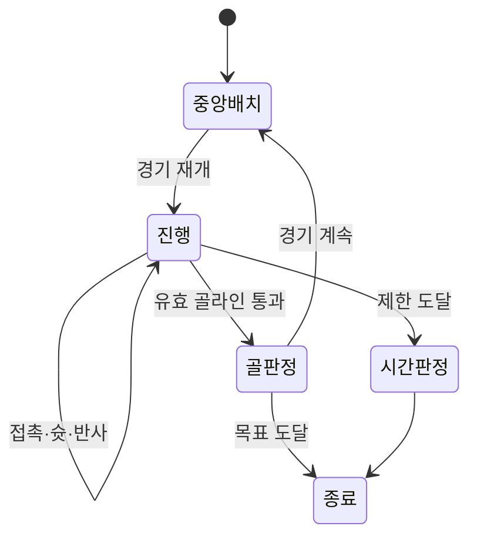

# 19. 브롤 하키 — Brawl Hockey

> 유형: 3대3 스포츠 목표 모드. 2024년 도입 자료와 2026년 물리 변경을 구분한다.
> 최신 슬롯 노출과 모든 경기 수치는 실기 미검증. [공식] 외 문단은 설계 해석 또는 재구현 제안이다.

## 1. 확인 규칙과 버전

[공식] 도입 공지는 미끄러지는 퍽을 쳐 상대 골에 넣는 3대3 전투와 3골 선취를 설명한다.[S1]
2026년 4월에는 공·퍽의 물리 계산 변경이 공지되었다.[S2]
3골은 도입 버전의 확인값이며, 개별 이벤트의 현행 설정까지 동일하다고 단정하지 않는다.

| 항목 | 확인/미확인 |
| --- | --- |
| 기본 목표 | 상대 골에 퍽을 넣어 득점 |
| 핵심 차이 | 퍽의 미끄러짐과 충돌 궤적 |
| 승리 목표 | 도입 버전 3골, 현행 이벤트 재확인 |
| 연장·동률·시간 | 브롤 볼 규칙 자동 상속 금지 |
| 퍽 소유·재습득 조건 | 실기 확인 필요 |
| 부활과 초기 자원 | 모드 설정 확인 필요 |

## 2. 설계 핵심 [해석]

브롤 볼은 운반자와 패스 경로에 시선이 모이기 쉽다.
하키는 이동 중인 퍽의 다음 위치와 반사 방향을 읽는 비중을 높인다.
플레이어를 쓰러뜨려도 퍽이 계속 위험한 방향으로 움직이면 수비가 끝나지 않는다.
전투 승리와 목표 안정 사이에 차이를 만들어 마지막 순간의 개입을 유도한다.

## 3. 단계별 의사결정

| 단계 | 공격의 질문 | 수비의 질문 |
| --- | --- | --- |
| 시작 | 퍽에 먼저 닿을지 상대 접근을 막을지 | 곧바로 골문을 비울지 |
| 중원 | 직접 슛, 측면 우회, 반사 중 무엇인가 | 예상 궤도에서 기다릴지 압박할지 |
| 골 앞 | 수비수를 제거할지 궤적을 바꿀지 | 몸·공격·능력으로 어떤 경로를 차단할지 |
| 턴오버 | 퍽을 따라갈지 복귀 경로를 막을지 | 제거보다 안전한 방향으로 보내기 |
| 마무리 | 무리한 추가 공격이 필요한가 | 중앙만 막으면 측면 반사가 열리는가 |

전방 플레이어와 골문 앞 플레이어의 간격이 너무 좁으면 한 번의 광역 공격으로 둘 다 역할을 잃는다.
반대로 너무 멀면 퍽 전환 때 지원이 늦는다.
지도 너비와 퍽 이동 속도가 이 간격의 적정치를 바꾼다.

## 4. 상태 모델 [제안]

“골문 근처에 있음”과 “유효한 방향으로 골라인을 통과함”을 분리한다.
벽 안에 들어간 퍽, 빠르게 이동하여 골라인을 한 프레임에 건너는 퍽,
골 판정 뒤 남은 반사 사건을 처리할 정책이 필요하다.

## 5. 물리·판정 명세 [제안]

| 필드 | 의미 |
| --- | --- |
| puckPosition / velocity | 권위 있는 위치·속도 |
| contactPolicy | 플레이어·벽·장치 접촉 반응 |
| shotImpulseProfile | 일반·강화·특수 슛의 이동 변화 |
| frictionProfile | 구역 또는 기본 감속 |
| pickupPolicy | 소유 가능한지, 접촉으로만 조작하는지 |
| goalPlane / goalVolume | 유효 득점 경계 |
| resetPolicy | 득점 후 위치·자원·효과 초기화 |
| stuckRecoveryPolicy | 지형 안 정지·도달 불가 상황 복구 |

원작 마찰계수·반발계수·물리 서브스텝은 공개 확인하지 않았다.
재구현에서 물리 수치를 변경하면 득점 경로와 수비 반응 시간이 함께 변하므로 아트 튜닝으로 취급하지 않는다.

## 6. 맵·조합·역전 [해석]

반사면은 단순한 장애물이 아니라 추가 슈팅 방향을 만든다.
벽에 가까운 수비수는 직선만 막아도 된다고 착각하기 쉽다.
공격팀이 한쪽에 집중하면 퍽을 반대로 보내는 행동의 가치가 커진다.

돌진·강제 이동·넓은 공격은 골 앞 공간에 영향을 주지만,
기본 모드에서 좋았던 능력이 퍽 판정에도 동일하게 작동한다고 가정하지 않는다.
역전은 체력 교환 외에 한 번의 궤도 변경, 상대 전진 뒤 빈 골문, 재개 직후의 압박에서 나올 수 있다.

## 7. UI 요구 [제안]

- 퍽이 브롤러와 효과에 가려져도 위치를 찾을 수 있게 한다.
- 우리 골과 상대 골을 색상 외 형태·방향으로도 구분한다.
- 빠른 슛의 잔상은 실제 위험 경로를 가리지 않아야 한다.
- 골 직전과 리셋 상태에서 조작 가능 여부를 명확히 보여 준다.
- 연장 규칙은 기본 브롤 볼과 다를 수 있으므로 전용 안내를 둔다.

## 8. QA 시나리오

| 사례 | 제안 기대 결과 |
| --- | --- |
| 최대 속도로 골라인 통과 | 연속 검사로 득점 누락 없음 |
| 골라인과 벽 동시 접촉 | 우선순위가 일관됨 |
| 골 직후 다음 반사 발생 | 추가 득점과 중복 리셋 없음 |
| 벽 파괴 중 퍽 접촉 | 유효 지형 버전에 맞는 반응 |
| 골문 가장자리 접촉 | 판정 경계와 표시 일치 |
| 퍽이 지형 안 정지 | 명시된 복구 정책 적용 |
| 양팀이 같은 순간 슛 | 입력 도착 순서에 종속되지 않는 정책 |
| 시간 종료 직전 슛 | 비행 중 퍽의 인정 범위를 정의 |
| 재접속 | 퍽 속도·점수·단계 복구 |

## 9. KPI와 미확인 실험

[제안] 득점당 슛 수, 직접/반사 득점 비중, 턴오버 후 실점 시간,
수비 위치별 골 방어율, 골 앞 효과 밀도, 시간 종료 비중을 본다.
실기에서는 소유 중 공격 가능 여부, 퍽에 작용하는 능력, 연장 지형 변경, 득점 후 초기화를 우선 확인한다.

## 10. 출처

- [S1: Toy Story 패치](https://supercell.com/en/games/brawlstars/blog/release-notes/patch-notes-toy-story/) — 도입 규칙. 검색 색인에서 본문 확인.
- [S2: 2026년 4월 패치](https://supercell.com/brawlstars/en/blog/release-notes/release-notes-april-2026/) — 물리 계산 변경.
- [브롤 볼](02_brawl_ball.md) · [슈퍼 하키](43_super_hockey.md) · [5대5 하키](56_brawl_hockey_5v5.md)

