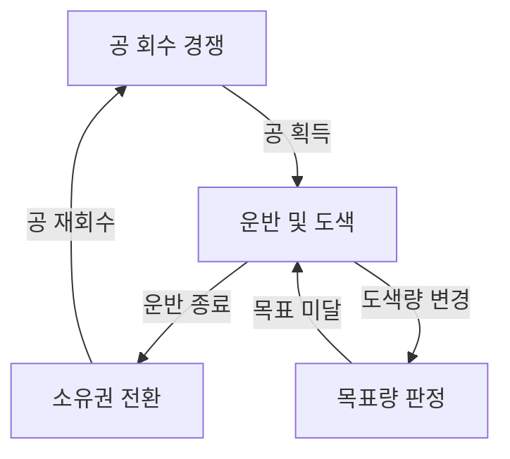

# 페인트 브롤 — Paint Brawl 역기획서

| 항목 | 내용 |
| --- | --- |
| 문서 기준일 | 2026-11-13 |
| 분석 상태 | 공식 소개 및 2024 도입 기록 확인. 2026-11-13의 실제 개방 슬롯은 미확인. |
| 자료 성격 | 공개 규칙 기반 역기획. 원작 내부 구현 또는 직접 플레이 실측 보고서가 아님 |

> 표기: **[공식]** 공개 자료에 명시된 사실, **[보조]** 커뮤니티 자료, **[해석]** 규칙에서 도출한 설계 분석, **[제안]** 재구현 방법, **[미확인]** 추가 검증 대상.

## 1. 핵심 규칙과 자료 경계

[공식] 페인트볼 운반과 처치로 팀 색을 늘리고, 목표 표시 100%를 먼저 달성한다. [S1]

**[미확인]** 100%의 분모가 전체 맵 타일인지 별도 목표 면적인지, 재도색·누적량 계산식과 시간 종료 기준은 공식 짧은 설명만으로 확정하지 않았다.

## 2. 플레이어 경험과 설계 의도 [해석]

이 모드는 전투 성과를 공간의 소유 변화로 번역한다. 운반자는 도색 경로를 설계하고 동료는 그 경로를 안전하게 만드는 역할을 맡는다. 점수판을 보지 않아도 지면의 색으로 우세가 드러나는 것이 핵심 경험이다.

이 절의 의도는 규칙을 설명하기 위한 분석이다. 개발팀의 실제 의사결정이라고 인용하지 않는다.

## 3. 경기 진행과 단계별 판단 [해석]

| 단계 | 플레이 흐름 및 판단 |
| --- | --- |
| 1 | 중앙 접근: 공을 바로 잡기보다 회수 후 빠져나갈 경로와 적의 사선을 먼저 확인한다. |
| 2 | 운반 분업: 운반자는 미도색 공간을 연결하고 호위자는 추격자의 접근선을 끊는다. |
| 3 | 지역 전환: 이미 아군 색인 곳을 반복 순회할지, 위험한 적색 구역으로 진입할지 결정한다. |
| 4 | 회수 싸움: 운반자가 쓰러졌을 때 공 회수와 주변 도색 상황을 함께 판단한다. |
| 5 | 종료 압박: 작은 면적을 확보하려는 돌진이 대규모 처치 도색을 상대에게 주지 않도록 속도를 조절한다. |

## 4. 규칙 상태 모델 [제안]

다음 모델은 검증 가능한 구현 단위로 규칙을 나눈 것이다. 원작의 클래스·함수·서버 처리 순서를 뜻하지 않는다.

## 5. 전략 구조·맵·조합·역전 [해석]

### 경로 길이 대 안전

짧은 길이 반드시 효율적인 것은 아니다. 새로운 도색 가능 면적과 적에게 노출되는 시간을 함께 비교한다.

### 운반자 선정

이동과 생존이 뛰어난 역할이 유리할 수 있지만, 그 선수가 공 때문에 공격 기회를 잃는 비용도 계산해야 한다.

### 처치 목적

처치 위치가 중요하다. 멀리 쫓아가 얻은 처치가 팀의 도색 전선과 무관하면 영향이 작다.

### 맵 형태

하나의 넓은 광장보다 여러 연결 구역이 있으면 공을 가진 팀의 다음 경로를 추론하는 재미가 커진다.

## 6. 판정 불변식과 예외 처리 [제안]

아래 항목은 재구현 시 보장할 일관성 조건이다. 원작에서 확인되지 않은 우선순위는 별도 설정과 실험 결과로 확정해야 한다.

1. 지면 표시와 승리 계산은 같은 도색 상태를 읽어야 한다. 렌더 텍스처만 변경하고 점수를 별도로 추정하지 않는다.
2. 한 셀이 한 시점에 두 팀의 소유로 중복 집계되지 않게 한다. 누적 도색 방식이라면 현재 소유와 누적 기여를 별도 변수로 둔다.
3. 처치 도색과 운반 도색이 동시에 발생해도 셀 갱신 순서가 모든 클라이언트에서 같은 결과를 낳아야 한다.

모든 종료 조건은 동일 경기 ID의 결과를 한 번만 확정해야 한다. 시간 종료·사망·목표 달성이 같은 판정 묶음에 들어오면 화면에 보인 순서만으로 승패를 정하지 않고, 명시된 규칙 버전을 사용한다.

## 7. 데이터와 이벤트 설계 [제안]

| 필드 | 의미 |
| --- | --- |
| PaintCellOwner[] | 셀별 소유 팀·중립 상태 |
| ScorableMask | 벽·물·비경기 영역 포함 여부 |
| PaintSourceId | 공 이동·처치 등 원인 식별 |
| CoverageTarget | 100% 표시의 실제 분모 |
| BallCarrierId | 현재 운반자 또는 없음 |
| PaintRuleVersion | 덮어쓰기·영구 누적 정책 버전 |

공통 메타데이터로 MatchId, RulesetVersion, EventId, ServerTime을 보관한다. 보상 정산에는 별도 SettlementId를 사용해 전투 재전송과 계정 지급을 분리한다.

### 판정 처리 흐름

1. 도색 이벤트를 원인 ID와 판정 시간으로 정렬한다.
2. 영향 셀 중 점수 인정 마스크에 속하는 셀만 갱신한다.
3. 변경 전후 팀별 면적 차이를 누적하여 점수를 계산한다.
4. 같은 판정 묶음의 도색 적용을 끝낸 뒤 목표량 달성 여부를 평가한다.

## 8. UI·피드백 요구사항 [제안]

- 공 위치·운반자·양 팀 진행도를 항상 식별 가능하게 한다.
- 아군/적군 색에 패턴이나 윤곽을 더해 색각 차이에 대응한다.
- 킬 피드와 별도로 큰 면적 변화가 생긴 위치를 짧게 강조한다.

## 9. QA 시나리오와 기대 결과 [제안]

이는 실제 테스트를 실행했다는 기록이 아니다. 미확인 규칙은 우선 클라이언트에서 관찰한 결과를 기입하고, 재구현의 합격 기준을 해당 버전에 맞춰 확정한다.

| ID | 상황 | 재구현의 기대 결과 또는 검증 기준 |
| --- | --- | --- |
| Q01 | 같은 셀을 아군이 반복 통과 | 선택한 누적 정책 이상으로 점수가 중복 증가하지 않는다. |
| Q02 | 두 팀 도색이 같은 시간에 겹침 | 서버의 정책에 따라 하나의 결과로 수렴한다. |
| Q03 | 벽 파괴로 바닥 면적이 늘어남 | 분모 변경 정책을 적용하고 UI와 점수가 일치한다. |
| Q04 | 공이 물·벽 안에 정지 | 유효 지점 복구 또는 접근 가능한 위치 보정이 실행된다. |
| Q05 | 운반 중 사망과 처치 도색 동시 발생 | 공 해제와 도색을 각각 한 번만 처리한다. |
| Q06 | 목표량 직전 상호 대형 도색 | 일괄 판정 후 승리 또는 동시 달성 정책을 적용한다. |
| Q07 | 관전자 중도 접속 | 현재 지면 전체 상태와 점수판이 일치한다. |
| Q08 | 시각 이펙트 품질 낮춤 | 판정에 필요한 셀 소유 정보는 사라지지 않는다. |

## 10. 밸런스 지표와 개선 판단 [해석·제안]

- 공 최초 획득 팀 승률: 공 획득 이후 회수전의 실효성을 평가한다.
- 운반 1초당 순도색량: 맵별로 안전한 반복 루트가 과도하게 강한지 찾는다.
- 처치 도색 비중: 도색 모드가 사실상 처치전으로 수렴하는지 측정한다.

지표는 맵·실력 구간·파티 구성·규칙 버전별로 분리한다. 단일 전체 승률만으로 규칙의 문제와 매치 구성의 문제를 구분하지 않는다.

## 11. 추가 실측 계획 [미확인]

1. 같은 바닥을 여러 번 지나며 표시 증가량을 기록한다.
2. 상대 색 위를 지나갈 때 상대 점수 감소와 아군 증가를 동시에 측정한다.
3. 맵 가장자리·파괴된 벽 자리에서 분모 또는 점수 변화를 비교한다.

측정에는 게임 버전, 이벤트명, 맵, 캐릭터와 능력, 화면 녹화의 시작·종료 시각을 함께 기록한다. 수치를 확인하면 기존 설명을 덮어쓰기보다 규칙 버전 표를 추가한다.

## 12. 출처와 연결 문서

- **[S1]** [공식 — Classic Brawl Update, 2024](https://supercell.com/en/games/brawlstars/blog/game-updates/patch-notes-classic-brawl-update/)

출처 접근 기준일: 2026-11-13. 공식 페이지가 로딩 화면만 제공한 경우 검색 서비스에 노출된 공식 본문 범위만 근거로 사용했다. 보조 자료는 공식 규칙으로 승격하지 않았다.

- [운반과 배달의 차이](31_present_plunder.md)
- [지역 유지와 도색의 차이](05_hot_zone.md)
- [전체 문서 목차](../README.md)
