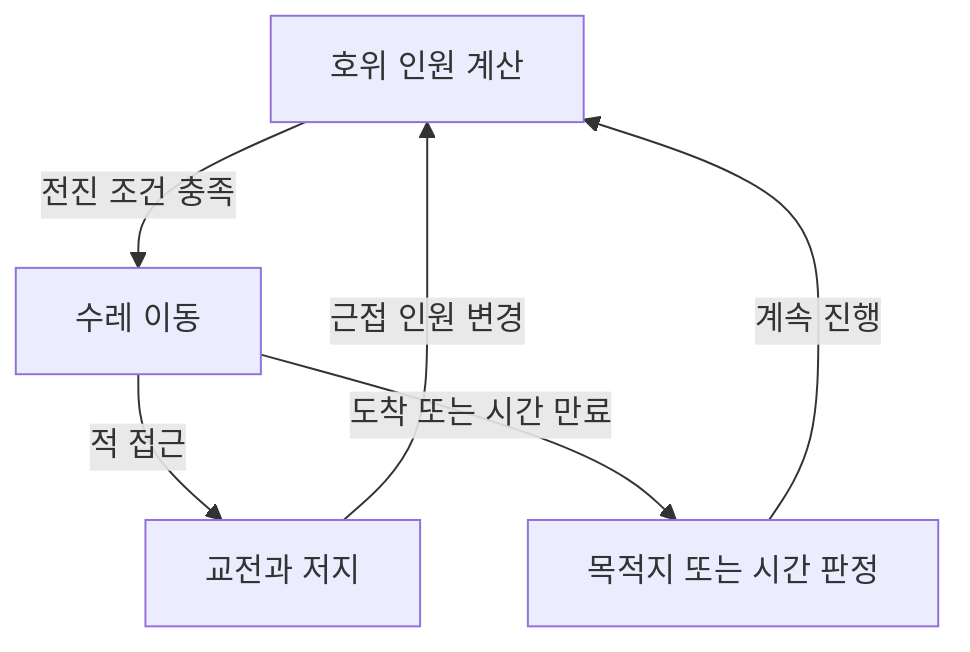

# 페이로드 — Payload 역기획서

| 항목 | 내용 |
| --- | --- |
| 문서 기준일 | 2026-11-13 |
| 분석 상태 | 공식 고객지원에 규칙 등재. 이 문서는 각 팀 수레가 있는 기본형을 분석한다. |
| 자료 성격 | 공개 규칙 기반 역기획. 원작 내부 구현 또는 직접 플레이 실측 보고서가 아님 |

> 표기: **[공식]** 공개 자료에 명시된 사실, **[보조]** 커뮤니티 자료, **[해석]** 규칙에서 도출한 설계 분석, **[제안]** 재구현 방법, **[미확인]** 추가 검증 대상.

## 1. 핵심 규칙과 자료 경계

[공식] 아군 수레 근접으로 전진하고 적 수레 근접으로 감속시킨다. 도착 또는 제한 시간의 더 먼 진척으로 승패를 정한다. [S1]

**[미확인]** 단일 수레를 서로 반대쪽으로 미는 Special Delivery와 구별한다. 인원별 가속 곡선, 정확한 저지 조건, 동률 처리는 미확인이다.

## 2. 플레이어 경험과 설계 의도 [해석]

움직이는 목표가 교전의 중심을 끌고 다닌다. 플레이어는 적을 밀어내는 전투와 실제 수레를 움직이는 업무 사이에서 인원을 배분한다. 맵의 같은 위치도 수레가 접근하기 전과 후에 가치가 달라진다.

이 절의 의도는 규칙을 설명하기 위한 분석이다. 개발팀의 실제 의사결정이라고 인용하지 않는다.

## 3. 경기 진행과 단계별 판단 [해석]

| 단계 | 플레이 흐름 및 판단 |
| --- | --- |
| 1 | 출발: 수레를 움직일 인원과 적 수레를 견제할 인원을 정한다. |
| 2 | 첫 병목: 수레보다 앞선 엄폐를 잡아 호위가 머무를 공간을 만든다. |
| 3 | 교차 판단: 적 수레를 늦추는 편이 내 수레 호위를 늘리는 것보다 이득인지 계산한다. |
| 4 | 복귀: 전방에서 쓰러진 동료가 재합류할 때 수레의 현재 위치를 기준으로 경로를 다시 정한다. |
| 5 | 마감: 남은 시간과 양쪽 진척 차이에 따라 총공세 또는 저지로 전환한다. |

## 4. 규칙 상태 모델 [제안]

다음 모델은 검증 가능한 구현 단위로 규칙을 나눈 것이다. 원작의 클래스·함수·서버 처리 순서를 뜻하지 않는다.

## 5. 전략 구조·맵·조합·역전 [해석]

### 호위와 전방 압박

수레 주변에 전원이 붙으면 광역 견제에 약해진다. 실제 이동에 필요한 인원만 남기고 다음 엄폐를 확보하는 구조가 합리적이다.

### 방해의 기회비용

적 수레를 늦추는 동안 자신의 수레가 멈춘다면 진척 차이는 개선되지 않을 수 있다. 두 수레의 순진행 속도를 비교해야 한다.

### 맵의 비대칭

진행도 백분율이 같아도 다음 병목 난도가 다르면 실제 우세는 다르다. 경로 길이와 전투 난도 모두 검증해야 한다.

### 역전 창

상대가 먼저 높은 진척에 도달했더라도 다음 구간에서 고립되면 한 번의 수비 성공으로 추격 시간이 생긴다.

## 6. 판정 불변식과 예외 처리 [제안]

아래 항목은 재구현 시 보장할 일관성 조건이다. 원작에서 확인되지 않은 우선순위는 별도 설정과 실험 결과로 확정해야 한다.

1. 수레 위치는 경로상의 스칼라 진척으로 저장하고 화면 좌표는 경로에서 계산한다. 단순 직선 거리로 승패를 비교하지 않는다.
2. 이동 반경 안의 소환물·무적·공중 상태를 인원으로 세는지 별도 정책이 필요하다.
3. 도착 이벤트는 종료 상태를 한 번만 만들며, 종료 후 수레가 추가로 이동해 승자가 바뀌지 않는다.

모든 종료 조건은 동일 경기 ID의 결과를 한 번만 확정해야 한다. 시간 종료·사망·목표 달성이 같은 판정 묶음에 들어오면 화면에 보인 순서만으로 승패를 정하지 않고, 명시된 규칙 버전을 사용한다.

## 7. 데이터와 이벤트 설계 [제안]

| 필드 | 의미 |
| --- | --- |
| PathId / PathDistance | 경로 및 누적 전진 거리 |
| NormalizedProgress | 팀 간 비교용 0~1 진척 |
| EscortRadius | 호위 인정 반경 |
| PresencePolicy | 생존·상태·팀별 인정 기준 |
| SpeedCurve | 아군/적 인원에 따른 속도 |
| TimeTiePolicy | 시간 종료 동률 해소 정책 |

공통 메타데이터로 MatchId, RulesetVersion, EventId, ServerTime을 보관한다. 보상 정산에는 별도 SettlementId를 사용해 전투 재전송과 계정 지급을 분리한다.

### 판정 처리 흐름

1. 각 수레 주변의 유효 아군·적 인원을 판정한다.
2. 설정된 인원-속도 함수를 평가하고 경로 거리를 적분한다.
3. 경로 끝을 넘는 이동량은 끝점으로 제한한다.
4. 두 수레의 같은 시간대 갱신 후 도착 또는 시간 종료 승패를 판정한다.

## 8. UI·피드백 요구사항 [제안]

- 양쪽 진척을 같은 축에 표시하되 수레별 위치도 미니 목표 표시로 제공한다.
- 멈춘 이유가 아군 부재인지 적 저지인지 수레 주변 아이콘으로 구분한다.
- 목표 근처 마지막 구간에는 도착까지 남은 진척을 강하게 알려준다.

## 9. QA 시나리오와 기대 결과 [제안]

이는 실제 테스트를 실행했다는 기록이 아니다. 미확인 규칙은 우선 클라이언트에서 관찰한 결과를 기입하고, 재구현의 합격 기준을 해당 버전에 맞춰 확정한다.

| ID | 상황 | 재구현의 기대 결과 또는 검증 기준 |
| --- | --- | --- |
| Q01 | 수레 반경 경계 반복 진입 | 상태 떨림이 속도·사운드 중복을 만들지 않는다. |
| Q02 | 아군 둘과 적 하나 진입 | 이 모드의 설정표를 적용하며 Special Delivery 규칙을 자동 상속하지 않는다. |
| Q03 | 점프 중 수레 근접 | 공중 상태 포함 정책대로 계산한다. |
| Q04 | 수레와 벽의 교차 | 경로 좌표가 벽 충돌로 영구 정지하지 않는다. |
| Q05 | 두 수레 동시 도착 | 지정된 동시 도착 정책을 적용한다. |
| Q06 | 서로 다른 길이 경로 | 원거리 자체보다 정규화된 진척을 비교한다. |
| Q07 | 시간 0 직전 마지막 이동 | 종료 시간 이전 이동만 점수에 포함한다. |
| Q08 | 중도 재접속 | 수레 위치·속도·목적지 방향이 재동기화된다. |

## 10. 밸런스 지표와 개선 판단 [해석·제안]

- 구간별 정체 시간: 특정 병목에 경기 전체가 묶이는지 측정한다.
- 수레 호위 인원 분포: 다수 동행만 항상 정답이 되는지 확인한다.
- 최대 진척 차이별 역전율: 공격과 방해 전략의 상호 대응성을 평가한다.

지표는 맵·실력 구간·파티 구성·규칙 버전별로 분리한다. 단일 전체 승률만으로 규칙의 문제와 매치 구성의 문제를 구분하지 않는다.

## 11. 추가 실측 계획 [미확인]

1. 아군 1·2·3명 및 적 0·1명 조합에서 일정 시간의 이동량을 비교한다.
2. 지형/무적/소환물 상태별 호위 인정 여부를 측정한다.
3. 진척 동률의 시간 종료를 재현해 무승부 또는 연장 여부를 확인한다.

측정에는 게임 버전, 이벤트명, 맵, 캐릭터와 능력, 화면 녹화의 시작·종료 시각을 함께 기록한다. 수치를 확인하면 기존 설명을 덮어쓰기보다 규칙 버전 표를 추가한다.

## 12. 출처와 연결 문서

- **[S1]** [공식 고객지원 — Game Modes](https://sc-brawlstars.zendesk.com/hc/en-us/articles/49526599632923-Game-Modes)
- **[S2]** [공식 — Toy Story!, 2024-12](https://supercell.com/en/games/brawlstars/blog/release-notes/patch-notes-toy-story/)

출처 접근 기준일: 2026-11-13. 공식 페이지가 로딩 화면만 제공한 경우 검색 서비스에 노출된 공식 본문 범위만 근거로 사용했다. 보조 자료는 공식 규칙으로 승격하지 않았다.

- [공성 전진 압박 비교](24_siege.md)
- [고정 목표와 이동 목표 비교](05_hot_zone.md)
- [전체 문서 목차](../README.md)
