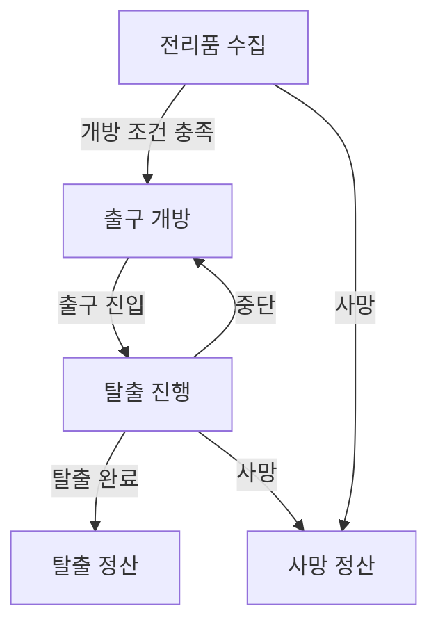

# 트로피 탈출 — Trophy Escape 역기획서

| 항목 | 내용 |
| --- | --- |
| 문서 기준일 | 2026-11-13 |
| 분석 상태 | 공식 특수 이벤트 설명 확인. 실제 개방 일정·보상 증감표는 미확인. |
| 자료 성격 | 공개 규칙 기반 역기획. 원작 내부 구현 또는 직접 플레이 실측 보고서가 아님 |

> 표기: **[공식]** 공개 자료에 명시된 사실, **[보조]** 커뮤니티 자료, **[해석]** 규칙에서 도출한 설계 분석, **[제안]** 재구현 방법, **[미확인]** 추가 검증 대상.

## 1. 핵심 규칙과 자료 경계

[공식] 전리품을 모아 출구로 탈출한다. 절반 탈락 또는 종료 카운트다운이 출구 개방 조건이며, 로봇도 전리품을 제공한다. [S1]

**[미확인]** 전장 안의 휴대 전리품과 계정에 확정된 트로피를 구분한다. 입장 비용, 사망 시 정산, 마지막 생존자 자동 처리 등은 현재 클라이언트 검증 대상이다.

## 2. 플레이어 경험과 설계 의도 [해석]

살아남는 시간만으로 보상을 결정하지 않고, 언제 위험을 멈출지를 플레이어에게 맡긴다. 전리품이 늘수록 다음 전투의 이득뿐 아니라 잃을 금액도 커진다. 탈출구는 승리 지점이자 매복 지점이다.

이 절의 의도는 규칙을 설명하기 위한 분석이다. 개발팀의 실제 의사결정이라고 인용하지 않는다.

## 3. 경기 진행과 단계별 판단 [해석]

| 단계 | 플레이 흐름 및 판단 |
| --- | --- |
| 1 | 초기 수집: 가까운 로봇과 상대 사이에서 낮은 위험의 수익 경로를 고른다. |
| 2 | 전투 선택: 자신이 확보한 전리품과 상대가 가진 전리품을 비교한다. |
| 3 | 출구 예측: 개방 조건에 가까워지면 도주로와 적의 예상 접근선을 확인한다. |
| 4 | 탈출 또는 잔류: 현재 수익을 확정할지, 남은 상대를 노려 더 얻을지 결정한다. |
| 5 | 정산: 탈출·사망·경기 종료 원인을 분리하여 결과 화면에서 설명한다. |

## 4. 규칙 상태 모델 [제안]

다음 모델은 검증 가능한 구현 단위로 규칙을 나눈 것이다. 원작의 클래스·함수·서버 처리 순서를 뜻하지 않는다.

## 5. 전략 구조·맵·조합·역전 [해석]

### 위험 예산

휴대량이 적으면 공격적인 전투가 합리적이지만, 많이 확보하면 같은 승률의 전투도 회피할 이유가 생긴다.

### 출구 캠핑

출구는 경로 선택을 압축한다. 여러 출구의 접근 거리와 시야가 비슷해야 특정 시작 위치가 유리해지는 것을 줄일 수 있다.

### 성장과 수익

파워 큐브는 추가 수익을 얻는 능력을 높이는 자원이다. 전리품과 같은 변수로 저장하면 성장과 정산을 혼동하기 쉽다.

### 매치 잔류 인원

먼저 탈출하는 플레이어가 생기면 다음 위험도가 변한다. 사망 탈락 수와 탈출 수를 같은 개방 조건으로 취급할지는 별도 검증이 필요하다.

## 6. 판정 불변식과 예외 처리 [제안]

아래 항목은 재구현 시 보장할 일관성 조건이다. 원작에서 확인되지 않은 우선순위는 별도 설정과 실험 결과로 확정해야 한다.

1. 확정 보상과 휴대 전리품을 별도 장부로 관리한다. 클라이언트의 애니메이션 완료만으로 계정 보상을 지급하지 않는다.
2. 플레이어당 탈출·사망·시간 종료 중 하나의 종결 원인만 유효해야 한다.
3. 로봇/플레이어 전리품 드롭과 회수는 원래 아이템 ID로 추적하여 재접속 또는 중복 이벤트 악용을 방지한다.

모든 종료 조건은 동일 경기 ID의 결과를 한 번만 확정해야 한다. 시간 종료·사망·목표 달성이 같은 판정 묶음에 들어오면 화면에 보인 순서만으로 승패를 정하지 않고, 명시된 규칙 버전을 사용한다.

## 7. 데이터와 이벤트 설계 [제안]

| 필드 | 의미 |
| --- | --- |
| CarriedLoot | 현재 휴대량 |
| SecuredReward | 정산 완료량 |
| ExitOpenRule | 인원·시간 개방 조건 |
| ExtractionProgress | 출구별 탈출 진행 |
| TerminalReason | 사망·탈출·종료 원인 |
| SettlementId | 중복 지급 방지 정산 키 |

공통 메타데이터로 MatchId, RulesetVersion, EventId, ServerTime을 보관한다. 보상 정산에는 별도 SettlementId를 사용해 전투 재전송과 계정 지급을 분리한다.

### 판정 처리 흐름

1. 전투 결과와 전리품 이전을 먼저 권위 상태에 반영한다.
2. 유효 잔류 인원과 종료 시간으로 출구 개방을 평가한다.
3. 출구의 유효 플레이어에 대해 탈출 진행을 누적하거나 중단한다.
4. 종결 원인을 확정한 후 보상 트랜잭션을 한 번만 발행한다.

## 8. UI·피드백 요구사항 [제안]

- 휴대 중인 양과 탈출 시 예상 확정 보상을 구분한다.
- 출구가 아직 닫혀 있으면 개방 이유와 남은 조건을 보여준다.
- 탈출 진행 중에는 취소 조건과 진행 막대가 전투 효과에 가려지지 않아야 한다.

## 9. QA 시나리오와 기대 결과 [제안]

이는 실제 테스트를 실행했다는 기록이 아니다. 미확인 규칙은 우선 클라이언트에서 관찰한 결과를 기입하고, 재구현의 합격 기준을 해당 버전에 맞춰 확정한다.

| ID | 상황 | 재구현의 기대 결과 또는 검증 기준 |
| --- | --- | --- |
| Q01 | 탈출 완료와 치명타 같은 판정 묶음 | 문서화된 우선순위 하나만 적용하고 이중 정산하지 않는다. |
| Q02 | 탈출 직후 연결 해제 | 이미 확정된 보상이 유지된다. |
| Q03 | 출구에서 밀려남 | 진행 중단 또는 초기화 정책이 즉시 표시된다. |
| Q04 | 동일 드롭 여러 명 접촉 | 전리품은 하나의 소유자에게만 이전된다. |
| Q05 | 마지막 두 명 중 한 명 탈출 | 잔류 인원 처리와 출구 상태가 일관된다. |
| Q06 | 서버 종료 후 결과 재요청 | 같은 SettlementId로 새 보상이 추가되지 않는다. |
| Q07 | 인원 조건과 시간 조건 동시 충족 | 출구 개방 이벤트를 한 번만 발생시킨다. |
| Q08 | 전리품 0 상태 탈출 | 허용 여부와 최소 보상 정책을 명시적으로 적용한다. |

## 10. 밸런스 지표와 개선 판단 [해석·제안]

- 휴대량별 탈출 선택률: 위험-보상 곡선의 실제 작동을 본다.
- 출구 개방 후 사망 위치 분포: 탈출구 캠핑 집중도를 찾는다.
- 보상 미확정 이탈 비율: 결과 안내의 부족이나 정산 문제를 구분한다.

지표는 맵·실력 구간·파티 구성·규칙 버전별로 분리한다. 단일 전체 승률만으로 규칙의 문제와 매치 구성의 문제를 구분하지 않는다.

## 11. 추가 실측 계획 [미확인]

1. 무전리품 탈출·최후 생존·시간 만료를 각각 재현해 결과 장부를 비교한다.
2. 출구 진입 중 피해·밀치기·은신·점프의 영향을 기록한다.
3. 사망과 탈출이 출구 개방 인원 조건에 각각 포함되는지 확인한다.

측정에는 게임 버전, 이벤트명, 맵, 캐릭터와 능력, 화면 녹화의 시작·종료 시각을 함께 기록한다. 수치를 확인하면 기존 설명을 덮어쓰기보다 규칙 버전 표를 추가한다.

## 12. 출처와 연결 문서

- **[S1]** [공식 고객지원 — Game Modes](https://sc-brawlstars.zendesk.com/hc/en-us/articles/49526599632923-Game-Modes)

출처 접근 기준일: 2026-11-13. 공식 페이지가 로딩 화면만 제공한 경우 검색 서비스에 노출된 공식 본문 범위만 근거로 사용했다. 보조 자료는 공식 규칙으로 승격하지 않았다.

- [최후 생존과 조기 탈출 비교](08_solo_showdown.md)
- [공격 유인 비교](23_hunters.md)
- [전체 문서 목차](../README.md)
