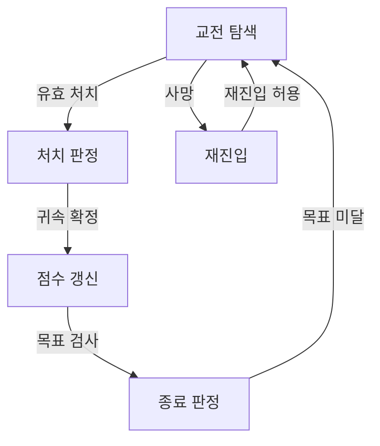

# 헌터즈 — Hunters 역기획서

| 항목 | 내용 |
| --- | --- |
| 문서 기준일 | 2026-11-13 |
| 분석 상태 | 공식 특수 이벤트 규칙 등재. 슬롯의 현재 개방 여부는 미확인. |
| 자료 성격 | 공개 규칙 기반 역기획. 원작 내부 구현 또는 직접 플레이 실측 보고서가 아님 |

> 표기: **[공식]** 공개 자료에 명시된 사실, **[보조]** 커뮤니티 자료, **[해석]** 규칙에서 도출한 설계 분석, **[제안]** 재구현 방법, **[미확인]** 추가 검증 대상.

## 1. 핵심 규칙과 자료 경계

[공식] 10인 개인전이며 처치당 1점, 6점 선착순이다. [S1]

**[미확인]** 재등장 주기, 정확한 부활 위치 선택, 동시 목표 달성 우선순위는 미확인이다. 현재 브롤러 메타를 특정하지 않고 처치 레이스의 구조를 분석한다.

## 2. 플레이어 경험과 설계 의도 [해석]

개인 생존보다 빠른 처치 누적을 유도하는 레이스다. 전투에 참여하지 않고 숨는 행동의 보상은 줄어들지만, 다른 둘이 싸우는 순간을 노리는 제삼자 개입 가치는 커진다.

이 절의 의도는 규칙을 설명하기 위한 분석이다. 개발팀의 실제 의사결정이라고 인용하지 않는다.

## 3. 경기 진행과 단계별 판단 [해석]

| 단계 | 플레이 흐름 및 판단 |
| --- | --- |
| 1 | 탐색: 가까운 적의 체력·탄약·교전 상대를 읽는다. |
| 2 | 교전 선택: 장기 일대일 대신 짧게 마무리할 수 있는 목표를 찾는다. |
| 3 | 처치 확보: 사용 가능한 공격을 모두 소모할지 다음 적을 위해 남길지 결정한다. |
| 4 | 재배치: 처치 지점에서 즉시 다음 사선 또는 회복 위치로 이동한다. |
| 5 | 종료 경쟁: 선두의 위치를 견제할지 자신의 마지막 점수를 직접 노릴지 선택한다. |

## 4. 규칙 상태 모델 [제안]

다음 모델은 검증 가능한 구현 단위로 규칙을 나눈 것이다. 원작의 클래스·함수·서버 처리 순서를 뜻하지 않는다.

## 5. 전략 구조·맵·조합·역전 [해석]

### 마지막 일격 경쟁

총피해와 최종 처치는 서로 다르다. 막타 귀속 중심이라면 오랜 전투의 기여를 빼앗기는 경험이 발생할 수 있다.

### 죽음의 비용

영구 탈락이 없는 형태를 구현한다면 사망 비용은 주로 이동·재합류 시간이다. 이 비용이 너무 작으면 무리한 교환이 최적이 된다.

### 정보 공개

선두 점수를 공개하면 추격 유인이 생기지만 정확한 위치까지 항상 공개하면 선두에게 과도한 불이익이 될 수 있다.

### 맵 밀도

적을 찾는 시간이 길면 목표 점수 경쟁이 정체된다. 너무 작으면 세 방향 동시 피격이 늘어 통제감이 낮아진다.

## 6. 판정 불변식과 예외 처리 [제안]

아래 항목은 재구현 시 보장할 일관성 조건이다. 원작에서 확인되지 않은 우선순위는 별도 설정과 실험 결과로 확정해야 한다.

1. 피해 이벤트가 아닌 처치 이벤트만 득점 장부를 변경한다.
2. 한 피해자가 여러 공격에 동시에 쓰러져도 득점 소유자는 정책상 한 명으로 확정한다.
3. 죽은 플레이어가 발사한 투사체가 나중에 처치했을 때의 득점 인정 여부를 분명히 해야 한다.

모든 종료 조건은 동일 경기 ID의 결과를 한 번만 확정해야 한다. 시간 종료·사망·목표 달성이 같은 판정 묶음에 들어오면 화면에 보인 순서만으로 승패를 정하지 않고, 명시된 규칙 버전을 사용한다.

## 7. 데이터와 이벤트 설계 [제안]

| 필드 | 의미 |
| --- | --- |
| KillScore[] | 개인별 점수 |
| TargetScore | 공식 소개 기준 6 |
| KillAttributionRule | 막타·환경사·자살 귀속 |
| RespawnPolicy | 대기·위치·보호 정책 |
| FinishOrder | 목표 도달 판정 순서 |
| LeaderVisibility | 선두 정보 공개 범위 |

공통 메타데이터로 MatchId, RulesetVersion, EventId, ServerTime을 보관한다. 보상 정산에는 별도 SettlementId를 사용해 전투 재전송과 계정 지급을 분리한다.

### 판정 처리 흐름

1. 사망을 확정하고 피해 이력에서 유효 처치 주체를 선택한다.
2. 동일 사망 ID를 이미 처리했으면 점수 변경을 생략한다.
3. 점수를 반영한 뒤 해당 판정 묶음의 목표 달성자를 모은다.
4. 동시 달성 정책에 따라 결과를 확정하고 이후 득점을 막는다.

## 8. UI·피드백 요구사항 [제안]

- 현재 내 점수와 목표량, 선두와의 차이를 짧게 보여준다.
- 처치의 귀속이 기대와 달랐을 때 킬 피드로 주체를 확인할 수 있게 한다.
- 종료 임박한 선수를 강조하되 일반 적 식별을 방해하지 않는다.

## 9. QA 시나리오와 기대 결과 [제안]

이는 실제 테스트를 실행했다는 기록이 아니다. 미확인 규칙은 우선 클라이언트에서 관찰한 결과를 기입하고, 재구현의 합격 기준을 해당 버전에 맞춰 확정한다.

| ID | 상황 | 재구현의 기대 결과 또는 검증 기준 |
| --- | --- | --- |
| Q01 | 두 플레이어가 같은 적에 치명타 | 점수 한 번만 발생한다. |
| Q02 | 사후 투사체 처치 | 사후 득점 정책대로 반영한다. |
| Q03 | 환경 피해 사망 | 환경사 귀속 정책을 적용한다. |
| Q04 | 목표 직전 상호 처치 | 동시 달성 규칙대로 처리한다. |
| Q05 | 초기 스폰 옆 즉시 교전 | 시작 보호·입력 활성화 시간이 공정하다. |
| Q06 | 부활 직후 적에게 포위 | 스폰 선정 정책의 안전성이 확보된다. |
| Q07 | 점수 HUD 수신 지연 | 서버 확정 점수로 수렴한다. |
| Q08 | 종료 후 지연 도착 처치 | 이미 확정된 순위가 변하지 않는다. |

## 10. 밸런스 지표와 개선 판단 [해석·제안]

- 처치의 제삼자 개입 비율: 순수 교전과 기회 포착의 균형을 본다.
- 탐색 시간 대비 교전 시간: 전투 레이스의 밀도를 평가한다.
- 선두 교체 횟수: 초반 몇 번의 처치가 승패를 고정하는지 본다.

지표는 맵·실력 구간·파티 구성·규칙 버전별로 분리한다. 단일 전체 승률만으로 규칙의 문제와 매치 구성의 문제를 구분하지 않는다.

## 11. 추가 실측 계획 [미확인]

1. 피해량이 큰 사람과 마지막 타격자가 다른 상황에서 귀속을 확인한다.
2. 동시 사망·사후 처치·환경사를 각각 기록한다.
3. 반복 사망 후 스폰 지점 분포를 수집해 편향을 확인한다.

측정에는 게임 버전, 이벤트명, 맵, 캐릭터와 능력, 화면 녹화의 시작·종료 시각을 함께 기록한다. 수치를 확인하면 기존 설명을 덮어쓰기보다 규칙 버전 표를 추가한다.

## 12. 출처와 연결 문서

- **[S1]** [공식 고객지원 — Game Modes](https://sc-brawlstars.zendesk.com/hc/en-us/articles/49526599632923-Game-Modes)

출처 접근 기준일: 2026-11-13. 공식 페이지가 로딩 화면만 제공한 경우 검색 서비스에 노출된 공식 본문 범위만 근거로 사용했다. 보조 자료는 공식 규칙으로 승격하지 않았다.

- [가변 현상금과 고정 처치점 비교](29_lone_star.md)
- [처치로 캐릭터가 바뀌는 레이스 비교](34_drumroll.md)
- [전체 문서 목차](../README.md)
