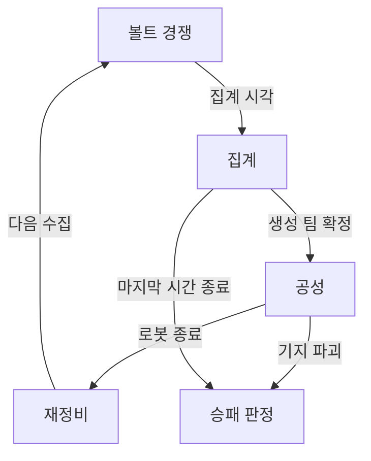

# 시즈 — Siege 역기획서

| 항목 | 내용 |
| --- | --- |
| 문서 기준일 | 2026-11-13 |
| 분석 상태 | 2019 도입 및 후속 조정 기록을 바탕으로 한 역사 모드 분석. 현재 제공 여부 미확인. |
| 자료 성격 | 공개 규칙 기반 역기획. 원작 내부 구현 또는 직접 플레이 실측 보고서가 아님 |

> 표기: **[공식]** 공개 자료에 명시된 사실, **[보조]** 커뮤니티 자료, **[해석]** 규칙에서 도출한 설계 분석, **[제안]** 재구현 방법, **[미확인]** 추가 검증 대상.

## 1. 핵심 규칙과 자료 경계

[공식] 3v3에서 볼트를 다투고, 집계 우세 팀의 로봇과 함께 적 방어 기지를 공략하며, 적 기지 파괴가 승리 목표다. [S1] 2019 조정은 공성 후 볼트 재생성 지연의 목적을 눈덩이 완화라고 설명했다. [S2]

**[미확인]** 도입 당시 긴 경기·보상 규칙을 현재 규칙으로 옮기지 않는다. 공성 횟수, 볼트 보유 이월, 동률 생성, 최종 시간·기지 체력은 버전별 검증이 필요하다.

## 2. 플레이어 경험과 설계 의도 [해석]

중립 자원전의 성과를 다음 공격 단계의 아군 병력으로 전환한다. 작은 교전 승리가 즉시 점수로 끝나지 않고 이후 공성의 기회를 만드는 두 단계 보상 구조다.

이 절의 의도는 규칙을 설명하기 위한 분석이다. 개발팀의 실제 의사결정이라고 인용하지 않는다.

## 3. 경기 진행과 단계별 판단 [해석]

| 단계 | 플레이 흐름 및 판단 |
| --- | --- |
| 1 | 볼트 수집: 중앙에서 생존과 획득을 함께 유지한다. |
| 2 | 집계 직전: 현재 차이와 다음 볼트 접근 가능성을 보고 무리한 진입 여부를 결정한다. |
| 3 | 공성 개시: 공격 팀은 로봇과 진입 시점을 맞추고 수비 팀은 화력 집중을 준비한다. |
| 4 | 공성 진행: 로봇을 지키는 행동과 기지를 직접 타격하는 행동의 비율을 조절한다. |
| 5 | 전환: 로봇이 사라진 뒤 중앙 복귀와 재정비를 동시에 수행한다. |

## 4. 규칙 상태 모델 [제안]

다음 모델은 검증 가능한 구현 단위로 규칙을 나눈 것이다. 원작의 클래스·함수·서버 처리 순서를 뜻하지 않는다.

## 5. 전략 구조·맵·조합·역전 [해석]

### 현재 공성 대 다음 공성

이번 획득 경쟁이 불리하다면 자원을 보전하는 선택이 가능할 수 있다. 이월 규칙에 따라 최적 전략이 크게 달라진다.

### 로봇의 역할

로봇은 피해원이며 방어 화력을 받아내는 전진 도구다. 체력만 높이는 것보다 플레이어가 호위했을 때 생존이 늘어나는 설계가 협동을 만든다.

### 기지 방어와 중앙 복귀

전원을 수비에 묶으면 다음 자원전을 양보한다. 반대로 로봇 처리를 너무 일찍 떠나면 기지 피해가 커진다.

### 눈덩이 원인

성공한 공성으로 전선을 밀고 다음 볼트까지 먼저 차지하면 보상이 복리로 연결된다. 단계 전환의 공백이 이 연결을 조절한다.

## 6. 판정 불변식과 예외 처리 [제안]

아래 항목은 재구현 시 보장할 일관성 조건이다. 원작에서 확인되지 않은 우선순위는 별도 설정과 실험 결과로 확정해야 한다.

1. 필드의 볼트, 휴대/확정된 볼트, 이미 소비한 볼트를 구분한다.
2. 공성 생성 시점의 자원 스냅샷을 고정하여 이후 획득이 생성된 로봇을 소급 변경하지 않게 한다.
3. 기지 공격 가능 상태·사거리·로봇 표적 우선순위를 별도 정책으로 두어 새 브롤러 능력과 충돌하지 않게 한다.

모든 종료 조건은 동일 경기 ID의 결과를 한 번만 확정해야 한다. 시간 종료·사망·목표 달성이 같은 판정 묶음에 들어오면 화면에 보인 순서만으로 승패를 정하지 않고, 명시된 규칙 버전을 사용한다.

## 7. 데이터와 이벤트 설계 [제안]

| 필드 | 의미 |
| --- | --- |
| `BaseHP` | 팀별 기지 잔여 체력 |
| `EndPolicy` | 기지 파괴·시간 종료·동시 파괴 정책 |
| SiegeSchedule[] | 수집 종료 및 공성 구간 |
| BoltSpawnSequence | 위치·순서·시간표 |
| TeamBolts[] | 집계된 팀 자원 |
| CarryOverPolicy | 패배·동률 자원 이월 |
| RobotLevelCurve | 자원량에 따른 로봇 능력 |
| BaseTargetPolicy | 기지 사거리·표적 우선순위 |

공통 메타데이터로 MatchId, RulesetVersion, EventId, ServerTime을 보관한다. 보상 정산에는 별도 SettlementId를 사용해 전투 재전송과 계정 지급을 분리한다.

### 판정 처리 흐름

1. 집계 시각 이전에 확정된 볼트 획득만 스냅샷에 넣는다.
2. 우세 또는 동률 정책으로 생성 팀과 로봇 수준을 선택한다.
3. 소비·이월 장부를 갱신한 뒤 공성 엔티티를 한 번 생성한다.
4. 공성 종료 시 잔여 로봇과 다음 볼트 생성 일정을 규칙에 맞게 정리한다.

## 8. UI·피드백 요구사항 [제안]

- 다음 집계까지 시간과 팀별 볼트 차이를 동시에 보여준다.
- 공성 단계 전환을 명확히 알리고 생성 로봇 수준을 표시한다.
- 기지 위험 범위를 맵 위에서 읽을 수 있게 하여 무리한 진입을 학습하게 한다.

## 9. QA 시나리오와 기대 결과 [제안]

이는 실제 테스트를 실행했다는 기록이 아니다. 미확인 규칙은 우선 클라이언트에서 관찰한 결과를 기입하고, 재구현의 합격 기준을 해당 버전에 맞춰 확정한다.

| ID | 상황 | 재구현의 기대 결과 또는 검증 기준 |
| --- | --- | --- |
| Q01 | 집계 순간 볼트 획득 | 정해진 경계 시간 규칙을 적용한다. |
| Q02 | 집계 볼트 동률 | 동률 생성/이월 정책이 유지된다. |
| Q03 | 공성 중 추가 볼트 이벤트 | 다음 집계 또는 무효 정책을 적용한다. |
| Q04 | 로봇이 임시 벽에 갇힘 | 경로 갱신·우회·복구 정책을 실행한다. |
| Q05 | 로봇 사망과 기지 파괴 동시 | 승패와 단계 전환이 충돌하지 않는다. |
| Q06 | 양 기지 동시에 파괴 | 문서화된 무승부·우선순위 정책을 적용한다. |
| Q07 | 은신 중 기지 진입 | 기지 감지 정책대로 표적을 정한다. |
| Q08 | 공성 직후 중앙 복귀 | 볼트 재생성 시계가 중복 시작되지 않는다. |

## 10. 밸런스 지표와 개선 판단 [해석·제안]

- 첫 공성 승리 팀의 최종 승률: 초반 우세 고착 정도를 본다.
- 공성 후 중앙 선점률: 한 승리가 다음 승리로 자동 연결되는지 본다.
- 로봇 수준별 실제 기지 피해: 숫자 증가가 전투 가능성을 과도하게 늘리는지 확인한다.

지표는 맵·실력 구간·파티 구성·규칙 버전별로 분리한다. 단일 전체 승률만으로 규칙의 문제와 매치 구성의 문제를 구분하지 않는다.

## 11. 추가 실측 계획 [미확인]

1. 서로 다른 볼트 차이로 집계하여 생성·소비·이월을 기록한다.
2. 투사체·은신·소환물별 기지 표적 정책을 확인한다.
3. 공성 종료에서 다음 볼트 생성까지 시간을 영상으로 측정한다.

측정에는 게임 버전, 이벤트명, 맵, 캐릭터와 능력, 화면 녹화의 시작·종료 시각을 함께 기록한다. 수치를 확인하면 기존 설명을 덮어쓰기보다 규칙 버전 표를 추가한다.

## 12. 출처와 연결 문서

- **[S1]** [공식 — Update has Arrived!, 2019-02-27](https://supercell.com/en/games/brawlstars/blog/game-updates/update-has-arrived-2/)
- **[S2]** [공식 — Bug Fixes and Game Improvements!, 2019](https://supercell.com/en/games/brawlstars/blog/release-notes/bug-fixes-and-game-improvements/)

출처 접근 기준일: 2026-11-13. 공식 페이지가 로딩 화면만 제공한 경우 검색 서비스에 노출된 공식 본문 범위만 근거로 사용했다. 보조 자료는 공식 규칙으로 승격하지 않았다.

- [다수 혼령 공성으로 변형된 규칙](37_spirit_wars.md)
- [이동 전선과 공격 기회 비교](21_payload.md)
- [전체 문서 목차](../README.md)
