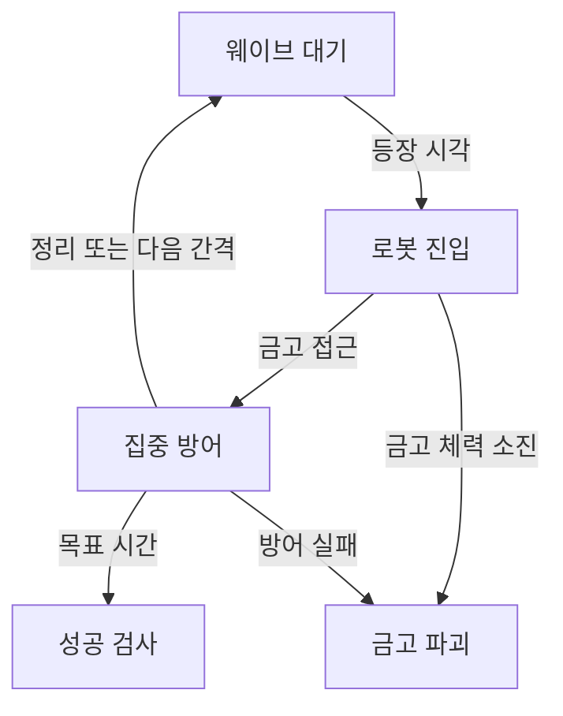

# 로보 럼블 — Robo Rumble 역기획서

| 항목 | 내용 |
| --- | --- |
| 문서 기준일 | 2026-11-13 |
| 분석 상태 | 공식 협동 이벤트 설명과 2020 개편 기준. 현재 이벤트 일정·난도표는 미확인. |
| 자료 성격 | 공개 규칙 기반 역기획. 원작 내부 구현 또는 직접 플레이 실측 보고서가 아님 |

> 표기: **[공식]** 공개 자료에 명시된 사실, **[보조]** 커뮤니티 자료, **[해석]** 규칙에서 도출한 설계 분석, **[제안]** 재구현 방법, **[미확인]** 추가 검증 대상.

## 1. 핵심 규칙과 자료 경계

[공식] 로봇 웨이브로부터 금고를 지키는 협동전이다. [S1] 2020 개편은 생존 목표를 2분으로 명시한다. [S2]

**[미확인]** 2분은 2020 규칙 스냅샷이며 모든 이후 이벤트에 자동 적용하지 않는다. 금고 체력, 로봇 수, 이동·공격 수치와 난도별 상한은 검증 대상이다.

## 2. 플레이어 경험과 설계 의도 [해석]

플레이어 체력이 아닌 공용 목표의 체력을 중심에 둔다. 자신이 피해를 피하는 것과 팀이 성공하는 것이 항상 같지 않기 때문에 몸으로 막기·위협 분산·탄약 관리가 협동의 핵심이 된다.

이 절의 의도는 규칙을 설명하기 위한 분석이다. 개발팀의 실제 의사결정이라고 인용하지 않는다.

## 3. 경기 진행과 단계별 판단 [해석]

| 단계 | 플레이 흐름 및 판단 |
| --- | --- |
| 1 | 배치: 금고로 이어지는 경로를 나누어 담당한다. |
| 2 | 일반 웨이브: 체력이 낮은 적보다 금고에 빨리 도달할 적을 우선 처리한다. |
| 3 | 강한 적 등장: 집중 화력과 유도 역할을 나누고 잡몹이 금고로 새지 않게 한다. |
| 4 | 재정비: 다음 방향의 접근을 보며 회복과 재장전을 맞춘다. |
| 5 | 마지막 방어: 남은 시간과 금고 체력을 보고 적을 처치할지 진입만 지연시킬지 선택한다. |

## 4. 규칙 상태 모델 [제안]

다음 모델은 검증 가능한 구현 단위로 규칙을 나눈 것이다. 원작의 클래스·함수·서버 처리 순서를 뜻하지 않는다.

## 5. 전략 구조·맵·조합·역전 [해석]

### 초과 피해 관리

남은 체력이 적은 로봇에 긴 공격을 전부 쓰면 다른 경로가 열린다. 목표 전환 속도와 공격 단위가 중요하다.

### 유도 거리

적을 너무 멀리 끌고 가면 아군이 지원할 수 없고 금고 주변은 비게 된다. 유도 행동의 이득을 금고까지의 시간으로 평가한다.

### 소환물 역할

소환물이 표적을 대신 받을 수 있는지에 따라 난도가 급변한다. 모든 방어 전략을 하나의 소환물에 의존하게 하지 않는 검증이 필요하다.

### 난도 설계

체력만 높이면 반복 작업이 길어진다. 경로·등장 조합·공격 예고를 바꾸면 판단 난도가 증가한다.

## 6. 판정 불변식과 예외 처리 [제안]

아래 항목은 재구현 시 보장할 일관성 조건이다. 원작에서 확인되지 않은 우선순위는 별도 설정과 실험 결과로 확정해야 한다.

1. 금고 피해는 실제 공격 성공으로만 누적하고 AI의 접근 상태만으로 피해를 적용하지 않는다.
2. 등장 스케줄은 난도 규칙과 함께 고정하여 재접속 때문에 같은 웨이브가 다시 생성되지 않게 한다.
3. 플레이어 전멸과 금고 파괴, 타이머 완료의 우선순위는 모드별로 분리한다. Boss Fight의 실패 규칙을 그대로 가져오지 않는다.

모든 종료 조건은 동일 경기 ID의 결과를 한 번만 확정해야 한다. 시간 종료·사망·목표 달성이 같은 판정 묶음에 들어오면 화면에 보인 순서만으로 승패를 정하지 않고, 명시된 규칙 버전을 사용한다.

## 7. 데이터와 이벤트 설계 [제안]

| 필드 | 의미 |
| --- | --- |
| SafeHP | 방어 목표 체력 |
| WaveSchedule[] | 시간·스폰 위치·종류 |
| RobotArchetype | 근접·원거리·강화 유형 |
| ThreatTarget | 현재 추적 대상 |
| DifficultyProfile | 체력·속도·구성 배율 |
| SurvivalDuration | 버전별 목표 시간 |

공통 메타데이터로 MatchId, RulesetVersion, EventId, ServerTime을 보관한다. 보상 정산에는 별도 SettlementId를 사용해 전투 재전송과 계정 지급을 분리한다.

### 판정 처리 흐름

1. 현재 난도의 웨이브 표에서 도래한 생성 항목만 실행한다.
2. 로봇은 유효 표적과 경로를 갱신하고 공격 예고 후 피해를 적용한다.
3. 공용 목표 체력과 목표 시간을 같은 판정 시각에서 비교한다.
4. 성공/실패를 확정하면 남은 스폰과 공격 예약을 취소한다.

## 8. UI·피드백 요구사항 [제안]

- 금고 체력과 생존 남은 시간이 전투 화면의 최상위 정보다.
- 화면 밖 위협은 접근 방향으로 알리고 체력바만으로 위험도를 표시하지 않는다.
- 난도 상승으로 새 공격이 생기면 첫 등장 예고를 충분히 길게 준다.

## 9. QA 시나리오와 기대 결과 [제안]

이는 실제 테스트를 실행했다는 기록이 아니다. 미확인 규칙은 우선 클라이언트에서 관찰한 결과를 기입하고, 재구현의 합격 기준을 해당 버전에 맞춰 확정한다.

| ID | 상황 | 재구현의 기대 결과 또는 검증 기준 |
| --- | --- | --- |
| Q01 | 마지막 시간과 금고 치명타 동시 | 정해진 마감 순서로 단일 결과를 낸다. |
| Q02 | 플레이어가 AI를 구석으로 유도 | 영구 정지 또는 공격 불가 상태가 지속되지 않는다. |
| Q03 | 소환물 제거 직후 | AI가 유효 대상에게 재지정된다. |
| Q04 | 넉백으로 경로 이탈 | 로봇이 목표를 재탐색한다. |
| Q05 | 금고 주변 과밀 | 충돌 때문에 적이 금고 안으로 순간 이동하지 않는다. |
| Q06 | 서버 지연으로 스폰 시각 누락 | 예약된 웨이브를 중복 없이 처리한다. |
| Q07 | 난도 데이터 누락 | 불완전 규칙으로 경기를 시작하지 않는다. |
| Q08 | 클리어 직후 잔여 발사체 | 성공 결과를 뒤집는 추가 피해를 막는다. |

## 10. 밸런스 지표와 개선 판단 [해석·제안]

- 금고 피해의 발생 방향·시간: 특정 웨이브의 급격한 난도 상승을 찾는다.
- 난도별 실패 직전 원인: 화력 부족과 대응 실패를 구분한다.
- 소환물 사용 여부별 클리어율: 특정 기믹이 난도를 무력화하는지 본다.

지표는 맵·실력 구간·파티 구성·규칙 버전별로 분리한다. 단일 전체 승률만으로 규칙의 문제와 매치 구성의 문제를 구분하지 않는다.

## 11. 추가 실측 계획 [미확인]

1. 기준 난도에서 웨이브 등장 시간과 접근 경로를 기록한다.
2. 유인 거리·소환물·은신에 따른 표적 전환을 관찰한다.
3. 전멸했지만 금고가 남아 있는 경우의 부활·실패 처리를 확인한다.

측정에는 게임 버전, 이벤트명, 맵, 캐릭터와 능력, 화면 녹화의 시작·종료 시각을 함께 기록한다. 수치를 확인하면 기존 설명을 덮어쓰기보다 규칙 버전 표를 추가한다.

## 12. 출처와 연결 문서

- **[S1]** [공식 고객지원 — Game Modes](https://sc-brawlstars.zendesk.com/hc/en-us/articles/49526599632923-Game-Modes)
- **[S2]** [공식 — Tara’s Bazaar, 2020-05-13](https://supercell.com/en/games/brawlstars/blog/game-updates/update-taras-bazaar/)

출처 접근 기준일: 2026-11-13. 공식 페이지가 로딩 화면만 제공한 경우 검색 서비스에 노출된 공식 본문 범위만 근거로 사용했다. 보조 자료는 공식 규칙으로 승격하지 않았다.

- [보호 목표와 보스 처치 목표 비교](26_boss_fight.md)
- [다수 건물 보호 비교](28_super_city_rampage.md)
- [전체 문서 목차](../README.md)
