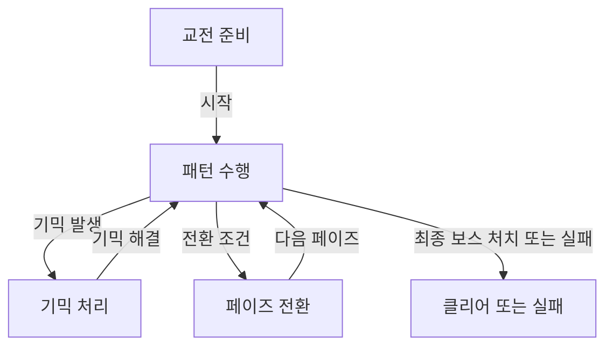

# 보스전 — Boss Fight 역기획서

| 항목 | 내용 |
| --- | --- |
| 문서 기준일 | 2026-11-13 |
| 분석 상태 | 역사적 3인 로봇 보스와 2026년 4월의 5인 개편을 중심으로 분석한다. 이후 20인 변형 언급도 별도 구분한다. |
| 자료 성격 | 공개 규칙 기반 역기획. 원작 내부 구현 또는 직접 플레이 실측 보고서가 아님 |

> 표기: **[공식]** 공개 자료에 명시된 사실, **[보조]** 커뮤니티 자료, **[해석]** 규칙에서 도출한 설계 분석, **[제안]** 재구현 방법, **[미확인]** 추가 검증 대상.

## 1. 핵심 규칙과 자료 경계

[공식] 2026년 4월 릴리스 노트는 보스전을 5인으로 변경하고 최고 난도 시간 기록을 도입한다. Finx는 2단계, Colette는 둥지와 소형 적 처리 중심이다. 사망 시 큐브 전량 드롭도 명시한다. [S1]

**[미확인]** 고객지원의 3인 설명은 구버전 근거다. 모든 보스가 동일 공격·부활·스테이지 규칙을 쓴다고 단정하지 않는다. 특히 Colette를 Finx와 같은 2단계 보스로 기술하지 않는다.

[공식·후속 범위] [2026년 11월 패치](https://supercell.com/brawlstars/en/blog/game-updates/release-notes-november-2026/)의 수정 목록에는 20인 Boss Fight 전용 퀘스트가 등장한다. 따라서 5인을 모든 현행 보스전의 고정 인원으로 일반화하지 않는다. 20인 변형의 목표·부활·보상·현재 운영은 이 자료만으로 확정할 수 없어 상세 복원 범위에서 제외한다.

## 2. 플레이어 경험과 설계 의도 [해석]

반복 학습할 수 있는 예고 공격과 협동 역할을 짧은 세션에 압축한다. 보스를 때리는 시간과 기믹을 처리하는 시간이 경쟁하기 때문에 순수 피해량 외에 생존·지원·처리 우선순위가 성과를 만든다.

이 절의 의도는 규칙을 설명하기 위한 분석이다. 개발팀의 실제 의사결정이라고 인용하지 않는다.

## 3. 경기 진행과 단계별 판단 [해석]

| 단계 | 플레이 흐름 및 판단 |
| --- | --- |
| 1 | 준비: 보스·난도·파티 인원을 확정하고 각자의 기믹 담당을 정한다. |
| 2 | 패턴 읽기: 공격 예고와 안전 구역을 보고 공격 유지 또는 회피를 선택한다. |
| 3 | 부가 목표: 둥지·소환 적·중앙 구조물의 영향에 따라 보스 공격을 중단한다. |
| 4 | 국면 전환: 페이즈 전환이 있는 보스는 상태 정리와 다음 공격 예고를 명확히 한다. |
| 5 | 마감: 생존을 우선할지 시간 기록을 단축할지 파티의 목적에 맞게 위험을 조절한다. |

## 4. 규칙 상태 모델 [제안]

다음 모델은 검증 가능한 구현 단위로 규칙을 나눈 것이다. 원작의 클래스·함수·서버 처리 순서를 뜻하지 않는다.

## 5. 전략 구조·맵·조합·역전 [해석]

### 5인 확장

참가자가 늘면 한 명의 실수를 흡수하기 쉬워지지만 화면 밀도와 기믹 전달은 어려워진다. 역할이 겹쳐 아무도 기믹을 맡지 않는 문제를 UI와 패턴으로 풀어야 한다.

### 보스별 역할 분기

Colette형은 증원 생산원을 빨리 제거하는 가치가 크다. Finx형은 상태 전환과 중앙 구조물의 현재 효과를 읽는 일이 중요하다. 이는 공통 엔진 위의 다른 encounter 설정으로 모델링할 수 있다.

### 성장 자원 재분배

사망 시 큐브가 떨어지면 회수할 위치를 선택하는 일이 중요해진다. 팀 전체 성장량과 특정 딜러 집중을 분리해 분석해야 한다.

### 시간 기록과 안전

첫 클리어와 최고 기록은 다른 최적화 문제다. 후자는 패턴을 기다리기보다 위험을 감수하며 피해 시간을 늘리는 동기가 생긴다.

## 6. 판정 불변식과 예외 처리 [제안]

아래 항목은 재구현 시 보장할 일관성 조건이다. 원작에서 확인되지 않은 우선순위는 별도 설정과 실험 결과로 확정해야 한다.

1. 보스 체력 0을 즉시 전체 클리어로 해석하지 않는다. 다음 페이즈가 있다면 전환 이벤트를 먼저 평가한다.
2. 보스 종류·난도·규칙 버전이 다른 시간 기록은 같은 리더보드 집계에 섞지 않는다.
3. 사망 큐브 드롭은 캐릭터가 보유하던 전투 자원을 정확히 한 번 이전해야 한다. 전량/일부 드롭 규칙을 과거 설정과 분리한다.

모든 종료 조건은 동일 경기 ID의 결과를 한 번만 확정해야 한다. 시간 종료·사망·목표 달성이 같은 판정 묶음에 들어오면 화면에 보인 순서만으로 승패를 정하지 않고, 명시된 규칙 버전을 사용한다.

## 7. 데이터와 이벤트 설계 [제안]

| 필드 | 의미 |
| --- | --- |
| EncounterId / Version | 보스·업데이트별 전투 규칙 |
| PartySize | 2026년 4월 개편형 5; 이후 20인 변형은 별도 설정 |
| PhaseGraph | 조건별 페이즈 전이 |
| TelegraphSpec | 예고 영역·시간·해제 조건 |
| AddSpawnPolicy | 둥지·소환 적 생성 설정 |
| ClearRecordKey | 난도·규칙·파티 조건별 기록 키 |

공통 메타데이터로 MatchId, RulesetVersion, EventId, ServerTime을 보관한다. 보상 정산에는 별도 SettlementId를 사용해 전투 재전송과 계정 지급을 분리한다.

### 판정 처리 흐름

1. 보스 스크립트에서 현재 페이즈의 입력 이벤트를 처리한다.
2. 피해 확정 후 다음 페이즈 존재 여부를 검사한다.
3. 전환 시 진행 중 공격·소환물의 유지 정책을 적용하고 다음 패턴을 예약한다.
4. 최종 페이즈 종료 때만 완료 시간을 고정하고 기록 자격을 검증한다.

## 8. UI·피드백 요구사항 [제안]

- 현재 보스 단계, 기믹 위험, 남은 파티 생존 상태를 서로 다른 층위로 표시한다.
- 화면 밖에서 생성되는 위험에는 방향 표시를 제공한다.
- 기록 화면에는 난도와 룰 버전을 연계해 이전 개편 기록과의 차이를 알린다.

## 9. QA 시나리오와 기대 결과 [제안]

이는 실제 테스트를 실행했다는 기록이 아니다. 미확인 규칙은 우선 클라이언트에서 관찰한 결과를 기입하고, 재구현의 합격 기준을 해당 버전에 맞춰 확정한다.

| ID | 상황 | 재구현의 기대 결과 또는 검증 기준 |
| --- | --- | --- |
| Q01 | Finx 첫 체력 0 | 클리어 대신 다음 페이즈로 이동한다. |
| Q02 | Colette 둥지 제거 | 해당 둥지의 추가 생성만 정지하고 기존 소형 적 정책은 별도 적용한다. |
| Q03 | 단계 전환 중 마지막 아군 사망 | 전환·실패 우선순위를 일관되게 적용한다. |
| Q04 | 플레이어 사망 큐브 회수 | 드롭은 한 번 발생하며 회수량 총합이 장부와 맞는다. |
| Q05 | 보스 예고 중 기절·넉백 | 중단 가능/불가 정책과 시각 표시가 일치한다. |
| Q06 | 보스 체력 음수 과잉 피해 | 다음 단계에 피해 이월 여부를 명시적으로 적용한다. |
| Q07 | 클리어 기록 재전송 | 동일 경기 기록이 두 번 반영되지 않는다. |
| Q08 | 구버전 3인 리플레이 | 다른 시기의 5인·20인 규칙으로 재해석하지 않는다. |

## 10. 밸런스 지표와 개선 판단 [해석·제안]

- 기믹별 사망률: 공격 예고가 충분히 읽히는지 평가한다.
- 역할별 유효 기여: 피해·치유·기믹 처리·생존을 함께 분석한다.
- 클리어 후 재도전율: 시간 기록이 반복 동기를 만드는지 확인한다.

지표는 맵·실력 구간·파티 구성·규칙 버전별로 분리한다. 단일 전체 승률만으로 규칙의 문제와 매치 구성의 문제를 구분하지 않는다.

## 11. 추가 실측 계획 [미확인]

1. 보스별 부활·전멸·최대 시간 규칙을 별도 표로 수집한다.
2. 단계 전환 중 지속 피해와 소환물 유지 여부를 확인한다.
3. 난도 변경 또는 파티 구성 변경이 기록 자격에 미치는 영향을 확인한다.

측정에는 게임 버전, 이벤트명, 맵, 캐릭터와 능력, 화면 녹화의 시작·종료 시각을 함께 기록한다. 수치를 확인하면 기존 설명을 덮어쓰기보다 규칙 버전 표를 추가한다.

## 12. 출처와 연결 문서

- **[S1]** [공식 — Release Notes April 2026, 2026-05 유지보수 포함](https://supercell.com/en/games/brawlstars/blog/release-notes/release-notes-april-2026/)
- **[S2]** [공식 고객지원 — Game Modes](https://sc-brawlstars.zendesk.com/hc/en-us/articles/49526599632923-Game-Modes)

출처 접근 기준일: 2026-11-13. 공식 페이지가 로딩 화면만 제공한 경우 검색 서비스에 노출된 공식 본문 범위만 근거로 사용했다. 보조 자료는 공식 규칙으로 승격하지 않았다.

- [웨이브 방어와의 차이](25_robo_rumble.md)
- [협동 보스전과 개인 피해 경쟁 비교](30_takedown.md)
- [전체 문서 목차](../README.md)
