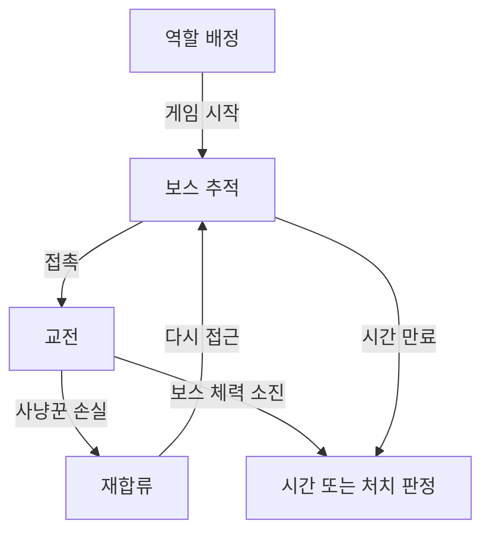

# 빅 게임 — Big Game 역기획서

| 항목 | 내용 |
| --- | --- |
| 문서 기준일 | 2026-11-13 |
| 분석 상태 | 공식 1대5 이벤트 설명 및 2020 개편 규칙을 기준으로 하는 비대칭 모드 분석. |
| 자료 성격 | 공개 규칙 기반 역기획. 원작 내부 구현 또는 직접 플레이 실측 보고서가 아님 |

> 표기: **[공식]** 공개 자료에 명시된 사실, **[보조]** 커뮤니티 자료, **[해석]** 규칙에서 도출한 설계 분석, **[제안]** 재구현 방법, **[미확인]** 추가 검증 대상.

## 1. 핵심 규칙과 자료 경계

[공식] 한 명의 강화된 브롤러와 다섯 사냥꾼이 대결한다. [S1] 2020 개편에서는 보스가 2분 생존하면 승리한다. [S2]

**[미확인]** 현재 배율·회복 제한·보스 선정 확률·공격별 예외는 미확인이다. 과거 생존 시간 비례 보상과 2분 승패형을 같은 정산식으로 합치지 않는다.

## 2. 플레이어 경험과 설계 의도 [해석]

같은 캐릭터를 서로 다른 전투 규모로 경험하게 하는 비대칭 PvP다. 보스에게는 추격을 분산시키는 공간 운영을, 사냥꾼에게는 손실을 감수하면서 화력을 이어가는 협동을 요구한다.

이 절의 의도는 규칙을 설명하기 위한 분석이다. 개발팀의 실제 의사결정이라고 인용하지 않는다.

## 3. 경기 진행과 단계별 판단 [해석]

| 단계 | 플레이 흐름 및 판단 |
| --- | --- |
| 1 | 역할 확정: 보스와 사냥꾼의 목표·능력 차이를 명확히 전달한다. |
| 2 | 추적: 사냥꾼이 한 방향으로 몰리지 않고 퇴로를 압축한다. |
| 3 | 압박: 보스는 좁은 추격선을 이용하고 사냥꾼은 화력을 교대로 유지한다. |
| 4 | 재합류: 쓰러진 사냥꾼이 현재 보스 위치에 맞춰 다시 접근한다. |
| 5 | 마감: 보스는 남은 시간을 생존 공간으로 바꾸고 사냥꾼은 남은 체력을 시간 내 처리해야 한다. |

## 4. 규칙 상태 모델 [제안]

다음 모델은 검증 가능한 구현 단위로 규칙을 나눈 것이다. 원작의 클래스·함수·서버 처리 순서를 뜻하지 않는다.

## 5. 전략 구조·맵·조합·역전 [해석]

### 체력 배율의 한계

체력만 크게 늘리면 보스가 지루한 이동 표적이 될 수 있다. 대신 위험한 공격 창과 사냥꾼의 재진입 템포를 맞추는 것이 중요하다.

### 회복의 영향

보스 체력 비례 치유나 최대 체력 기반 보호막은 일반전보다 훨씬 큰 값이 된다. 보스용 능력 정책이 없으면 일부 캐릭터가 모드 전체를 지배할 수 있다.

### 사냥꾼 교대

전원 같은 방향에서 동시에 쓰러지면 보스에게 긴 공백을 준다. 일정한 압박을 유지하는 분산이 유리한 구조를 만들 수 있다.

### 역할 기대값

무작위 보스 역할은 경험을 바꾸지만 원하는 역할을 얻지 못한 이탈도 만들 수 있다. 역할 선호와 매치 유지율을 함께 관찰한다.

## 6. 판정 불변식과 예외 처리 [제안]

아래 항목은 재구현 시 보장할 일관성 조건이다. 원작에서 확인되지 않은 우선순위는 별도 설정과 실험 결과로 확정해야 한다.

1. 보스 역할은 단순 외형 크기 변경이 아니라 별도 전투 규칙 집합으로 관리한다.
2. 사냥꾼 사망을 팀 패배로 처리하지 않으며 보스 사망만 해당 승리 조건으로 연결한다.
3. 보스의 최대 체력 기반 능력, 소환물, 변신, 부활 효과는 각각 허용 규칙을 가진다.

모든 종료 조건은 동일 경기 ID의 결과를 한 번만 확정해야 한다. 시간 종료·사망·목표 달성이 같은 판정 묶음에 들어오면 화면에 보인 순서만으로 승패를 정하지 않고, 명시된 규칙 버전을 사용한다.

## 7. 데이터와 이벤트 설계 [제안]

| 필드 | 의미 |
| --- | --- |
| BossPlayerId | 비대칭 역할 소유자 |
| BossStatProfile | 체력·피해·속도 배율 |
| BossAbilityOverrides | 회복·소환·변신 예외 |
| HunterRespawnPolicy | 부활 대기·보호 |
| BossSurvivalTarget | 룰 버전별 생존 목표 |
| RoleAssignmentSeed | 역할 배정 재현 정보 |

공통 메타데이터로 MatchId, RulesetVersion, EventId, ServerTime을 보관한다. 보상 정산에는 별도 SettlementId를 사용해 전투 재전송과 계정 지급을 분리한다.

### 판정 처리 흐름

1. 매치 시작 전에 보스와 사냥꾼 역할을 고정한다.
2. 각 플레이어 능력에 해당 역할의 오버라이드 정책을 적용한다.
3. 보스 사망 또는 생존 시한 도달을 판정한다.
4. 사냥꾼 부활은 종료 상태가 아닐 때만 예약·실행한다.

## 8. UI·피드백 요구사항 [제안]

- 보스 체력은 팀 공통 목표로 표시하고 보스 자신에게는 남은 생존 시간을 강조한다.
- 사냥꾼에게 보스 이동 방향의 추적 정보를 제공할 범위를 명시한다.
- 역할별 능력 제한이 있으면 입장 전에 알리고 일반전 수치와 혼동하지 않게 한다.

## 9. QA 시나리오와 기대 결과 [제안]

이는 실제 테스트를 실행했다는 기록이 아니다. 미확인 규칙은 우선 클라이언트에서 관찰한 결과를 기입하고, 재구현의 합격 기준을 해당 버전에 맞춰 확정한다.

| ID | 상황 | 재구현의 기대 결과 또는 검증 기준 |
| --- | --- | --- |
| Q01 | 보스 변신 중 체력 변경 | 보스 전용 최대 체력 정책을 일관되게 유지한다. |
| Q02 | 최대 체력 비례 회복 | 보스용 회복 상한·배율을 적용한다. |
| Q03 | 소환물 대량 생성 | 소환물의 보스 배율 상속 여부가 일관된다. |
| Q04 | 보스의 부활 능력 | 허용/차단 규칙에 따라 승패를 한 번 판정한다. |
| Q05 | 시한과 보스 치명타 동시 | 사전에 정한 판정 우선순위를 적용한다. |
| Q06 | 사냥꾼 전원 동시에 사망 | 일반 팀전 전멸 규칙이 잘못 실행되지 않는다. |
| Q07 | 보스 연결 해제 | 대체 AI·포기·유예 정책 중 선택한 처리만 실행한다. |
| Q08 | 역할 배정 뒤 재접속 | 보스 역할이 새로 추첨되지 않는다. |

## 10. 밸런스 지표와 개선 판단 [해석·제안]

- 캐릭터별 보스 승률 편차: 일반전보다 큰 능력 배율 문제를 찾는다.
- 사냥꾼 유효 공격 가동률: 긴 추적 공백으로 게임이 지루해지는지 본다.
- 역할 공개 직후 이탈률: 비대칭 역할 선호와 기대를 측정한다.

지표는 맵·실력 구간·파티 구성·규칙 버전별로 분리한다. 단일 전체 승률만으로 규칙의 문제와 매치 구성의 문제를 구분하지 않는다.

## 11. 추가 실측 계획 [미확인]

1. 보스 상태에서 비례 치유·변신·소환물을 각각 사용해 수치를 기록한다.
2. 다섯 사냥꾼 전멸 상황의 부활 지속 여부를 확인한다.
3. 시간 종료 직전 처치 장면을 수집해 경계 판정을 검증한다.

측정에는 게임 버전, 이벤트명, 맵, 캐릭터와 능력, 화면 녹화의 시작·종료 시각을 함께 기록한다. 수치를 확인하면 기존 설명을 덮어쓰기보다 규칙 버전 표를 추가한다.

## 12. 출처와 연결 문서

- **[S1]** [공식 고객지원 — Game Modes](https://sc-brawlstars.zendesk.com/hc/en-us/articles/49526599632923-Game-Modes)
- **[S2]** [공식 — Tara’s Bazaar, 2020-05-13](https://supercell.com/en/games/brawlstars/blog/game-updates/update-taras-bazaar/)

출처 접근 기준일: 2026-11-13. 공식 페이지가 로딩 화면만 제공한 경우 검색 서비스에 노출된 공식 본문 범위만 근거로 사용했다. 보조 자료는 공식 규칙으로 승격하지 않았다.

- [플레이어 보스와 AI 보스의 차이](26_boss_fight.md)
- [생존 목적의 차이](08_solo_showdown.md)
- [전체 문서 목차](../README.md)
