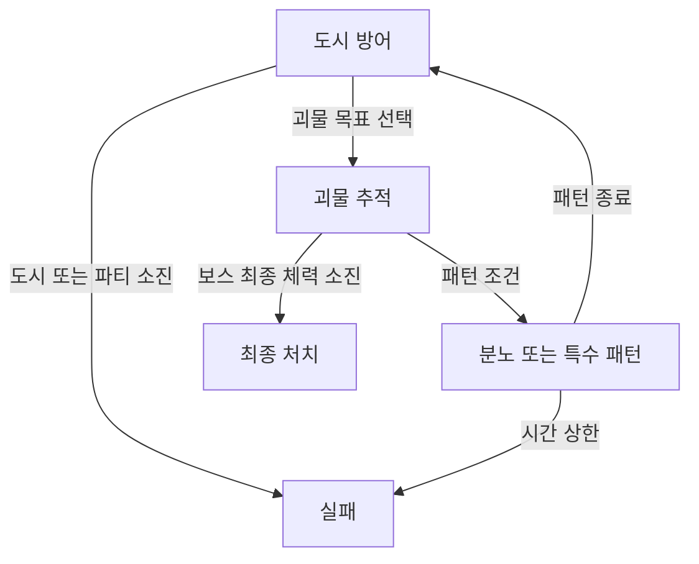

# 슈퍼 시티 램피지 — Super City Rampage 역기획서

| 항목 | 내용 |
| --- | --- |
| 문서 기준일 | 2026-11-13 |
| 분석 상태 | 2020 도입·유지보수 기록을 분석한 역사 PvE 모드. 현재 서비스 제공 여부 미확인. |
| 자료 성격 | 공개 규칙 기반 역기획. 원작 내부 구현 또는 직접 플레이 실측 보고서가 아님 |

> 표기: **[공식]** 공개 자료에 명시된 사실, **[보조]** 커뮤니티 자료, **[해석]** 규칙에서 도출한 설계 분석, **[제안]** 재구현 방법, **[미확인]** 추가 검증 대상.

## 1. 핵심 규칙과 자료 경계

[공식] 괴물로부터 도시를 지키며 전원 또는 모든 건물을 잃으면 실패한다. 난도에 따라 괴물 능력이 추가된다. [S1] 2020-08 조정은 미처치 상태의 13분 상한을 패배로 정의했다. [S2]

**[미확인]** 13분은 해당 역사 버전의 안전 상한이다. 최신 보스전 시간표·5인 체계를 이 모드에 자동 이식하지 않는다. 건물 수, 세부 어그로, 분노 단계 수치는 미확인이다.

## 2. 플레이어 경험과 설계 의도 [해석]

보스 처치와 환경 보호를 동시에 요구한다. 플레이어가 안전한 위치에서 오래 생존해도 도시가 무너지면 실패하므로 회피 동선 자체가 공용 목표에 영향을 준다.

이 절의 의도는 규칙을 설명하기 위한 분석이다. 개발팀의 실제 의사결정이라고 인용하지 않는다.

## 3. 경기 진행과 단계별 판단 [해석]

| 단계 | 플레이 흐름 및 판단 |
| --- | --- |
| 1 | 초기 배치: 괴물과 건물의 위치를 보고 공격 가능한 공간을 확보한다. |
| 2 | 위협 유도: 괴물이 플레이어와 건물 중 무엇을 노리는지 읽어 이동한다. |
| 3 | 분노 대응: 공격 패턴 변화에 맞춰 피해를 줄이고 생존자를 남긴다. |
| 4 | 잔여 도시 관리: 남은 건물이 적어질수록 안전한 유도 경로가 줄어든다. |
| 5 | 결정적 공격: 보스 남은 체력과 도시 내구를 비교하여 회피보다 마무리가 유리한 시점을 잡는다. |

## 4. 규칙 상태 모델 [제안]

다음 모델은 검증 가능한 구현 단위로 규칙을 나눈 것이다. 원작의 클래스·함수·서버 처리 순서를 뜻하지 않는다.

## 5. 전략 구조·맵·조합·역전 [해석]

### 개인 회피의 외부 비용

자신에게 안전한 후퇴가 괴물을 남은 건물로 유도할 수 있다. 위치 선택을 개인 생존률만으로 평가할 수 없다.

### 도시의 유효 내구

건물 총합 체력뿐 아니라 분산도 중요하다. 일렬로 모인 잔여 건물은 한 번의 광역 행동에 큰 손실을 입을 수 있다.

### 장기 생존 전략

보스를 무한히 유인해 파괴를 멈출 수 있다면 처치 게임이 시간 버티기로 변한다. 상한과 경로 복구는 이런 상태를 종결하는 장치다.

### 난도 상승

패턴 추가는 기존 회피 경로의 안전성을 바꾼다. 단순 수치 상승과 새 행동 추가를 분리하면 학습 비용을 조절할 수 있다.

## 6. 판정 불변식과 예외 처리 [제안]

아래 항목은 재구현 시 보장할 일관성 조건이다. 원작에서 확인되지 않은 우선순위는 별도 설정과 실험 결과로 확정해야 한다.

1. 건물은 파괴 가능 환경과 점수 목표를 모두 가지므로 파괴 이벤트를 고유 ID로 관리한다.
2. 잔여 건물 0과 보스 최종 처치가 겹치는 경우 한 가지 결과를 내야 한다.
3. 괴물이 경로를 잃거나 공격할 수 없는 표적에 고정되어도 서버 시간은 정상 진행되어야 한다.

모든 종료 조건은 동일 경기 ID의 결과를 한 번만 확정해야 한다. 시간 종료·사망·목표 달성이 같은 판정 묶음에 들어오면 화면에 보인 순서만으로 승패를 정하지 않고, 명시된 규칙 버전을 사용한다.

## 7. 데이터와 이벤트 설계 [제안]

| 필드 | 의미 |
| --- | --- |
| CityBuildings[] | 건물 ID·체력·파괴 상태 |
| CitySurvivalMetric | 도시 잔여량 계산 정책 |
| MonsterPhase | 추적·분노·특수 패턴 |
| TargetWeights | 플레이어·건물 표적 가중치 |
| MaxEncounterTime | 버전별 상한 |
| WipeRule | 전원 탈락 판정 정책 |

공통 메타데이터로 MatchId, RulesetVersion, EventId, ServerTime을 보관한다. 보상 정산에는 별도 SettlementId를 사용해 전투 재전송과 계정 지급을 분리한다.

### 판정 처리 흐름

1. 괴물의 현 페이즈에서 유효 표적과 공격을 선택한다.
2. 공격 피해를 플레이어와 건물에 각각 적용한다.
3. 한 묶음의 파괴 결과로 잔여 도시량을 갱신한다.
4. 보스 처치·도시 소진·전멸·시간 상한의 규칙 순서로 종료를 결정한다.

## 8. UI·피드백 요구사항 [제안]

- 보스 체력과 도시 잔여량을 나란히 보여주어 양쪽 소모 속도를 비교하게 한다.
- 괴물의 다음 공격 대상 또는 영역을 가능한 범위에서 예고한다.
- 파괴된 건물의 잔해가 남은 목표 건물과 혼동되지 않게 색·실루엣을 구별한다.

## 9. QA 시나리오와 기대 결과 [제안]

이는 실제 테스트를 실행했다는 기록이 아니다. 미확인 규칙은 우선 클라이언트에서 관찰한 결과를 기입하고, 재구현의 합격 기준을 해당 버전에 맞춰 확정한다.

| ID | 상황 | 재구현의 기대 결과 또는 검증 기준 |
| --- | --- | --- |
| Q01 | 괴물과 마지막 건물 동시 파괴 | 단일 종료 정책대로 처리한다. |
| Q02 | 괴물이 파괴된 건물 계속 추적 | 유효 표적으로 즉시 재선정한다. |
| Q03 | 괴물 이동 경로를 임시 벽으로 차단 | 무한 정지 대신 복구 정책이 실행된다. |
| Q04 | 전원 쓰러졌지만 부활 예약 있음 | 규정된 전멸 정책대로 처리한다. |
| Q05 | 13분 역사 룰 재현 | 해당 버전에서 미처치면 실패한다. |
| Q06 | 분노 임계 체력과 정확히 일치 | 경계값에서도 페이즈가 누락되지 않는다. |
| Q07 | 건물에 여러 광역 피해 중첩 | 파괴와 잔여량 차감이 한 번만 반영된다. |
| Q08 | 저성능 기기 잔해 표시 축소 | 도시 판정 상태에는 영향을 주지 않는다. |

## 10. 밸런스 지표와 개선 판단 [해석·제안]

- 피해 대비 도시 손실: 공격 효율과 유도 전략을 함께 평가한다.
- 괴물 비활성 시간: 경로·표적 버그로 난도가 무력화되는지 확인한다.
- 분노 단계별 전멸률: 새 패턴의 학습 곡선을 추정한다.

지표는 맵·실력 구간·파티 구성·규칙 버전별로 분리한다. 단일 전체 승률만으로 규칙의 문제와 매치 구성의 문제를 구분하지 않는다.

## 11. 추가 실측 계획 [미확인]

1. 건물과 플레이어의 상대 거리별 표적 변화를 기록한다.
2. 분노 체력 경계 직전·일치·직후를 비교한다.
3. 전멸·도시 소진·보스 처치가 겹친 장면을 별도로 검증한다.

측정에는 게임 버전, 이벤트명, 맵, 캐릭터와 능력, 화면 녹화의 시작·종료 시각을 함께 기록한다. 수치를 확인하면 기존 설명을 덮어쓰기보다 규칙 버전 표를 추가한다.

## 12. 출처와 연결 문서

- **[S1]** [공식 — New Update, 2020-07-02](https://supercell.com/en/games/brawlstars/blog/release-notes/new-update-release-notes/)
- **[S2]** [공식 — Balance Changes!, 2020-08-18](https://supercell.com/en/games/brawlstars/blog/game-updates/balance-changes-16/)

출처 접근 기준일: 2026-11-13. 공식 페이지가 로딩 화면만 제공한 경우 검색 서비스에 노출된 공식 본문 범위만 근거로 사용했다. 보조 자료는 공식 규칙으로 승격하지 않았다.

- [단일 보호 대상과 분산 보호 대상 비교](25_robo_rumble.md)
- [협동 방어와 팀별 도시 파괴 비교](35_godzilla_city_smash.md)
- [전체 문서 목차](../README.md)
